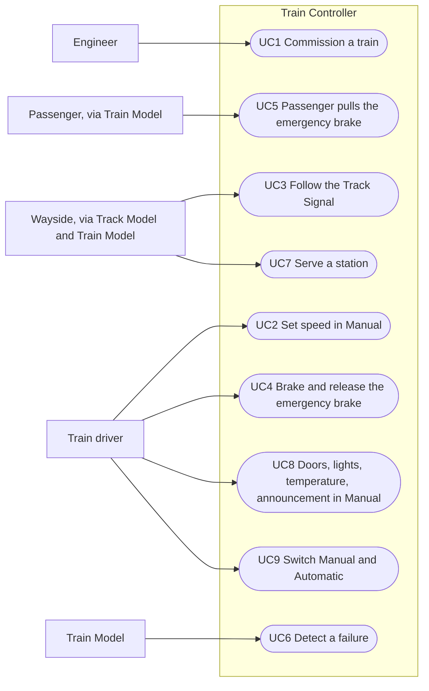
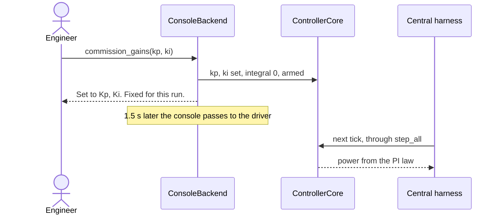
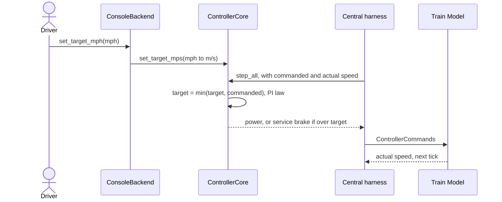
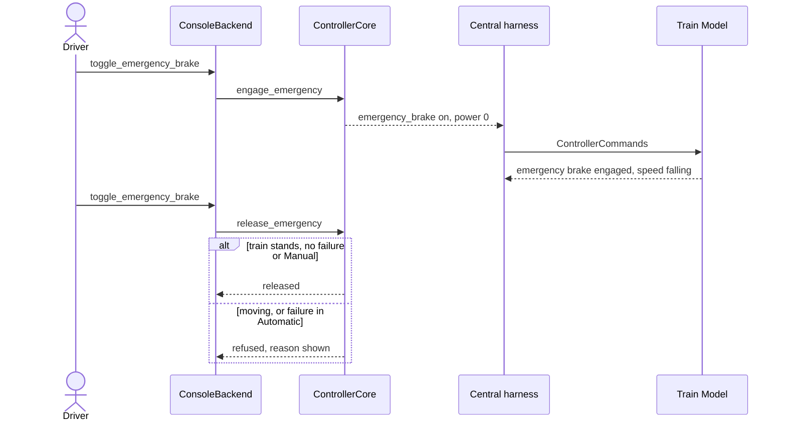
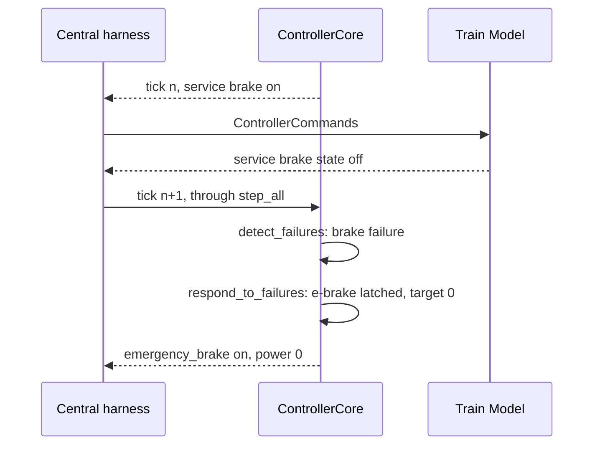
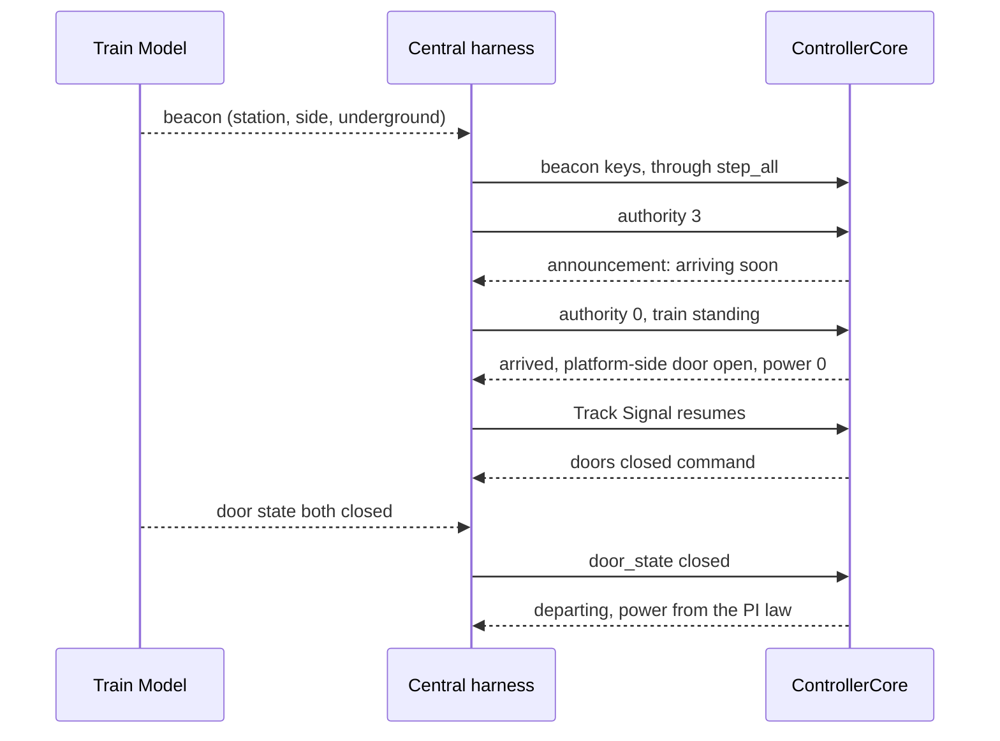

# Software Design Description

## For the Railway Simulation Project

Version: {{version}}
Prepared by: {{author}}
Organization: {{organization}}
Date Modified: {{date_modified}}

> **Merge note — Train Controller contribution.** Every section keeps
> the template's heading. Content for this module sits under a
> **Train Controller** label, so the merge is a section-by-section
> paste beside the other modules' labelled blocks. Text marked
> **[TEAM]** is a system-wide placeholder that one person fills once at
> the merge; this module does not decide it. Built from
> `Train_Ctrl_integration` @ `cfba866` and `truth` @ `84c7d44`; from `development` @
> `de7a98f`, only the Train Model and Track Model boundary types and
> timing the controller exchanges with them. Updated 2026-10-22.

## Table of Contents

- [1. Introduction](#1-introduction)
  - [1.1 Document Purpose](#11-document-purpose)
  - [1.2 Subject Scope](#12-subject-scope)
  - [1.3 Definitions, Acronyms, and Abbreviations](#13-definitions-acronyms-and-abbreviations)
  - [1.4 References](#14-references)
  - [1.5 Document Overview](#15-document-overview)
- [2. Design Overview](#2-design-overview)
  - [2.1 Stakeholder Concerns](#21-stakeholder-concerns)
  - [2.2 Selected Viewpoints](#22-selected-viewpoints)
- [3. Design Views](#3-design-views)
  - [001-context — System Context](#001-context--system-context)
  - [002-composition — Module Composition](#002-composition--module-composition)
  - [003-logical — Shared Boundary Types](#003-logical--shared-boundary-types)
  - [004-interface — Module Interface Contracts](#004-interface--module-interface-contracts)
  - [005-interaction — Representative Interaction: Movement Authority Request](#005-interaction--representative-interaction-movement-authority-request)
- [4. Decisions](#4-decisions)
  - [4.1 Interface Contract Mechanism](#41-interface-contract-mechanism)
  - [4.2 Shared Boundary Data Types](#42-shared-boundary-data-types)
  - [4.3 Contract Enforcement in CI](#43-contract-enforcement-in-ci)
  - [4.4 Stub-First Development](#44-stub-first-development)
  - [4.5 Contracts Package Ownership](#45-contracts-package-ownership)
  - [4.6 External Input Validation](#46-external-input-validation)
  - [4.7 Knowledge Capture and Decision Logging](#47-knowledge-capture-and-decision-logging)
  - [4.8 Rejected Tooling — Summary Table](#48-rejected-tooling--summary-table)
  - [4.9 Open Items — Not Yet Decided](#49-open-items--not-yet-decided)
- [5. Appendixes](#5-appendixes)

## Revision History

| Name           | Date       | Reason For Changes                                                                                          | Version     |
| -------------- | ---------- | ----------------------------------------------------------------------------------------------------------- | ----------- |
| Jonathan Tsang | 2026-10-21 | Train Controller sections filled for the merge                                                              | {{version}} |
| Jonathan Tsang | 2026-10-22 | Scope combined; design choices, class cards, IO dictionary, use cases, authority, timing and vitality added | {{version}} |

---

## 1. Introduction

### 1.1 Document Purpose

**[TEAM]** System-wide purpose statement.

**Train Controller:** This document describes the design of the
Train Controller: the vital, on-board controller of a single train. It
records how the module is built, what it exchanges with the rest of the
system, and the decisions behind it, so that the central harness can
integrate it and the module can be tested against its requirements.
Readers are the team, the integrator of the central harness, and the
course staff.

### 1.2 Subject Scope

The system being designed is the Railway Simulation, Version {{version}}. The system is split into seven modules, all software; the Track Controller and the Train Controller each have a SW and a HW variant, and the HW variants run on Raspberry Pis (D021):

- CTC office (centralized traffic control)
- Track controller (SW)
- Track controller (HW)
- Track model
- Train model
- Train controller (SW)
- Train controller (HW)

In scope:

Out of scope:

**Train Controller:** one module and one code base for the SW and HW
variants. The SW variant keeps this code and runs the Green Line; the HW
variant will run the same code on a Raspberry Pi later, for the Red Line
(D021, D027).

- *In scope:*
  - Speed regulation: a PI law from velocity error to traction power,
    0–480 kW, in Manual (driver setpoint, capped at the commanded speed)
    and Automatic (commanded speed) modes.
  - The safety path: service and emergency brake commands, traction cut
    under braking, stopping at authority 0.
  - Inferring engine, brake and signal pickup failures from the signals
    returned by the Train Model, and latching the emergency brake.
  - Doors, cabin lights, cabin temperature setpoint and station
    announcement commands.
  - One controller per train, held in a fleet the central harness steps
    once per 0.1 s tick.
  - The driver and engineer console (PySide6 / QML) and a test bench used
    only when the harness is not running.
- *Out of scope:*
  - Train physics, mass, grade and brake rates: the Train Model's (D009).
    The controller assumes perfect movement (M19).
  - Counting authority down: the count is used as given (M16).
  - Moving Block (MBO): out of scope for the whole system (D001).
  - The event log: written by the harness (D005).
  - Running the HW variant on the Raspberry Pi over USB (D021, D027):
    later; see §4.9.

### 1.3 Definitions, Acronyms, and Abbreviations

| Term            | Definition                                                                                                                                                                                        |
| --------------- | ------------------------------------------------------------------------------------------------------------------------------------------------------------------------------------------------- |
| API             | Application Programming Interface — the set of definitions and protocols by which modules interact.                                                                                              |
| CI              | Continuous Integration — automated build, type-check, and test execution on every change.                                                                                                        |
| CTC             | Centralized Traffic Control — the module that issues movement authority / routing decisions across the track network.                                                                            |
| Protocol        | A `typing.Protocol` — a Python structural interface type, used here to define module boundary contracts.                                                                                       |
| SDD             | Software Design Description — this document.                                                                                                                                                     |
| SRS             | Software Requirements Specification — the document specifying functional and non-functional requirements the system must satisfy; referenced but not authored by this SDD.                       |
| Stub            | A module implementation committed at its real import path from Day 1, returning non-degenerate fixture data and exposing `STUB = True`, standing in for real logic during parallel development. |
| Authority       | The number of blocks ahead of the current block a train may still enter before it must stop; a non-negative integer (D013).                                                                       |
| Automatic mode  | The controller regulates to the commanded speed and serves stations itself.                                                                                                                       |
| Beacon          | A message heard near a station: station name, platform side (`L`, `R`, `LR`) and whether the track is underground.                                                                          |
| Commanded speed | The speed sent over the track circuit; the only speed cap the controller applies (M1).                                                                                                            |
| Commissioning   | The engineer setting a train's Kp and Ki once, before it may apply power (M9, D024).                                                                                                              |
| Fleet           | `TrainControllerFleet`: one controller per train in service, keyed by train ID.                                                                                                                 |
| Harness         | The central harness: integration infrastructure that steps every module and maps each producer-to-consumer edge (D005).                                                                           |
| Kp, Ki          | Proportional and integral gains of the PI speed law.                                                                                                                                              |
| Latch           | A state that holds until an explicit release, e.g. the emergency brake after a failure.                                                                                                           |
| Manual mode     | The driver sets a speed on the dial; the controller regulates to it, capped at the commanded speed.                                                                                               |
| PI              | Proportional-integral control.                                                                                                                                                                    |
| Test bench      | The module's own stand-in for the Train Model and Track Model, used when no harness drives the controller (M0, M15).                                                                              |
| Tick            | One fixed 0.1 s step of simulated time (D006, D017).                                                                                                                                              |
| Track Signal    | Commanded speed and authority, sent by the Track Controller over the track circuit and passed through the Train Model.                                                                            |

### 1.4 References

| Reference                                                                                         | Owner / Location                                                                                                       | Normative?                                                    |
| ------------------------------------------------------------------------------------------------- | ---------------------------------------------------------------------------------------------------------------------- | ------------------------------------------------------------- |
| Train Controller requirements, rules M0–M20                                                      | Jonathan Tsang, Ivan Zheng / `Train-Ctrl_HW/REQUIREMENTS.md` (`Train_Ctrl_integration`)                            | Yes, for this module; wins over the other module documents    |
| Train Controller harness integration guide                                                        | Jonathan Tsang, Ivan Zheng / `Train-Ctrl_HW/HARNESS_INTEGRATION.md`                                                  | No (describes the interface; REQUIREMENTS.md wins)            |
| Train Controller open issues                                                                      | `Train-Ctrl_HW/OPEN_ISSUES.md`                                                                                       | No                                                            |
| Truth store: decisions D001–D027, signals, arbitration, conventions                              | Team / `truth/` on the `truth` branch                                                                              | Yes, except the module's recorded deviations (M1, M12)        |
| Train Model boundary types and timing (`ControllerCommands`, `ControllerOutputs`, `Beacon`) | Kevin Schillinger / `TrainModel/train_model/interface.py`, `TrainModel/docs/module-interface.md` (`development`) | Yes, for the Train Model edge                                 |
| Track Model output to the controller (`TrackModelOutputs.signal_seen`)                          | Track Model team / `TrackModel/track_model/interface.py` (`development`)                                           | Yes, for the signal light edge                                |
| Shared simulation clock (`utils/system_clock.py`)                                               | Team / truth D017                                                                                                      | Yes                                                           |
| Software Requirements Specification v1.0                                                          | Team / `documents/srs-filled.md`                                                                                     | Yes, except NFR-001.1 (0.1 s tick, D017) and FUNC-038 wording |
| Final Project deck                                                                                | Course / `documents/Project_Information/Final Project vF.pdf`                                                        | Yes                                                           |
| Units convention                                                                                  | `truth/conventions/units.md`, D002                                                                                   | Yes                                                           |
| UI style guide                                                                                    | `truth/ui/style-guide.md`                                                                                            | Yes, for the console                                          |

### 1.5 Document Overview

**[TEAM]** System-wide overview of sections 1–5.

**Train Controller:** Section 2 lists who cares about this module
and which views answer them. Section 3 gives the views: where the
controller sits (001), its parts and design choices (002), its classes
(003), its signals and exact inputs and outputs (004), and how authority
reaches it (005). Section 4 records this module's position on each team
decision and its own open items. Section 5 holds the control law,
failure rules, automatic behaviour, the module's part in authority,
timing and vitality, and its use cases.

---

## 2. Design Overview

### 2.1 Stakeholder Concerns

| Stakeholder                                    | Concern                                                                                                                                              | Addressed By                           |
| ---------------------------------------------- | ---------------------------------------------------------------------------------------------------------------------------------------------------- | -------------------------------------- |
| Customer: Port Authority of Allegheny County   | The train never exceeds its commanded speed, and at authority 0 targets 0 and brakes; stopping in time is the wayside's, through the commanded speed | M1, M17; 004-interface; Appendix A     |
| Customer                                       | A failure stops the train safely                                                                                                                     | M3–M5; Appendix B                     |
| Train driver                                   | Clear Manual control of speed, brakes, doors, lights, temperature and announcements                                                                  | 002-composition (console); M2, M6, M14 |
| Engineer                                       | Sets Kp and Ki once per train, before it moves                                                                                                       | M9, D024                               |
| Passengers                                     | Emergency brake reachable; stations announced; doors open on the platform side                                                                       | M2, M6, M7                             |
| Central harness integrator                     | One call per tick, SI units, all-or-nothing validation, clear errors                                                                                 | 004-interface; §4.6                   |
| Train Model owner (Kevin Schillinger)          | Commands map one-to-one onto `ControllerCommands`; brake states read as engaged, not commanded                                                     | 004-interface; M18                     |
| Track Model and Track Controller teams         | Authority and commanded speed used as sent; signal light taken directly                                                                              | M16, M20; 005-interaction              |
| Course staff                                   | Requirements traced; 1× and 10× give the same behaviour                                                                                            | REQUIREMENTS.md §2; M11               |
| Module developers (Jonathan Tsang, Ivan Zheng) | One code base serves the SW variant and, later, the HW variant on the Raspberry Pi                                                                   | 002-composition (Qt-free core)         |

### 2.2 Selected Viewpoints

This project uses five viewpoints; the rest are omitted rather than carried as empty placeholders.

**2.2.1 Context**

**Train Controller:** Shows the controller between the central
harness, the Train Model and the Track Model, and its two human users.

**2.2.2 Composition**

**Train Controller:** Shows the Qt-free core (fleet, controller,
inputs, state), the bench simulation and the Qt console.

**2.2.3 Logical**

**Train Controller:** Shows the module's classes, with a card for each
(description, attributes, responsibilities and collaborators), and the
boundary types it produces and consumes.

**2.2.6 Interface**

**Train Controller:** A signal dictionary (sender, receiver, signal,
data items), then every input and output with unit, source and the
harness's mapping to the Train Model's types.

**2.2.7 Interaction**

**Train Controller:** Shows how an authority count reaches the
controller and how the controller acts on it. The module's use cases,
each with a sequence diagram, are in Appendix E.

**Omitted viewpoints**

Physical, Structure, Dependency, Information, Algorithm, State Dynamics, Concurrency, Patterns, Deployment, and Resources.

---

## 3. Design Views

### 001-context — System Context

- **Viewpoint:** Context
- **Representation:**

  **Train Controller:**

  ```mermaid
  flowchart LR
    Driver([Train driver]) -->|speed, brakes, e-brake, mode,<br/>doors, lights, temperature,<br/>announcement repeat| TC[Train Controller<br/>one controller per train]
    Engineer([Engineer]) -->|Kp, Ki once| TC
    TC -->|power, brakes, doors, lights,<br/>temp setpoint, announcement| H[Central harness<br/>clock: dt, time_s]
    H -->|step_all each tick| TC
    H -->|inputs per train| TC
    H -->|ControllerCommands| TM[Train Model]
    TM -->|actual speed, brake states,<br/>doors, lights, cabin temp,<br/>Track Signal, beacon| H
    H ~~~ TK[Track Model]
    TK -->|signal light ahead| H
  ```

  The controller talks to no module directly; the harness maps every
  edge (D005). It receives the Track Signal through the Train Model,
  which passes it through from the Track Model, and the signal light
  ahead directly from the Track Model (M20). The same logic drives Green
  and Red Line trains.

### 002-composition — Module Composition

- **Viewpoint:** Composition
- **Representation:**

  Seven modules, each independently owned and independently stubbed from Day 1:

  - CTC office —
  - Track controller (SW) —
  - Track controller (HW) —
  - Track model —
  - Train model —
  - Train controller (SW and HW) — one `ControllerCore` per train in a
    `TrainControllerFleet`, stepped by the harness; owns the speed law,
    the safety path, failure inference, doors, lights, temperature and
    announcements. Owners: Jonathan Tsang, Ivan Zheng. Not stubbed: the
    real core has been built from the start (see §4.4). The SW variant
    runs the Green Line; the HW variant will run the same code on a
    Raspberry Pi for the Red Line.

  **Train Controller** internal parts, all under `Train-Ctrl_HW/`:

  | Part              | File                                      | Imports Qt | Role                                                                                                   |
  | ----------------- | ----------------------------------------- | ---------- | ------------------------------------------------------------------------------------------------------ |
  | Fleet             | `train_ctrl/fleet.py`                   | No         | `TrainControllerFleet`: add, remove, get, `step_all(dt, inputs_by_id, time_s)`                     |
  | Controller core   | `train_ctrl/control.py`                 | No         | `ControllerCore`: PI law, safety path, failure inference, station stop, lights, announcements        |
  | Input reader      | `train_ctrl/inputs.py`                  | No         | `read_inputs`, `EVERY_TICK`: validates one train's inputs                                          |
  | State and outputs | `train_ctrl/state.py`                   | No         | `State`, `TrainModelCommands`                                                                      |
  | Errors            | `train_ctrl/errors.py`                  | No         | Exception hierarchy                                                                                    |
  | Constants, units  | `train_ctrl/constants.py`, `units.py` | No         | Tick, limits, thresholds, conversions                                                                  |
  | Bench simulation  | `train_ctrl/bench_sim.py`               | No         | `SimTrain`: stand-in Train Model and Track Model for the bench only; not part of the controller (M0) |
  | Console bridge    | `train_ctrl/backend.py`                 | Yes        | `ConsoleBackend`: driver, engineer and bench actions                                                 |
  | App               | `train_ctrl/app.py`, `main.py`        | Yes        | Opens the console and bench windows; `--check` self-test                                             |
  | Views             | `ui_parts/*.qml`                        | Yes        | Console and bench screens, built on the shared `ui/` library                                         |


  ```mermaid
  flowchart TB
    subgraph Core[Qt-free core]
      F[TrainControllerFleet] --> C[ControllerCore x N]
      F --> I[read_inputs]
      C --> S[State]
      C --> O[TrainModelCommands]
    end
    B[ConsoleBackend / QML console] -->|operator actions| C
    B -->|reads snapshot| S
    Bench[SimTrain bench simulation] -->|inputs, through step_all| F
    H[Central harness] -->|inputs, through step_all| F
  ```

  Either the harness or the bench drives the fleet, never both, and the
  controller cannot tell which (M0).
- **More Information:** `HARNESS_INTEGRATION.md` gives the call
  sequence and import path. `import train_ctrl` imports no Qt and does
  not re-export `bench_sim`.

  **Design choices and rationale:**

  | Choice                                                                          | Rationale                                                                                                                                                                              |
  | ------------------------------------------------------------------------------- | -------------------------------------------------------------------------------------------------------------------------------------------------------------------------------------- |
  | The controller core imports no Qt; the console is a separate layer              | The core runs unchanged with or without a window, so the same code serves the SW variant and, later, the HW variant on the Raspberry Pi, whose window runs on the host PC (D021, D027) |
  | One fleet, stepped once per tick through `step_all`                           | Mirrors the Train Model's fleet, so one harness loop drives both modules                                                                                                               |
  | All-or-nothing input validation, every required input every tick                | A bad or stale value never moves one train and not another, and a stale brake state never reads as a brake failure (NFR-003/004)                                                       |
  | The commanded speed is the only cap (M1)                                        | The controller cannot know the true speed limit; keeping under it is the wayside's, through the commanded speed                                                                        |
  | Failures are inferred from returned signals (M3)                                | Nothing reports failures to the controller; it sees only what the Train Model sends back                                                                                               |
  | Authority is used as given, never counted down (M16)                            | The Track Model updates the count after each block change the Train Model reports, so the controller keeps no count of its own                                                         |
  | Perfect movement assumed; no mass or grade model (M19)                          | Physics is the Train Model's (D009); the speed error absorbs every outside force                                                                                                       |
  | Fixed 0.1 s tick; time from the harness clock (M11)                             | The same inputs give the same behaviour at 1× and 10× (D006, D017)                                                                                                                   |
  | The test bench is outside the controller and feeds it through `step_all` (M0) | The controller cannot tell bench from harness, so what is tested on the bench is what runs integrated                                                                                  |
  | Gains set once by the engineer, never defaulted (M9)                            | A new train applies no power until a person has commissioned it (D024)                                                                                                                 |
  | Safety rules enforced in the backend, not only in the view                      | A control that is disabled on screen but called anyway still refuses                                                                                                                   |

### 003-logical — Shared Boundary Types

- **Viewpoint:** Logical
- **Representation:**

  **Train Controller:**

  ```mermaid
  classDiagram
    class TrainControllerFleet {
      +add(train_id: str, line: str) ControllerCore
      +remove(train_id: str)
      +get(train_id: str) ControllerCore
      +ids() list~str~
      +step_all(dt: float, inputs_by_id: dict, time_s: float) dict
    }
    class ControllerCore {
      +State state
      +armed: bool
      +step()
      +apply_staged(staged: dict)
      +detect_failures()
      +respond_to_failures()
      +enforce_safety()
      +engage_emergency()
      +release_emergency() bool
      +set_target_mps(mps: float)
      +may_open(side: str) bool
      +command_door(side: str, open_: bool) bool
      +command_lights(interior: bool, exterior: bool)
      +repeat_announcement() bool
      +clear_failure(name: str)
      +commands() TrainModelCommands
    }
    class State
    class TrainModelCommands {
      <<frozen dataclass>>
      +power_w: float
      +service_brake: bool
      +emergency_brake: bool
      +door_command: tuple
      +light_command: tuple
      +temperature_setpoint_c: float
      +announcement: str
    }
    class TrainControllerError
    class InvalidInputError
    class DuplicateTrainError
    class UnknownTrainError
    TrainControllerFleet "1" o-- "*" ControllerCore
    ControllerCore *-- State
    ControllerCore ..> TrainModelCommands : produces
    TrainControllerError <|-- InvalidInputError
    TrainControllerError <|-- DuplicateTrainError
    TrainControllerError <|-- UnknownTrainError
  ```

  Boundary types this module **produces**: `TrainModelCommands` (one per
  train per tick). Boundary type it **consumes**: a plain `dict` per
  train with the keys in 004-interface, checked by `read_inputs`. It
  defines no `typing.Protocol` yet (§4.1).

  **Class cards.** One card per class: what it is for, what it holds,
  what it does and with whom.

  **TrainControllerFleet** (`fleet.py`) — Holds one controller per train
  in service, keyed by train ID. The harness's only entry point.

  | Attribute | Description                                                      |
  | --------- | ---------------------------------------------------------------- |
  | cores     | Each train's `ControllerCore`, by train ID, in the order added |

  | Responsibility                                            | Collaborator                                     |
  | --------------------------------------------------------- | ------------------------------------------------ |
  | Add a train's controller when it enters service           | Central harness, ControllerCore                  |
  | Remove it when it leaves                                  | Central harness                                  |
  | Return one train's controller                             | ConsoleBackend                                   |
  | Read every train's inputs, then step every train, or none | Central harness, `read_inputs`, ControllerCore |
  | Return each train's commands                              | Central harness, TrainModelCommands              |

  **ControllerCore** (`control.py`) — One train's controller: speed law,
  safety path, failure inference, station stop, lights and
  announcements. Imports no Qt.

  | Attribute           | Description                                                                                                   |
  | ------------------- | ------------------------------------------------------------------------------------------------------------- |
  | state               | The train's `State`                                                                                         |
  | dt                  | The fixed 0.1 s step                                                                                          |
  | integral            | The PI law's accumulated speed error                                                                          |
  | armed               | Whether the engineer has commissioned the gains                                                               |
  | last_announcement   | The last automatic announcement, for the driver's repeat                                                      |
  | Station-stop flags  | A station beacon heard and not yet served, its name, arrived, held with doors open, closing                   |
  | Failures braked for | Failures that have already latched the emergency brake, so it is not engaged again after the driver's release |

  | Responsibility                                                                                                                                                                          | Collaborator                |
  | --------------------------------------------------------------------------------------------------------------------------------------------------------------------------------------- | --------------------------- |
  | Apply this tick's inputs                                                                                                                                                                | TrainControllerFleet        |
  | Run one control period: failures, lights, target, station stop, PI law, safety                                                                                                          | TrainControllerFleet, State |
  | Detect failures from returned signals                                                                                                                                                   | State                       |
  | Respond to a failure: latch the emergency brake, target 0                                                                                                                               | State                       |
  | Enforce safety: service brake at authority 0, traction cut under braking                                                                                                                | State                       |
  | Engage and release the emergency brake                                                                                                                                                  | ConsoleBackend              |
  | Set the Manual target                                                                                                                                                                   | ConsoleBackend              |
  | Say whether a door side may open: at a stand, and only the platform side at a station (M6)                                                                                              | ConsoleBackend              |
  | Command doors and lights                                                                                                                                                                | ConsoleBackend              |
  | Repeat the last announcement                                                                                                                                                            | ConsoleBackend              |
  | Clear a failure the bench injected and cleared. Bench only: the one place the bench reaches into the controller (M0); to be removed once the controller detects resolution itself (#23) | ConsoleBackend              |
  | Produce this tick's commands                                                                                                                                                            | TrainModelCommands          |

  **State** (`state.py`) — Everything the console shows or the control
  law needs, for one train.

  | Attribute                                                 | Description                                                          |
  | --------------------------------------------------------- | -------------------------------------------------------------------- |
  | train_id, line, manual                                    | Identity, line and mode                                              |
  | actual_mps, commanded_mps, target_mps                     | Speeds, m/s                                                          |
  | time_s                                                    | System time as last received                                         |
  | authority_blocks                                          | Blocks the train may still enter (D013)                              |
  | power_w, service_brake, service_request, emergency_brake  | What the controller commands, and the driver's service brake request |
  | failures                                                  | Engine, brake and signal pickup, as detected                         |
  | fb_*                                                      | Doors, lights and brakes as the Train Model reports them             |
  | beacon_station, beacon_side, beacon_underground           | The last beacon                                                      |
  | announcement                                              | The announcement while it plays, else empty                          |
  | cabin_temp_c, target_temp_c                               | Cabin temperature and setpoint, °C                                  |
  | doors_left, doors_right, interior_lights, exterior_lights | Door and light commands                                              |
  | next_signal                                               | Signal light ahead, display only                                     |
  | kp, ki                                                    | Gains                                                                |

  | Responsibility          | Collaborator                   |
  | ----------------------- | ------------------------------ |
  | Hold one train's values | ControllerCore, ConsoleBackend |

  **TrainModelCommands** (`state.py`) — One tick's commands to the Train
  Model, one field per truth signal; frozen. Fields in 004-interface.

  | Responsibility                                                                  | Collaborator    |
  | ------------------------------------------------------------------------------- | --------------- |
  | Carry the commands to the harness, which maps them onto the Train Model's types | Central harness |

  **ConsoleBackend** (`backend.py`) — The console's Qt bridge: one
  snapshot out, one slot per operator action. Every rule about who may
  do what lives here; the view only mirrors it.

  | Attribute        | Description                                 |
  | ---------------- | ------------------------------------------- |
  | fleet            | The fleet shown: its own, or the harness's  |
  | selected         | The selected train                          |
  | operator         | Driver, engineer or nobody                  |
  | sim_rate, paused | 1× or 10×, and Pause, for a fleet it owns |
  | sims             | The bench's `SimTrain` per train          |
  | time_s           | The clock shown                             |

  | Responsibility                                                                          | Collaborator                   |
  | --------------------------------------------------------------------------------------- | ------------------------------ |
  | Sign the driver or engineer in                                                          | Driver, Engineer               |
  | Commission the gains once                                                               | Engineer, ControllerCore       |
  | Switch Manual and Automatic                                                             | Driver, ControllerCore         |
  | Set speed, service brake, temperature, doors, lights, announcement repeat (Manual only) | Driver, ControllerCore         |
  | Engage and release the emergency brake (any mode)                                       | Driver, ControllerCore         |
  | Step the fleet on the bench, when it owns the fleet                                     | TrainControllerFleet, SimTrain |
  | Publish a snapshot to the views                                                         | QML views                      |

  **SimTrain** (`bench_sim.py`, bench only) — The bench's stand-in for
  the Train Model and Track Model. Not part of the controller (M0).

  | Attribute        | Description                                                          |
  | ---------------- | -------------------------------------------------------------------- |
  | Track Model side | Commanded speed, authority, beacon, signal light, at station         |
  | Train Model side | Actual speed, acceleration, cabin temperature, brakes, doors, lights |
  | injected         | Failures injected on the bench                                       |

  | Responsibility                                       | Collaborator                         |
  | ---------------------------------------------------- | ------------------------------------ |
  | Supply the controller's inputs, as the harness would | ConsoleBackend, TrainControllerFleet |
  | Apply the bench's edits and Block change             | ConsoleBackend                       |
  | Step its toy physics from the controller's commands  | TrainModelCommands                   |

  **Errors** (`errors.py`): `TrainControllerError` and its subclasses
  `InvalidInputError`, `DuplicateTrainError`, `UnknownTrainError`
  (004-interface).
- **More Information:** `armed` is the commissioning flag; the harness
  must not set it (`HARNESS_INTEGRATION.md`, Commissioning). Per D005
  the module defines only its own types and never imports the Train
  Model's; the harness maps `TrainModelCommands` onto the Train Model's
  `ControllerCommands`, and `ControllerOutputs` onto this module's input
  dict.

### 004-interface — Module Interface Contracts

- **Viewpoint:** Interface
- **Representation:**

  **Train Controller** — signal dictionary:

  | Sender           | Receiver         | Signal                        | Data items                                     |
  | ---------------- | ---------------- | ----------------------------- | ---------------------------------------------- |
  | Central harness  | Train Controller | Tick                          | `dt` (0.1 s), `time_s`                     |
  | Train Model      | Train Controller | Actual speed                  | Speed, m/s                                     |
  | Train Model      | Train Controller | Brake state                   | Emergency brake engaged, service brake engaged |
  | Train Model      | Train Controller | Door state                    | Left, right                                    |
  | Train Model      | Train Controller | Light state                   | Interior, exterior                             |
  | Train Model      | Train Controller | Cabin temperature             | °C                                            |
  | Train Model      | Train Controller | Track signal (passed through) | Commanded speed, authority (blocks)            |
  | Train Model      | Train Controller | Beacon                        | Station name, platform side, underground       |
  | Track Model      | Train Controller | Signal aspect ahead           | Red, Yellow, Green, Super Green                |
  | Train Controller | Train Model      | Power command                 | Power, W                                       |
  | Train Controller | Train Model      | Service brake command         | On, off                                        |
  | Train Controller | Train Model      | Emergency brake command       | On, off                                        |
  | Train Controller | Train Model      | Door command                  | Left, right                                    |
  | Train Controller | Train Model      | Light command                 | Interior, exterior                             |
  | Train Controller | Train Model      | Temperature setpoint          | °C                                            |
  | Train Controller | Train Model      | Announcement                  | Text                                           |

  Call: `fleet.step_all(TICK_S, inputs_by_id, time_s)` once per tick, one input dict per train in
  service. All values SI (D002).

  **Clock inputs (from the harness, D017):**

  | Argument   | Unit                                 | Rule                                                                    |
  | ---------- | ------------------------------------ | ----------------------------------------------------------------------- |
  | `dt`     | s                                    | Must equal `TICK_S` (0.1); anything else raises `InvalidInputError` |
  | `time_s` | s since midnight of day 1, unwrapped | Finite, ≥ 0                                                            |

  **Inputs per train, required every tick** (`EVERY_TICK`) and their
  source:

  | Key                       | Unit / shape                        | Truth signal            | Harness maps from (`ControllerOutputs`)                                               |
  | ------------------------- | ----------------------------------- | ----------------------- | --------------------------------------------------------------------------------------- |
  | `actual_speed`          | m/s, signed                         | `actual-speed`        | `actual_speed_mps`                                                                    |
  | `commanded_speed`       | m/s (negative clamped to 0)         | `track-signal`        | `commanded_speed_mps` (passed through; 0 under pickup failure)                        |
  | `authority_blocks`      | int, blocks (negative clamped to 0) | `track-signal` (D013) | `authority_blocks` (passed through; 0 under pickup failure or before the first step)  |
  | `emergency_brake_state` | bool, engaged                       | `brake-state` [0]     | `emergency_brake_active` (commanded or passenger)                                     |
  | `service_brake_state`   | bool, engaged                       | `brake-state` [1]     | `service_brake_active` (false while the e-brake is engaged or the brakes have failed) |
  | `door_state`            | `[left, right]`                   | `door-state`          | `door_left_open`, `door_right_open`                                                 |
  | `light_state`           | `[interior, exterior]`            | `light-state`         | `interior_lights_on`, `exterior_lights_on`                                          |
  | `cabin_temperature`     | °C                                 | `cabin-temperature`   | `cabin_temp_c`                                                                        |

  **Inputs per train, optional** (left out = last value kept):

  | Key                    | Unit / shape                                            | Truth signal            | Harness maps from                                                                                       |
  | ---------------------- | ------------------------------------------------------- | ----------------------- | ------------------------------------------------------------------------------------------------------- |
  | `beacon_station`     | str                                                     | `beacon`              | `ControllerOutputs.beacon.station_name`, only when `beacon` is not `None`                         |
  | `beacon_side`        | `"L"`, `"R"`, `"LR"`                              | `beacon`              | `beacon.platform_side`                                                                                |
  | `beacon_underground` | bool                                                    | `beacon`              | `beacon.underground`                                                                                  |
  | `signal_light_ahead` | `"RED"`, `"YELLOW"`, `"GREEN"`, `"SUPER GREEN"` | `signal-aspect-ahead` | `TrackModelOutputs.signal_seen[train_id]`, when not `None` (display only, M20; not mapped yet, #27) |

  Not used: `ControllerOutputs.speed_limit_mps` (M1, #24).

  **Outputs per train** (`TrainModelCommands`), all to the Train Model:

  | Field                      | Unit / shape             | Truth signal                | Harness maps to (`ControllerCommands`) |
  | -------------------------- | ------------------------ | --------------------------- | ---------------------------------------- |
  | `power_w`                | W, 0–480,000            | `power-command`           | `power_cmd_w`                          |
  | `service_brake`          | bool                     | `service-brake-command`   | `service_brake`                        |
  | `emergency_brake`        | bool                     | `emergency-brake-command` | `emergency_brake`                      |
  | `door_command`           | `(left, right)`        | `door-command`            | `door_left_open`, `door_right_open`  |
  | `light_command`          | `(interior, exterior)` | `light-command`           | `interior_lights`, `exterior_lights` |
  | `temperature_setpoint_c` | °C                      | `temperature-setpoint`    | `temp_setpoint_c`                      |
  | `announcement`           | str, empty when none     | `announcement`            | `announcement`                         |

  **Errors** (all derive from `TrainControllerError`; a failed
  `step_all` changes no train):

  | Exception                                 | When                                                                                            |
  | ----------------------------------------- | ----------------------------------------------------------------------------------------------- |
  | `DuplicateTrainError`                   | `add` with an ID already in the fleet                                                         |
  | `UnknownTrainError` (also `KeyError`) | `get`, `remove` or `step_all` with an unknown ID                                          |
  | `TrainControllerError`                  | A train in service has no inputs this tick                                                      |
  | `InvalidInputError`                     | Bad `dt` or `time_s`; a missing `EVERY_TICK` key; a value that cannot be read as its type |

  **Lifecycle:** the harness calls `fleet.add(train_id, line)` when a
  train enters service and `fleet.remove(train_id)` when it leaves.
  Train IDs are opaque strings.
- **More Information:** The edge mapping functions are the harness's
  (D005); the right-hand columns are what they must do, checked against
  the Train Model's `interface.py` and `module-interface.md` on
  `development` `de7a98f`. What the Train Model's side means for this
  module:

  - **One tick of latency.** The Train Model's outputs describe the end
    of its tick, so the controller sees the result of its commands on
    its next tick. M4's "next tick's service brake state" relies on this.
  - **The Train Model rejects** negative power, a non-`bool` on/off
    value and a non-text announcement, and caps power at 480 kW itself.
    The controller never sends these (power is clamped 0–480 kW).
  - **No speed governor** in the Train Model (D009): the commanded-speed
    cap is the controller's alone.
  - **No traction cut** in the Train Model: the controller sends 0 W
    under braking (truth `traction-cut-under-braking`).

### 005-interaction — Representative Interaction: Movement Authority Request

- **Viewpoint:** Interaction
- **Representation:**

  **Train Controller** — the controller's part. Steps before the
  Track Model are the CTC Office's and Track Controller's, to be
  detailed in their blocks at the merge.

  ```mermaid
  sequenceDiagram
    participant CTC as CTC Office
    participant TKC as Track Controller
    participant TK as Track Model
    participant TM as Train Model
    participant H as Central harness
    participant TC as Train Controller
    CTC->>TKC: suggested speed, suggested authority (blocks)
    TKC->>TK: commanded speed, authority (Track Signal)
    TK->>TM: TrackSignal(commanded_speed_mps, authority_blocks)
    TM->>H: ControllerOutputs (Track Signal passed through)
    H->>TC: step_all(0.1, {id: inputs}, time_s)
    TC->>TC: read_inputs: validate all trains
    TC->>TC: target = min(setpoint or commanded, commanded)<br/>authority 0 → target 0, service brake
    TC->>TC: PI law → power, brake if over target
    TC-->>H: {id: TrainModelCommands}
    H->>TM: ControllerCommands
    Note over TM,TK: Train enters a new block
    TM->>TK: block change
    TK->>TM: next block's Track Signal (new count)
    Note over TC: The controller never counts authority itself (M16)
  ```

  When `authority_blocks` reaches 3 the controller sends "arriving
  soon" (also on a rise to 3); at 0 the target is 0 and the service brake
  is applied while the train moves, as a fail safe (M17). Stopping at the right block depends on the wayside
  lowering the commanded speed in time. If commanded speed and
  authority both drop to 0 from 2 or more blocks in one update, the
  controller infers a signal pickup failure (Appendix B).

---

## 4. Decisions

Each decision below is system-wide. **[TEAM]** marks the outcome the
team records at the merge; the **Train Controller** lines give this
module's facts so the outcome can be written without asking us.

### 4.1 Interface Contract Mechanism

- **ID:** D-001 — **[TEAM]**
- **Context:** **Train Controller:** The module exposes a plain
  Python API: `TrainControllerFleet.step_all` taking a `dict` per train
  and returning `TrainModelCommands`. It has no `interface.py` and no
  `typing.Protocol`.
- **Options:**
  - `typing.Protocol` in each module's `interface.py`
  - Each module's own boundary dataclasses, harness maps each edge (D005)
  - A shared catalog, `common/interfaces.py` (superseded, D008)
- **Outcome:** **[TEAM]** **Train Controller:** follows D005 (own
  types, harness maps each edge). Adding a Protocol is deferred: under
  D005 no other module imports our types, so its absence breaks nothing
  at integration. If adopted, the module adds `train_ctrl/interface.py`
  declaring the fleet's existing calls, with no behaviour change.

### 4.2 Shared Boundary Data Types

- **ID:** D-002 — **[TEAM]**
- **Context:** **Train Controller:** Output is a frozen dataclass
  (`TrainModelCommands`); input is an untyped `dict` keyed by truth
  signal names, validated at run time by `read_inputs`.
- **Options:**
  - Frozen dataclasses per module
  - Plain dicts with run-time validation (this module's input today)
  - Shared types imported across modules (ruled out by D005)
- **Outcome:** **[TEAM]** **Train Controller:** deferred; if typed
  inputs are chosen, add a frozen `TrainControllerInputs` dataclass with the
  `EVERY_TICK` and optional keys from 004-interface.

### 4.3 Contract Enforcement in CI

- **ID:** D-003 — **[TEAM]**
- **Context:** **Train Controller:** The module's checks run
  locally: `python main.py --check` (offscreen self-test, rule checks,
  cut-off text scan). It has no `mypy.ini`, no contract tests, and no
  CI job. `check.py` is timing-sensitive under load (#21).
- **Options:**
  - mypy per module plus contract tests in CI
  - Each module's own self-test, run by hand
  - No enforcement
- **Outcome:** **[TEAM]** **Train Controller:** type-checking and
  contract tests deferred; nothing depends on them at integration.
  `--check` stays the module's gate.

### 4.4 Stub-First Development

- **ID:** D-004 — **[TEAM]**
- **Context:** **Train Controller:** No stub with `STUB = True`
  was committed; the real core was built directly. Its test bench
  (`bench_sim.py`) stands in for the Train Model and Track Model
  instead, and `harness_sim.py` stands in for the harness. Both are for
  testing only.
- **Options:**
  - Stub at the real import path from Day 1
  - Real implementation with a local stand-in for neighbours (this module)
  - No stand-ins; integrate only when every module is real
- **Outcome:** **[TEAM]**

### 4.5 Contracts Package Ownership

- **ID:** D-005 — **[TEAM]**
- **Context:** **Train Controller:** Under D005 each module owns
  its own boundary types and the harness owns the edge mappings. This
  module's types are owned by Jonathan Tsang and Ivan Zheng, in
  `Train-Ctrl_HW/train_ctrl/`. The truth contract shard
  `truth/modules/train-controller/train-controller.md` is still a
  placeholder with no owner.
- **Options:**
  - Each module owns its types; harness owns mappings (D005)
  - One owner for a shared contracts package
  - Shared ownership of a shared package
- **Outcome:** **[TEAM]**

### 4.6 External Input Validation

- **ID:** D-006 — **[TEAM]**
- **Context:** **Train Controller:** Validation is at the
  boundary, all or nothing: every train's inputs are read before any
  train steps; one bad value raises `InvalidInputError` and leaves the
  fleet unchanged (NFR-003/004). Every required key is needed every tick,
  so a stale brake state can never read as a brake failure. Unknown keys
  are ignored. The console cannot produce bad input; a refused bench
  entry shows a "Not sent" note.
- **Options:**
  - Validate at each module's boundary, reject the whole tick (this module)
  - Validate in the harness's mapping functions only
  - Trust inputs
- **Outcome:** **[TEAM]** **Train Controller:** keeps boundary
  validation whatever is chosen, because failure inference depends on
  faithful inputs.

### 4.7 Knowledge Capture and Decision Logging

- **ID:** D-007 — **[TEAM]**
- **Context:** **Train Controller:** Team decisions live in the
  truth store (`truth/decisions/`, proposals through `truth/_inbox/`).
  Module rules live in `Train-Ctrl_HW/REQUIREMENTS.md` (M0–M20, with
  code status and revision table), open items in `OPEN_ISSUES.md`,
  changes in `CHANGELOG.md`.
- **Options:**
  - Truth store for team decisions, module docs for module rules (this module)
  - Everything in the truth store
- **Outcome:** **[TEAM]**
- **More Information:** The module's rules are not yet in truth (#19).

### 4.8 Rejected Tooling — Summary Table

| Tool                                                                                          | Why it was rejected                                                                       |
| --------------------------------------------------------------------------------------------- | ----------------------------------------------------------------------------------------- |
| **Train Controller:** `common/interfaces.py` (`ISwTrainController`, `TrainState`) | Stale: authority in metres, failures reported by the Train Model; superseded by D008      |
| **Train Controller:** Trapezoidal PI integration from the course deck                   | Not taken up for now; the code sums rectangles at the fixed 0.1 s tick. To consider later |

### 4.9 Open Items — Not Yet Decided

- **Train Controller:**
  - **Process and USB link — deferred.** D005 runs each module as its
    own process exchanging newline-delimited JSON; D027 runs the HW core
    on a Raspberry Pi over USB serial. The module today is an in-process
    Python API with no message wrapper and no Pi build.
  - **Passenger brake release — planned.** Truth
    `passenger-emergency-brake` expects a one-shot
    `passenger-brake-release` command; the module's outputs have none
    yet (#25). The Train Model's `module-interface.md` still says how
    the controller releases a pull is not settled, and only a test call
    clears its latch.
  - **Door interlock.** The Train Model's `ControllerCommands` table says
    door commands are obeyed only at 0 mph, while its `ControllerOutputs`
    table and M6 say the interlock is commented out. The controller
    opens doors only at a stand either way; which the Train Model does
    is Kevin's to confirm.
  - **Failure resolution** is not detected yet (M3, M5, #23). Engine
    resolution cannot be seen while the emergency brake is on; once the
    driver releases it in Manual at a stand, a repaired service brake
    can be seen.
  - **Engine failure rule** (M19, #28): measured against the Train
    Model, no window and threshold separate a dead engine on the flat
    from a healthy full train climbing +5 %, because the controller has
    no grade. The code still uses the mass-based `F = P/v` rule, which
    flags a healthy full train 2.4–2.9 s onto a +2 % or +5 % grade.
  - **E-brake under a failure in Automatic** (#34): after a Manual
    release, switching to Automatic leaves the emergency brake off; the
    train is held by the 0 target. Keep it, or re-engage it, after
    testing.
  - **Signal light ahead** not yet mapped from the Track Model (M20,
    #27).
  - **To review (noted, not yet assessed against the requirements):**
    spawning a train from the bench breaks a harness fleet, as the
    harness does not know that train; this module's exception classes
    differ from `TrainModelFleet`'s (`HARNESS_INTEGRATION.md`); the dial
    cannot set a commanded speed above 43.5 mph (#29).
  - **Truth shards** for the Train Controller are placeholders; the
    module's rules are not in truth or the SRS (#19).
  - **Recorded deviations from truth:** no separate speed limit input
    (M1, against D009 and `signals/track-info.md`); acceleration shown
    in m/s² (M12).

---

## 5. Appendixes

### Appendix A — Train Controller: speed law and safety path

| Item              | Rule                                                                                                                                                                                                                                                        |
| ----------------- | ----------------------------------------------------------------------------------------------------------------------------------------------------------------------------------------------------------------------------------------------------------- |
| Target, Automatic | Commanded speed                                                                                                                                                                                                                                             |
| Target, Manual    | Driver's dial setpoint (1 mph steps), capped at the commanded speed: when the commanded speed drops, the setpoint drops with it; when it rises, the setpoint stays (M1). No 70 km/h cap; the dial's 70 km/h scale is display only (M14)                     |
| Authority 0       | Target 0, and the service brake applied while moving, as a fail safe (M17)                                                                                                                                                                                  |
| Failure latched   | Emergency brake latched once, on detection, and target 0, either mode; mode switching still allowed (M3)                                                                                                                                                    |
| Power             | `P = Kp·e + Ki·∫e dt`, e = target − actual speed; clamped 0–480 kW, the integral held at the clamp                                                                                                                                                   |
| Service brake     | Applied when the speed is more than 0.05 m/s over the target, on the driver's request, or at a target of 0 until the train stands; the integral holds while braking                                                                                         |
| Traction cut      | Power 0 while either brake is commanded (truth `traction-cut-under-braking`)                                                                                                                                                                              |
| Uncommissioned    | Power 0 until the engineer sets Kp, Ki (M9). Defaults offered: Kp 400,000 W per m/s, Ki 8,000 W per m                                                                                                                                                       |
| Emergency brake   | Driver engages; a passenger pull (reported state turning on while not commanded) latches it; only the driver releases, at < 0.1 m/s: in either mode with no failure latched; in Manual only with a failure latched, which does not engage it again (M2, M3) |
| Tick              | Fixed 0.1 s; 10× runs more ticks, never a longer step (M11)                                                                                                                                                                                                |

### Appendix B — Train Controller: failure inference

Detected only from returned signals (M3); nothing reports failures to
the controller.

| Failure       | Detected when (decided)                                                                                                                                                                                                                                                                                                                                                                                                                                                                   | Resolved when (decided)                          |
| ------------- | ----------------------------------------------------------------------------------------------------------------------------------------------------------------------------------------------------------------------------------------------------------------------------------------------------------------------------------------------------------------------------------------------------------------------------------------------------------------------------------------- | ------------------------------------------------ |
| Brake         | Last tick commanded the service brake (e-brake off), this tick's `service_brake_state` still off; the service brake stays commanded                                                                                                                                                                                                                                                                                                                                                     | Service brake reads applied again when commanded |
| Engine        | **Under review (#28).** Rule decided: power > 0, no brake in the window, speed fallen by more than a threshold over a window a little longer than 2 s, never within the control band. Measured against the Train Model, no window and threshold separate the cases: a dead engine on the flat loses at most 0.10 m/s in 5 s, while a healthy full train climbing +5 % under full power loses up to 0.81 m/s, and the controller has no grade (M19). A replacement rule is undecided | Commanded power gives rising speed again         |
| Signal pickup | Commanded speed and authority drop to 0 together from ≥ 2 blocks                                                                                                                                                                                                                                                                                                                                                                                                                         | A valid non-zero Track Signal resumes            |

Code today: brake and signal pickup detection as decided. The engine
rule is still the mass-based `F = P/v` one, which flags a healthy full
train 2.4–2.9 s onto a +2 % or +5 % grade and latches the emergency
brake (#28). Resolution is not detected (#23).

While a signal pickup failure is detected, the console shows the
commanded speed and authority as "--", not as the zeros that arrive.

### Appendix C — Train Controller: automatic behaviour

| Function           | Rule                                                                                                                                                                                                                                                                                                                                                     |
| ------------------ | -------------------------------------------------------------------------------------------------------------------------------------------------------------------------------------------------------------------------------------------------------------------------------------------------------------------------------------------------------- |
| Announcements (M7) | Commands, both modes, each held 5 s of system time: "arriving soon" when authority reaches 3 blocks; "has arrived at *station*" when a station beacon was heard, stopped, authority 0; "is departing from *station*" when doors report closed and the Track Signal resumes. In Manual the driver's press repeats the last one, held 5 s the same way |
| Doors (M6)         | Automatic: open the beacon's platform side on arrival; close when a non-zero Track Signal resumes; depart once both report closed. Manual: either side at a full stop, except at a station (arrived, until it departs), where only the platform side opens                                                                                               |
| Lights (M8)        | On with an underground beacon and at 18:00. Off with a later above-ground beacon, unless it is between 18:00 and 06:00 (leaving underground at night keeps them on), and at 06:00, unless underground. The driver's choice stands until the next transition. A train spawns with nothing on; spawned between 18:00 and 06:00, its lights are set on      |
| Temperature        | Driver setpoint 60–80 °F in Manual, sent in °C                                                                                                                                                                                                                                                                                                        |

### Appendix D — Train Controller: authority, timing and vitality

The module's part in the system architecture topics; the system-wide
text is the team's.

**Authority.** Authority is a block count (D013). The controller uses
the count it receives and never counts down itself (M16): when the
Train Model reports a block change, the Track Model sends the next
count. At 3 blocks the controller announces "arriving soon" (M7). At 0
its target is 0 and it applies the service brake while the train moves,
as a fail safe; stopping at the right block depends on the wayside
lowering the commanded speed in time (M17). A drop of commanded speed
and authority to 0 together from 2 or more blocks is read as a signal
pickup failure (Appendix B). See 005-interaction.

**Timing.**

- The harness's clock drives every tick (D017, M11): `dt` is fixed at
  0.1 s and `time_s` counts from 05:00:00 without wrapping. 10× runs 100
  ticks a second, never a longer step, so behaviour is the same at 1×
  and 10× (D006).
- The harness waits for every module's reply before the next tick, and
  pauses the clock if one is late (D017).
- The Train Model's outputs describe the end of its tick, so the
  controller sees the effect of its commands one tick later (004-
  interface). Brake failure detection relies on this (M4).
- System-time rules: announcements are held 5 s (M7); lights turn on at
  18:00 and off at 06:00 (M8).
- On the bench, the bench keeps its own clock the same way, from the
  first commissioning on; Pause holds every train and the clock (M11).

**Vitality.** The course deck calls the Train Controller a "vital"
(safety-critical) controller and requires the Train and Track
controllers to have a vital architecture. The module's safety measures:

- Every required input every tick, validated all or nothing; one bad
  value leaves every train unchanged (§4.6).
- Failures inferred from returned signals latch the emergency brake and
  set the target to 0 (M3, M4).
- Traction is 0 whenever a brake is commanded (truth
  `traction-cut-under-braking`).
- Service brake at authority 0 while moving (M17).
- No power until the engineer commissions the gains, while the brakes
  and the safety path run from the first tick (M9).
- The commanded speed is the only cap, in both modes (M1).
- The emergency brake is released only by the driver, only at a stand
  (M2).
- Operator rules are enforced in the backend, so a disabled control
  that is called anyway still refuses.

Not designed yet: the deck requires a diverse implementation of the
Track Controller only; whether the Train Controller needs diversity or
redundancy too is undecided.

### Appendix E — Train Controller: use cases



#### UC1 — Engineer commissions a train

|                     |                                                                                                                                                                                                                                                                   |
| ------------------- | ----------------------------------------------------------------------------------------------------------------------------------------------------------------------------------------------------------------------------------------------------------------- |
| User story          | As an engineer, I want to set Kp and Ki once for a new train, so that it can apply power.                                                                                                                                                                         |
| SRS                 | FUNC-030                                                                                                                                                                                                                                                          |
| Acceptance criteria | Given an uncommissioned train, when the engineer sets Kp and Ki, then the gains are fixed for the train's run, the train may apply power, and the console hands over to the driver.                                                                               |
| Actors              | Engineer                                                                                                                                                                                                                                                          |
| Preconditions       | The train is in service and not commissioned; it commands 0 W. The engineer is signed in with it selected.                                                                                                                                                        |
| Postconditions      | The gains are fixed; the train applies power by the PI law; the driver may sign in.                                                                                                                                                                               |
| Normal flow         | 1. The engineer enters Kp and Ki in the pop-up (defaults offered, never applied on their own). 2. The console sets the gains, clears the integral and marks the train commissioned. 3. It confirms the values. 4. After 1.5 s it hands the console to the driver. |
| Exceptional flow    | Gains that are not numbers are refused ("Kp and Ki must be numbers."). The Engineer role is refused on a train already commissioned.                                                                                                                              |



#### UC2 — Driver sets the speed in Manual

|                     |                                                                                                                                                                                                                                                                                     |
| ------------------- | ----------------------------------------------------------------------------------------------------------------------------------------------------------------------------------------------------------------------------------------------------------------------------------- |
| User story          | As a driver, I want to set the train's speed on the dial, so that I can drive it by hand.                                                                                                                                                                                           |
| SRS                 | FUNC-025, FUNC-031                                                                                                                                                                                                                                                                  |
| Acceptance criteria | Given Manual mode, when the driver sets a speed, then the train regulates to it, never above the commanded speed.                                                                                                                                                                   |
| Actors              | Train driver                                                                                                                                                                                                                                                                        |
| Preconditions       | Train commissioned; driver signed in; Manual mode.                                                                                                                                                                                                                                  |
| Postconditions      | The target is the setpoint, capped at the commanded speed.                                                                                                                                                                                                                          |
| Normal flow         | 1. The driver turns the dial (1 mph steps). 2. The console converts mph to m/s and sets the target. 3. Each tick the controller caps the target at the commanded speed and computes power, or brakes if over the target. 4. The Train Model reports the new speed on the next tick. |
| Exceptional flow    | In Automatic the dial is disabled; before commissioning there is no driver (M9). When the commanded speed drops below the setpoint, the setpoint drops with it (M1). A latched failure keeps the target at 0.                                                                       |



#### UC3 — Train follows the Track Signal

|                     |                                                                                                                                                                             |
| ------------------- | --------------------------------------------------------------------------------------------------------------------------------------------------------------------------- |
| User story          | As the wayside, I want the train to run at the commanded speed and stop where its authority ends.                                                                           |
| SRS                 | FUNC-026, FUNC-032, FUNC-037.1                                                                                                                                              |
| Acceptance criteria | Given a commanded speed and authority, the train regulates to the commanded speed, announces "arriving soon" at 3 blocks, and at 0 blocks targets 0 and brakes.             |
| Actors              | Wayside (Track Controller through the Track Model and Train Model)                                                                                                          |
| Preconditions       | Train commissioned; the harness steps it every tick.                                                                                                                        |
| Postconditions      | The train runs at the commanded speed or stands at authority 0.                                                                                                             |
| Normal flow         | See 005-interaction.                                                                                                                                                        |
| Exceptional flow    | Commanded speed and authority both dropping to 0 from 2 or more blocks: signal pickup failure (UC6). A tick with a missing or bad input is refused for every train (§4.6). |

#### UC4 — Driver brakes and releases the emergency brake

|                     |                                                                                                                                                                                                                                     |
| ------------------- | ----------------------------------------------------------------------------------------------------------------------------------------------------------------------------------------------------------------------------------- |
| User story          | As a driver, I want to slow the train with the service brake, or stop it with the emergency brake, and release the emergency brake once stopped.                                                                                    |
| SRS                 | FUNC-028, FUNC-029                                                                                                                                                                                                                  |
| Acceptance criteria | Given a moving train, when the driver applies a brake, traction is cut and the brake is commanded; the emergency brake latches and is released only at a stand.                                                                     |
| Actors              | Train driver                                                                                                                                                                                                                        |
| Preconditions       | Driver signed in. Service brake: Manual mode. Emergency brake: any mode.                                                                                                                                                            |
| Postconditions      | Brake commanded and power 0; after a release, the train may move again.                                                                                                                                                             |
| Normal flow         | 1. The driver presses the emergency brake. 2. The controller commands it and sets power to 0. 3. The Train Model reports it engaged. 4. Once the train stands (< 0.1 m/s), the driver presses again. 5. The controller releases it. |
| Exceptional flow    | Release while moving is refused ("Cannot release: the train is still moving."). With a failure latched, release is refused in Automatic ("Release it in Manual: …") and allowed in Manual. Engagement needs no confirmation.       |



#### UC5 — Passenger pulls the emergency brake

|                     |                                                                                                                                                                                                |
| ------------------- | ---------------------------------------------------------------------------------------------------------------------------------------------------------------------------------------------- |
| User story          | As a passenger, I want to stop the train in an emergency.                                                                                                                                      |
| SRS                 | FUNC-047                                                                                                                                                                                       |
| Acceptance criteria | Given a passenger pull in the Train Model, the controller latches its own emergency brake and cuts traction.                                                                                   |
| Actors              | Passenger, through the Train Model                                                                                                                                                             |
| Preconditions       | Train in service.                                                                                                                                                                              |
| Postconditions      | Emergency brake latched in the controller; only the driver releases it (UC4).                                                                                                                  |
| Normal flow         | 1. The Train Model reports the emergency brake engaged while the controller is not commanding it. 2. The controller reads that as a pull and latches its emergency brake. 3. Power is 0.       |
| Exceptional flow    | A pull reported within a tick or two of the driver's release, before the reported state has gone false, is not seen. How the Train Model clears its own latch after the release is open (#25). |

#### UC6 — Controller detects a failure

|                     |                                                                                                                                                                                                                                                                                                                             |
| ------------------- | --------------------------------------------------------------------------------------------------------------------------------------------------------------------------------------------------------------------------------------------------------------------------------------------------------------------------- |
| User story          | As the train's controller, I want to detect engine, brake and signal pickup failures from what the Train Model returns, so that the train stops safely.                                                                                                                                                                     |
| SRS                 | FUNC-037.2, FUNC-038                                                                                                                                                                                                                                                                                                        |
| Acceptance criteria | Given a failure, the controller detects it, latches the emergency brake once and holds the target at 0 in either mode.                                                                                                                                                                                                      |
| Actors              | Train Model (its returned signals)                                                                                                                                                                                                                                                                                          |
| Preconditions       | Train in service.                                                                                                                                                                                                                                                                                                           |
| Postconditions      | Failure shown; emergency brake latched; target 0.                                                                                                                                                                                                                                                                           |
| Normal flow (brake) | 1. The controller commands the service brake with the emergency brake off. 2. On the next tick the Train Model still reports the service brake off. 3. The controller concludes a brake failure, latches the emergency brake and shows "Brake fault".                                                                       |
| Exceptional flow    | A brake failure is seen only when the service brake is asked for. A cut from 2 or more blocks straight to 0 reads as a signal pickup failure; while one is detected, the console shows the commanded speed and authority as "--", not 0. The engine rule false-trips on grades (#28). Resolution is not yet detected (#23). |



#### UC7 — Train serves a station

|                     |                                                                                                                                                                                                                                                                                                           |
| ------------------- | --------------------------------------------------------------------------------------------------------------------------------------------------------------------------------------------------------------------------------------------------------------------------------------------------------- |
| User story          | As a passenger, I want the train to stop at the station, open the platform-side doors, announce the station and depart when cleared.                                                                                                                                                                      |
| SRS                 | FUNC-034, FUNC-035, FUNC-036                                                                                                                                                                                                                                                                              |
| Acceptance criteria | Given a station beacon and the authority ending at the station, the train announces arriving and arrived, opens the platform side when stopped, closes the doors when the Track Signal resumes, announces departing, and moves off once both doors report closed.                                         |
| Actors              | Wayside (through the Track Model and Train Model)                                                                                                                                                                                                                                                         |
| Preconditions       | A station beacon heard; Automatic mode for the doors (announcements in both modes).                                                                                                                                                                                                                       |
| Postconditions      | The train has served the station and departed.                                                                                                                                                                                                                                                            |
| Normal flow         | 1. A beacon names the station and platform side. 2. At 3 blocks: "arriving soon". 3. Authority 0 and standing: "has arrived at *station*", platform-side doors open, train held. 4. The Track Signal resumes: doors close. 5. Both doors report closed: "is departing from *station*", hold released. |
| Exceptional flow    | If the doors never report closed, the train waits. In Manual the driver opens doors (UC8). The dwell is the Train Model's.                                                                                                                                                                                |



#### UC8 — Driver controls doors, lights, temperature and announcements in Manual

|                     |                                                                                                                                                                                                                                                                    |
| ------------------- | ------------------------------------------------------------------------------------------------------------------------------------------------------------------------------------------------------------------------------------------------------------------ |
| User story          | As a driver, I want to operate the doors, lights, cabin temperature and announcements myself in Manual.                                                                                                                                                            |
| SRS                 | FUNC-027, FUNC-033, FUNC-034, FUNC-035                                                                                                                                                                                                                             |
| Acceptance criteria | Given Manual mode, each press sends the matching command, within the rules below.                                                                                                                                                                                  |
| Actors              | Train driver                                                                                                                                                                                                                                                       |
| Preconditions       | Train commissioned; driver signed in; Manual mode.                                                                                                                                                                                                                 |
| Postconditions      | The command is sent to the Train Model on the next tick.                                                                                                                                                                                                           |
| Normal flow         | Doors: either side at a stand, only the platform side at a station (M6). Lights: on or off at any time; the automatic rules act only on their transitions (M8). Temperature: 60–80 °F, sent in °C. Announcement: repeats the last automatic one, held 5 s (M7). |
| Exceptional flow    | Door tiles are greyed while moving or on the wrong side at a station. The announcement button is greyed while one plays and before any was sent. In Automatic the console is locked except the emergency brake and the mode switch.                                |

#### UC9 — Driver switches Manual and Automatic

|                     |                                                                                                                                                                |
| ------------------- | -------------------------------------------------------------------------------------------------------------------------------------------------------------- |
| User story          | As a driver, I want to switch between Manual and Automatic, also with a failure latched, to try the train.                                                     |
| SRS                 | FUNC-025, FUNC-026                                                                                                                                             |
| Acceptance criteria | Given a signed-in operator, the mode changes; a latched failure still holds the target at 0.                                                                   |
| Actors              | Train driver                                                                                                                                                   |
| Preconditions       | Someone signed in, a train selected.                                                                                                                           |
| Postconditions      | The train is in the chosen mode.                                                                                                                               |
| Normal flow         | 1. The driver picks Manual or Automatic. 2. The console sets the mode. 3. The next tick regulates to the setpoint (Manual) or the commanded speed (Automatic). |
| Exceptional flow    | With a failure latched the target stays 0. After a Manual release of the emergency brake, switching to Automatic leaves it off (#34).                          |

---

*— End of document —*
