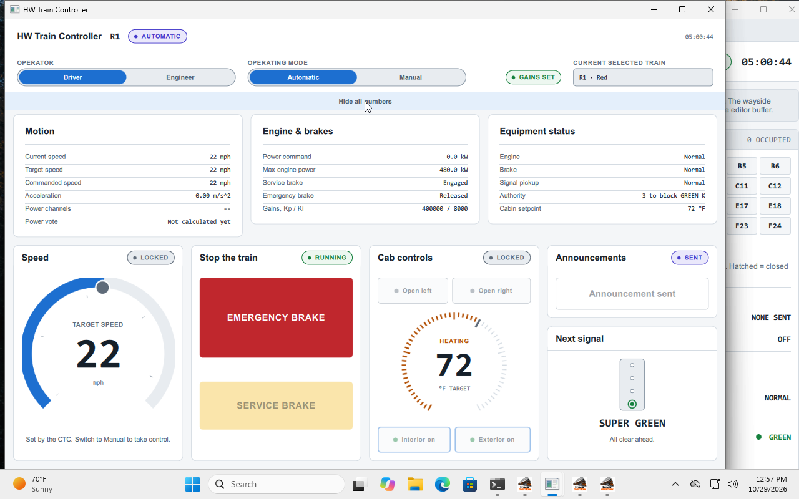

# Central harness: Windows GUI walkthrough, 2026-10-28

A grader-style pass through every window of the full system on Windows, driven
through the real UI. Nothing ran headless or through Qt test events: the mouse
was the VM's USB tablet, keys went through QEMU, and every observation is from a
screenshot of the Windows desktop. Screenshots are in
[`windows-gui-2026-10-28/`](windows-gui-2026-10-28/).

## Setup

| | |
| --- | --- |
| Machine | libvirt VM `win11` (Windows 11 build 26300), 4 vCPU, 8 GB |
| Screen | 1280×800; work area 1280×752 above the taskbar |
| Tree | `claude/quirky-fermi-sickg4` at `60521ce` (committed tree only; the uncommitted harness `Main.qml` changes were not included) |
| Python | 3.14.4, PySide6 6.11.2 |
| Launch | `track_overflow.py --test-pi process` (simulated Pis; no `--load-starters`, `--auto-run`, `--dispatch` or `--engineer-gains`) |

## What was done

1. Opened every window, then maximized each, shrank each to its minimum and
   restored it.
2. Loaded PLC programs by hand through the native file dialogs:
   - Green: the GTC-01 sample, then generated starter files for GTC-02 to
     GTC-06 (see F8).
   - Red: the three Red databases and their programs. A Green program was
     deliberately tried on Red-1 first.
3. Pressed Run in the CTC, switched to Manual and dispatched T1 (Green, to
   Dormont 73) and T2 (Red, to Herron Ave 16). An invalid arrival time was tried
   first.
4. Set the engineer gains in both Train Controllers, the first time with
   invalid text.
5. Ran both trains to their stations, then rerouted T1 to Poplar 88.
6. Induced and cleared a signal pickup failure on T2, then released its brake
   as the driver.
7. In the Track Model: searched for a station, entered an invalid ambient
   temperature, and checked the heaters at 32 °F and 20 °F.
8. In CTC Maintenance:
   - Closed the block a train was standing in, then reopened it.
   - Sent a switch command while a train stood on the switch's points block,
     then released it.
9. Ran at 10× and checked the harness's timing figures.
10. Tested every harness control: Show window, Read history, event selection
    and Last outputs.
11. Ended the run from the harness's close button.

**End state:** the run ended cleanly, with seven `MODULE_EXITED: exit code 0`
and `HARNESS_STOPPED`. There were no `TICK_REJECTED`, protocol errors,
`TRAIN_LEFT_TRACK` or QML warnings. All 33 `TIME_SLIPPED` events fall inside
the 10× stretch.

## Most important

| ID | Window | Finding | Shot |
| --- | --- | --- | --- |
| F8 | Track Controller SW | **No way to load programs from the UI for a whole line.** The *Load starters* button was removed in `7120fee` (README and `module_process.py` still describe it). Only GTC-01 has a sample `.plc`, so a grader must write five Green programs by hand before the CTC can dispatch on Green. | `tcsw_plc.png` |
| F37 | Train Controller (T2) | **A signal pickup failure can't be recovered under the harness.** After inducing and clearing it in the Train Model (which then shows commanded 0.0 mph and authority 0), the controller stays at *Signal pickup: Fault*. `control.py` latches it "until cleared on the test bench", and the harness has no test bench, so the train never drives in Automatic again. | `tm_fail.png`, `tc2_rel.png` |
| F23 | Train Controller | **Gains accept garbage.** Typing `abc-5` into Kp and pressing Set gains saved Kp = 0 with no error, and gains can't be changed afterwards. | `tc_nums.png` |
| F7 | Harness | **Show window doesn't raise the window on Windows.** The taskbar icon only flashes (Windows' foreground lock). The harness would need to call `AllowSetForegroundWindow(pid)` before sending SHOW. | `tcsw.png` |
| F1 / F38 | Track Controller SW | **Opens larger than the screen (1300×820), with no aspect lock.** It is the only window that doesn't scale; it reflows instead. Shrinking it changes only the width, so it stays taller than the work area, and *Set switch manually* sits under the taskbar. | `tcsw_plc.png`, `rs_sw_small.png` |
| F24 | Train Controller | The authority readout says **GREEN** for both lines ("6 to block GREEN K" for a Red train) and names a section letter, not the block. | `tc_nums.png`, `tc_b2.png` |
| F35 | Harness | At 10× on 4 vCPU: mean round trip 31.7 ms against a 10 ms budget, max 301 ms, 2645 ticks slipped. The effective speed was about 5×. 1× is fine. | `x10b.png`, `h10.png` |
| F30 | CTC | Trains at their destination still read *En route*, even under "At its destination, block 88". | `occ_sel.png` |

## Behaviour and wording

| ID | Window | Finding |
| --- | --- | --- |
| F2 | Train Controller | The Train Controller **SW** window is titled "HW Train Controller", the same as the HW one. |
| F15 | Track Controller HW | Its window title is "CTC / Train System — Track Controller". |
| F9 | Track Controller SW | *New*'s tooltip says "Start from this controller's layout", but it makes an empty buffer. |
| F11 | Track Controller SW | The clock reads `--:--:--` while paused; every other window shows 05:00:00. |
| F20 | CTC | Suggested speed and authority stay "—" after line, train and destination are chosen, though the hint says choosing them computes both. They appear only after Dispatch. |
| F21 | CTC | The "'99:99' is not a valid time of day" error stays after the field is corrected, until Dispatch. |
| F26 | Train Controller | Acceleration reads 0.00 m/s² while the train speeds up. The Train Model shows 1.98 ft/s² at the same moment. |
| F25 | Train Controller | *Stop the train* shows BRAKING while both brakes read Released and the train holds its target. Reproduction steps and cause are in [F25 reproduction](#f25-reproduction). |
| F32 | CTC | After confirming a closure of an occupied block, the panel says "Green 73 closed." while Active closures says "Closing — train in …". The "closed" line stays after reopening. |
| F33 | CTC | Notices push the whole layout down about 56 px mid-interaction. Clicks land on the wrong control. |
| F34 | CTC | A switch command held by the vital layer (Red 15 with a train on its points block, 16) shows commanded reverse and reported normal, with no reason given. The hold itself is correct. |
| F6 | Harness | With CTC Office selected in Last outputs before the first tick, the panel still says "No outputs selected. Select a module…". |
| — | CTC | Maintenance block picker: a plain 150-row list with no typing. About 0.75 rows per wheel click, so roughly 90 clicks to reach block 73. |
| — | CTC | Red switch 9 is listed as "(75-yard)", the raw layout text. |
| F27 | Train Model | The header rotates real company logos (Boston Dynamics, Flock Safety, Lockheed Martin, Palantir). Check this is intended and permitted. |

## Look: clipping, truncation, overlap

| ID | Window | Finding |
| --- | --- | --- |
| F3 | CTC | At its default size, the window's bottom edge is under the taskbar. Its lower panels need scrolling even when maximized. |
| F4 | Harness | The Last outputs hint text runs through the box's bottom border. |
| F5 | Harness | The Last outputs picker has no placeholder. Its popup is monospace and wider than the field. |
| F36 | Harness | Last outputs shows only about three lines of JSON. |
| F10 | Track Controller SW | "Track Cont…", "PLC program —…" and the vital file "vi…lc" are cut while the NOT READY badge shows. The title is fine once ready. |
| F12 | Track Controller SW | A gutter line number ("25") is drawn below the editor, outside its panel. |
| F13 / F14 | Track Controller SW | Pickers cut their text: "Crossing :", "Block 1 (", "GTC-05 · R101 – W", and "Set switch manually (CTC mainte…". |
| F16 / F17 | Track Controller HW | The heading runs into the NOT READY badge. The Wayside picker shows "Re…". |
| F18 | Track Controller HW | In the territory diagram, "XING-11 · DOWN" is drawn over signal 9's label. |
| F19 | Track Controller HW | Dashed switch legs run down into the legend (Red-2, Red-3). |
| F22 | CTC | Throughput tiles cut values ("56…", "96…" /hr). |
| F31 | CTC | The minimized Train occupancy pill sits on the track-view legend. |
| F32b | CTC | The confirm button reads "YES, CLOSE BL…". |
| F29 | Track Model | The Station and Beacon columns cut "EDGEBR…". |

## Working as intended

- **Resizing:** every window except the SW Track Controller holds 16:10 and
  scales evenly (minimum 736×489). Maximizing is clean.
- **Wrong program:** loading a Green program on Red-1 is refused with a clear
  list of nine errors.
- **File dialogs:** the HW dialogs open in `data/waysides` and `data/plc`.
- **Arrival time:** 99:99 is refused.
- **Ambient temperature:** "abc" is refused with a clear message. Heaters are
  OFF at 32 °F and come ON at 20 °F, holding the track at 32.1 °F.
- **Station search:** finding Dormont lists its two blocks.
- **Boarding:** Dormont's waiting count went from 59 to 0 when T1 stopped.
- **Rerouting and maintenance:** rerouting highlights the route and the train
  arrives. Closing an occupied block cancels that train's order with a notice,
  and reopening works.
- **Switch hold:** the HW vital layer holds a switch while a train is on its
  points block.
- **Pickup failure:** commanded speed and authority go null and the emergency
  brake applies. The brake stays latched until the driver releases it in
  Manual.
- **Ending the run:** asks first (*Keep running* / *End run*), and all seven
  modules exit with code 0.

## F25 reproduction

**What you see:** in the HW Train Controller window, the *Stop the train* badge
flickers between BRAKING and RUNNING while a train holds its speed on a downhill.
At the same moment, *Show all numbers* → *Engine & brakes* reads *Service brake:
Released*. The two never agree: when the badge says BRAKING the row says
Released, and when the row says Engaged the badge says RUNNING.

**When:** only on a downhill grade. On flat track or uphill the train holds its
speed with power alone and the badge stays RUNNING. In the walkthrough this was
T2 on Red blocks 11 to 15 (−0.5% to −2%) on its way to Herron Ave. T1's Green
run to Dormont is flat, so it never showed.

### Steps

1. Launch with simulated Pis:
   `python track_overflow.py --test-pi process`.
   - Shortcut for the setup in steps 2, 4 and 5: add `--load-starters
     --engineer-gains 400000 8000 --dispatch R1:Red:16`.
2. In the HW Track Controller window, load and commit a program on all three Red
   waysides, until the log shows `WAYSIDES_READY` for Red.
3. In the CTC Office, press **Run** at 1x.
4. In the CTC Office, switch to Manual and dispatch a Red train from the yard to
   Herron Ave (block 16).
5. In the HW Train Controller window, select that train and set its gains to
   Kp 400000, Ki 8000.
6. Leave the train in Automatic. Press **Show all numbers** at the top of the
   console.
7. Wait until the train reaches block 11 (the Track Model or the CTC Office
   shows its block). It is at its target, the commanded 22 mph, by then.
8. Watch the *Stop the train* badge and the *Service brake* row in *Engine &
   brakes* through blocks 11 to 15.

**Expected:** the badge and the *Service brake* row agree, each either braking
or not.

**Actual:** the badge shows BRAKING for about 0.2 s every 0.6 to 0.8 s, each
time while the row reads Released. The row reads Engaged for about 0.2 s just
before, while the badge reads RUNNING.

### Seen again in the VM, 2026-10-29

Reproduced on `win11` with the same tree, using the shortcut flags for the
setup, Run pressed in the CTC Office, the Driver selected, and *Show all
numbers* open. Over 60 screenshots taken back to back while R1 held 22 mph on
the downhill towards Herron Ave (05:00:38 to 05:00:50):

- The badge read BRAKING in 5 frames, and the row read Released in all 5.
- The row read Engaged in 10 frames, and the badge read RUNNING in all 10.

The two frames below are consecutive, both at 05:00:44. In the first the row reads
Engaged and the badge RUNNING. In the next the row reads Released and the badge
BRAKING.

| Engaged, RUNNING | Released, BRAKING |
| --- | --- |
|  |  |

### Cause

The badge and the row read different signals:

| Readout | Source | Meaning |
| --- | --- | --- |
| *Stop the train* badge (`StopPanel.qml`) | `fb_service_brake` | The Train Model's *Brake State*, the report of the command it received |
| *Service brake* row (`NumbersDrawer.qml`) | `service_brake` | The controller's own command this tick |

On a downhill, power alone can't hold the target, so the controller holds it
with the service brake. It applies the brake once the train is more than
`SERVICE_BAND_MPS` (0.05 m/s) over target and releases it as soon as it isn't.
That makes 2 ticks of brake every 6 to 8 ticks. Under the harness the report
comes back `ECHO_TICKS` (2) ticks after the command. So the badge shows each
brake pulse just after the command has ended, and the two readouts are always
out of phase.

The brake itself works, and the train holds its speed within about 0.3 m/s. So
F25 is two readouts that disagree, plus a badge that flickers. Whether it should
be fixed in the badge, the row, or the brake law is for the Train Controller
owners.

### Confirmed in simulation

Confirmed with a closed loop of the real `ControllerCore` (Train-Ctrl_HW,
`ECHO_TICKS`) and the real `TrainModel`, wired through
`common/harness/train_edges.py` as the harness wires them. The setup was gains
400000 / 8000 and a commanded speed of 40 km/h. Each run measured the last 30 s
of a 120 s run (300 ticks):

| Grade | Ticks with badge BRAKING | Of those, with the row reading Released |
| --- | --- | --- |
| 0% | 0 | — |
| +1% | 0 | — |
| −0.5% (Red 11) | 36 | 36 |
| −1% (Red 12, 15) | 46 | 46 |
| −1.25% (Red 14) | 50 | 50 |
| −2% (Red 13) | 61 | 61 |

Six ticks at −2%:

```
tick  speed m/s  command  report  badge
 906    11.138   off      off     RUNNING
 907    11.165   on       off     RUNNING   <- row says Engaged
 908    11.189   on       off     RUNNING   <- row says Engaged
 909    11.057   off      on      BRAKING   <- row says Released
 910    10.925   off      on      BRAKING   <- row says Released
 911    10.957   off      off     RUNNING
```
