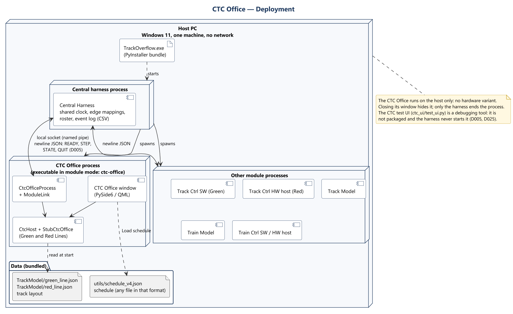

# CTC Office — Software Design

Contribution to the Software Design Description (WP2), for the CTC Office. Paste into the
group SDD as needed; every figure is a PNG beside its PlantUML source in
`documents/uml/ctc_office/`. System-wide concepts (route, authority, wayside distribution,
timing, vitality) are in [system_concepts.md](system_concepts.md); this document covers
only what is specific to the CTC Office.

| | |
|---|---|
| **Module** | CTC Office (`CTC-Office/`, packages `ctc` and `ctc_ui`) |
| **Owner** | Landis |
| **Status** | Draft for WP2 and the design review, 2026-10-22 |
| **Basis** | `development` at `de7a98f` (PRs #40, #42), plus the CTC Office commits on the integration branch `claude/quirky-fermi-sickg4` (`9c440d6`, `97a2fd1`, `4cc873b`): next-block suggestions, train events, return to yard, the harness process and the harness's clock. Decisions D005, D007, D013, D017, D020, D022, D023, D025. |

**Reading the figures.** Everything shown exists on the basis above; nothing is marked
«planned». The integration branch is not yet merged into `development`.

## Revision history

| Name | Date | Reason for changes | Version |
|---|---|---|---|
| Landis | 2026-10-22 | First CTC Office contribution, following the Track Controller (HW) contribution's layout. | 0.1 |
| Landis | 2026-10-25 | Sequence diagrams name the signals and method calls; Cancel order removed from Selected train (UC-02, UC-05, UC-06, SD-05, SD-13). | 0.2 |

## References

| Reference | Location | Role |
|---|---|---|
| R1. Team decisions | D005, D007, D013, D017, D020, D022, D023, D025 | Decisions the design follows. |
| R2. Requirements | [srs-filled.md](../srs-filled.md) §3.1, §3.2.1, §3.2.2, §4 | Requirement IDs. |
| R3. Rubrics | [rubric-to-requirements-map.md](../rubrics/rubric-to-requirements-map.md); functional rubric rows 1.2 to 1.4 and 2.0 to 2.8 | Grading criteria. |
| R4. Implementation | `CTC-Office/ctc/`, `CTC-Office/ctc_ui/`, [ctc_ui/README.md](../../CTC-Office/ctc_ui/README.md) | The design as built. |
| R5. Integration | [system-integration-design.md](../system-integration-design.md); `common/harness/wayside_edges.py`, `track_edges.py`, `roster.py` | Harness, edge mappings and roster. |
| R6. Sibling contributions | [track_ctrl_hw.md](track_ctrl_hw.md), [system_concepts.md](system_concepts.md), [Railway_Sim_SDD_Train_Model.md](../Railway_Sim_SDD_Train_Model.md) | Layout and shared concepts. |

---

## 1. Scope

The CTC Office is the dispatcher's console for the **Green and Red Lines** (the Blue Line is
out of scope, D023). It is one module in one process on the host PC, with no hardware
variant. It:

- creates every train, when it releases it from the yard, and gives the train ID every
  module uses (D022);
- dispatches trains by hand, or runs the loaded schedule in automatic mode (D020);
- works out each train's route, authority and suggested speed every step, and sends them to
  the Track Controller for the block the train is in and the next block on its route;
- closes blocks and sets switches in maintenance mode;
- shows occupancy and throughput to the dispatcher;
- commands the shared clock: pause, run, 1x and 10x (D017).

The CTC Office knows trains **only from block occupancy**: no train IDs, positions within a
block or speeds reach it, and a failed block reports occupied like a train. It follows its
own trains from that.

Not the CTC Office's job: moving switches outside maintenance mode, signals and crossings
(the waysides' PLC programs), the station dwell itself (the Train Controller, D007), and the
physics (the Train Model).

---

## 2. Requirements coverage

Every CTC Office item of the functional rubric, and the SRS requirements behind it, is
covered by at least one use case (section 3).

| Rubric | Points | Requirement | SRS | Use cases |
|---|---|---|---|---|
| 1.2 | 1 | Transit system operating at wall clock speed | REQ-FUNC-001 | UC-01 |
| 1.3 | 1 | Pause simulation | REQ-FUNC-003 | UC-01 |
| 1.4 | 1 | Transit system operating at 10 times wall clock speed | REQ-FUNC-002 | UC-01 |
| 2.0 | 2 | Dispatcher enters destination station and arrival time and dispatches a train | REQ-FUNC-004, 004.1, 004.2 | UC-03, UC-20 |
| 2.1 | 2 | CTC determines and sends speed limit and authority to the track controller within safety limits | REQ-FUNC-005, 005.1, 005.2 | UC-21, UC-13 |
| 2.2 | 1 | Switches between manual and automatic mode | REQ-FUNC-006, 007, 008 | UC-02 |
| 2.3 | 1 | Dispatcher manually dispatches a train to a block | REQ-FUNC-009 | UC-04, UC-05 |
| 2.4 | 1 | Close block for maintenance | REQ-FUNC-011 | UC-09, UC-22 |
| 2.5 | 3 | Monitor train occupancy | REQ-FUNC-013 | UC-11, UC-12, UC-17, UC-18 |
| 2.6 | 2 | Loading and running a schedule | REQ-FUNC-010 | UC-07, UC-08, UC-19 |
| 2.7 | 2 | In maintenance mode, set switch positions manually, sending the command to the track controller | REQ-FUNC-012 | UC-10, UC-22 |
| 2.8 | 1 | Throughput metrics displayed | REQ-FUNC-014 | UC-14, UC-23 |
| 9.0 | 5 | Each sub-system has a user interface | REQ-INTF-001.1 | UC-01 to UC-15 |
| — | — | Live system map | REQ-INTF-002.1, 002.2 | UC-11 |
| — | — | Track layout loaded from JSON | REQ-INTF-012 | UC-11, UC-16 |
| — | — | Channels with the Track Controller | REQ-INTF-019, 020 | UC-17, UC-21, UC-22 |
| — | — | One shared simulation clock | REQ-INTF-013, REQ-NFR-002 | UC-01, UC-16 |
| — | — | Validate user input; reject it without changing state | REQ-NFR-003, 004 | UC-03 to UC-10, UC-16 |

REQ-INTF-002.3 and 002.4 (switches and signals on the map) are only partly met; see
section 9.

---

## 3. Use cases

Actors:

- **Dispatcher** — the person at the CTC Office window. Every interactive control of the
  window belongs to one of UC-01 to UC-15.
- **Central Harness** — owns the shared clock and steps the module once per tick (D005,
  D017). It carries everything the Track Controller and the Track Model send and receive,
  and keeps the roster of trains the CTC Office creates and retires.
- **Track Controller** and **Track Model** — the neighbouring modules, reached only through
  the harness.

### Use case diagrams

One diagram per actor. A use case in grey belongs to another actor and is shown only for
its include or extend link.

**Dispatcher** (UC-01 to UC-15):

**Central Harness** (UC-01, UC-16 and the use cases it includes, UC-24):

**Track Controller** (UC-17, UC-18, UC-21, UC-22, UC-24):

**Track Model** (UC-23):

### User stories

One user story per actor. The dispatcher is the only person who uses the CTC Office; the
other three actors are modules, and their stories say what they need from it. Together the
stories cover every use case.

| Actor | User story | Accepted when | Use cases |
|---|---|---|---|
| Dispatcher | As the dispatcher, I want to dispatch trains by hand or run them from a schedule, close blocks and set switches for maintenance, and see where every train is and how many passengers each line carries, so that trains reach their stations safely and on time. | A train dispatched to a station with an arrival time leaves the yard and stops there; a loaded schedule runs by itself in Automatic mode; a closed block gets no train; every train's block, speed and authority are on screen; every refusal says why. | UC-01 to UC-15, UC-19 |
| Central Harness | As the central harness, I want the CTC Office to answer every step with its outputs, to tell me at once when the dispatcher pauses, runs or speeds up the clock, and to tell me once about each train it creates or retires, so that every module runs on one clock with the same trains. | Every valid step gets a reply and an invalid one a rejection that changes nothing; Run, Pause and 1x / 10x reach the harness while paused; each new and retired train appears in exactly one step's outputs. | UC-01, UC-16, UC-20 |
| Track Controller | As the Track Controller, I want a suggested speed and authority for each block a train is in or about to enter, the closed blocks and the maintenance switch commands, and nothing for a line until every wayside on it is ready, so that my waysides can protect the track. | No two trains' suggestions name one block; no authority runs into an occupied, closed or failed block; a line with a wayside not ready gets nothing. | UC-17, UC-18, UC-21, UC-22, UC-24 |
| Track Model | As the Track Model, I want the tickets I sell at each station counted, so that the dispatcher sees each line's throughput. | Each sale is counted once, in its line and its clock hour. | UC-23, UC-14 |

### UC-01 Control the simulation clock

| | |
|---|---|
| **Actors** | Dispatcher; Central Harness |
| **Description** | Runs, pauses and speeds up the one shared clock, for every module. |
| **Data** | `clock_paused` (true at start), `clock_speedup` (true for 10x). The header shows the harness's time, 24-hour, from 05:00:00. |
| **Stimulus** | **Run** / **Pause** and **1x** / **10x** under SIMULATION CLOCK in the header. |
| **Response** | The module's outputs change at once and go to the harness as `STATE`, since no step runs while the clock is paused. The harness starts, stops or speeds the ticks of every module. At 10x ticks come ten times as often; dt stays 0.1 s. |
| **Alternatives** | The harness allows Run only once every module has said it is ready (D005). Pressing the control that is already set changes nothing. |
| **Requirements** | Rubric 1.2 to 1.4; REQ-FUNC-001, 002, 003; REQ-INTF-013; REQ-NFR-002 |
| **Sequence** | SD-01 |

### UC-02 Change operating mode

| | |
|---|---|
| **Actors** | Dispatcher |
| **Description** | Chooses Automatic, Manual or Maintenance mode. |
| **Data** | One mode at a time. |
| **Stimulus** | OPERATING MODE toggle in the header. |
| **Response** | The right-hand column shows that mode's view. Automatic: the loaded schedule's runs dispatch themselves. Manual: Dispatch train, and reroute or return to yard for the selected train. Maintenance: Close block, Active closures and Set switch position. Leaving Automatic holds every scheduled run where it is; leaving Maintenance drops every switch command, while closed blocks stay closed. The mode itself is sent to no module: the Track Controller gets the closed blocks instead. |
| **Requirements** | Rubric 2.2; REQ-FUNC-006, 007, 008 |
| **Sequence** | SD-02 |

### UC-03 Dispatch a train to a station

| | |
|---|---|
| **Actors** | Dispatcher |
| **Description** | Orders a train to a station of its line, with an optional arrival time. |
| **Data** | Line; train: one already on the line, or **New train (T*n*)** with the next free ID; destination station (the line's station blocks); arrival `HH:MM`, optional. |
| **Stimulus** | **Dispatch train** (Manual view). It reads **Reroute train** when the train already has an order. |
| **Response** | The order is recorded, replacing any earlier one. A new train waits in the yard until the CTC Office releases it (UC-20). From then on the train gets authority toward the station every step (UC-21). The panel shows the suggested speed and authority sent for it. The arrival time ranks the train for contested blocks: the train most behind schedule goes first. |
| **Alternatives** | Refused with a message, and nothing changes: the line's waysides are not all ready (the message names the wayside and why); the destination is closed or closing; the train is on the other line; the train ID is empty, unprintable or longer than 32 characters; the arrival is not a time of day. A destination the CTC Office takes for a failure is accepted: the train waits short of it until it clears. |
| **Requirements** | Rubric 2.0; REQ-FUNC-004, 004.1, 004.2, 006; REQ-NFR-003, 004 |
| **Sequence** | SD-03 |

### UC-04 Dispatch a train to a block

| | |
|---|---|
| **Actors** | Dispatcher |
| **Description** | Sends a train straight to any block of its line. |
| **Data** | Line, train, block. |
| **Stimulus** | **Set authority** ("or dispatch directly to a block"), Manual view. |
| **Response** | An order to that block with no arrival time. The CTC Office turns it into a count of blocks every step (D013). |
| **Alternatives** | As UC-03. |
| **Requirements** | Rubric 2.3; REQ-FUNC-009 |
| **Sequence** | SD-04 |

### UC-05 Reroute a train

| | |
|---|---|
| **Actors** | Dispatcher |
| **Description** | Changes where the selected train is going. |
| **Data** | Train; new destination; arrival time (optional). |
| **Stimulus** | A new destination, then **Reroute** in Selected train (Manual mode). |
| **Response** | The new order replaces the old one; the route is worked out again from where the train is, carrying on the way it is going. |
| **Alternatives** | Refused as UC-03 refuses. |
| **Requirements** | Rubric 2.3; REQ-FUNC-009 |
| **Sequence** | SD-05 |

### UC-06 Return a train to the yard

| | |
|---|---|
| **Actors** | Dispatcher |
| **Description** | Sends a manual train on the track back to the yard, where it is retired (D022). |
| **Data** | Train. |
| **Stimulus** | **Return to yard** in Selected train (Manual mode). |
| **Response** | An order to the line's yard entry block (Green 57, Red 9). Once the train has stopped there with authority 0 it is retired (UC-20). A later order withdraws it. |
| **Alternatives** | Refused for a train not on the track, for a run of the loaded schedule (the schedule returns it), and as UC-03 refuses. |
| **Requirements** | D022 |
| **Sequence** | SD-06 |

### UC-07 Load a schedule

| | |
|---|---|
| **Actors** | Dispatcher |
| **Description** | Loads the schedule that automatic mode runs. |
| **Data** | Schedule JSON in the `utils/schedule_v4.json` format: per run, the line, run number and timed stops. |
| **Stimulus** | **Load schedule** (Automatic view) and a file. |
| **Response** | Each run is planned at once (D020). Its train ID is the line's initial and run number (`G1`, `R1`). It stops only at its scheduled stations, in the order the track reaches them from the yard, then returns to the yard. It is due out of the yard at 05:00 plus its departure, and at each stop after the run time and a 45 s dwell at each stop before (D007). DEPARTURES lists every run. |
| **Alternatives** | A malformed file, a stop not on the layout, a run listed twice, or two runs with one train ID: "Schedule not loaded: …", and the current schedule is kept. |
| **Requirements** | Rubric 2.6; REQ-FUNC-010; REQ-NFR-003, 004 |
| **Sequence** | SD-07 |

### UC-08 Monitor and pause automatic dispatch

| | |
|---|---|
| **Actors** | Dispatcher |
| **Description** | Shows how far each run has got, and holds or releases them all. |
| **Data** | DEPARTURES: train, due time, status (Queued, Held, In yard, To *station*, At *station*, To yard, Done). |
| **Stimulus** | **Pause dispatch** / **Resume dispatch**; any step. |
| **Response** | While paused, no run leaves the yard or a stop; a run already on its way carries on to its next stop. |
| **Requirements** | Rubric 2.6; REQ-FUNC-007, 010 |
| **Sequence** | SD-08 |

### UC-09 Close or reopen a block

| | |
|---|---|
| **Actors** | Dispatcher |
| **Description** | Takes a block out of service for maintenance, and back. |
| **Data** | Line, block. |
| **Stimulus** | **Close block**, then **Yes, close block** (Maintenance view); **Reopen block** or **Cancel closing** under Active closures. |
| **Response** | A clear block closes at once. An occupied block is listed as "Closing — train in block" and closes by itself once the train has left. Either way, orders into it are cancelled at once with a notice, no authority is given into it, and it is in `closed_blocks` from the moment it is requested until it is reopened. |
| **Alternatives** | Already closed or closing: says so. Outside maintenance mode: refused. |
| **Requirements** | Rubric 2.4; REQ-FUNC-011 |
| **Sequence** | SD-09 |

### UC-10 Set a switch position

| | |
|---|---|
| **Actors** | Dispatcher |
| **Description** | Commands a switch, in maintenance mode. |
| **Data** | Line; switch, named by its block; **Normal** (the first connection the layout file lists) or **Reverse** (the second). The panel shows the position the Track Controller reports and the one commanded. |
| **Stimulus** | **Send to track controller** or **Release** (Maintenance view). |
| **Response** | The command is in `switch_commands` every step while maintenance mode lasts; the wayside's PLC program carries it out, and the reported position follows. |
| **Alternatives** | The switch's block is occupied: refused. Outside maintenance mode: refused. |
| **Requirements** | Rubric 2.7; REQ-FUNC-012 |
| **Sequence** | SD-10 |

### UC-11 Monitor the track map

| | |
|---|---|
| **Actors** | Dispatcher |
| **Description** | Shows both lines and what is on them. |
| **Data** | Every block from the layout files, coloured by line; occupied, closed and closing blocks; each train the CTC Office follows, as a car tagged with its ID on its head block; an untagged car on any other occupied block (an inferred failure among them); active crossings. |
| **Stimulus** | Any step; **+** / **−** zoom, drag to pan, **Fit**. |
| **Response** | The map redraws. A selected train's route is highlighted (UC-13). |
| **Requirements** | Rubric 2.5; REQ-FUNC-013; REQ-INTF-002.1, 002.2 |
| **Sequence** | SD-11 |

### UC-12 Monitor train occupancy

| | |
|---|---|
| **Actors** | Dispatcher |
| **Description** | Lists every train the CTC Office follows or has an order for. |
| **Data** | Train, line, block (both blocks while it crosses into the next), suggested speed (mph; its actual speed is never known), authority (blocks, and the block it ends at), destination, requested arrival, status (En route, In yard, Not located, No order). |
| **Stimulus** | Train occupancy window, or its dock ("Keep open at bottom"); filter by line, status or train ID. |
| **Response** | Rows update after each step. **Select train** loads the row into Selected train (UC-13). |
| **Requirements** | Rubric 2.5; REQ-FUNC-013 |
| **Sequence** | SD-12 |

### UC-13 View the selected train

| | |
|---|---|
| **Actors** | Dispatcher |
| **Description** | Shows one train in detail. |
| **Data** | Current block, next station, suggested speed, authority and the block it runs to, why it ends there (destination, a block occupied, closed or closing, a switch not set, a block reserved by another train), destination, arrival, dwell at the next stop, the route, and where it would have to reverse. |
| **Stimulus** | **Select train** in the occupancy window or on a reversal alert. |
| **Response** | The panel fills, and the route is highlighted on the map, within authority and beyond it. In Manual mode the panel adds UC-05 and UC-06. |
| **Requirements** | Rubric 2.1 (display); REQ-FUNC-005, 013 |
| **Sequence** | SD-13 |

### UC-14 View throughput metrics

| | |
|---|---|
| **Actors** | Dispatcher |
| **Description** | Shows passenger throughput per line, from ticket sales. |
| **Data** | Tickets per hour on each line since 05:00; tickets sold on each line in each clock hour, last 12 hours. |
| **Stimulus** | Any step; hover a bar for its value. |
| **Response** | The tiles, table and charts update. |
| **Requirements** | Rubric 2.8; REQ-FUNC-014 |
| **Sequence** | SD-14 |

### UC-15 Handle notices and reversal alerts

| | |
|---|---|
| **Actors** | Dispatcher |
| **Description** | Tells the dispatcher what needs their attention. |
| **Data** | Notices: each wayside not ready and why; orders the CTC Office cancelled itself (block closed or closing); Track Controller reports staged while paused. Reversal alert: the train, what holds it, and the block where it would have to reverse. |
| **Stimulus** | **Dismiss** (notices); **Select train** or **Dismiss** (alert). |
| **Response** | The CTC Office never reverses a train: it waits, and the alert says so. A dismissed alert does not come back unless the situation clears and happens again. |
| **Requirements** | REQ-INTF-004 |
| **Sequence** | SD-15 |

### UC-16 Run one step

| | |
|---|---|
| **Actors** | Central Harness (primary); Track Controller and Track Model through it |
| **Description** | Once per tick, takes that tick's inputs, moves every train and run on, and returns the outputs. |
| **Data** | Tick number; dt (fixed, 0.1 s); simulation time (unwrapped seconds, 05:00:00 is 18 000); the tick's inputs (UC-17, UC-23). |
| **Stimulus** | A `STEP` message from the harness. |
| **Response** | In order: follow the trains (UC-18), add ticket sales (UC-23), run the schedule (UC-19), close pending closures whose block is clear, retire trains (UC-20), work out authority and commit it, release a waiting train (UC-20), and return the outputs (UC-21, UC-22, clock commands, train events). The reply goes before the window redraws, which it does at most every 200 ms. |
| **Alternatives** | Malformed or invalid input, a dt that is not finite and positive, or a time not after the module's: the whole tick is refused before anything changes, and the harness logs it and keeps the last outputs. The module's time is the harness's, so a refused tick does not put the schedule behind. A line not ready: UC-24. |
| **Requirements** | REQ-INTF-013; REQ-NFR-002, 003, 004; REQ-DSN-004 |
| **Sequence** | SD-16 |

### UC-17 Receive Track Controller reports

| | |
|---|---|
| **Actors** | Track Controller (through the harness) |
| **Description** | Takes what every wayside reports. |
| **Data** | Occupied blocks; switch positions; crossing states; each wayside's ID, line, ready and why not. The harness maps them from every wayside's `CtcReport`. |
| **Stimulus** | Every step. |
| **Response** | Occupancy drives tracking (UC-18). A switch not reported set for a train's route cuts its authority short. Crossings show on the map. Readiness gates each line (UC-24). |
| **Alternatives** | An unknown block, switch or crossing, or a switch reported in two positions: the tick is refused. |
| **Requirements** | Rubric 2.5; REQ-FUNC-013; REQ-INTF-020 |
| **Sequence** | SD-17 |

### UC-18 Follow trains from occupancy

| | |
|---|---|
| **Actors** | Central Harness (included in UC-16); Track Controller (its occupancy) |
| **Description** | Works out where each of its trains is, and which occupied blocks are failures, from occupancy alone. |
| **Data** | Occupancy now and at the last step; each train's route, authority and suggested speeds; the trains it has released. |
| **Stimulus** | Every step. |
| **Response** | The train in a yard exit block (Green 63, Red 9) is the one the CTC Office last released there. A train moves into the next block of its route when that block becomes occupied, and leaves a block when it clears; it holds both while crossing. |
| **Alternatives** | The next block occupied sooner than half the time the train would need, or an occupancy no train explains: a failure. No authority is given into it and routes go round it, but it is shown only as occupied, and orders into it are kept. A train whose blocks all clear outside the yard is dropped quietly ("Not located"); its order stays. |
| **Requirements** | Rubric 2.5; REQ-FUNC-013 |
| **Sequence** | SD-18 |

### UC-19 Run the schedule

| | |
|---|---|
| **Actors** | Central Harness (included in UC-16) |
| **Description** | In automatic mode, gives the orders that carry the loaded schedule out (D020). |
| **Data** | Each run's plan and progress; the time; ready lines; where each train is. |
| **Stimulus** | Every step, in Automatic mode with dispatch not paused. |
| **Response** | A run that is due is dispatched from the yard and released (UC-20). It is sent to its next scheduled station, where its authority ends; once its head reaches that block it is held 45 s, then sent on. After its last stop it returns to the yard and is retired. Runs are never sent to meet head-on: where runs use the same track in both directions (Green 77 to 100 and 1 to 28; Red 16 to 66) one scheduled train at a time is let in, and a run due to enter a busy stretch waits at its last stop or in the yard as Held. |
| **Alternatives** | A closed or closing stop is skipped. A line not ready: its runs wait. |
| **Requirements** | Rubric 2.6; REQ-FUNC-007, 010 |
| **Sequence** | SD-19 |

### UC-20 Release and retire trains

| | |
|---|---|
| **Actors** | Central Harness (included in UC-16; applies the events to its roster) |
| **Description** | Lets trains out of the yard and takes them back (D022). |
| **Data** | `new_trains`: train ID and line; `retired_trains`: train ID. Each appears in exactly one step's outputs. |
| **Stimulus** | Every step. |
| **Response** | Release: per line, one train at a time, the waiting train most behind schedule first, and only when every wayside on the line is ready, the yard exit block is clear and not closed or closing, no train is authorized into it, and the scheduler is not holding the run. The harness adds the train to the Train Model and the line's Train Controller at the yard exit block. Retire: a train sent to the yard that has stopped at the yard entry block (Green 57, Red 9) with authority 0 at its destination. The harness removes it; its block clears; its run is done and its order dropped. |
| **Requirements** | Rubric 2.0; REQ-FUNC-004; D022 |
| **Sequence** | SD-20 |

### UC-21 Send speed and authority suggestions

| | |
|---|---|
| **Actors** | Track Controller (through the harness) |
| **Description** | Suggests each train's speed and authority, for the block it is in and the next block on its route. |
| **Data** | Up to two per train: train ID, line, block, speed (whole m/s), authority (blocks). The second is for the next block, while the authority is at least 1, with one block less. |
| **Stimulus** | Every step. |
| **Response** | Authority and speed are worked out as in section 4.1. The harness sends each line's suggestions to its Track Controller by block, dropping the train ID; the next block always lies within the train's own exclusive authority, so no two trains name one block. |
| **Alternatives** | A train still in the yard gets neither. A line not ready: UC-24. |
| **Requirements** | Rubric 2.1; REQ-FUNC-005, 005.1, 005.2; REQ-INTF-019 |
| **Sequence** | SD-21 |

### UC-22 Send closures and switch commands

| | |
|---|---|
| **Actors** | Track Controller (through the harness) |
| **Description** | Tells the waysides which blocks are closed and, in maintenance mode, where to set switches. |
| **Data** | `closed_blocks`: the full set every step, closing blocks included; `switch_commands`: only in maintenance mode. |
| **Stimulus** | Every step. |
| **Response** | The Track Controller may not override a listed block; the PLC program carries out a switch command. |
| **Alternatives** | A line not ready: nothing is sent for it; closures and commands are kept and go out once it is ready (UC-24). |
| **Requirements** | Rubric 2.4, 2.7; REQ-FUNC-011, 012; REQ-INTF-019 |
| **Sequence** | SD-22 |

### UC-23 Receive ticket sales

| | |
|---|---|
| **Actors** | Track Model (through the harness) |
| **Description** | Takes the tickets sold at each station. |
| **Data** | Tickets sold since the previous step, by station name as the layout files write it (`GLENBURY`). The harness delivers each tick's sales exactly once. |
| **Stimulus** | Every step. |
| **Response** | Added to each station's count since the start, which gives each line's throughput (UC-14). |
| **Alternatives** | An unknown station, or a count that is negative or not a whole number: the tick is refused. |
| **Requirements** | Rubric 2.8; REQ-FUNC-014 |
| **Sequence** | SD-23 |

### UC-24 Hold a line that is not ready

| | |
|---|---|
| **Actors** | Central Harness (extends UC-16); Track Controller (a wayside not ready) |
| **Description** | Keeps a line still while any wayside on it is not ready (no PLC program loaded). The waysides are vital, so nothing is sent to a line until every wayside on it runs its program. |
| **Data** | Each wayside's ready and reason. A line is ready once a wayside on it has reported and every wayside on it is ready. |
| **Stimulus** | Any step on which a line is not ready. |
| **Response** | For that line only: no suggestions, closed blocks or switch commands are sent; no authority is granted; no train is released; automatic dispatch waits; a dispatch is refused, naming the wayside and why; the window lists each wayside not ready. Closures and switch commands are kept. The other line keeps running. Everything resumes on the first step the line is ready. |
| **Requirements** | REQ-FUNC-005; D022 (release conditions) |
| **Sequence** | SD-24 |

---

## 4. Software architecture

The module is layered so that every decision is made in Qt-free code:

| Layer | Parts | Responsibility |
|---|---|---|
| Presentation | QML window (`Main.qml`, `CtcHeader`, the Automatic, Manual and Maintenance views, panels), `CtcHost`, `TrackMapModel`, `display`, `HarnessClockBridge` | Shows the railway in imperial units and 24-hour time; turns clicks into `CtcOffice` calls and shows each refusal's text. Never decides anything. |
| Process and communication | `CtcOfficeProcess`, `ModuleLink` (shared `utils`), `wire` | `READY`, `STEP`, `STATE` and `QUIT` with the harness; decodes inputs and encodes outputs as JSON. |
| Control | `StubCtcOffice` (`ctc/model.py`) | Validation, safety rules, orders, closures, switch commands, authority, suggestions, yard release and retirement, outputs. |
| Domain services | `TrainTracker`, `AutoDispatcher` and `plan_run`, `TrackGraph` and `authority` | Tracking from occupancy; schedule plans and progress; routes and block-count authority. |
| Data | `track_layout`, `schedule` | Reads the layout files at start and a schedule file on request. |
| Contract | `interface.py`, the `CtcError` family | The `CtcOffice` Protocol and the boundary types. |

Design choices:

- **One interface, three users.** The harness (through `CtcOfficeProcess`), the window and
  the CTC test UI drive the module only through `CtcOffice`. Dispatcher actions are not
  cross-module inputs.
- **The core is Qt-free.** `interface`, `model`, `tracking`, `scheduler`, `routing`,
  `track_layout`, `schedule`, `wire` and `actions` import no Qt, and are unit-tested
  headlessly.
- **Validate, then change.** `step` rejects a bad tick before any state changes; an action
  is refused with a message before anything changes.
- **Recompute every step.** Routes and authority are worked out again from the current
  reports every step, never carried from a stored plan. Only the blocks already granted to a
  train are kept, until it has passed them.
- **The harness's time.** Under the harness the module's time is each step's simulation
  time, not a sum of dt values; standalone, it moves on by dt.
- `StubCtcOffice` keeps its first name: it is the full implementation.

### 4.1 How the CTC Office decides

| Concern | Design |
|---|---|
| Route | Shortest route a train can run, on a graph built from each block's `next_blocks` and each switch's two legs. It never turns a train back: each route carries on from the block the train came from. It goes round closed, closing and failed blocks and trains that are not moving, preferring a way round both, then round unusable blocks only, then the shortest route, on which the train waits. No detour more than twice the shortest is taken. When only reversing would get round, the train waits and the dispatcher is alerted. |
| Switches | Outside maintenance mode the CTC Office never commands a switch. Authority stops at the block before a switch not reported set for the route, and grows once the wayside sets it. |
| Authority | Blocks ahead of the train's head block along its route, to the destination, ending before the first block that is occupied, closed, closing, failed or within another train's authority, or before a switch not set. |
| Contested blocks | A block no train holds yet goes to the train most behind schedule: the least slack between its requested arrival and the time it needs at each block's limit. A train with no arrival comes after; ties go to the lower ID. |
| Suggested speed | The block's limit in m/s, rounded down, less 1 m/s; never more than √(2 × 1.2 m/s² × d), d being the length within authority; 0 at authority 0. The next block's value is worked out for that block, with one block less. |
| Tracking | UC-18. |
| Automatic dispatch | UC-19. Track order is a first approach and may change. |
| Yard | UC-20. |
| Readiness | UC-24. |

---

## 5. Interface

Units are backend units: speed in m/s, distance in m; the window shows mph. Authority is a
count of blocks (D013). Every block, switch and crossing reference carries its line, since
block numbers repeat across lines; a switch or crossing is named by the block the layout
file lists it on. Line names are `"Green"` and `"Red"`; a train ID is a trimmed, printable
string of at most 32 characters.

**Inputs from the Track Controller** (every step, mapped by the harness from every wayside's
report):

| Field | Type | Meaning |
|---|---|---|
| `occupancy` | (line, block, occupied) per block | A train or a failure; a block not listed is clear. |
| `switches` | (line, switch, `normal` \| `reverse`) | Position each switch reports. |
| `crossings` | (line, crossing, `inactive` \| `active`) | State each crossing reports. |
| `waysides` | (wayside ID, line, ready, reason) | Each wayside's readiness, and why not. |

**Input from the Track Model:**

| Field | Type | Meaning |
|---|---|---|
| `ticket_sales` | {station name: whole number ≥ 0} | Tickets sold since the previous step. |

**Outputs to the Track Controller:**

| Field | Type | Meaning |
|---|---|---|
| `suggestions` | (train ID, line, block, speed m/s int, authority blocks int) | Up to two per train: its head block and the next block. |
| `closed_blocks` | (line, block), full set | Closed and closing blocks; the Track Controller may not override them. |
| `switch_commands` | (line, switch, `normal` \| `reverse`) | Maintenance mode only. |

**Outputs to the central harness:**

| Field | Type | Meaning |
|---|---|---|
| `clock_speedup` | bool | True for 10x, false for 1x. |
| `clock_paused` | bool, true at start | True while the dispatcher has the clock paused; also sent at once as `STATE`. |
| `new_trains` | (train ID, line) | Trains released from the yard this step. |
| `retired_trains` | (train ID) | Trains retired this step. |

---

## 6. Class diagrams

### 6.1 Core: the module and train tracking

- `StubCtcOffice` implements `CtcOffice`. It holds the orders, closures, switch commands and
  granted blocks, and owns one `TrackGraph` per line, the `TrainTracker` and, once a
  schedule is loaded, the `AutoDispatcher`.
- `_Layout` checks every reference and input against the layout files.
- Every refusal is a `CtcError`: `InvalidInputError` (bad value), `InvalidTimeStepError`,
  `MaintenanceModeRequiredError`, `UnsafeActionError` (a safety rule).
- `TrainTracker` keeps one `Tracked` per train: its blocks, how far it may have got, the
  fastest it may be going and the block it came from. Each step it reads the last step's
  `Plan` per train and the trains released (`Waiting`).

### 6.2 Core: scheduling, routing and data

- `plan_run` turns each `ScheduledTrain` into a `RunPlan`: its stops in track order with due
  times, the path out and back, and where on it each stop is.
- `AutoDispatcher` keeps a `Progress` per run and the two-way zones per line. Each step it
  reads a `World` and gives `Order` and `Cancel` actions, which the model carries out with
  the dispatcher's own safety checks.
- `TrackGraph` is built from a `Line`'s blocks; `authority()` counts an `AuthorityLimit`
  along a route.

### 6.3 Boundary types

All are frozen dataclasses in `ctc/interface.py`, owned by the CTC Office (D005); other
modules' types never appear in them, and `common/interfaces.py` is not used (D008).
`CtcSnapshot` is for the CTC window only and crosses no module boundary.

### 6.4 Process and window classes

- `CtcOfficeProcess` answers the harness through `ModuleLink` and steps the module through
  `CtcHost`.
- `CtcHost` is the only object QML talks to: it reads snapshots into rows, and its slots
  return an empty string or the refusal's text.
- `HarnessClockBridge` gives QML the same clock face as the standalone clock, but shows the
  harness's time, and hands Run, Pause and 1x / 10x to the module and the harness.

---

## 7. Sequence diagrams

One sequence diagram per use case, numbered to match: SD-*n* shows UC-*n*. SD-16, one
whole step, refers to the diagrams of the use cases it includes.

| Diagram | Use case |
|---|---|
| SD-01 | UC-01 Control the simulation clock |
| SD-02 | UC-02 Change operating mode |
| SD-03 | UC-03 Dispatch a train to a station |
| SD-04 | UC-04 Dispatch a train to a block |
| SD-05 | UC-05 Reroute a train |
| SD-06 | UC-06 Return a train to the yard |
| SD-07 | UC-07 Load a schedule |
| SD-08 | UC-08 Monitor and pause automatic dispatch |
| SD-09 | UC-09 Close or reopen a block |
| SD-10 | UC-10 Set a switch position |
| SD-11 | UC-11 Monitor the track map |
| SD-12 | UC-12 Monitor train occupancy |
| SD-13 | UC-13 View the selected train |
| SD-14 | UC-14 View throughput metrics |
| SD-15 | UC-15 Handle notices and reversal alerts |
| SD-16 | UC-16 Run one step |
| SD-17 | UC-17 Receive Track Controller reports |
| SD-18 | UC-18 Follow trains from occupancy |
| SD-19 | UC-19 Run the schedule |
| SD-20 | UC-20 Release and retire trains |
| SD-21 | UC-21 Send speed and authority suggestions |
| SD-22 | UC-22 Send closures and switch commands |
| SD-23 | UC-23 Receive ticket sales |
| SD-24 | UC-24 Hold a line that is not ready |

### SD-01 Control the simulation clock

### SD-02 Change operating mode

### SD-03 Dispatch a train to a station

### SD-04 Dispatch a train to a block

### SD-05 Reroute a train

### SD-06 Return a train to the yard

### SD-07 Load a schedule

### SD-08 Monitor and pause automatic dispatch

### SD-09 Close or reopen a block

### SD-10 Set a switch position

### SD-11 Monitor the track map

### SD-12 Monitor train occupancy

### SD-13 View the selected train

### SD-14 View throughput metrics

### SD-15 Handle notices and reversal alerts

### SD-16 Run one step

### SD-17 Receive Track Controller reports

### SD-18 Follow trains from occupancy

### SD-19 Run the schedule

### SD-20 Release and retire trains

### SD-21 Send speed and authority suggestions

### SD-22 Send closures and switch commands

### SD-23 Receive ticket sales

### SD-24 Hold a line that is not ready

---

## 8. Deployment

- The system is one executable on one Windows 11 PC, with no network. It starts the central
  harness, which spawns one process per module (D005).
- The CTC Office process holds the one module for both lines and its window. It talks to the
  harness over a local socket (a named pipe on Windows), in newline-delimited JSON carrying a
  request ID and the tick.
- It reads the Green and Red layout files at start; a schedule file is loaded from the
  window.
- Closing the window hides it; only the harness ends the process.
- The CTC test UI stands in for the Track Controller only (D025). It is a debugging tool: it
  is not packaged and the harness never starts it.

---

## 9. Open items

| # | Item | Owner |
|---|---|---|
| 1 | REQ-INTF-002.3 and 002.4: the map shows blocks, trains and crossings. Switch positions appear in Set switch position and in why a train's authority ends, not on the map. Signal aspects never reach the CTC Office: the waysides report them, but the harness mapping drops them. | Landis |
| 2 | Ticket sales: the agreed signal definition is per line, as (count, line) pairs. The CTC Office and the harness use tickets per station. The definition should be updated to match. | Landis |
| 3 | The naming convention makes enumerated values all caps (`NORMAL`, `REVERSE`), but the CTC Office and the switch command definition use lower case for switch positions and crossing states. The harness mapping or the module must convert, and the two should agree. | Landis, Kevin |
| 4 | D020 says the CTC Office holds a train at its station for the dwell; D007 says the Train Controller holds the dwell. Both hold: the CTC Office keeps the authority at the station for 45 s and the Train Controller holds the doors for 45 s. D020's wording should say so. | Landis |
| 5 | Throughput: trains per hour and dwell per line stay empty; nothing reports that data. | Landis |
| 6 | The CTC Office's integration changes are on `claude/quirky-fermi-sickg4`, not yet on `development`. | Kevin, Landis |

---

## Appendix A. Design review rubric coverage

| Design review item | Points | Where |
|---|---|---|
| 1.3 System architecture and design: route, authority, wayside distribution, timing, vitality | 15 | Section 4.1 for the CTC Office's part; [system_concepts.md](system_concepts.md) for the system. |
| 1.4 Software architecture | 14 | Section 4 and its figure. |
| 1.5 Use case diagram (actors shown) | 14 | Section 3: one use case diagram per actor, a user story per actor, and a description of each use case, UC-01 to UC-24. |
| 1.6 Class diagram | 14 | Section 6: four diagrams. |
| 1.7 Sequence diagram | 14 | Section 7: one per use case, SD-01 to SD-24. |
| 1.8 Deployment diagram | 14 | Section 8. |

The presentation (1.1, 1.2) and observations (1.9) are delivered at the review, not in this
document.
