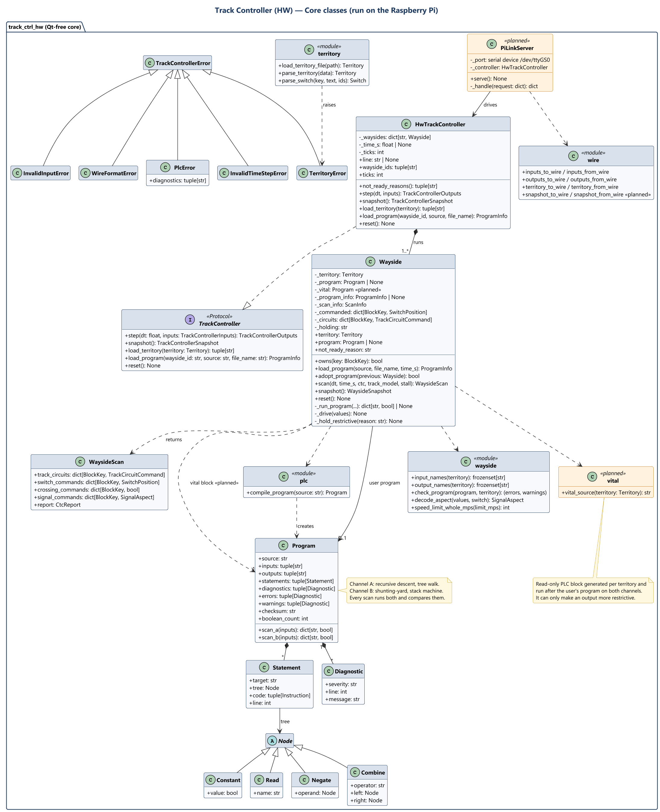
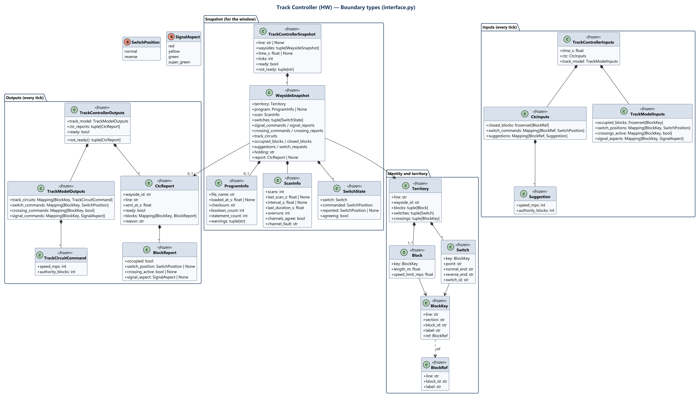
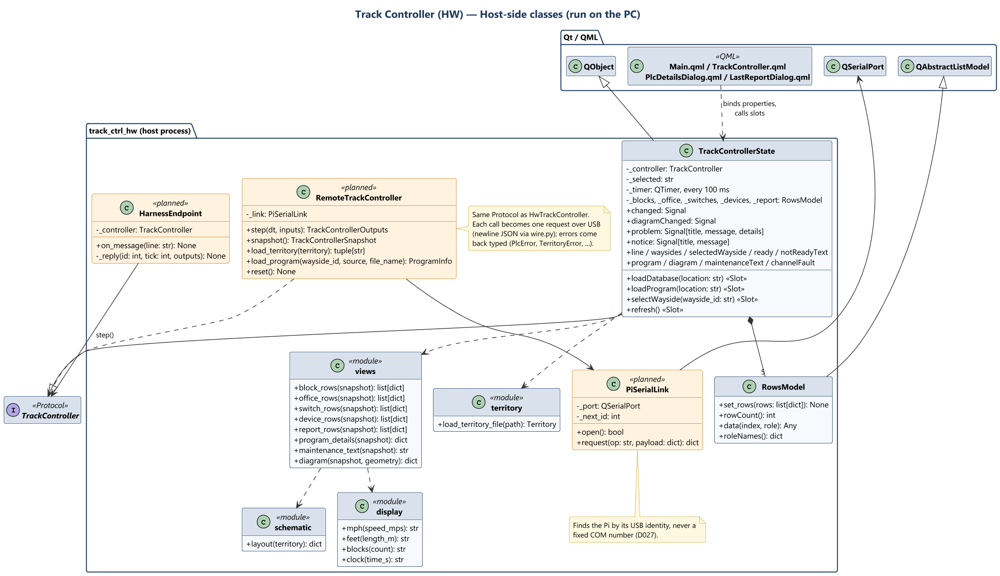
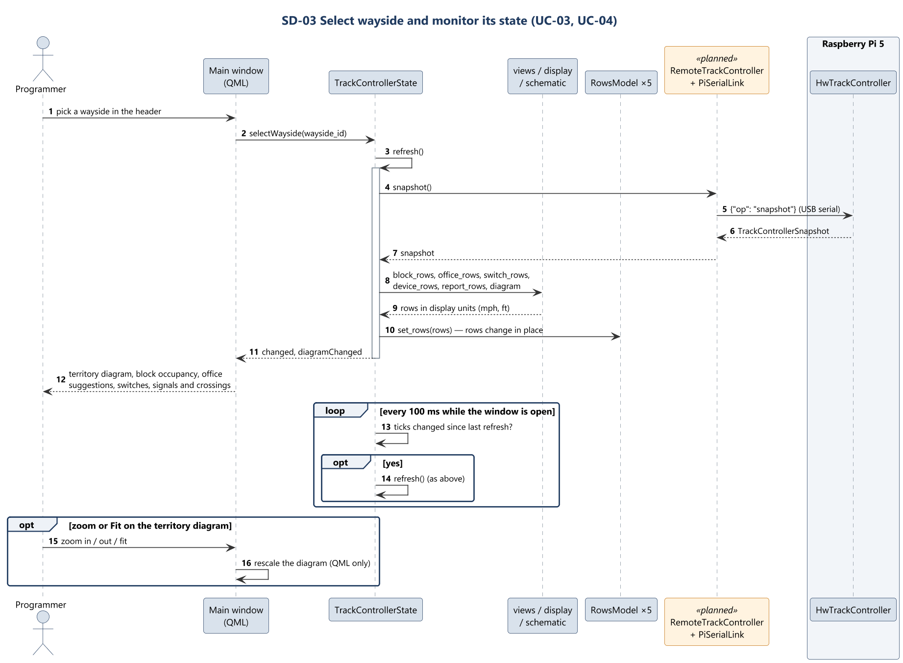
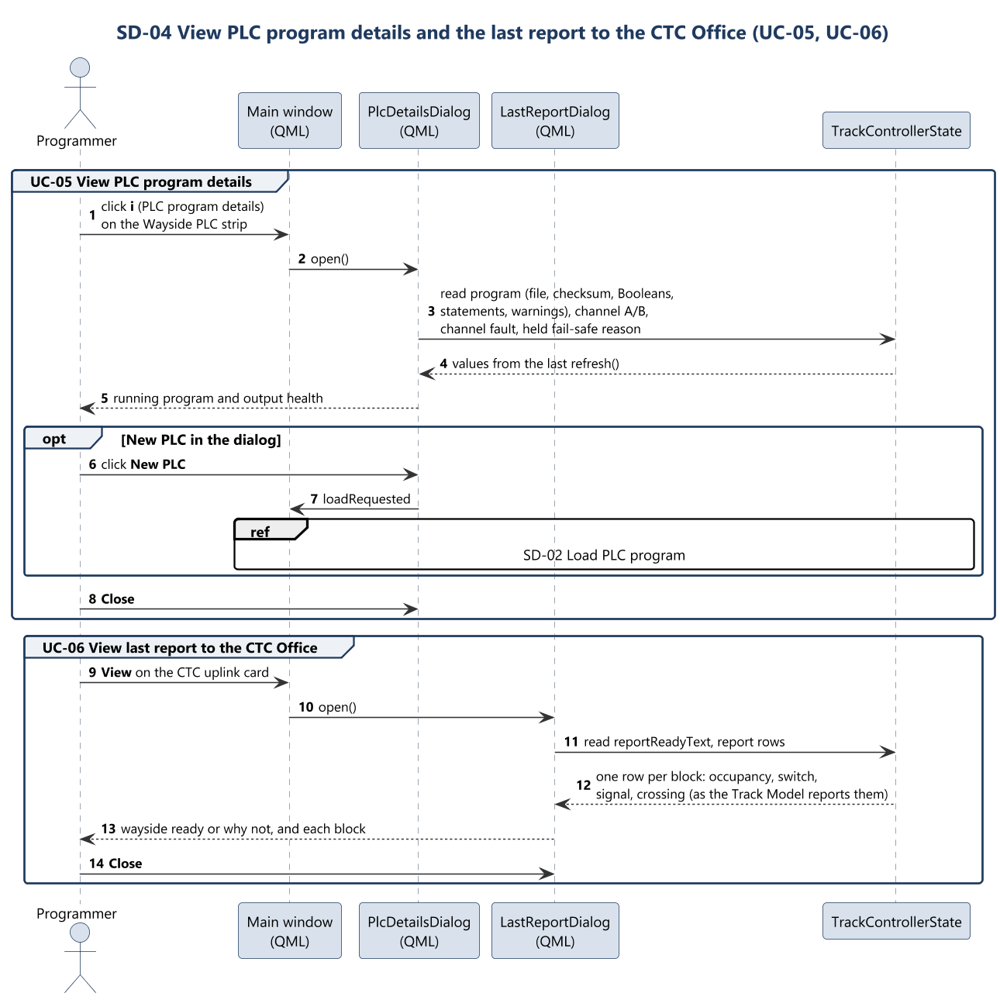
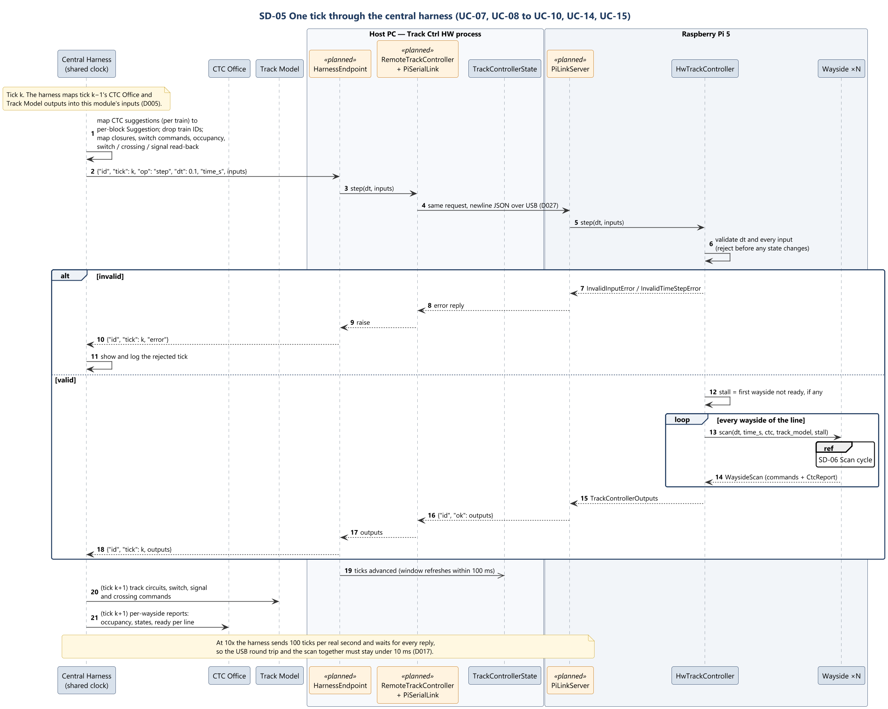
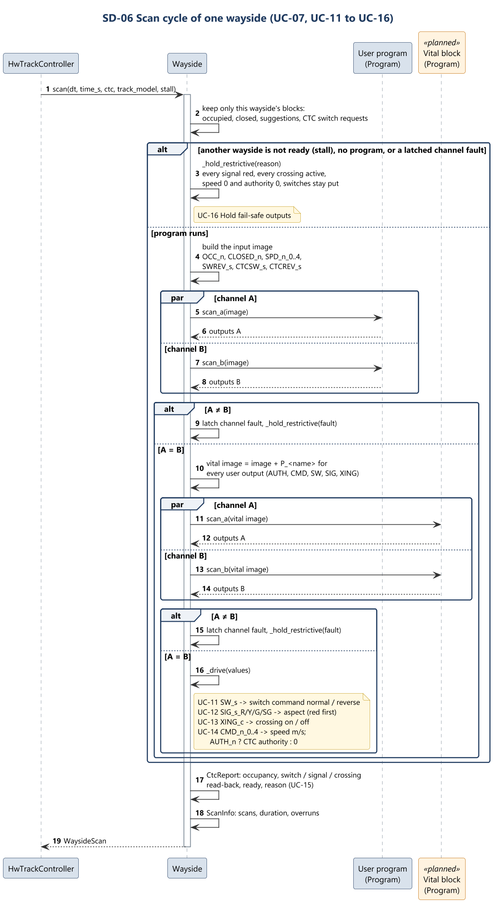
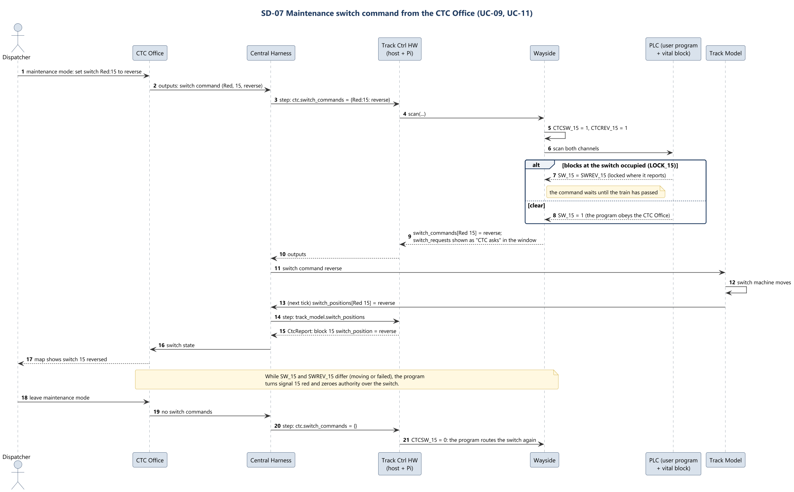
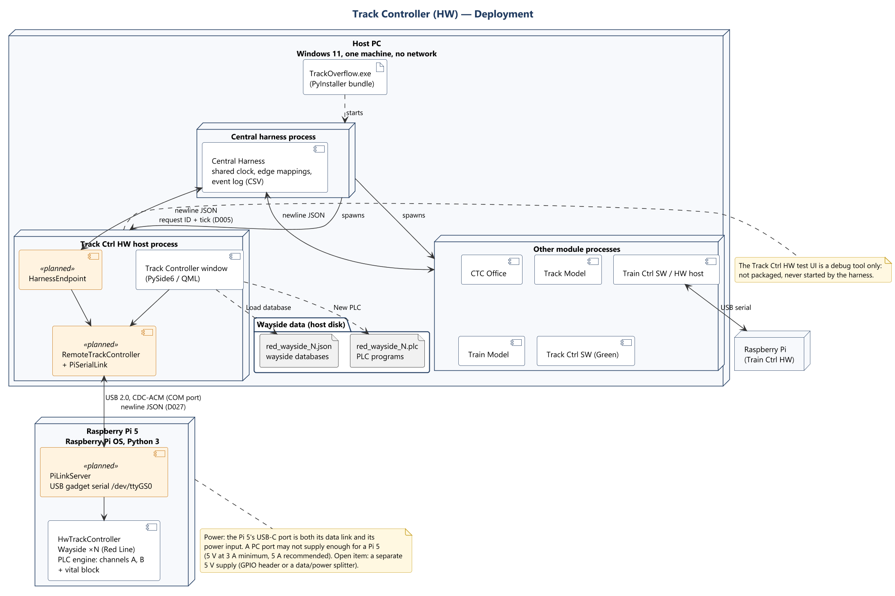

# Track Controller (HW) — Software Design

Contribution to the Software Design Description (WP2), for the hardware Track Controller.
Paste into the group SDD as needed; every figure is a PNG beside its PlantUML source in
`documents/uml/track_ctrl_hw/`.

| | |
|---|---|
| **Module** | Track Controller, hardware variant (`TrackCtrlHw/`, package `track_ctrl_hw`) |
| **Owner** | Braden |
| **Status** | Draft for WP2 and the design review, 2026-10-22 |
| **Basis** | PR #43 (`feature/TrackCtrl-Showcase-Feedback`, `49f16e6`); decisions D005, D006, D013, D017, D021, D027 on `truth` |

**Reading the figures.** Orange elements marked «planned» are designed but not built yet.
Everything else exists in PR #43. Two parts of the design are planned:

- **The split between PC and Raspberry Pi** (D021, D027). Today the whole module runs in one
  process on the PC. In the design, the core runs on the Pi and the PC keeps the window.
- **The read-only vital PLC block.** A design assumption until Harry Tye confirms it: each
  wayside runs a fixed, generated PLC block after the user's program, which can only make
  an output more restrictive.

---

## 1. Scope

The hardware Track Controller runs every wayside controller of the **Red Line**; the
software Track Controller runs the Green Line (D021). Each wayside governs a territory
loaded from a database file and runs its own Boolean PLC program. The module knows the
blocks it governs, never the trains on them: everything it exchanges is keyed by block.
A broken rail, a dead track circuit or a power failure reaches it only as an occupied
block.

---

## 2. Requirements coverage

Every Track Controller item of the functional rubric, and the SRS requirements behind it,
is covered by at least one use case (section 3).

| Rubric | Points | Requirement | SRS | Use cases |
|---|---|---|---|---|
| 6.0 | 2 | Wayside receives suggested speed and authority from the CTC | REQ-FUNC-049 | UC-08, UC-14 |
| 6.1 | 2 | Wayside moves switches by PLC program execution | REQ-FUNC-052 | UC-07, UC-11 |
| 6.2 | 1 | Wayside sets traffic light colour by PLC program execution | REQ-FUNC-053 | UC-07, UC-12 |
| 6.3 | 2 | Wayside receives train presence from the Track Model | REQ-FUNC-054 | UC-10 |
| 6.4 | 2 | Wayside sends track occupancy to the CTC | REQ-FUNC-055 | UC-15, UC-06 |
| 6.5 | 1 | Railway crossing lights and gates activated | REQ-FUNC-056 | UC-13 |
| 6.6 | 2 | PLC language based only on Boolean variables | REQ-FUNC-051 | UC-02, UC-07 |
| 6.7 | 1 | Load PLC file | REQ-FUNC-050 | UC-02 |
| 6.8 | 1 | In maintenance mode, manually set a switch position | REQ-FUNC-057, REQ-FUNC-012 | UC-09, UC-11 |
| 6.9 | 1 | Has safety-critical architecture | REQ-FUNC-058 | UC-07, UC-16 |
| — | — | Failures detected (as occupancy) | REQ-FUNC-059 | UC-10 |
| 9.0 | 5 | Each sub-system has a user interface | REQ-INTF-001.4 | UC-01 to UC-06 |
| — | — | Track layout loaded from JSON | REQ-INTF-012 | UC-01 |
| — | — | Channels to and from the CTC Office, Track Model and train | REQ-INTF-017 to 020 | UC-08, UC-10, UC-14, UC-15 |

Rubric 6.8 is met by the CTC Office's dispatcher: only the CTC Office sets a switch in
maintenance mode, and the wayside's program carries the command out (UC-09). Whether the
programmer may also set a switch by hand at the wayside is still open with the software
Track Controller (section 8).

---

## 3. Use cases

Actors:

- **Programmer** — the person at the Track Controller window. Loads databases and PLC
  programs and watches the waysides. Every interactive control of the window belongs to one
  of UC-01 to UC-06.
- **Central Harness** — owns the shared clock and steps the module once per tick (D005,
  D017). It carries everything the CTC Office and the Track Model send and receive.
- **CTC Office** and **Track Model** — the neighbouring modules, reached only through the
  harness.

### UC-01 Load wayside database

| | |
|---|---|
| **Actors** | Programmer |
| **Description** | Adds one wayside to the Track Controller, or replaces the wayside with the same ID. |
| **Data** | Wayside database (JSON): line, wayside ID, and per block the number, section, length, speed limit, switch and railway crossing. A cut of the course layout file. |
| **Stimulus** | The programmer clicks **Load database** and picks a file. |
| **Response** | The PC parses the file and sends the territory to the Pi. The wayside appears in the header's picker, selected, and the header reads **Not ready** until it has a PLC program. A replaced wayside keeps its program if the program still fits; otherwise the program is unloaded with a notice. |
| **Alternatives** | An unreadable or malformed file, a database for another line, or a block another wayside already governs: refused with a message; nothing changes. |
| **Requirements** | REQ-INTF-001.4, REQ-INTF-012, REQ-NFR-003, REQ-NFR-004 |
| **Sequence** | SD-01 |

### UC-02 Load PLC program

| | |
|---|---|
| **Actors** | Programmer |
| **Description** | Installs a PLC program on the selected wayside. |
| **Data** | PLC source text, Boolean only: `VAR_IN` and `VAR_OUT` declarations, then `NAME := expression` over `NOT`, `AND`, `XOR`, `OR`, `0`, `1` and parentheses. |
| **Stimulus** | The programmer clicks **New PLC** (on the Wayside PLC strip or in the PLC details dialog) and picks a file. |
| **Response** | The program is compiled twice, once per channel, and checked against the names this wayside provides. It runs from the next scan; until then the wayside holds its outputs fail-safe. The window shows the file name, checksum and any warnings. Once every wayside has a program, the header reads **Ready**. |
| **Alternatives** | A syntax error, or a name that is not this wayside's input or output: refused; a dialog lists every problem with its line number, and the previous program keeps running. No wayside loaded: refused. |
| **Requirements** | Rubric 6.6, 6.7; REQ-FUNC-050, REQ-FUNC-051 |
| **Sequence** | SD-02 |

### UC-03 Select wayside

| | |
|---|---|
| **Actors** | Programmer |
| **Description** | Chooses which loaded wayside the window shows. |
| **Data** | Wayside ID. |
| **Stimulus** | The programmer picks a wayside in the header. |
| **Response** | Every panel and dialog shows that wayside. |
| **Requirements** | REQ-INTF-001.4 |
| **Sequence** | SD-03 |

### UC-04 Monitor wayside state

| | |
|---|---|
| **Actors** | Programmer |
| **Description** | Shows the live state of the selected wayside, in imperial units. |
| **Data** | Territory diagram (blocks, switches with the set leg, signals, crossings); block table (section, block, length, speed limit, occupancy or closure, track-circuit speed and authority); CTC suggestions; switches (commanded, reported, CTC request, agreement); signals and crossings (commanded, reported); header (line, clock, ready, maintenance banner with closures and CTC switch commands). |
| **Stimulus** | Any tick; the window refreshes at most every 100 ms. Zoom and **Fit** on the diagram. |
| **Response** | Tables update in place; the diagram redraws. |
| **Requirements** | REQ-INTF-001.4, REQ-INTF-011; displays rubric 6.1 to 6.5 |
| **Sequence** | SD-03 |

### UC-05 View PLC program details

| | |
|---|---|
| **Actors** | Programmer |
| **Description** | Shows the running program and the health of its two channels. |
| **Data** | File, load time, checksum, Boolean and statement counts, warnings; channel A/B agreement, channel fault, why outputs are held. Planned: the vital block's checksum, shown read-only. |
| **Stimulus** | The programmer clicks **i** on the Wayside PLC strip. |
| **Response** | The PLC program details dialog opens; **New PLC** there starts UC-02. |
| **Requirements** | Rubric 6.9; REQ-FUNC-050 |
| **Sequence** | SD-04 |

### UC-06 View last report to the CTC Office

| | |
|---|---|
| **Actors** | Programmer |
| **Description** | Shows exactly what the selected wayside last sent the CTC Office. |
| **Data** | Wayside ready, or why not; per block: occupancy, switch position, signal aspect, crossing state. |
| **Stimulus** | The programmer clicks **View** on the CTC uplink strip. |
| **Response** | The Last report dialog opens. |
| **Requirements** | Rubric 6.4; REQ-FUNC-055 |
| **Sequence** | SD-04 |

### UC-07 Run scan cycle

| | |
|---|---|
| **Actors** | Central Harness (primary); CTC Office and Track Model through it |
| **Description** | Once per tick, every wayside of the line runs its PLC program against that tick's inputs and drives the result onto the track. |
| **Data** | dt (fixed, 0.1 s), simulation time, the tick's inputs (UC-08 to UC-10). |
| **Stimulus** | A `step` message from the harness. |
| **Response** | Before the next tick: track-circuit commands, switch, signal and crossing commands, and one report per wayside. Each statement runs on two independently written channels and both must agree; the vital block then runs the same way. |
| **Alternatives** | Invalid dt or input: the whole tick is rejected before anything changes, and the harness logs it. Any wayside not ready: UC-16. |
| **Requirements** | Rubric 6.1, 6.2, 6.6, 6.9; REQ-FUNC-058, REQ-INTF-013, REQ-NFR-002 |
| **Sequence** | SD-05, SD-06 |

### UC-08 Receive speed and authority suggestions

| | |
|---|---|
| **Actors** | CTC Office (through the harness) |
| **Description** | Takes the CTC Office's suggested speed and authority for each block. |
| **Data** | Per block: speed in whole m/s (0 to 31), authority in blocks (D013). |
| **Stimulus** | Every tick. |
| **Response** | The speed enters the program as five bits, `SPD_n_0..4`; the authority waits for the program's `AUTH_n`. Blocks of other lines or no wayside are ignored. |
| **Alternatives** | A negative, fractional or too-large value rejects the tick. |
| **Requirements** | Rubric 6.0; REQ-FUNC-049, REQ-INTF-019 |
| **Sequence** | SD-05 |

### UC-09 Receive closures and maintenance switch commands

| | |
|---|---|
| **Actors** | CTC Office (through the harness) |
| **Description** | Takes the blocks the dispatcher has closed and, in maintenance mode, the switch positions the dispatcher commands. |
| **Data** | Closed blocks; switch commands `{switch block: normal \| reverse}`, sent only while the dispatcher is in maintenance mode. There is no maintenance flag. |
| **Stimulus** | Every tick. |
| **Response** | `CLOSED_n`, `CTCSW_s` and `CTCREV_s` inputs to the program. The window shows each command as "CTC asks" and lists closures and commands in the maintenance banner. |
| **Requirements** | Rubric 6.8; REQ-FUNC-057, REQ-FUNC-012 |
| **Sequence** | SD-07 |

### UC-10 Receive track state

| | |
|---|---|
| **Actors** | Track Model (through the harness) |
| **Description** | Takes occupancy and the actual state of the wayside's equipment. |
| **Data** | Occupied blocks (a train or a failure, indistinguishable); switch positions; crossing states; signal aspects lit. |
| **Stimulus** | Every tick. |
| **Response** | `OCC_n` and `SWREV_s` inputs to the program; the read-back goes into the report (UC-15). A failed block is protected exactly like an occupied one. |
| **Requirements** | Rubric 6.3; REQ-FUNC-054, REQ-FUNC-059, REQ-INTF-018 |
| **Sequence** | SD-05 |

### UC-11 Command switches

| | |
|---|---|
| **Actors** | Track Model |
| **Description** | Drives each switch machine from the program's `SW_s` output. |
| **Data** | `SW_s`: 1 reverse, 0 normal. |
| **Stimulus** | Each scan (UC-07). |
| **Response** | A switch command to the Track Model. The vital block holds a switch where it reports while a train is on its blocks. |
| **Requirements** | Rubric 6.1, 6.8; REQ-FUNC-052 |
| **Sequence** | SD-06, SD-07 |

### UC-12 Set signal aspects

| | |
|---|---|
| **Actors** | Track Model |
| **Description** | Lights each signal from the program's four aspect outputs. |
| **Data** | `SIG_s_R`, `_Y`, `_G`, `_SG`. Red when `_R` is 1 or none is; otherwise the first lit of yellow, green, super green. |
| **Stimulus** | Each scan. |
| **Response** | A signal command to the Track Model. |
| **Requirements** | Rubric 6.2; REQ-FUNC-053 |
| **Sequence** | SD-06 |

### UC-13 Control railway crossings

| | |
|---|---|
| **Actors** | Track Model |
| **Description** | Activates each crossing from the program's `XING_c` output. |
| **Data** | `XING_c`: 1 lights on and gates down. |
| **Stimulus** | Each scan. |
| **Response** | A crossing command to the Track Model. |
| **Requirements** | Rubric 6.5; REQ-FUNC-056 |
| **Sequence** | SD-06 |

### UC-14 Send speed and authority on track circuits

| | |
|---|---|
| **Actors** | Track Model (delivers them to the train in the block) |
| **Description** | Sends each block that has a suggestion its commanded speed and authority. |
| **Data** | Speed from `CMD_n_0..4` in whole m/s; authority is the CTC Office's count when `AUTH_n` is 1, else 0. |
| **Stimulus** | Each scan. |
| **Response** | One track-circuit command per block with a suggestion. |
| **Requirements** | Rubric 6.0, 6.9; REQ-INTF-017, REQ-FUNC-058.1 |
| **Sequence** | SD-06 |

### UC-15 Report occupancy, state and readiness

| | |
|---|---|
| **Actors** | CTC Office (through the harness) |
| **Description** | Tells the CTC Office what each wayside sees, every tick. |
| **Data** | One report per wayside: line, wayside, time, ready and why not; per block: occupied, switch position, signal aspect, crossing state, as the Track Model reports them. |
| **Stimulus** | Each scan. |
| **Response** | The harness maps the reports into the CTC Office's inputs. The CTC Office dispatches nothing on a line until every wayside of it is ready. |
| **Requirements** | Rubric 6.4; REQ-FUNC-055, REQ-INTF-020 |
| **Sequence** | SD-05, SD-06 |

### UC-16 Hold fail-safe outputs

| | |
|---|---|
| **Actors** | Central Harness (extends UC-07) |
| **Description** | Puts a wayside's outputs in their safe state whenever no trustworthy program runs. |
| **Data** | Why: no program; a new program that has not scanned yet; channels A and B disagreed (latched until a new program is loaded); or another wayside of the line is not ready. |
| **Stimulus** | Any of those conditions at a scan. |
| **Response** | Every signal red, every crossing active, speed 0 and authority 0 on every track circuit, switches left where they are. The report says not ready and why. |
| **Requirements** | Rubric 6.9; REQ-FUNC-058 |
| **Sequence** | SD-06 |

---

## 4. Software architecture

The module is layered so that the safety-relevant part has no user interface and no Qt:

| Layer | Runs on | Parts | Responsibility |
|---|---|---|---|
| Presentation | PC | QML window and dialogs, `TrackControllerState`, `views`, `display`, `schematic` | Shows the waysides in imperial units; turns clicks into calls on the `TrackController` interface. Never decides anything. |
| Communication | PC and Pi | `HarnessEndpoint`, `RemoteTrackController`, `PiSerialLink` (PC); `PiLinkServer` (Pi); `wire` (both) | Carries harness ticks and window requests to the Pi and the replies back, as newline JSON over USB serial (D027). |
| Control | Pi | `HwTrackController`, `Wayside` | One line's waysides: input image, scan, outputs, report, ready, fail-safe hold. |
| PLC engine | Pi | `compile_program`, channel A, channel B, vital block | Compiles each statement twice, by different algorithms, and runs both every scan. |
| Contract | both | `interface.py`, `errors.py` | The `TrackController` Protocol and the boundary types. The software variant implements the same Protocol. |

Design choices:

- **One interface, three users.** The harness, the window and the test UI drive the module
  only through `TrackController` (`step`, `snapshot`, `load_territory`, `load_program`,
  `reset`). `RemoteTrackController` implements the same Protocol on the PC and forwards each
  call to the Pi, so the window and the harness endpoint do not change when the core moves.
- **The core is Qt-free.** `interface`, `controller`, `wayside`, `plc`, `territory`, `wire`
  and `errors` import no Qt, so they run on the Pi with plain Python and are unit-tested
  headlessly (74 tests).
- **Validate, then change.** `step` rejects a bad tick before any state changes; the window
  rejects a bad file before anything is sent.
- **Two channels.** Channel A parses by recursive descent and walks the tree; channel B
  parses with the shunting-yard algorithm and runs postfix code on a stack. A disagreement
  is a latched fault.

---

## 5. Class diagrams

### 5.1 Core classes (Raspberry Pi)

- `HwTrackController` holds one `Wayside` per loaded database, all on one line, and scans each
  once per `step`. While any wayside is not ready, every wayside holds fail-safe.
- `Wayside` owns its territory, the user's `Program`, and (planned) the generated vital
  `Program`. `scan` builds the input image, runs the programs on both channels, compares
  them, drives the outputs and builds the `CtcReport`.
- `Program` is immutable: a compiled program never changes while it is scanned. Each
  `Statement` carries a tree (channel A) and postfix code (channel B).
- `PiLinkServer` (planned) reads requests from the USB gadget serial port and calls the
  controller.

### 5.2 Boundary types

All are frozen dataclasses. The CTC Office names a block by `BlockRef` (line and number,
`Red:15`); the Track Model by `BlockKey` (line, section, number). A switch, its signal and a
crossing are named by the block they are listed on. Speeds are whole m/s; authorities are
block counts (D013).

### 5.3 Host-side classes (PC)

- `TrackControllerState` is the only object QML talks to. It reads a snapshot, turns it into
  rows through `views`, and pushes them into five `RowsModel`s that update in place.
- `RemoteTrackController` (planned) replaces the in-process `HwTrackController`; it owns the
  serial link to the Pi through `PiSerialLink`.
- `HarnessEndpoint` (planned) answers the harness's tick messages.

---

## 6. Sequence diagrams

| Diagram | Use cases |
|---|---|
| SD-01 Load wayside database | UC-01 |
| SD-02 Load PLC program | UC-02 |
| SD-03 Select wayside and monitor its state | UC-03, UC-04 |
| SD-04 View PLC details and the last report | UC-05, UC-06 |
| SD-05 One tick through the central harness | UC-07 to UC-10, UC-14, UC-15 |
| SD-06 Scan cycle of one wayside | UC-07, UC-11 to UC-16 |
| SD-07 Maintenance switch command | UC-09, UC-11 |

---

## 7. Deployment

- The system is one executable on one Windows PC. It starts the central harness, which
  spawns one process per module (D005).
- The Track Ctrl HW process on the PC shows the window, owns the serial port, and relays the
  harness's messages to the Pi and the replies back (D027).
- One Raspberry Pi 5, in USB device mode, runs the core for every Red Line wayside. It
  appears on the PC as a standard USB serial (COM) port, needing no driver; the PC finds it
  by its USB identity, not a fixed COM number.
- Wayside databases and PLC programs are files on the PC; the window sends their contents
  to the Pi.
- The test UI is a debugging tool. It is not packaged and the harness never starts it, so it
  is not part of the deployment.

---

## 8. Open items

| # | Item | Owner |
|---|---|---|
| 1 | The read-only vital PLC block is assumed. Harry Tye to confirm for both variants; implementation steps are recorded. | Braden, Harry |
| 2 | Whether the programmer may set a switch by hand in maintenance mode (rubric 6.8). Assumed: only the CTC Office sets a switch. The software variant has a manual switch. | Braden, Harry |
| 3 | The Red Line's wayside boundaries, and its database and program files. Every switch must lie inside one wayside. Block 9's switch string `75-yard` should be checked against the course spreadsheet. | Braden |
| 4 | The USB message framing and the Pi's identification on connect. | Kevin, Braden |
| 5 | Power for the Pi 5: its USB-C port is both data link and power input. | Braden, Kevin |
| 6 | At 10x the harness sends 100 ticks per second and waits for every reply, so the USB round trip and the scan must stay under 10 ms. To be measured on the Pi. | Braden |
| 7 | The PLC names differ between the variants (`CTCSW_n`, `CTCREV_n`, `SPD_n_b`, `CMD_n_b` here; `MAINT`, no speed bits in the software variant), so one program file does not yet load on both (REQ-INTF-009). | Braden, Harry |
| 8 | Signal aspects cross the boundary in lower case here (`super_green`); the system convention is upper case (`SUPER_GREEN`). The harness mapping or the module must convert. | Braden |
| 9 | REQ-FUNC-057 ("know when the system is in maintenance mode"): the CTC Office sends no flag, so the wayside knows only through switch commands. Wording left open. | Braden |
