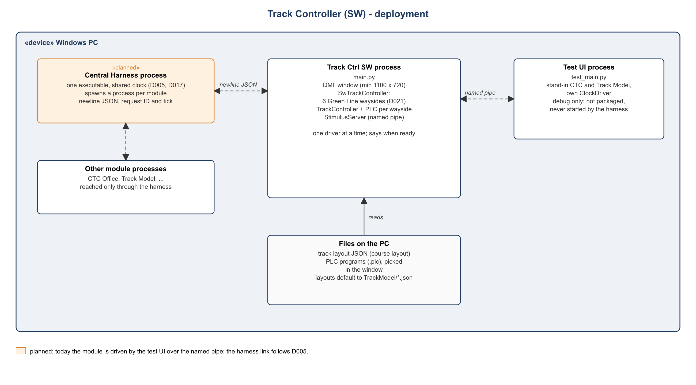

# Track Controller (SW) — Software Design

This is the software Track Controller's part of the Software Design Description (WP2).
Copy it into the group SDD as needed. Every figure is a PNG in `documents/uml/track_ctrl_sw/`,
next to the file it was drawn from:

- the use cases and classes are StarUML `.mdj` projects;
- the sequence diagrams are Mermaid `.mmd`, which StarUML imports with
  **Tools → Generate Diagram by Mermaid…**.

| | |
|---|---|
| **Module** | Track Controller, software variant (`TrackCtrlSW/`, package `track_ctrl`; test UI `track_ctrl_test`) |
| **Owner** | Harry Tye |
| **Status** | Draft for WP2 and the design review, 2026-10-21 |
| **Basis** | Branch `Track-Ctrl-SW` (`f6900f5`); decisions D005, D006, D013, D017, D021 on `truth` |

**Reading the figures.** Orange elements marked «planned» are designed but not built yet.
Everything else exists on `Track-Ctrl-SW`. One part of the design is planned:

- **The central harness link** (D005). Today the module is driven by its test UI, over a
  named pipe. In the design, the central harness spawns the module as a process and steps
  it with newline JSON. The calls behind the pipe (`step(dt, inputs)`) are the same, so
  only the endpoint is new.

---

## 1. Scope

The software Track Controller runs every wayside controller of the **Green Line**. The
hardware Track Controller runs the Red Line (D021).

- **Territory.** The Green Line is divided into six waysides. The track fixes that number;
  the user does not choose it. Each wayside governs its blocks, switches, signals and
  crossings.
- **PLC program.** Each wayside runs its own Boolean PLC program, written in the same
  language as the hardware variant.
- **Vital code.** Every program has generated vital PLC code attached after it, and only
  that code writes the outputs.
- **Keyed by block.** The module knows the blocks it governs, never the trains on them.
  Everything it exchanges is keyed by block (`BlockKey(line, block_id)`).
- **Failures.** A broken rail, a dead track circuit or a power failure reaches it only as an
  occupied block.

---

## 2. Requirements coverage

At least one use case (section 3) covers each Track Controller item of the functional
rubric and the SRS requirements behind it.

| Rubric | Points | Requirement | SRS | Use cases |
|---|---|---|---|---|
| 6.0 | 2 | Wayside receives suggested speed and authority from the CTC | REQ-FUNC-049 | UC-10, UC-16 |
| 6.1 | 2 | Wayside moves switches by PLC program execution | REQ-FUNC-052 | UC-09, UC-13 |
| 6.2 | 1 | Wayside sets traffic light colour by PLC program execution | REQ-FUNC-053 | UC-09, UC-14 |
| 6.3 | 2 | Wayside receives train presence from the Track Model | REQ-FUNC-054 | UC-12 |
| 6.4 | 2 | Wayside sends track occupancy to the CTC | REQ-FUNC-055 | UC-17, UC-07 |
| 6.5 | 1 | Railway crossing lights and gates activated | REQ-FUNC-056 | UC-15 |
| 6.6 | 2 | PLC language based only on Boolean variables | REQ-FUNC-051 | UC-04, UC-05 |
| 6.7 | 1 | Load PLC file | REQ-FUNC-050 | UC-03, UC-06 |
| 6.8 | 1 | In maintenance mode, manually set a switch position | REQ-FUNC-057, REQ-FUNC-012 | UC-08, UC-11, UC-13 |
| 6.9 | 1 | Has safety-critical architecture | REQ-FUNC-058, REQ-FUNC-058.1 | UC-05, UC-09, UC-16, UC-18 |
| — | — | Failures detected (as occupancy) | REQ-FUNC-059 | UC-12 |
| 9.0 | 5 | Each sub-system has a user interface | REQ-INTF-001.5 | UC-01 to UC-08 |
| — | — | Track layout loaded from JSON | REQ-INTF-012 | UC-01 |
| — | — | One shared clock | REQ-INTF-013 | UC-09 |
| — | — | Channels to and from the CTC Office, Track Model and train | REQ-INTF-017 to 020 | UC-10, UC-11, UC-12, UC-16, UC-17 |

Rubric 6.8 is met in two ways:

- The CTC Office's dispatcher sets a switch in maintenance mode, and the vital code carries
  the command out (UC-11, UC-13).
- While maintenance is in effect, the programmer may also set a switch by hand at the
  wayside (UC-08). The CTC Office's command takes precedence over the hand-set position.

The hardware variant has only the first (section 8, item 4).

---

## 3. Use cases

Actors:

- **Programmer** — the person at the Track Controller window. Loads the track and PLC
  programs, writes and runs programs, watches the waysides and sets switches by hand in
  maintenance mode. Every interactive control of the window belongs to one of UC-01 to
  UC-08.
- **Central Harness** — owns the shared clock and steps the module once per tick (D005,
  D017). It carries everything the CTC Office and the Track Model send and receive.
- **CTC Office** and **Track Model** — the neighbouring modules, reached only through the
  harness. The diagram gives each of them its own use cases, all included in the scan cycle
  (UC-09).

«requires» on the diagram marks a precondition. Every programmer use case after UC-02 needs
a selected wayside, and UC-02 needs a loaded track.

### UC-01 Load track layout

| | |
|---|---|
| **Actors** | Programmer |
| **Description** | Loads one line of the course layout and divides it among that line's waysides. |
| **Data** | Track layout (JSON): the line, and for each block its section, number, length, grade, speed limit, station, switch and railway crossing. A file in the shape of the course layout, for example `Track_layout/green_line.json`. |
| **Stimulus** | The programmer clicks **Load track…**, picks a file, checks the summary and clicks **Load**. |
| **Response** | The summary lists the line, block, switch and crossing counts and the number of waysides, which the track fixes (`WAYSIDE_COUNTS`, six for Green). On **Load**, the line's blocks are divided among the waysides, each wayside is created with no program, and its vital code is generated and compiled. The line and its first wayside are selected, the editor is empty and the header reads **NOT READY**. Loading a line that is already loaded replaces it and drops its programs. |
| **Alternatives** | A file that cannot be read, is not a layout, or is a single wayside's database is refused with the reason, and nothing changes. |
| **Requirements** | REQ-INTF-001.5, REQ-INTF-012, REQ-NFR-003, REQ-NFR-004 |
| **Sequence** | SD-01 |

### UC-02 Select wayside

| | |
|---|---|
| **Actors** | Programmer |
| **Description** | Chooses which wayside of a loaded line the window shows. |
| **Data** | Line name, wayside ID. |
| **Stimulus** | The programmer picks a line, then a wayside, in the header. |
| **Response** | The editor, file list, block grid and header show that wayside. The editor holds its committed program, or nothing. Uncommitted edits in the editor are discarded. |
| **Alternatives** | No track loaded: the pickers are empty. An unknown wayside leaves the selection as it was. |
| **Requirements** | REQ-INTF-001.5 |
| **Sequence** | SD-02 |

### UC-03 Load PLC program

| | |
|---|---|
| **Actors** | Programmer |
| **Description** | Reads a PLC program file into the editor of the selected wayside. |
| **Data** | PLC source text (`.plc`, UTF-8). |
| **Stimulus** | The programmer clicks **Load .plc file** and picks a file. |
| **Response** | The program appears in the editor marked **NOT COMMITTED**. Nothing reaches the wayside yet: the program must still be run (UC-05) and committed (UC-06). |
| **Alternatives** | A file that cannot be read: the terminal says so and the editor is unchanged. |
| **Requirements** | Rubric 6.7; REQ-FUNC-050 |
| **Sequence** | SD-03 |

### UC-04 Write PLC program

| | |
|---|---|
| **Actors** | Programmer |
| **Description** | Writes or edits a PLC program in the editor. |
| **Data** | The language is Boolean only, and the same as the hardware variant's. A program has `VAR_IN` and `VAR_OUT` declarations, then statements `NAME := expression` built from `NOT`, `AND`, `XOR`, `OR`, `0`, `1` and parentheses. **Inputs** per block `n`: `OCC_n`, `CLOSED_n`, `FAIL_n`. Per switch `s`: `SWREV_s`. And `MAINT`. **Outputs:** `AUTH_n`, `SW_s`, `SIG_s_R`, `SIG_s_Y`, `SIG_s_G`, `SIG_s_SG`, and per crossing `c`: `XING_c`. |
| **Stimulus** | The programmer clicks **New**, or types in the editor. |
| **Response** | The editor shows **Edited**, and **Commit** is disabled until the new text is run cleanly. |
| **Requirements** | Rubric 6.6; REQ-FUNC-051 |
| **Sequence** | SD-04 |

### UC-05 Run PLC program

| | |
|---|---|
| **Actors** | Programmer |
| **Description** | Compiles the editor's program and runs one scan of it in a sandbox, so that its effect can be checked before it is committed. |
| **Data** | The editor's text, and a copy of the selected wayside's current inputs. |
| **Stimulus** | The programmer clicks **Run**. |
| **Response** | The program is compiled and then checked against this wayside's I/O: every name must be one of its inputs or outputs, and every output must be driven. One scan then runs on the copy of the inputs. The OS decodes the inputs, the program runs, the attached vital code runs, and the OS encodes the outputs. The window shows the sandbox outputs, the log, and every output the vital code overrode. **Commit** is enabled only if the run had no diagnostic. The live outputs and the track are untouched. |
| **Alternatives** | No track loaded: refused. A syntax error, an unknown name or an undriven output: the parser pane lists each problem with its line number, and nothing runs. |
| **Requirements** | Rubric 6.6, 6.9; REQ-FUNC-051, REQ-FUNC-058 |
| **Sequence** | SD-05 |

### UC-06 Commit PLC program

| | |
|---|---|
| **Actors** | Programmer (extends UC-05, after a clean run) |
| **Description** | Installs the program that was just run on the selected wayside. |
| **Data** | The verified source and its file name. |
| **Stimulus** | The programmer clicks **Commit iteration**. |
| **Response** | The program is compiled and checked again, then installed as the next iteration. The wayside keeps its last five iterations, and any of them can be reopened from the file list. It runs from the next scan, and the editor shows **COMMITTED**. Once every wayside on the line has a program, the header's **NOT READY** clears and the line's waysides report ready (UC-17). |
| **Alternatives** | No clean run of exactly this text, or any diagnostic: refused, the terminal says why, and the previous program keeps running. |
| **Requirements** | Rubric 6.7; REQ-FUNC-050 |
| **Sequence** | SD-06 |

### UC-07 Monitor wayside state

| | |
|---|---|
| **Actors** | Programmer |
| **Description** | Shows the live state of the selected wayside, in imperial units. |
| **Data** | **Block grid:** occupancy and closure per block. **Outputs:** track-circuit speed and authority, switch, signal and crossing commands. **Also shown:** the CTC suggestions, the vital overrides, maintenance mode, the clock, and READY or NOT READY with the reason. |
| **Stimulus** | The programmer opens the **View** tab. The window refreshes after each scan, at most every 200 ms. |
| **Response** | The rows update in place. Speeds are converted from m/s to mph at the edge. This view is read-only. |
| **Requirements** | REQ-INTF-001.5, REQ-INTF-011. It displays rubric 6.1 to 6.5. |
| **Sequence** | SD-07 |

### UC-08 Hand-set switch

| | |
|---|---|
| **Actors** | Programmer |
| **Description** | In maintenance mode, sets one of the wayside's switches by hand. |
| **Data** | Switch ID; normal or reverse. |
| **Stimulus** | The programmer clicks **Set switch manually**, picks a switch and a position, or clicks **Release**. |
| **Response** | The position is held as `HAND_s` and `HANDREV_s`, which only the vital code can read; no program can declare them. Precedence is the CTC command, then the hand-set position, then the program. The position is sent to the Track Model on the next scan (UC-13). It holds until it is released or maintenance ends. |
| **Alternatives** | Not in maintenance: refused, with the reason. |
| **Requirements** | Rubric 6.8; REQ-FUNC-057 |
| **Sequence** | SD-08 |

### UC-09 Run scan cycle

| | |
|---|---|
| **Actors** | Central Harness (primary); the CTC Office and Track Model through it |
| **Description** | Once per tick, every wayside of a ready line runs its program and the attached vital code against that tick's inputs, and drives the result. |
| **Data** | `dt` (fixed, D006), the simulation time, and the tick's inputs (UC-10 to UC-12). |
| **Stimulus** | `step(dt, inputs)` from the harness. |
| **Response** | The whole tick is validated first. Maintenance is in effect while the CTC Office has a switch command in effect on a switch the module governs. Each wayside then scans: the OS decodes the inputs to bits, the user program runs, and the vital code runs and writes the `OUT_` bits. The OS encodes those bits into commands. The scan produces track-circuit, switch, signal and crossing commands (UC-13 to UC-16) and one report per wayside (UC-17), all returned before the next tick. |
| **Alternatives** | An invalid `dt` or input rejects the whole tick before anything changes. A line that is not ready triggers UC-18. |
| **Requirements** | Rubric 6.1, 6.2, 6.9; REQ-FUNC-058, REQ-INTF-013, REQ-NFR-002 |
| **Sequence** | SD-09 |

### UC-10 Receive speed and authority suggestions

| | |
|---|---|
| **Actors** | CTC Office (through the harness) |
| **Description** | Takes the CTC Office's suggested speed and authority for each block. |
| **Data** | Per block: `Suggestion(speed_mps, authority_blocks)`, both whole numbers of 0 or more (D013). The CTC Office sends `TrainSuggestion(train_id, line, block_id, suggested_speed_mps, authority_blocks)`. The harness (`ctc_edges`) keys it by block and drops the train ID. If two suggestions name one block, the more restrictive speed and authority win. |
| **Stimulus** | Every tick. |
| **Response** | Each suggestion is stored on the wayside that governs the block. The numbers never enter the user's program: it decides only `AUTH_n`, pass or stop (UC-16). The speed reaches only the vital code. A block with no suggestion gets no track-circuit command. |
| **Alternatives** | A negative or fractional value rejects the tick. Blocks no wayside governs are ignored. |
| **Requirements** | Rubric 6.0; REQ-FUNC-049, REQ-INTF-019 |
| **Sequence** | SD-10 |

### UC-11 Receive closures and switch commands

| | |
|---|---|
| **Actors** | CTC Office (through the harness) |
| **Description** | Takes the blocks the dispatcher has closed and, in maintenance mode, the switch positions the dispatcher commands. |
| **Data** | Closed blocks, and switch commands `{switch block: normal or reverse}`. The CTC Office sends switch commands only in maintenance mode, and sends no maintenance flag. |
| **Stimulus** | Every tick. |
| **Response** | The program receives `CLOSED_n` and `MAINT`. Only the vital code can read `CTCCMD_s` and `CTCREV_s`. A closed block gets no authority, and a commanded switch follows the command. Ending maintenance releases every hand-set switch and CTC command. |
| **Requirements** | Rubric 6.8; REQ-FUNC-057, REQ-FUNC-012 |
| **Sequence** | SD-11 |

### UC-12 Receive track state

| | |
|---|---|
| **Actors** | Track Model (through the harness) |
| **Description** | Takes occupancy and the actual state of the waysides' equipment. |
| **Data** | Occupied blocks (a train and a failure look the same), switch positions, crossing states and signal aspects lit. |
| **Stimulus** | Every tick. |
| **Response** | The program receives `OCC_n` and `SWREV_s`, and the read-back goes into the report (UC-17). A failed block is protected exactly like an occupied one. `FAIL_n` is always 0, because the Track Model reports failures as occupancy. |
| **Requirements** | Rubric 6.3; REQ-FUNC-054, REQ-FUNC-059, REQ-INTF-018 |
| **Sequence** | SD-12 |

### UC-13 Command switches

| | |
|---|---|
| **Actors** | Track Model |
| **Description** | Drives each switch machine from `OUT_SW_s`. |
| **Data** | `SW_s` from the program; `OUT_SW_s`, where 1 is reverse and 0 is normal. |
| **Stimulus** | Each scan (UC-09). |
| **Response** | The vital code picks the request: the CTC command, else the hand-set position, else the program. It keeps a switch on an occupied block where it actually is. While a switch moves, its block's `OUT_AUTH_n` is 0. The scan sends a switch command to the Track Model. |
| **Requirements** | Rubric 6.1, 6.8; REQ-FUNC-052 |
| **Sequence** | SD-13 |

### UC-14 Set signal aspects

| | |
|---|---|
| **Actors** | Track Model |
| **Description** | Lights each signal from the program's four aspect outputs. |
| **Data** | `SIG_s_R`, `_Y`, `_G`, `_SG`. |
| **Stimulus** | Each scan. |
| **Response** | The vital code passes the program's aspect only if exactly one aspect is lit and the block is clear and open. Otherwise the signal shows red. A yellow signal sets `OUT_HALF_n`, which halves its block's speed. The scan sends a signal command to the Track Model. |
| **Requirements** | Rubric 6.2; REQ-FUNC-053 |
| **Sequence** | SD-14 |

### UC-15 Control railway crossings

| | |
|---|---|
| **Actors** | Track Model |
| **Description** | Activates each crossing from `OUT_XING_c`. |
| **Data** | `XING_c` from the program; the occupancy of the approach blocks. |
| **Stimulus** | Each scan. |
| **Response** | `OUT_XING_c` is `XING_c` OR a train on the approach. When it is 1, the lights are on and the gates down. The scan sends a crossing command to the Track Model. |
| **Requirements** | Rubric 6.5; REQ-FUNC-056 |
| **Sequence** | SD-15 |

### UC-16 Send speed and authority on track circuits

| | |
|---|---|
| **Actors** | Track Model (delivers them to the train in the block) |
| **Description** | Sends each block that has a suggestion its commanded speed and authority. |
| **Data** | `OUT_AUTH_n = AUTH_n AND NOT CLOSED_n AND NOT (its switch moving)`; `OUT_HALF_n`. |
| **Stimulus** | Each scan. |
| **Response** | Each block with a suggestion gets one track-circuit command: the suggestion when `OUT_AUTH_n` is 1, with its speed first clamped by the vital code to the block's posted limit (`OUT_SPD_n_b`, from the vital-only inputs `SUGSPD_n_b`) and halved if `OUT_HALF_n` is set, else speed 0 and authority 0. The CTC Office gives zero speed for zero authority. |
| **Requirements** | Rubric 6.0, 6.9; REQ-INTF-017, REQ-FUNC-058.1 |
| **Sequence** | SD-16 |

### UC-17 Report occupancy, read-back and readiness

| | |
|---|---|
| **Actors** | CTC Office (through the harness) |
| **Description** | Tells the CTC Office what each wayside sees, every tick. |
| **Data** | One `CtcReport` per wayside: wayside, line, time, ready, and the reason if not. Per block: occupied, and the Track Model's own switch, crossing and signal read-back. No failures, no trains. |
| **Stimulus** | Each scan. |
| **Response** | The harness passes the reports to the CTC Office. The CTC Office dispatches nothing on a line until every wayside on it is ready. |
| **Requirements** | Rubric 6.4; REQ-FUNC-055, REQ-INTF-020 |
| **Sequence** | SD-17 |

### UC-18 Transmit nothing while not ready

| | |
|---|---|
| **Actors** | Central Harness (extends UC-09) |
| **Description** | A line where any wayside has no program runs nothing and transmits nothing. |
| **Data** | Why: no track loaded, or a wayside on the line has no PLC program. |
| **Stimulus** | Either condition at a scan. |
| **Response** | Every wayside of that line idles. It sends no switch, signal or track-circuit command: those outputs are absent, not safe defaults, because a wayside running no program cannot drive anything. Its crossings are the exception: their default state is armed, so they are commanded active (lights on, gates down). The reports say not ready and why, the window shows **NOT READY** with the reason, and the CTC Office holds the line. Another, ready line is not held. |
| **Requirements** | Rubric 6.9; REQ-FUNC-058 |
| **Sequence** | SD-18 |

---

## 4. Software architecture

The module is layered so that the safety-relevant part has no user interface and no Qt:

| Layer | Parts | Responsibility |
|---|---|---|
| Presentation | QML window (`ui/`), `TrackControllerState`, `models`, `display`, `theme` | Shows the waysides in imperial units, and turns clicks into calls on the module. Never decides anything. |
| Test link | `link` (`StimulusServer`), `stimulus`, `wire` | Lets the test UI step the module and drive the window's actions over a named pipe, as newline JSON. |
| Control | `SwTrackController`, `TrackController` | One line's waysides: input image, scan, outputs, report, readiness per line. In each wayside the OS only decodes inputs to bits and encodes bits to commands. |
| PLC engine | `plc` (`compile_program`, `Program`), `vital` | Compiles and scans Boolean programs. Generates each wayside's vital code, which is attached after the user program. |
| Contract and layout | `interface`, `errors`, `layout` | The `TrackController` Protocol and the boundary types; the track JSON parser. |
| Harness edge | `common/harness/ctc_edges` | Maps the CTC Office's `TrainSuggestion` and switch commands to `CtcInputs`. |

Design choices:

- **The PLC makes every decision.** The OS (`build_scan_inputs`, `encode_outputs`) decides
  nothing. The user program runs first. The vital code then runs: it is generated for each
  wayside from its territory, it is plain PLC code, and it can only make an output more
  restrictive. Only the vital code's `OUT_` bits leave the wayside. A wrong program
  therefore stops the railway; it cannot cause a collision.
- **One interface, three users.** The harness, the window and the test UI drive the module
  only through `step`, `snapshot`, `load_program` and `reset`, plus the window's track
  load. The window owns the one `SwTrackController`, and the test link steps that same
  object, so what the window shows is what was sent.
- **The core is Qt-free.** `interface`, `module`, `controller`, `plc`, `vital`, `layout`,
  `wire`, `stimulus`, `display` and `errors` import no Qt, and are unit-tested headlessly
  (218 tests at `2d3dd86`, 207 passing; see the test plan, section 7).
- **Validate, then change.** `step` rejects a bad tick before any state changes. The window
  rejects a bad file or program before anything changes.
- **Run before commit.** A program reaches a wayside only after a clean sandbox run of
  exactly that text, and it is checked again at commit.
- **No safe defaults, except crossings.** A wayside with no program transmits nothing but armed crossings, and its line reports
  not ready.

---

## 5. Class diagrams

All four diagrams are in one StarUML project, `track_ctrl_sw_classes.mdj`.

### 5.1 Core classes

- **`SwTrackController`** holds one `TrackController` per wayside of every loaded line, and
  scans each once per `step`. While any wayside of a line has no program, every wayside of
  that line idles.
- **`TrackController`** is one wayside, and the one object for all of it. A class that only
  held data does not get its own type: the wayside carries its input card (`occupancy`,
  `closed`, `suggestions`, `trains`, `switch_reverse`, `maintenance`, `ctc_switch_commands`)
  and the result of its last scan (`track_circuits`, `switch_commands`, `aspects`,
  `crossing_commands`, `overrides`, `warnings`, `log`) as its own attributes.
  - It owns its territory (`ControllerConfig`, `Block`s), the user's `Program`, and the
    compiled vital `Program`.
  - `scan` decodes the inputs, runs both programs and encodes the `OUT_` bits into its
    output attributes.
  - `trial` is the sandbox of UC-05: it returns a copy of the wayside, with the candidate
    program scanned once on it. The live wayside is untouched.
  - `commit` installs a program as the next numbered iteration, keeping the last five.
- **`Program`** is immutable: a compiled program never changes while it is scanned.
  `diagnostics` lists any problems; any diagnostic blocks a commit. A committed program is
  stamped with its iteration `number`, `file_name` and `committed_at`, so the history is a
  list of programs.

### 5.2 Track layout

- `layout.parse_layout` reads the course layout into a `LineLayout` with no waysides yet.
- `LineLayout.divide` divides its blocks among the fixed number of waysides
  (`WAYSIDE_COUNTS`) into `ControllerConfig`s, so that every switch lies inside one wayside.
- A switch, its signal and a crossing are each named by the block they stand on, so
  `ControllerConfig` holds them as ids (a switch maps to its point and two legs) and names
  their PLC outputs itself (`switch_output`, `aspect_outputs`, `crossing_output`). They have
  no classes of their own.

### 5.3 Boundary types

- All the boundary types are frozen dataclasses.
- Every block is named by `BlockKey(line, block_id)`. A switch, its signal and a crossing are
  named by the block they sit on.
- Speeds are whole m/s; authorities are block counts (D013).
- `TrackControllerOutputs.ready` is derived from the per-wayside `CtcReport`s.

### 5.4 Host-side classes

- **`TrackControllerState`** is the only object QML talks to. It owns the `SwTrackController`,
  holds the editor buffer and its last clean run, and pushes rows into `BlockListModel`,
  which updates in place.
- **`StimulusServer`** accepts one test client at a time on a named pipe. It runs `step`,
  `user` (a window action), `clock` and `hello` messages against `TrackControllerState`.
- **`TestClientState`** runs in the test UI process.
  - Its `StandInWorld` plays the CTC Office and the Track Model, moving simple `Train`s
    block by block.
  - Its `ClockDriver` plays the shared clock.

---

## 6. Sequence diagrams

There is one sequence diagram per use case.

| Diagram | Use case |
|---|---|
| SD-01 Load track layout | UC-01 |
| SD-02 Select wayside | UC-02 |
| SD-03 Load PLC program | UC-03 |
| SD-04 Write PLC program | UC-04 |
| SD-05 Run PLC program | UC-05 |
| SD-06 Commit PLC program | UC-06 |
| SD-07 Monitor wayside state | UC-07 |
| SD-08 Hand-set switch | UC-08 |
| SD-09 Run scan cycle | UC-09 |
| SD-10 Receive speed and authority suggestions | UC-10 |
| SD-11 Receive closures and switch commands | UC-11 |
| SD-12 Receive track state | UC-12 |
| SD-13 Command switches | UC-13 |
| SD-14 Set signal aspects | UC-14 |
| SD-15 Control railway crossings | UC-15 |
| SD-16 Send speed and authority on track circuits | UC-16 |
| SD-17 Report occupancy, read-back and readiness | UC-17 |
| SD-18 Transmit nothing while not ready | UC-18 |

---

## 7. Deployment

Startup, numbered as in the figure:

1. The user runs `TrackOverflow.exe`, the single executable on the one Windows PC. It
   starts the central harness process.
2. The harness spawns one process per module (D005), the Track Ctrl SW host process among
   them.
3. The harness talks to each process in newline JSON with a request ID and a tick number.
   Each module reports when it is ready, and the harness then runs the shared clock (D017).
4. In the Track Ctrl SW window, the programmer loads the Green Line and commits a PLC
   program to each of its six waysides. Until then the line reports NOT READY and
   transmits nothing (UC-18).
5. Every tick, the harness sends `step(dt, inputs)` through the «planned»
   `HarnessEndpoint` and waits for the outputs.

- The Track Ctrl SW host process (`main.py`) shows the window and runs every Green Line
  wayside in the same process. There is no separate hardware.
- The track layout and the PLC programs are files on the PC, picked in the window. Layouts
  default to the `Track_layout/` folder.
- The test UI (`test_main.py`) is a debugging tool.
  - It plays the clock, the CTC Office and the Track Model, and connects over a named pipe.
  - It is not packaged and the harness never starts it, so it is not part of the deployment.
  - Only one driver, the harness or the test UI, may step the module at a time.

---

## 8. Open items

| # | Item | Owner |
|---|---|---|
| 1 | D021 gives the software variant the Green Line only, but the module and window still load any line, Red included (`WAYSIDE_COUNTS` has Red: 5). Decide whether to refuse other lines. | Harry |
| 2 | The harness endpoint of D005 is not built. It needs the process protocol (newline JSON with a request ID and a tick number), a single driver, and a ready message. Today `StimulusServer` accepts `step` with an ID only. | Harry |
| 3 | The PLC names differ between the variants, so one program file does not yet load on both (REQ-INTF-009). HW has moved to `CTCSW_s`, `CTCREV_s`, `SPD_n_b` and `CMD_n_b`, with no `FAIL_n` or `MAINT`. The software variant uses the earlier HW names (`FAIL_n`, `SWREV_s`, `MAINT`; restored 2026-10-22), has no speed bits, and so no longer matches HW's current files. One language has to be agreed. | Braden, Harry |
| 4 | Hand-set switch (rubric 6.8). The software variant lets the programmer set a switch in maintenance mode (UC-08); the hardware variant assumes only the CTC Office does. Agree one behaviour. | Braden, Harry |
| 5 | Vital code. In the software variant every program has generated vital PLC code attached after it, and only that code writes the outputs. This answers HW open item 1 for the software side. The vital rules and `OUT_` names should be agreed for both variants. | Harry, Braden |
| 6 | The Protocols differ: HW has `load_territory` and SW loads a whole line through the window (`load_track`). REQ-INTF-009 asks for equivalent external interfaces. | Harry, Braden |
| 7 | `FAIL_n` is always 0, because the Track Model reports failures as occupancy. It is kept so that programs match HW. Check that REQ-FUNC-059 is satisfied by protecting failures as occupancy. | Harry |
| 8 | REQ-FUNC-057 ("know when the system is in maintenance mode"). The CTC Office sends no flag; maintenance is inferred from a CTC switch command being in effect. The wording is left open. | Harry, CTC owner |
| 9 | The posted-limit clamp is now vital PLC code (2026-10-28), so the track controller clamps a suggestion that is over the limit. Zero speed for zero authority still belongs to the CTC Office. The CTC owner to confirm. | CTC owner |
| 10 | REQ-INTF-011 asks for 720 x 450, but the window's minimum size is 1100 x 720. | Harry |
| 11 | Stale text in the code. `plc.py` cites REQ-FUNC-066 (the Boolean-only requirement is REQ-FUNC-051). The `interface.py` docstrings still say a not-ready wayside drives fail-safe outputs; it transmits nothing. | Harry |
| 12 | Two proposals in `truth/_inbox/Track-Ctrl-SW/` are superseded: `20261008-1740-vital-restrictions.md` and `20261014-0950-track-controller-vital-restrictions.md`. They should be denied at promotion. | Harry (human promotion) |
| 13 | The old `track_controller_class_diagram*` files in `documents/uml/track_ctrl_sw/` predate the boundary types and are superseded by `class_*.png`. Remove them or keep them as history. | Harry |
| 14 | «requires» on the use case diagram is not a standard UML stereotype; it marks a precondition. Keep it or replace it with notes. | Harry |
