# Software Design Description
## For the Railway Simulation Project

Version: 1.0  
Prepared by: Deni Ephraim  
Organization: ECE 1140,  Track Overflow  
Date Modified: 2026-10-22

Module described in detail in this revision: **Track Model**

## Table of Contents

- [1. Introduction](#1-introduction)
  - [1.1 Document Purpose](#11-document-purpose)
  - [1.2 Subject Scope](#12-subject-scope)
  - [1.3 Definitions, Acronyms, and Abbreviations](#13-definitions-acronyms-and-abbreviations)
  - [1.4 References](#14-references)
  - [1.5 Document Overview](#15-document-overview)
- [2. Design Overview](#2-design-overview)
  - [2.1 Stakeholder Concerns](#21-stakeholder-concerns)
  - [2.2 Selected Viewpoints](#22-selected-viewpoints)
- [3. Design Views](#3-design-views)
  - [001-context — System Context](#001-context--system-context)
  - [002-composition — Module Composition](#002-composition--module-composition)
  - [003-logical — Shared Boundary Types](#003-logical--shared-boundary-types)
  - [004-interface — Module Interface Contracts](#004-interface--module-interface-contracts)
  - [005-interaction — Representative Interaction: Movement Authority Request](#005-interaction--representative-interaction-movement-authority-request)
- [4. Decisions](#4-decisions)
  - [4.1 Interface Contract Mechanism](#41-interface-contract-mechanism)
  - [4.2 Shared Boundary Data Types](#42-shared-boundary-data-types)
  - [4.3 Contract Enforcement in CI](#43-contract-enforcement-in-ci)
  - [4.4 Stub-First Development](#44-stub-first-development)
  - [4.5 Contracts Package Ownership](#45-contracts-package-ownership)
  - [4.6 External Input Validation](#46-external-input-validation)
  - [4.7 Knowledge Capture and Decision Logging](#47-knowledge-capture-and-decision-logging)
- [5. Appendixes](#5-appendixes)

## Revision History

| Name | Date | Reason For Changes | Version |
|------|------|---------------------|---------|
| [Your name] | 2026-10-22 | First complete draft for Work Package 2: Track Model design, system-wide concepts and UML diagrams, written from the current implementation. | 1.0 |

---

## 1. Introduction

### 1.1 Document Purpose

This document describes the design of the Railway Simulation, with the Track Model module worked out in detail. It follows IEEE 1016 viewpoints. It is written for the project group and the owners of the other four modules. Section 3 gives the design views; the appendixes add the key system-wide concepts and the UML diagrams that support them.

### 1.2 Subject Scope

The system being designed is the Railway Simulation, Version 1.0. The system is split into five modules. The Track controller and the Train controller each have a software and a hardware variant:

- CTC office (centralized traffic control)
- Track controller
- Track model
- Train model
- Train controller

In scope:

- The shared boundary between the five modules: the central harness, the boundary types and the interface contracts (Section 3).
- The full design of the Track Model: composition, classes, interfaces, interactions, data, algorithms, state, user interface and test interface.
- System-wide concepts: route, authority, wayside controller distribution, wayside language, timing and vitality (Appendix A).
- UML diagrams: use case, class, sequence, state machine and deployment (Appendixes B to F).

Out of scope:

- The internal design of the CTC office, Track controller, Train model and Train controller.
- The Blue Line, which is not part of the final product (D023).
- The Software Requirements Specification, source code and test cases.

### 1.3 Definitions, Acronyms, and Abbreviations

| Term | Definition |
|-------------|----------------------------------------------|
| Authority | The number of blocks a train may still enter beyond its current block. 0 means stop before leaving the current block. |
| Beacon | Station data (station name, platform side, underground flag) broadcast near a station. |
| Block | The smallest unit of track, named by a string such as `GREEN D-13`. At most one train occupies it. |
| Commanded speed | The speed, in whole m/s, that the Track Controller sends to the track circuit of a block. |
| CTC | Centralized Traffic Control — the module that issues movement authority / routing decisions across the track network. |
| Edge | The connection from one module to another. The harness has one pure mapping function for each edge. |
| Fail-safe | A fault drives the system to its most restrictive state. |
| Harness | The central harness: the one process that drives every module, owns the shared clock and maps every edge. |
| Line | A complete track layout, Green or Red. |
| Murphy | The tester persona who injects failures into the simulation. |
| Offset | The distance, in metres, that a train has moved into its current block, as the Train Model reports it. |
| PLC | Programmable logic controller. The wayside controller runs a Boolean PLC program. |
| Protocol | A `typing.Protocol` — a Python structural interface type, used here to define the Track Model contract. |
| Route | The ordered list of blocks, with the switch positions needed, that a train follows from its origin to its destination. |
| Section | A lettered group of blocks, named like `GREEN D`. Heaters and track temperature are per section. |
| Signal aspect | The colour a wayside signal light shows: `RED`, `YELLOW`, `GREEN` or `SUPER_GREEN`. |
| Tick | One simulation step. Its length, dt, is fixed at 0.1 s. |
| Track circuit | The electrical circuit of one block. It detects a train and carries the commanded speed and authority to it. |
| Vital | Safety-critical: must be correct and must fail to a safe state. |
| Wayside | The wayside (Track) controller, which runs the PLC program and controls switches, signals and crossings. |

### 1.4 References

| Reference | Owner / Location |
|-----------------------------------------|------------------|
| IEEE Std 1016-2009, Systems Design — Software Design Descriptions | IEEE |
| Software Requirements Specification, version 1.0 (REQ-... identifiers) | Project group |
| System Architecture and Interface Dictionary (Work Package 1) | Project group |
| Coding Standards (Group) | Project group |
| Source of truth: decisions (D-numbers), signals and conventions on the `truth` branch | Project group |
| Track Model README and code overview (`TrackModel/README.md`, `TrackModel/knowledge/CODE_OVERVIEW.md`) | Project group |
| ECE 1140 Deliverable Descriptions v5 | Course |
| Track layout files `green_line.json`, `red_line.json` | Course |

### 1.5 Document Overview

Section 2 lists the stakeholder concerns and the viewpoints chosen. Section 3 holds the five design views: system context, module composition, shared boundary types, module interface contracts and one representative interaction. Section 4 records the design decisions. Section 5 holds the appendixes:

- A. Key system-wide design concepts (route, authority, wayside distribution, wayside language, timing, vitality)
- B. Use case diagram and use case descriptions
- C. Track Model detailed design (software architecture, class diagrams, data, algorithms, user interface, test interface)
- D. Sequence diagrams
- E. State machine diagram
- F. Deployment diagram
- G. Interface dictionary
- H. Requirements traceability

---

## 2. Design Overview

This section says who the design is for and which IEEE 1016 viewpoints present it. The design itself is in Section 3.

### 2.1 Stakeholder Concerns

| Stakeholder | Concern | Addressed By |
|--------------|-----------------------------|----------------|
| Track Model developer | Build and test the module alone, before the other modules are integrated. | 004-interface; D005; Appendix C.6 |
| Owners of CTC, Track controller, Train model, Train controller | Stable boundary types, with one place (the harness edge function) where types and units are matched. | 003-logical; 004-interface; D005; D002 |
| Dispatcher | Correct block occupancy and device state, and ticket sales, reaching the CTC Office. | 005-interaction; Appendix B (UC-4, UC-11) |
| Track Builder | Load a line and inspect its properties. | Appendix B (UC-1, UC-2) |
| Murphy | Inject failures and set the temperature to test the system. | Appendix B (UC-12, UC-14); Appendix E |
| Passenger | Wait for and board a train at a station. | Appendix B (UC-10) |

### 2.2 Selected Viewpoints

This project uses five viewpoints; the rest are omitted rather than carried as empty placeholders.

**2.2.1 Context — used**

The five modules, their users and the information between them.

**2.2.2 Composition — used**

How the system divides into independently owned modules driven by one central harness.

**2.2.3 Logical — used**

The boundary types of the Track Model: what goes in and what comes out.

**2.2.6 Interface — used**

The `TrackModel` Protocol and the harness edge functions that connect it to the other modules.

**2.2.7 Interaction — used**

One representative interaction, the movement authority request. More are in Appendix D.

**Omitted viewpoints**

Physical, Structure, Dependency, Information, Algorithm, State Dynamics, Concurrency, Patterns, Deployment, and Resources.

---

## 3. Design Views

### 001-context — System Context
- **Viewpoint:** Context
- **Representation:**

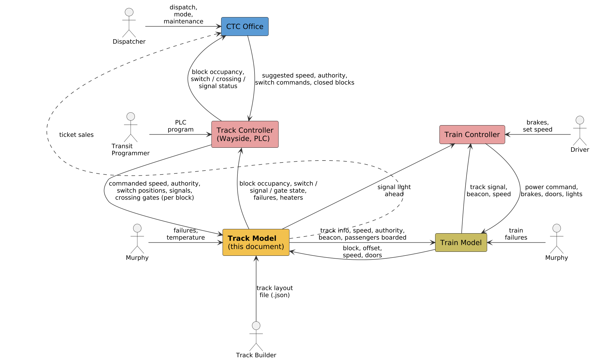

  Signals pass down from the CTC office to the train and status passes back up the same path. The Track Model sits between the Track controller and the Train model. It also sends the signal light ahead straight to the Train controller, and ticket sales straight to the CTC office. In the running system every connection passes through the central harness (D005). The inputs and outputs of the Track Model are listed in Appendix G.

### 002-composition — Module Composition
- **Viewpoint:** Composition
- **Representation:**

  Five modules, each independently owned and run alone from its own test UI:
  - CTC office — plans routes from dispatcher requests, suggests speed and authority per block, shows the map and throughput.
  - Track controller — vital wayside controllers that run a Boolean PLC program and a vital supervisor, set switches, signals and crossing gates, and report occupancy upward. Software variant (Green Line) and hardware variant (Red Line).
  - Track model — simulates the physical track: layout, train position, occupancy, track circuits, beacons, stations and passengers, environment and failures. Detailed in this SDD.
  - Train model — simulates the physics of each train and reports its block and offset.
  - Train controller — regulates speed, applies the brakes and runs doors and lights. Software variant and hardware variant.

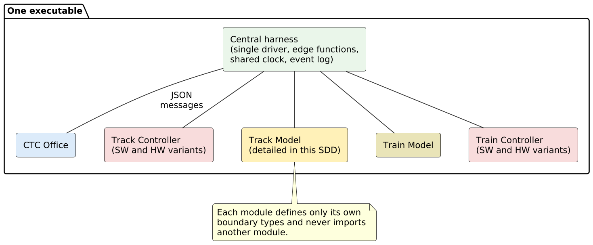

- **More Information:**

  The harness is one process. It starts a separate process for each module, drives every module once per tick, owns the shared simulation clock and writes the event log (D005, D017). A module defines only its own boundary types and never imports another module. Inside the Track Model the code has a window, a module core, and test scaffolding that is removed at integration; see Appendix C.1.

### 003-logical — Shared Boundary Types
- **Viewpoint:** Logical
- **Representation:**


- **More Information:**

  Every type is a frozen dataclass or an enumeration, so a value cannot change after it is sent. Every value is in its backend unit: metres, m/s, degrees and degrees Celsius (D002). Every ID is a string: a block is `GREEN D-13`, a section is `GREEN D`. A switch is keyed by the block of its point, a signal by the block it stands on, a crossing by its block. Commanded speed and authority are per block, never per train, because the Track Controller knows which blocks are occupied, not which train is in them. Speed is a whole number of m/s and authority is a whole number of blocks (D013). The fields are described in Appendix G.

### 004-interface — Module Interface Contracts
- **Viewpoint:** Interface
- **Representation:**


- **More Information:**

  The whole interface for the other modules is one call, `step(dt, inputs)`, which returns the outputs. The harness calls it once per tick. The other methods serve the Track Model window (`snapshot`, `set_block_failure`, `set_ambient_temp`, `load_layout_file`) or the test UI (`edit_block`, `reset`). The module does not know that a test UI exists.

  The harness owns one pure function for each connection:

| Edge | Function (`common/harness/track_model_edges.py`) |
|---------------------------|--------------------------------|
| Track Controller → Track Model | `track_controller_to_track_model` |
| Train Model → Track Model | `train_model_to_track_model` |
| Track Model → Track Controller | `track_model_to_track_controller` |
| Track Model → Train Model | `track_model_to_train_model` |
| Track Model → Train Controller | `track_model_to_train_controller` |
| Track Model → CTC Office | `track_model_to_ctc_office` |

  The CTC office reads occupancy and device state through the Track controller. Ticket sales go to the CTC office directly.

### 005-interaction — Representative Interaction: Movement Authority Request
- **Viewpoint:** Interaction
- **Representation:**

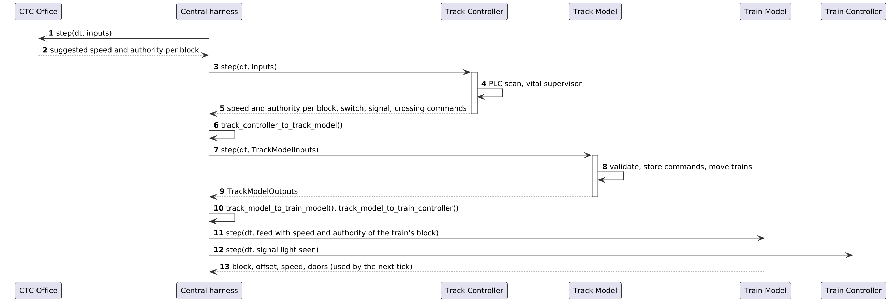

  The CTC suggests a speed and authority for each block. The Track controller runs its PLC program and its vital supervisor, which can only make an output more restrictive, and sends a speed and an authority to the track circuit of each block, with its switch, signal and crossing commands. The harness maps them to the Track Model's inputs. The Track Model checks the whole tick before changing anything, stores the values for each block, places the trains from their reports, and builds a feed for each train. The train receives the speed and authority of the block it is in; a block that was never commanded, or whose circuit has failed, carries 0 and 0. The harness passes the feed to the Train model, and the light the train saw on entering a signal block to the Train controller. The full dispatch scenario is SD-16 in Appendix D.

---

## 4. Decisions

### 4.1 Interface Contract Mechanism

- **ID:** D005 — A central harness sits between the modules
- **Context:** Each module needs types for the data it exchanges with others. If each module imported the others' structures, every pair of modules would be coupled and one field change would break the neighbours.
- **Options:**
  - Each module defines only its own boundary types; the harness owns one pure mapping function per producer-to-consumer edge.
  - A shared catalog of types (`common/interfaces.py`) that every module imports. It is now stale and not treated as true (D008).
  - Modules call each other directly.
- **Outcome:** The first option. The harness is one process that starts a process for each module and is every module's single driver. They exchange newline-delimited JSON messages, each carrying a request ID and the tick number. The Track Model's contract is the `TrackModel` Protocol in `track_model/interface.py`.

### 4.2 Shared Boundary Data Types

- **ID:** D002, D013 — Backend units are SI; authority is a block count
- **Context:** Values that cross a boundary must mean the same thing to every module, including their units.
- **Options:**
  - SI units for everything stored or sent, with conversion to imperial units only in the display layer.
  - Mixed units chosen by each module.
- **Outcome:** The first option. Backend: m, m/s, degrees, degrees Celsius, whole blocks. Display: ft, mph, degrees Fahrenheit, converted in `track_model/state.py` only. Authority is a non-negative integer count of blocks ahead of the train's current block (D013). Enumerated values are all caps.

### 4.3 Contract Enforcement in CI

- **ID:** none on record — practice of the Track Model (`TrackModel/README.md`)
- **Context:** A contract that is not checked drifts, and a broken interface must be found when it changes.
- **Options:**
  - A static type check plus tests that the module matches its Protocol and that the edge functions carry values unchanged.
  - Runtime checks only.
  - Manual review only.
- **Outcome:** The first option: `mypy --strict`, `flake8 --max-line-length=79` and `pytest`, including `tests/test_contract.py` (the module matches its Protocol), `tests/test_harness_edges.py` (the edge functions carry values unchanged) and `tests/test_end_to_end.py`.

### 4.4 Stub-First Development

- **ID:** none on record — practice of the Track Model (`TrackModel/README.md`)
- **Context:** The Track Model needs a Track controller, a Train model and a clock to run against before the other modules are finished.
- **Options:**
  - A separate test UI process that stands in for the Track controller, the Train model and the clock.
  - Mocks inside each test only.
  - Wait for the real modules.
- **Outcome:** The first option. The test UI reaches the module only through a local socket link (JSON lines), so it can be removed at integration with no change to `track_model/`. Its option "Act as the Train Model" moves its fake trains.

### 4.5 Contracts Package Ownership

- **ID:** D005 — Each module owns its boundary types
- **Context:** Boundary types are the one thing other modules depend on, so an uncoordinated change breaks them.
- **Options:**
  - Each module owns its own boundary types; only the harness edge functions know two modules' types.
  - One shared types package that every module imports.
- **Outcome:** The first option. A change to the Track Model's boundary types changes only the Track Model and its edge functions in `common/harness/`.

### 4.6 External Input Validation

- **ID:** none on record — practice of the Track Model; REQ-NFR-003, REQ-NFR-004
- **Context:** Inputs come from other modules, from the window (Murphy, Track Builder) and from layout files. A wrong value must not corrupt the track state.
- **Options:**
  - Check the whole tick first and reject it as a whole, so that nothing changes.
  - Check each value as it is used and keep the valid part.
  - Trust the caller.
- **Outcome:** The first option. `step` raises `InvalidInputError` or `UnknownIdError` for a non-finite number, a speed or authority that is not a whole non-negative number, or an ID that is not in the layout. A bad layout file raises `LayoutError` and the loaded track is kept.

### 4.7 Knowledge Capture and Decision Logging

- **ID:** AGENTS.md — The `truth` branch is the record of decisions
- **Context:** Reasons for design choices get lost between work packages.
- **Options:**
  - A `truth` branch holding interfaces, signals, conventions and decisions as one file per entry, changed by proposals that a human promotes.
  - Decisions only in Jira comments.
- **Outcome:** The first option. Facts live on the `truth` branch; status is read from the repository.
- **More Information:**

  Decisions on record that shape the Track Model:

| ID | Decision | Effect on the Track Model |
|-----|---------------------------|---------------------------|
| D002 | Two unit systems, split at the display layer | Backend values are SI; the window shows ft, mph and °F. |
| D005 | A central harness sits between the modules | One `step(dt, inputs)` call per tick; edge functions map the types. |
| D006 | Fixed time step | dt is constant; 10x changes the tick rate, never dt. The Track Model does not sub-step. |
| D013 | Authority is a count of blocks ahead of the train | Authority is an integer in every signal the Track Model handles. |
| D017 | One shared simulation clock, run by the harness at 1x or 10x | The Track Model keeps no clock; it is stepped by the harness. |
| D023 | The Blue Line is out of scope | Only the Green and Red lines are loaded at integration. |
| D026 | The Track Model switches the track heaters | No heater command comes from the Track controller. |

---

## 5. Appendixes

### A. Key System-Wide Design Concepts

#### A.1 Route

A route is the ordered list of blocks from origin to destination, together with the switch positions needed to follow it. The CTC office plans the route when the dispatcher dispatches a train. It does not send the route as one object: it suggests a speed and an authority for each block, and the Track controller turns the route into switch positions and signal aspects.

The Track Model never routes. It applies the Track controller's switch commands, and a train follows the rails as the switches are set. If a switch is set wrong, the train still goes where the track leads, as on a real railway. The direction of travel is in the layout file as `next_blocks` on each block: the blocks a train may move on to, with `yard` where it may run into the yard. Whoever counts authority walks the track in the train's direction through the current switch positions (D013).

#### A.2 Authority

Authority is the number of blocks a train may still enter before it must stop (D013). The current block is not counted. 0 means stop before leaving the current block. A train in block 5 that may run through block 8 and stop there has an authority of 3.

- **CTC office:** suggests a speed and an authority for each block.
- **Track controller:** passes a block's suggestion down its track circuit or replaces it with speed 0 and authority 0. Its vital supervisor can only make a result more restrictive; it never raises a speed or extends an authority.
- **Track Model:** stores the speed and the authority of each block as the signal of that block's track circuit. A train receives the signal of the block it is in. A block that was never commanded, or whose track circuit has failed, carries speed 0 and authority 0.
- **Train controller:** stops the train inside its authority.

Authority and commanded speed are per block, not per train, like the signal on the rails.

#### A.3 Distribution of Wayside Controllers

A wayside controller owns a contiguous run of block numbers. A switch belongs to the wayside that owns the block it is listed on. The number of waysides is configurable, from 2 up to one per block, and the Track controller starts with the Green Line divided among 6 waysides and the Red Line among 5. The software variant of the Track controller runs the Green Line and the hardware variant runs the Red Line (D021).

Design impact on the Track Model: all its inputs and outputs are keyed by block ID, switch ID or section ID, never by wayside. The harness gives each wayside its blocks, so the split can change without touching the Track Model.

#### A.4 Wayside Controller Language

The wayside controller runs a PLC program made only of Boolean variables, loaded from a text file. A scan evaluates the assignments top to bottom, exactly once per tick. Operators are `AND`, `OR`, `XOR`, `NOT` and parentheses. There are no numbers, so a scan always finishes in bounded time.

```text
VAR_IN   OCC_12 .. OCC_38
VAR_OUT  AUTH_12..38 SW_12 XING_19

AHEAD    := OCC_13 OR OCC_14
SIG_12_R := FAULT_12 OR OCC_12
AUTH_20  := NOT (OCC_19 OR OCC_21)
```

Inputs are block occupancy (`OCC_n`), closed blocks (`CLOSED_n`), maintenance mode (`MAINT`) and switch state. Outputs are one bit per block (`AUTH_n`: pass the CTC's suggestion down the track circuit, or send speed 0 and authority 0), switch positions (`SW_s`), signal aspects (`SIG_s_R`, `_O`, `_G`, `_SG`) and crossing gates (`XING_c`).

For the Track Model the language matters only through its outputs, which arrive as the per-block speed and authority, the switch commands, the signal aspects and the crossing gates. The Track Model never reads PLC text.

#### A.5 Simulation Timing

- **One clock:** `SystemClock` (`utils/system_clock.py`) is the only clock. The harness owns it and sends dt and the simulation time to every module on each tick. A module sees its inputs only on the rising edge of the clock (D017).
- **Fixed step:** dt is 0.1 s and constant. Speed changes only the tick rate: 1x is 10 ticks per real second and 10x is 100 (D006, D017).
- **Pause:** the CTC office can pause and resume the clock, and set its speed to 1x or 10x.
- **Waiting:** the harness waits for every module's reply to a tick before it sends the next. If a reply takes longer than about 1 s, it pauses the clock and names the late module.
- **Order in a tick:** the Track Model steps on the previous tick's train reports, then each Train model steps on this tick's feed.

#### A.6 Vitality (Safety-Critical Design)

The Track Model is not vital: it simulates the physical track and is not a controller. The vital modules are the Track controller and the Train controller. Their messages travel on non-vital channels (REQ-INTF-021), so each vital module checks what it is given.

- **Fail-safe default:** with no program, or a failed scan, a wayside stops everything: speed 0 everywhere, all signals red, all crossings armed, switches left where they stand.
- **Supervisor:** the Track controller's vital supervisor sits between the PLC program and its outputs and can only make an output more restrictive. For example, a signal on an occupied, closed or faulted block is red, a switch under a train does not move, and a closed block gets speed 0 and authority 0.
- **Diverse variants:** the Track controller exists as a software and a hardware variant with identical interfaces.
- **Track Model role:** it supports the fail-safe scheme. A failed block reads as occupied and its track circuit carries nothing, so a train in it gets speed 0 and authority 0 (Appendix C.4). It rejects an invalid tick as a whole.

#### A.7 Hardware / Software Interface

The Track controller and the Train controller each have a hardware variant that runs on a Raspberry Pi. The Pi connects to the host PC with one USB cable and appears as a USB serial (CDC-ACM) device. The hardware variant's window runs on the host and relays the harness's JSON messages to the Pi, so the harness drives it like any other module (D021, D027). The Track Model has no hardware variant.

### B. Use Case Diagram and Descriptions

Human actors are the Track Builder and Murphy. System actors are the Track controller, Train model, Train controller and CTC office.

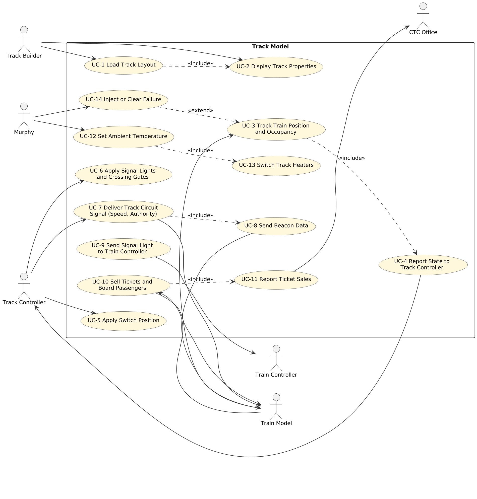


The same use cases, one diagram for each actor:

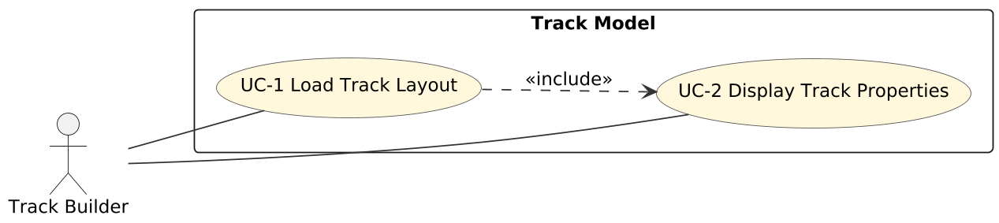


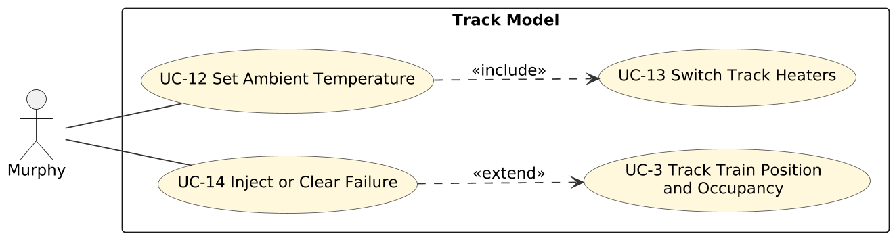


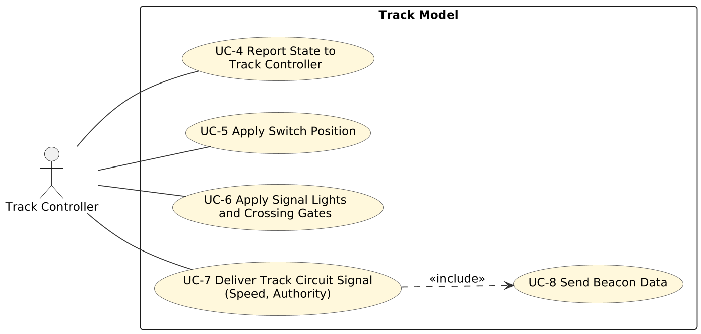


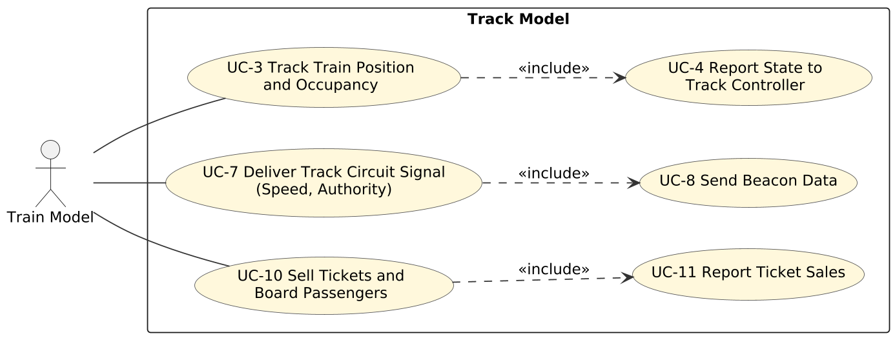


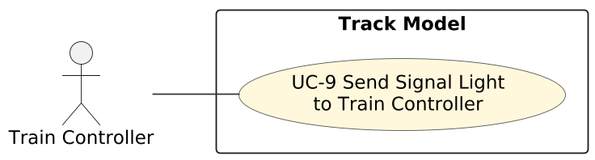


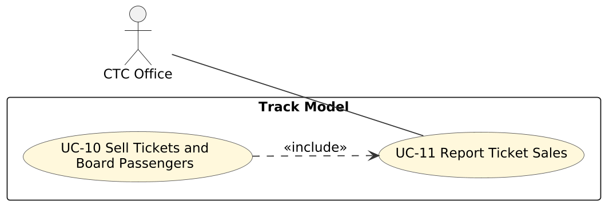


| ID | Use case | Actors | Description | Data | Stimulus and response | Sequence |
|---|-------|-------|--------------------|-------|---------|----|
| UC-1 | Load Track Layout | Track Builder | (1) The builder chooses a layout JSON file with Load track... (2) The module reads each block and its infrastructure, converts grade and speed to backend units, finds switches, signals and beacons and builds the track graph. (3) The file replaces the loaded line of the same name or adds a new line, and the module restarts. At startup the module loads each `*_line.json` file beside it. | In: layout file. Out: loaded line, or an error message. | File chosen. A bad file changes nothing and shows why. | SD-01 |
| UC-2 | Display Track Properties | Track Builder | (1) The user selects a block. (2) The window shows its length, grade, speed limit, elevation, commanded speed, authority, station, platform, direction of travel, beacon, heater, track temperature, underground flag, crossing, signal, switch and occupancy, in imperial units. | In: selected block. Out: block table and detail panel. | Block selected. All properties are shown. | SD-02 |
| UC-3 | Track Train Position and Occupancy | Train Model | (1) Each tick the Train Model reports each train's block and offset. (2) The Track Model adds the offset to the distance it kept from earlier blocks and moves the train to the next block when that passes the block length, or back when it goes below 0, following the switches as set. (3) A block is occupied when a train is in it or its track circuit has failed. | In: TrainReport per train. Out: occupancy. | Tick. Occupancy matches the train positions. | SD-03 |
| UC-4 | Report State to Track Controller | Track Controller | (1) Every tick the Track Model builds the actual state of every device: block occupancy, switch positions, crossing gates, signal aspects, failure status, heater states and track temperature. (2) It returns it for the Track controller. The CTC office reads it through the Track controller. | Out: TrackControllerOutputs. | Tick or failure injected. The read-back shows the actual state, which a failure can make differ from the command. | SD-04 |
| UC-5 | Apply Switch Position | Track Controller | (1) The Track controller commands a switch position. (2) The switch moves to it unless its block has lost power. (3) The actual position is reported. | In: switch commands. Out: switch states. | Command received. The switch shows its actual position. | SD-05 |
| UC-6 | Apply Signal Lights and Crossing Gates | Track Controller | (1) The Track controller commands signal aspects and crossing gates. (2) A light shows its commanded aspect, or RED without power. A gate is down when commanded, or without power. | In: signal and crossing commands. Out: signal and gate states. | Command received. Lights and gates show the new state. | SD-06 |
| UC-7 | Deliver Track Circuit Signal | Track Controller, Train Model | (1) The Track controller sends a speed (whole m/s) and an authority (blocks) for each block. (2) The Track Model stores them as the signal of that block's track circuit. (3) Each train receives the signal of the block it is in. A failed circuit, or a block never commanded, carries speed 0 and authority 0. | In: speed and authority per block. Out: TrackSignal in the train feed. | Tick. The train gets the signal of its block. | SD-07 |
| UC-8 | Send Beacon Data | Train Model | (1) Beacons stand on the blocks next to a station block. (2) When a train is in a beacon block, its feed carries the station name, platform side and underground flag. | Out: Beacon in the train feed. | Train in a beacon block. The feed carries the beacon. | SD-08 |
| UC-9 | Send Signal Light to Train Controller | Train Controller | (1) A signal stands on the block before each switch. (2) On the tick a train enters such a block, the Track Model reports the light's colour for that train; on every other tick it reports none. (3) The harness sends it to the Train controller, which keeps it. | Out: `signal_seen` per train. | Train enters a signal block. The Train controller receives the colour once. | SD-09 |
| UC-10 | Sell Tickets and Board Passengers | Train Model | (1) Each station may sell one ticket per tick, at a configured probability, and keeps a queue of waiting passengers. (2) A train that is stopped in a station block with a door open takes min(waiting, capacity) passengers. (3) The count is returned in the train feed. | In: speed, doors, capacity. Out: passengers boarded. | Train stopped with a door open. The waiting count falls and the train is told how many boarded. | SD-10 |
| UC-11 | Report Ticket Sales | CTC Office | (1) Every tick the Track Model reports the tickets sold on that tick, by station. (2) It keeps no running total and sends none. (3) The harness sends the sales to the CTC office as (count, station) pairs. | Out: `tickets_sold_now`. | Tick. The CTC office receives the sales of that tick. | SD-11 |
| UC-12 | Set Ambient Temperature | Murphy | (1) Murphy enters a temperature in °F in the Track Model window. (2) It replaces the temperature the harness or test UI sends, until the module restarts. | In: temperature. Out: displayed ambient temperature. | Value entered. Track temperature follows it. | SD-12 |
| UC-13 | Switch Track Heaters | Murphy (indirect) | (1) The Track Model switches each section's heaters itself (D026). (2) Each section's track temperature eases toward ambient, or toward ambient plus 10 °C while its heaters run. (3) A power failure in any block of the section stops its heaters. | In: ambient temperature. Out: heater state and track temperature per section. | Temperature change. Heater states and track temperatures change. | SD-13 |
| UC-14 | Inject or Clear Failure | Murphy | (1) Murphy selects a block and a failure: broken rail, track circuit or power. (2) The block reads occupied and its track circuit carries nothing, so a train in it gets speed 0 and authority 0. (3) A power failure also holds the block's switch, shows its light RED, drops its crossing gates and stops its section's heaters. | In: block and failure. Out: failure shown in the window and in the read-back. | Failure selected. The Track controller sees it at once, between ticks. | SD-14 |

### C. Track Model Detailed Design

#### C.1 Software Architecture

The Track Model runs as one process with a window. The window (Qt Quick, PySide6) shows state through `TrackModelState`, which converts to display units. The module core (`model.py`, `layout.py`) has no Qt code. The boundary types and the `TrackModel` Protocol are in `interface.py`. The test scaffolding (`test_link/`, `test_ui/`) is not part of the module and is removed at integration. At integration the harness calls `step` through the edge functions in `common/harness/`.

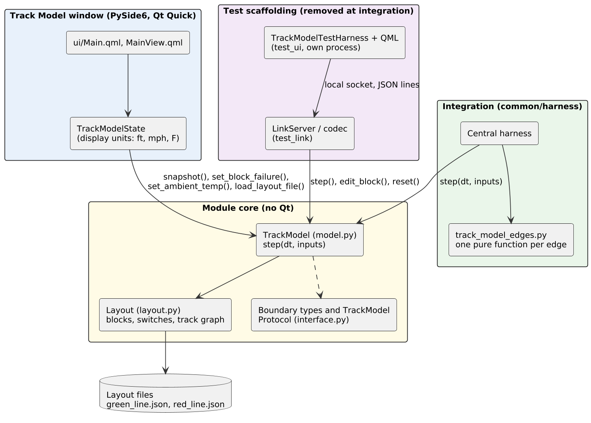

#### C.2 Class Diagrams

Figure 14 shows the module core and Figure 15 the window and the test link.

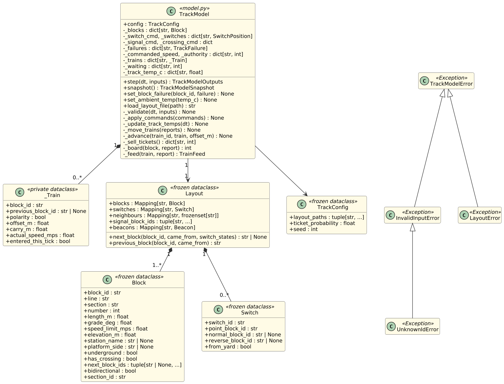


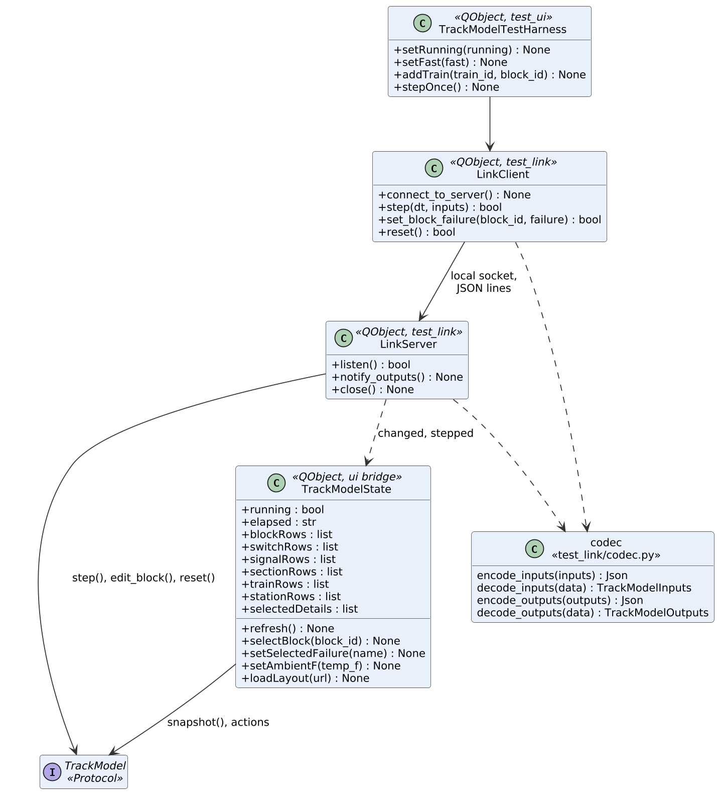

#### C.3 Data Design

**Layout files.** Each line is one JSON file with a line name and an array of blocks. A block has a block number, section letter, length (m), grade (%), speed limit (km/h), elevation and cumulative elevation (m), an optional station side, an optional `infrastructure` object (station, switch, railway crossing, beacon, transponder, underground) and `next_blocks`. The loader converts grade to degrees and speed to m/s on read, and checks `next_blocks` against the switches. A line without `next_blocks` is run both ways. Only the Green and Red lines are used at integration (D023).

**Identifiers.** A block is `<LINE> <section>-<number>`, such as `GREEN D-13`. A section is `<LINE> <section>`, such as `GREEN D`. A switch is named after the block of its point.

**Derived from the layout.** Switch legs come from the switch text in the layout. The first leg listed is NORMAL. A signal stands on each block next to a switch point on its fixed side. A beacon stands on each neighbour of a station block.

**Runtime state.** Each device keeps what the Track controller commanded and what it is actually doing: `_switch_cmd` and `_switches`, `_signal_cmd`, `_crossing_cmd`. Also kept: `_failures` by block, `_commanded_speed` and `_authority` by block, `_trains`, `_waiting` passengers by station, and `_track_temp_c` by section. Devices start safe: switches NORMAL, gates up, lights RED, heaters off. `TrackConfig` holds the layout paths, the ticket probability per station per tick (default 0.02) and a random seed.

#### C.4 Algorithms

**One tick (`step`).**

1. Check the whole input. If anything is wrong, raise and change nothing.
2. Store the Track controller's commands. A switch moves to its command unless its block has lost power.
3. Work out each device's actual state: what was commanded, unless a failure overrides it.
4. Move each section's track temperature toward ambient, or toward ambient plus 10 °C while the section's heaters run. The time constant is 300 s. Both numbers are placeholders.
5. Move trains across block boundaries from their reported offsets.
6. Sell tickets, board passengers and build every output.

**Train position.** The Train Model restarts its offset at 0 in each new block. The Track Model keeps what that reset throws away, in `carry_m`: the overshoot when a train moves forward, or the new block's length when it rolls back into it. The true distance into the block is the reported offset plus the carry. When it passes the block length, the train moves to `Layout.next_block`, which follows the switches as set. When it goes below 0, the train rolls back into the block it came from. A report that still names the block the train just left is stale and only corrects the carry. A train that reports no block is not on the track yet and is skipped. A train that runs into the yard leaves the track.

**Occupancy.** A block is occupied if a train is in it or its track circuit has failed.

**Failures.** All three failures cut the block's track circuit and make it read occupied:

| Failure | Occupancy | Track circuit | Other effects |
|------------|---------|--------------|-----------------------|
| BROKEN_RAIL | occupied | speed 0, authority 0 | — |
| TRACK_CIRCUIT | occupied | speed 0, authority 0 | — |
| POWER | occupied | speed 0, authority 0 | switch held where it is, light RED, crossing gates down, section heaters stop; commands sent meanwhile take effect when power returns |

**Signal seen.** A train sees a light once, on the tick it enters a block with a light. The Train controller keeps it.

**Stations.** Each station rolls for one new ticket per tick. Passengers board only when a train is stopped (speed exactly 0) in a station block with a door open, up to the capacity the train reports.

#### C.5 User Interface

The Track Model window is a Qt Quick window (`ui/Main.qml`, `MainView.qml`) fed by `TrackModelState`. It shows imperial units: ft, mph and °F. Its areas are:

- **Header:** Running or Paused, elapsed time, ambient temperature entry (°F), line selector, block filter and **Load track...**.
- **Block table:** block, direction of travel, length, grade, speed limit, commanded speed (**Cmd mph**), authority (**Auth**), station, beacon, heater, occupied, signal and failure.
- **Switch, signal and section tables:** switch legs and position, signal aspects, and heater state and track temperature per section.
- **Train and station tables:** each train's block, offset and speed, and the passengers waiting at each station.
- **Selected block:** all properties of the block in focus, and Murphy's failure selector.

#### C.6 Test Interface

The test UI is a separate program (`test_ui/`). It stands in for the Track controller, the Train model and the clock, and reaches the module only through the test link: newline-delimited JSON over a local socket (a named pipe on Windows). Its requests are `step`, `set_block_failure`, `edit_block` and `reset`. It builds the module's inputs, ticks the clock at 1x or 10x with a fixed dt, and shows the outputs. With **Act as the Train Model** ticked it moves its trains: add a train, give it a speed, press Run. At integration the test UI and the link are deleted and the harness calls `step` instead.

### D. Sequence Diagrams

Each use case has one sequence diagram, numbered to match: SD-01 is the diagram of UC-1, and so on. SD-15 is an overview of one tick and SD-16 is the system-level dispatch scenario. Figure 5 (Section 3) is the movement authority request.

| Diagram | Title | Use case |
|--------|------------------------------------|---------------|
| SD-01 | Load a track layout | UC-1 |
| SD-02 | Display track properties | UC-2 |
| SD-03 | Track train position and occupancy | UC-3 |
| SD-04 | Report state to the Track Controller | UC-4 |
| SD-05 | Apply a switch position | UC-5 |
| SD-06 | Apply signal lights and crossing gates | UC-6 |
| SD-07 | Deliver the track circuit signal | UC-7 |
| SD-08 | Send beacon data | UC-8 |
| SD-09 | Send the signal light to the Train Controller | UC-9 |
| SD-10 | Sell tickets and board passengers | UC-10 |
| SD-11 | Report ticket sales | UC-11 |
| SD-12 | Set the ambient temperature | UC-12 |
| SD-13 | Switch the track heaters | UC-13 |
| SD-14 | Inject or clear a failure | UC-14 |
| SD-15 | One tick in the Track Model (overview) | UC-3 to UC-9, UC-13 |
| SD-16 | Dispatch a train (system level) | all |

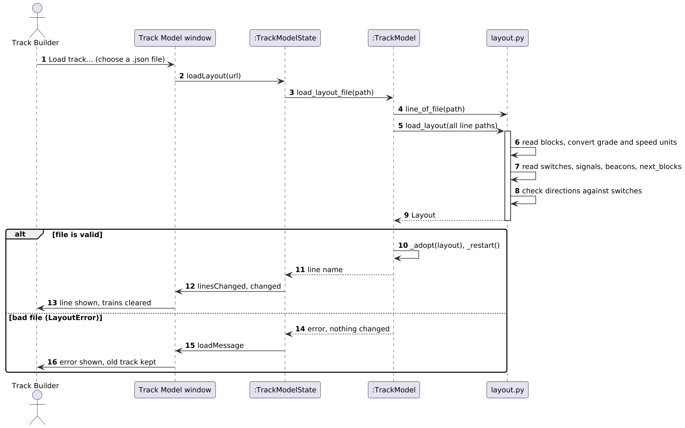


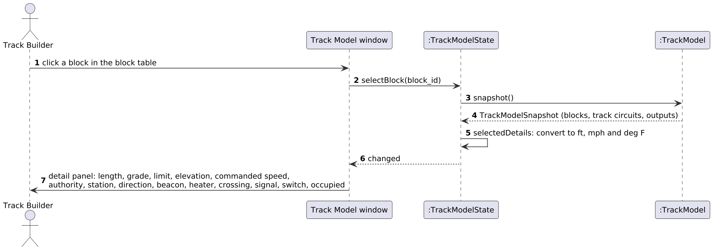


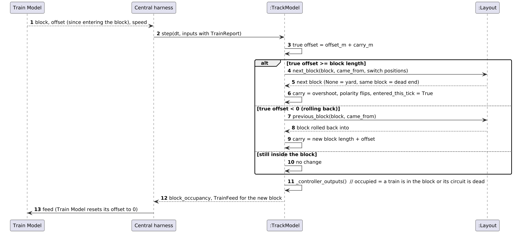


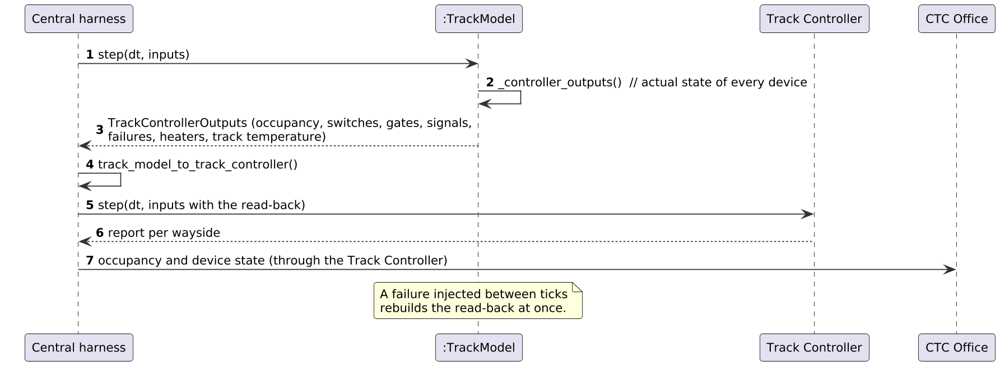


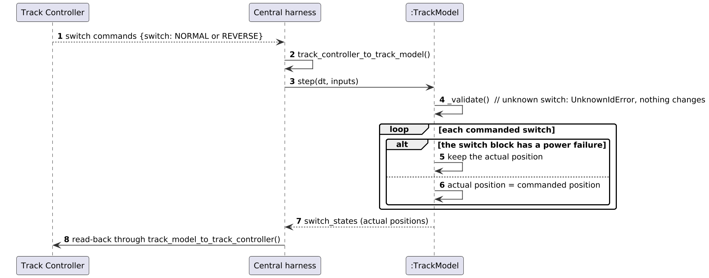


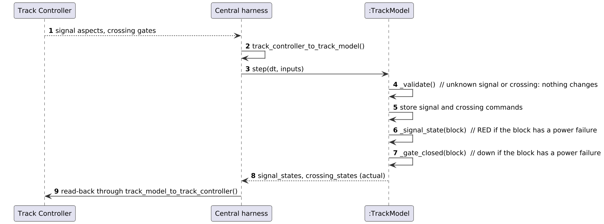


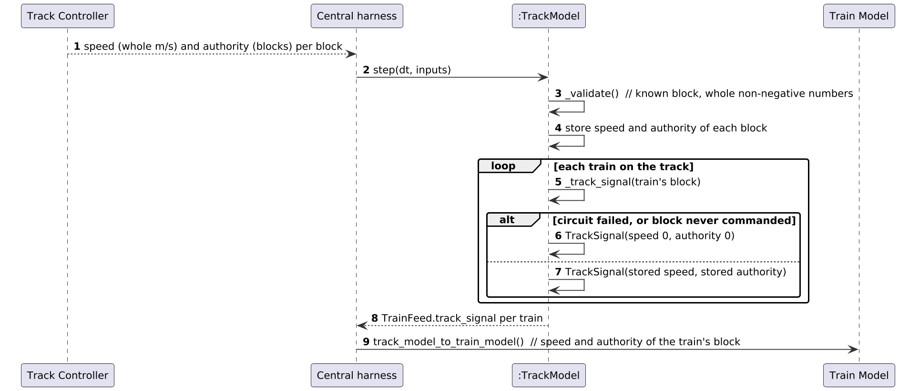


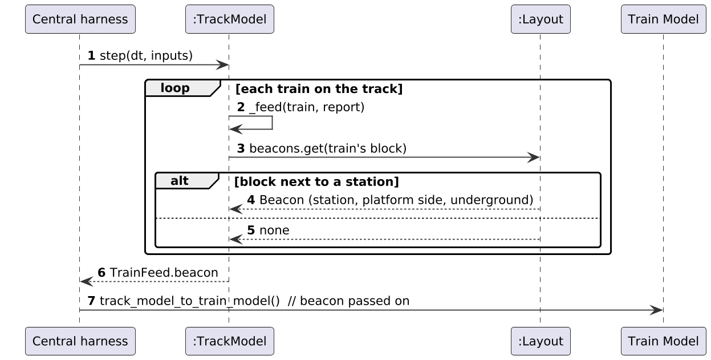


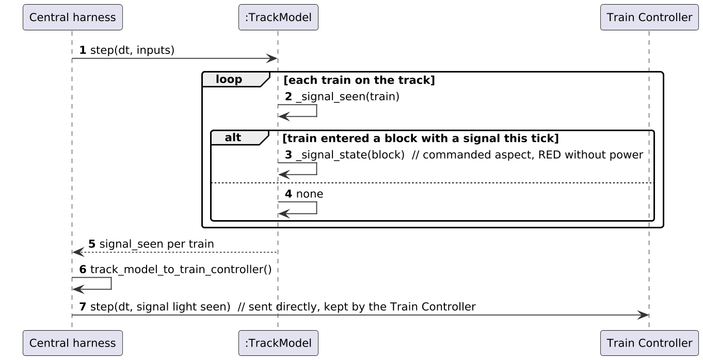


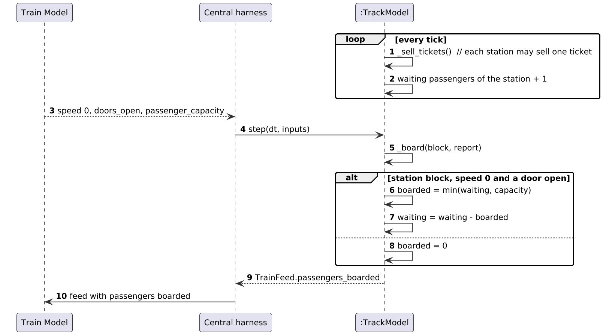


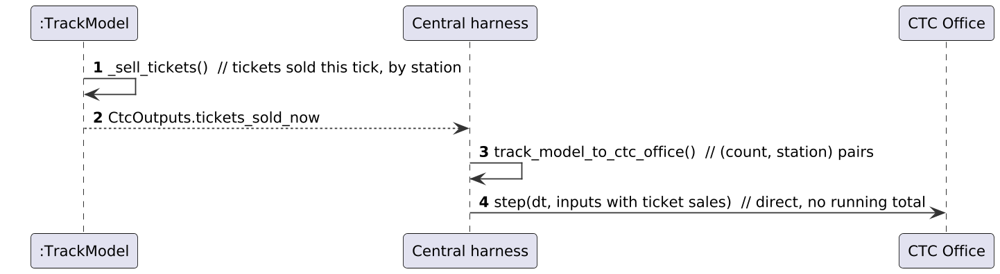


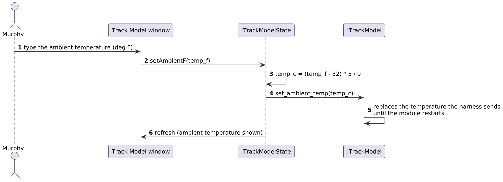


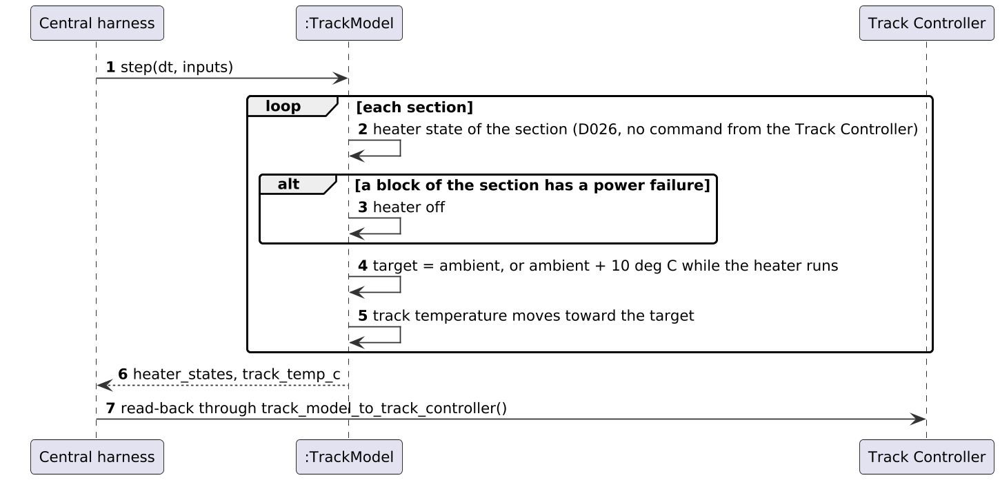


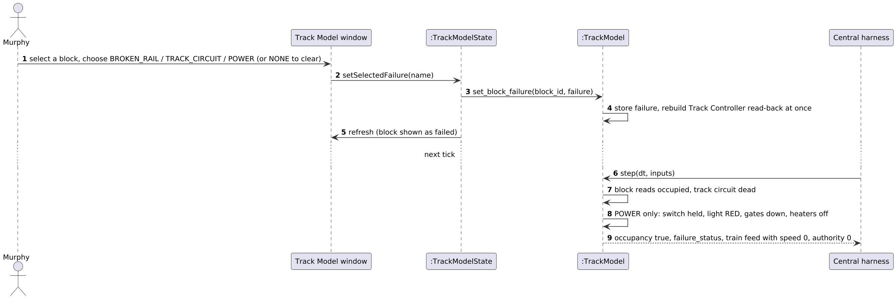


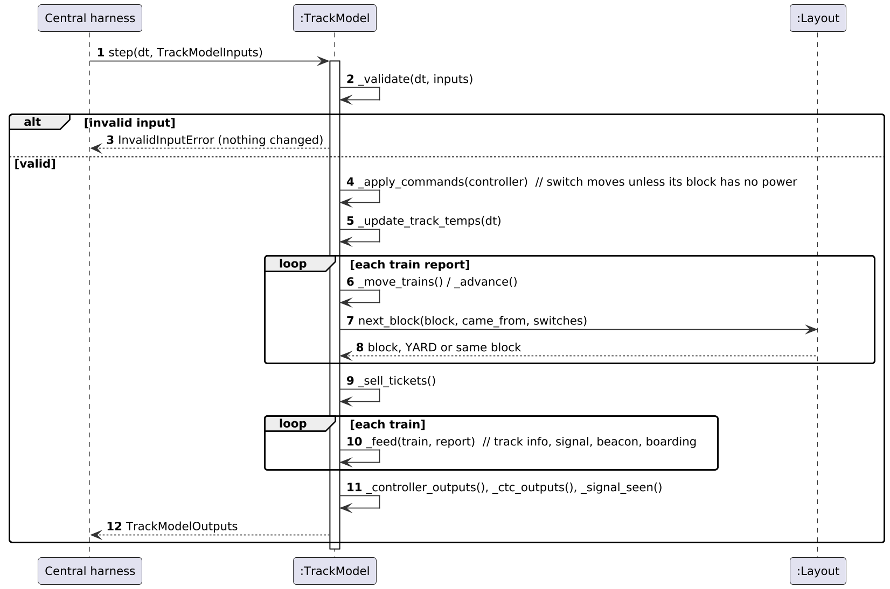


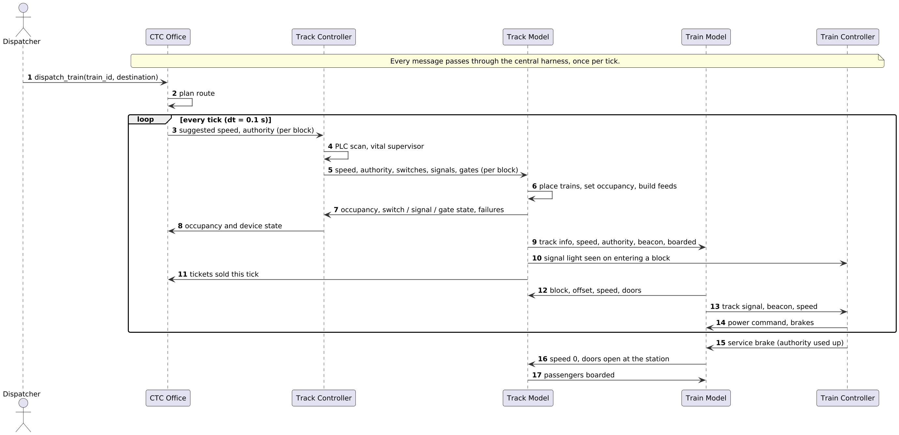


### E. State Machine Diagram

Each block is always in one of three states. A failure overrides the occupancy states and reads as occupied.

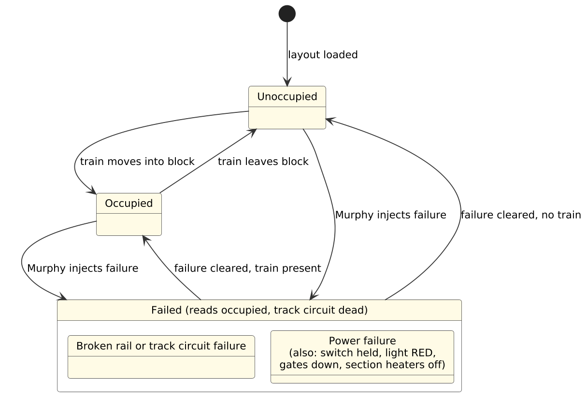

### F. Deployment Diagram

The system runs on one Windows 11 PC as one executable, with Python 3.10 or later and PySide6. The executable starts the central harness; the harness starts each module as its own process by running the same executable again with the module's name. No network connection or external service is needed. The Track Model process needs its layout files. Each hardware variant's window runs on the PC and relays the harness's messages over USB to its Raspberry Pi. The Track Model test UI exists only when the module runs alone.

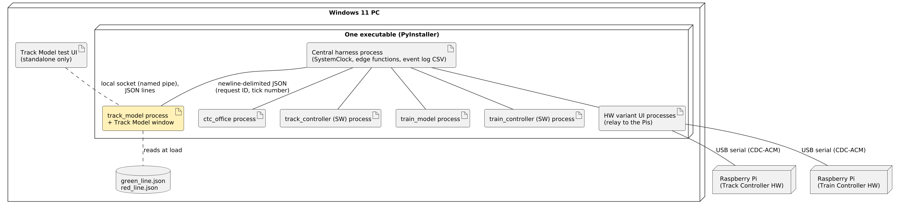

### G. Interface Dictionary

Every value is in its backend unit (D002). Per-block data is keyed by block ID, per-train data by train ID, per-station data by station name and per-section data by section ID.

| ID | Direction | Signal | Type | Units | Description |
|----|----------|----------|-----------|------|-----------------|
| IF-01 | Track Controller → Track Model | commanded_speed_mps | dict[block, int] | m/s | Speed for the track circuit of each block, a whole number. |
| IF-02 | Track Controller → Track Model | commanded_authority | dict[block, int] | blocks | Blocks a train in that block may still enter. 0 = stop. |
| IF-03 | Track Controller → Track Model | switch_commands | dict[switch, SwitchPosition] | - | Keyed by the block of the switch point. |
| IF-04 | Track Controller → Track Model | crossing_commands | dict[block, bool] | - | True = gate closed. |
| IF-05 | Track Controller → Track Model | signal_commands | dict[block, SignalAspect] | - | Aspect of the light on the block. |
| IF-06 | Train Model → Track Model | block_id | str | - | Block the train is in. Empty = not on the track yet. |
| IF-07 | Train Model → Track Model | offset_m | float | m | Distance since entering the block. Restarts at 0 in each block; negative while rolling back. |
| IF-08 | Train Model → Track Model | actual_speed_mps | float | m/s | Signed speed. |
| IF-09 | Train Model → Track Model | doors_open | bool | - | A door is open. Boarding needs one. |
| IF-10 | Train Model → Track Model | passenger_capacity | int | persons | Passengers the train can take. |
| IF-11 | Train Model → Track Model | block_changed | bool | - | Recorded, not used. |
| IF-12 | Harness → Track Model | dt | float | s | Tick length, fixed at 0.1 s. |
| IF-13 | Harness → Track Model | ambient_temp_c | float | deg C | Ambient temperature. A value set in the Track Model window replaces it. |
| IF-14 | Murphy (window) → Track Model | set_block_failure | (block, TrackFailure) | - | Inject or clear NONE, BROKEN_RAIL, TRACK_CIRCUIT or POWER. |
| IF-15 | Murphy (window) → Track Model | set_ambient_temp | float | deg C | Entered in deg F and converted by the window. |
| IF-16 | Track Builder (window) → Track Model | load_layout_file | path to .json | - | Replaces or adds a line and restarts the module. |
| IF-17 | Track Model → Track Controller | block_occupancy | dict[block, bool] | - | True if a train is in the block or its circuit has failed. |
| IF-18 | Track Model → Track Controller | switch_states | dict[switch, SwitchPosition] | - | Actual positions. |
| IF-19 | Track Model → Track Controller | crossing_states | dict[block, bool] | - | True = gate closed (also closed without power). |
| IF-20 | Track Model → Track Controller | signal_states | dict[block, SignalAspect] | - | Actual aspects (RED without power). |
| IF-21 | Track Model → Track Controller | failure_status | dict[block, TrackFailure] | - | Active failure on each block. |
| IF-22 | Track Model → Track Controller | heater_states | dict[section, bool] | - | Heaters actually running. |
| IF-23 | Track Model → Track Controller | track_temp_c | dict[section, float] | deg C | Track temperature of each section. |
| IF-24 | Track Model → CTC Office | tickets_sold_now | dict[station, int] | tickets | Tickets sold this tick. No running total is kept or sent. The edge sends (count, station) pairs. |
| IF-25 | Track Model → Train Model | track_info | block_id, grade_deg, elevation_m, speed_limit_mps, polarity, station_name | deg, m, m/s | Terrain of the occupied block. Polarity reverses at every block change. |
| IF-26 | Track Model → Train Model | track_signal | commanded_speed_mps: int, authority_blocks: int | m/s, blocks | Track circuit signal of the occupied block. 0 and 0 on a dead circuit. |
| IF-27 | Track Model → Train Model | beacon | station_name, platform_side, underground | - | Platform side is L, R or LR. None when not over a beacon. |
| IF-28 | Track Model → Train Model | passengers_boarded | int | persons | Passengers who boarded this tick. |
| IF-29 | Track Model → Train Controller | signal_seen | dict[train, SignalAspect or None] | - | Colour of the light as the train enters a signal block, on that tick only. Sent directly, not through the Train Model. |

### H. Requirements Traceability

SRS requirements that the Track Model covers, and where each is designed.

| Requirement | Summary | Use cases | Design elements | Figures |
|-----------|-------------------|------|---------------|-------|
| REQ-FUNC-015, REQ-INTF-012 | Load the track layout from JSON at startup | UC-1 | `layout.py` (`load_layout`), `Layout` | SD-01 |
| REQ-FUNC-016 | Display each segment's grade, elevation, length, speed limit, direction, crossings, heaters and beacons | UC-2 | `Block`, `TrackModelState` | SD-02, Figure 15 |
| REQ-FUNC-017 | Track ticket sales and send them to the CTC office | UC-10, UC-11 | `_sell_tickets`, `CtcOutputs`, `track_model_to_ctc_office` | SD-10, SD-11 |
| REQ-FUNC-018 | Show passengers boarding. Disembarking is reported by the Train Model and is not an input to the Track Model. | UC-10 | `_board`, `TrainFeed.passengers_boarded` | SD-10 |
| REQ-FUNC-019 | Show train occupancy on the display | UC-3 | `_move_trains`, `TrackModelState` | SD-03 |
| REQ-FUNC-020, REQ-INTF-018 | Send and receive track circuit signals; occupancy channel with the Track controller | UC-4, UC-7 | `TrackSignal`, `TrackControllerOutputs` | SD-04, SD-07, Figure 5 |
| REQ-FUNC-021 | Set the environmental temperature | UC-12 | `set_ambient_temp` | SD-12 |
| REQ-FUNC-022 | Simulate track heaters | UC-13 | `_heater_on`, `_update_track_temps` | SD-13 |
| REQ-FUNC-016.8 | Beacons: display them and send them with the train feed | UC-8 | `Layout.beacons`, `Beacon` | SD-08 |
| REQ-FUNC-023 | Display switch positions and light states | UC-5, UC-6 | `TrackModelState` switch and signal rows | SD-05, SD-06 |
| REQ-FUNC-024 | Simulate broken rail, track circuit and power failures | UC-14 | `TrackFailure`, `set_block_failure` | SD-14, Figure 32 |
| REQ-INTF-001.2 | A GUI for the Track Model | UC-2 | `TrackModelState`, `ui/*.qml` | Appendix C.5 |
| REQ-INTF-013, REQ-FUNC-001 to 003 | One shared clock; real time, 10x and pause | - | `SystemClock`, harness | Appendix A.5 |
| REQ-NFR-003, REQ-NFR-004 | Validate input; reject bad input without changing state | - | `_validate`, `InvalidInputError` | Section 4.6 |
| REQ-DSN-004 | Modules interact through defined interfaces | - | `TrackModel` Protocol, edge functions | Figure 4 |

---

*— End of document —*
