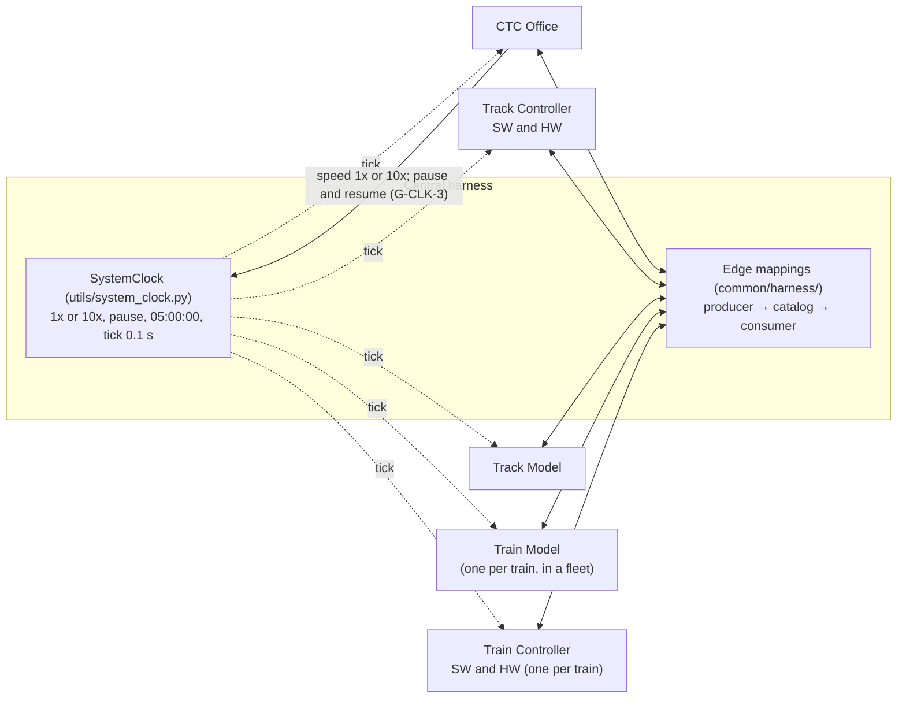

# System Integration Design: Central Harness and Shared Clock

| | |
|---|---|
| **Status** | Initial draft v0.1, for team review. Not normative. |
| **Date** | 2026-10-16 |
| **Requested by** | Kevin Schillinger |
| **Prepared by** | Claude (Claude Code session) |
| **Basis** | `development` at `c3f317a`; `truth` at `f7c52c1`; all remote branches as fetched on 2026-10-16; test runs of 2026-10-16 |

The `truth` branch is the authoritative record. This document cites it by shard path
(`origin/truth:truth/<path>`, shortened below to the shard name) and does not override it.
Where a fact is missing or contested, the document records a gap (section 6) instead of
choosing a value. Where it recommends something, it says so and names the decision that has
to be made first. Nothing here is filled in silently.

**Tags**

| Tag | Meaning |
|---|---|
| [T] | Normative fact on `truth`. |
| [U] | Stated by Kevin Schillinger on 2026-10-16 when requesting this design. Statements new to `truth` were filed as proposals (section 7.1). |
| [P] | Pending proposal under `truth/_inbox/`. Not a fact. |
| [C] | Observed in code at `c3f317a`: current behaviour, not a decision. |
| [D] | Stated in a project document: SRS, course deck, interface dictionary, module README, or meeting log. |
| G-… | Open gap or question, listed in section 6. |

## 1. Decisions needed first

These block the harness core or the first end-to-end run. That run is graded at Iteration 3
on 2026-11-12. Evidence for each is in section 6.

| # | Question | Gap |
|---|---|---|
| 1 | What does "propagated to all modules in parallel" require beyond direct fan-out from the harness? Concurrent execution, or only that every module steps on the same tick? Within one tick, does a module see other modules' outputs from that same tick? | G-CLK-1 |
| 2 | What does the harness pass each module per tick: simulation time, dt, or both? D017 says simulation time, but five of the seven implementations take no simulation-time input. | G-CLK-2 |
| 3 | How do the CTC Office's pause and resume reach the harness? No signal exists. A command returned from `step()` cannot resume a paused clock, because nothing is stepped while paused. | G-CLK-3 |
| 4 | Does the system run as one process, or one process per module? | G-RUN-1 |
| 5 | What makes the HW variants "hardware"? Which Track Controller variant runs which line, and which Train Controller variant drives which train? | G-HW-1, G-HW-2 |
| 6 | What is the canonical block identifier inside the harness? Every module uses a different one today. | G-SIG-11 |
| 7 | Are suggested speed and authority keyed per train, as [T] says, or per block, as both Track Controllers implement? | G-SIG-3 |
| 8 | Track Controller readiness: what shape, and what does it gate? Does the harness hold the clock until the system is ready? | G-SIG-5 |
| 9 | Who creates and retires trains in the Train Model and Train Controller, and on what trigger? | G-SIG-6 |
| 10 | When a Track Controller stops sending a block's commanded speed and authority, the Track Model keeps the last value. Which side changes? This one is safety-relevant. | G-SIG-12 |

## 2. Goal and fixed constraints

### 2.1 Goal [U]

1. Integrate all seven module implementations into one functional system through a central
   harness. The seven are the CTC Office, Track Controller SW and HW, Train Controller SW
   and HW, Track Model, and Train Model.
2. The clock lives in the central harness and is propagated to all modules in parallel.
3. The CTC Office sets the clock speed, 1x or 10x only, and pauses and resumes the clock.
4. Commanded speed and authority come from the Track Controller.

Items 2 and 3 match D017, except that "in parallel" is new. Item 4 is new to `truth`. Both
new statements were filed as proposals (section 7.1).

### 2.2 Constraints already on `truth` [T]

| Constraint | Shard |
|---|---|
| A central harness sits between the modules. Each module defines only its own boundary types. The harness owns one pure mapping function per producer-to-consumer edge. No module's interface contains another module's types. | `decisions/D005-central-harness.md` |
| `common/interfaces.py` is the harness-side signal catalog. Edge mappings go from producer type to catalog type to consumer type. Modules never import it, and it must agree with `truth`. | `decisions/D008-interfaces-harness-catalog.md` |
| There is one shared `SystemClock`, at `utils/system_clock.py`. The harness owns it and passes simulation time to every module, and modules run no clocks of their own. Speeds are 1x and 10x only. The clock can pause and resume, starts at 05:00:00, and shows 24-hour `HH:MM:SS`. The default tick is 0.1 s and stays fixed while running. The CTC Office sets the speed and pauses and resumes the clock through the harness. | `decisions/D017-shared-simulation-clock.md` |
| Steps use a constant dt. Speed and pause change the tick rate, never dt. Decided for the Train Model; the other owners have not confirmed. | `decisions/D006-fixed-time-step.md` |
| The CTC's speed command is a boolean from the CTC to the harness, true for 10x. The harness relays it so that all modules run in sync. | `signals/clock-speedup.md` |
| Values crossing a boundary are in backend SI units. Conversion happens only in the display layer. | `decisions/D002-two-unit-systems.md`, `conventions/units.md` |
| The Train Model test UI is removed at integration, and the harness becomes the Train Model's single driver. | `decisions/D010-train-model-test-ui-boundary.md` |
| The Train Model is physics only. Speed regulation belongs to the Train Controller. | `decisions/D009-train-model-control-boundary.md` |
| Authority is a non-negative count of blocks ahead of the train. | `decisions/D013-authority-block-count.md` |
| The system is delivered as one runnable executable, with no external services or network at runtime. The clock and an event logger are standalone shared utilities. | `conventions/files-and-paths.md` |
| There are five modules. The Track Controller and the Train Controller each have a software and a hardware instance. MBO is out of scope. | `conventions/naming.md`, `decisions/D001-drop-mbo-from-scope.md` |

### 2.3 Course and customer requirements that bear on integration [D]

From `documents/srs-filled.md` (line numbers in parentheses):

- Clock and timing:
  - REQ-INTF-013 (211): all submodules share a single simulation clock.
  - REQ-FUNC-001, -002 and -003 (237-241): real-time speed, "at least 10x", and pause.
  - REQ-NFR-001.1 (443): the simulation *should* advance in 1 ms ticks.
  - REQ-NFR-001.2 (444): the simulation *shall not* drop any ticks.
  - REQ-NFR-002 (446): correctness in fast-forward.
  - REQ-NFR-007 (462): ready within 20 s of launch.
- Channels:
  - REQ-INTF-017 (223): the track circuit carries speed and authority from the Track
    Controller to the Train Controller.
  - REQ-INTF-018 (225): a Track Model to Track Controller channel for occupancy and train
    presence.
  - REQ-INTF-019 and -020 (227-229): CTC to Track Controller speed and authority; Track
    Controller to CTC occupancy.
  - REQ-INTF-021 (231): every channel is non-vital.
- Variants: REQ-INTF-009 and -010 (199-201): the HW and SW variants expose equivalent
  external interfaces.
- Event log: REQ-NFR-008 (466) and REQ-INTF-015 (215): an event log, written as CSV.
- Delivery: REQ-DSN-001, -002 and -003 (496-504): a standalone, pre-compiled executable on
  a single machine with no network.

Notes:

- REQ-FUNC-002's "at least 10x" is met by D017's 10x.
- REQ-NFR-001.1 and REQ-NFR-001.2 are not reflected in D017 (G-CLK-4, G-CLK-5).
- Schedule (`documents/Track_Overflow_Schedule.gan`):
  - Design Review: 2026-10-22.
  - Iteration 3, System Group Review: 2026-11-12.
  - Iteration 4, Final: 2026-12-10.
- The Iteration 3 rubric (`documents/rubrics/detailed-png/semester-06-…png`) gives 35 points
  each to "Do the Sub-systems Communicate" and "Does the Train Move from Yard to Destination
  Block". Its heading item is "Dispatch a Train from Yard to a Station - Completely Working
  Systemwide".
- The course deck (`Final Project vF.pdf`, p.80) says: "Initial order of integration: All at
  once… FAILED" and "Successful order of integration: Train -> Train Controller -> Track ->
  Wayside Controller -> CTC".

## 3. Current state (read from the repo on 2026-10-16)

### 3.1 Integration guides

The request assumed that every module already has an integration guide. Only the Train Model
has one. For every other module, the notes in section 3.3 come from the code.

| Module | Guide | Nearest material |
|---|---|---|
| CTC Office | Partial | `CTC-Office/ctc_ui/README.md` covers the boundary contract and test links, and says the harness "calls the module directly". It has nothing on stepping, startup, threading or shutdown, and still describes scheduling as absent although `ctc/scheduler.py` exists. |
| Track Controller SW | None | `TrackCtrlSW/README.md` has one paragraph on integrated mode. `TrackCtrlSW/INTEGRATION_DISCREPANCIES.md` also applies. |
| Track Controller HW | None | `TrackCtrlHw/README.md`, section "Integrating the module" (lines 66-160). |
| Train Controller SW | None | `TrainController/README.md`, which says "no PI control law and no Train Model yet". |
| Train Controller HW | None | The `Train-Ctrl_HW/main.py` docstring and `Train-Ctrl_HW/OPEN_ISSUES.md`. There is no guide on the `Train-Ctrl_HW` or `train-ctrl-hw-integration` branches either. |
| Track Model | None | `TrackModel/README.md` and `TrackModel/knowledge/CODE_OVERVIEW.md` §6. |
| Train Model | **Yes** | `TrainModel/docs/integration.md`: the fleet API, per-tick stepping, and edge tables. Parts are stale: it says no harness code exists, and it omits `doors_open` on the Track Model edge. |

### 3.2 Module status at a glance [C]

| Module | Callable boundary | Time input | Own clock or timer today | Instances | Tests (2026-10-16) |
|---|---|---|---|---|---|
| CTC Office | `CtcOffice.step(dt, inputs) -> CtcOutputs` (`ctc/interface.py:334`); Qt-free core | dt only | Yes. The window owns a `SystemClock` and `ClockDriver` (`ctc_ui/sim_clock.py:40-44`) and steps the module on each tick (`ctc_ui/ctc_host.py:226-228`). | One per system; trains are records inside it | 205 passed |
| Track Controller SW | `SwTrackController.step(dt, inputs) -> outputs` (`track_ctrl/module.py:278`); Qt-free core | dt and `time_s` (seconds since midnight) | Not in the core. The test client owns a `SystemClock` (`track_ctrl_test/client.py:102-103`). | One per process. Loads Green (6 waysides) and Red (5). | 178 passed |
| Track Controller HW | `HwTrackController.step(dt, inputs) -> outputs` (`track_ctrl_hw/interface.py:340`); Qt-free core | dt and `time_s` | Not in the core. The test harness owns a `SystemClock` (`track_ctrl_hw/harness.py:164-167`). | One per process, one line only (`controller.py:75-81`) | 61 passed, **1 failed** |
| Train Controller SW | **None.** No inputs from or outputs to any module. | dt only. `step(dt)` is public, but its own timer calls it. | Yes. A 1 s `QTimer` calls `step(1.0)` (`train_controller/train_controller_state.py:31, 160-173`). | One train, ID hard-coded as `"T-214"` | 24 passed |
| Train Controller HW | Partial. `ConsoleBackend.apply_inputs(dict)` writes the selected train only. Outputs go out on the Qt signal `commands_changed`, on change only (`main.py:830`). | None on `development` | Yes. Timers at 20 Hz and 10 Hz (`main.py:77-78`), with dt = speed / 20 (`main.py:882, 1171`). | Many trains per backend | No pytest suite |
| Track Model | `TrackModel.step(dt, inputs) -> TrackModelOutputs` (`track_model/model.py:149`); Qt-free core | dt only | Not in the core. The test UI has its own `QTimer`. | One instance for all lines; trains keyed by ID | 266 passed |
| Train Model | `TrainModelFleet.add` / `remove` / `step_all(dt, inputs_by_id)` (`train_model/fleet.py:59-124`); Qt-free physics | dt only | Not in the module. The test UI owns a `SystemClock` (`train_model/harness.py:354-358`). | One model per train in a fleet | 760 passed, 13 skipped |

Neither HW implementation contains hardware I/O. `Train-Ctrl_HW/main.py:314-320` says: "The
physical panel is not wired yet, so there is no hardware layer". `TrackCtrlHw/` has no GPIO,
serial or network code. No hardware platform is documented anywhere in the repository
(G-HW-1).

### 3.3 Per-module notes (read from the code where no guide exists) [C]

**CTC Office** (`CTC-Office/`)
- The harness can call `step(tick_s, CtcInputs)`.
  - Inputs from the Track Controller: per-block occupancy, switch and crossing reports, and
    `WaysideStatus(wayside_id, line, ready, reason)` per wayside.
  - Input from the Track Model: `ticket_sales: Mapping[str, int]`, keyed by station
    (`ctc/interface.py:86-110`).
  - Outputs:
    - `TrainSuggestion(train_id, line, block_id, suggested_speed_mps: int, authority_blocks: int)`,
      one per followed train.
    - The full `closed_blocks` set.
    - Switch commands, in maintenance only.
    - `clock_speedup: bool` (`ctc/interface.py:124-187`).
- The clock is backwards relative to D017.
  - The dispatcher's Run/Pause and 1x/10x controls act on the window's own clock
    (`ctc_ui/sim_clock.py:68-81`).
  - The module's `clock_speedup` is then set *from* that clock (`ctc_ui/ctc_host.py:213-219`).
  - Nothing outside the CTC reads `clock_speedup`.
- The CTC has no pause or resume output and no simulation-time input. It keeps its own
  elapsed time from 05:00:00.
- It sends nothing to a line, and refuses dispatch, until every wayside on that line reports
  ready (`ctc/model.py:346-350`, `ready_lines`).
- It never announces a new train. It matches yard-exit occupancy against waiting orders
  (`ctc/tracking.py:160-173`).
- The test link's `step` op lets any local client step the module with any dt
  (`ctc/socket_link.py:225-229`).

**Track Controller SW** (`TrackCtrlSW/`)
- The harness can call
  `step(dt, TrackControllerInputs(time_s, ctc, track_model)) -> TrackControllerOutputs(ready, track_model, ctc_reports)`
  (`track_ctrl/interface.py:113-186`). The core has no Qt, timers or threads.
- It produces commanded speed and authority **per block**, consistent with [U] item 4:
  - The field is
    `track_circuits: Mapping[BlockKey, TrackCircuitCommand(speed_mps: int, authority_blocks: int)]`.
  - It forwards the CTC's suggestion for a block when the PLC grants `AUTH_<block>` and the
    vital rules allow it (`track_ctrl/vital.py:289-335`).
  - Switch, crossing and signal commands go out every tick. It sends no heater commands.
- Blocks are keyed as `BlockKey(line, block_id)`. Suggestions are keyed by block, and the
  module has no notion of which train is where.
- Both lines load in `TrackControllerState.__init__` (`track_ctrl/state.py:69-71`).
- PLC programs load only through the UI, so only a person can make the module ready.
- `ready` is one module-level flag on `development`. On `origin/Track-Ctrl-SW` it becomes
  per-wayside `ready` and `reason`, with an incompatible wire format.

**Track Controller HW** (`TrackCtrlHw/`)
- The call has the same shape as the SW variant. The boundary differs in these ways:
  - The block key is `BlockKey(line, section, block_id)`.
  - It requires `ctc.maintenance_mode: bool`, a signal that [T] superseded
    (`signals/maintenance-mode.md`).
  - It consumes per-block failures.
  - It reports no readiness.
  - It runs one line only.
- Its window always starts a test-link server that can step the module. A harness and a
  test UI could therefore both drive it; there is no single-driver guard.
- One test fails (section 3.5).

**Both Track Controllers.** A block with no current suggestion gets no track-circuit entry:
"A block not listed transmits nothing" (`TrackCtrlSW/track_ctrl/interface.py:139`). The HW
variant skips such blocks the same way (`TrackCtrlHw/track_ctrl_hw/wayside.py:529-531`). The
Track Model, however, keeps the last value for an absent key
(`TrackModel/track_model/interface.py:184`; `model.py:280-281`). A withdrawn suggestion
therefore leaves a train running on stale values (G-SIG-12).

**Train Controller SW** (`TrainController/`)
- It has no integration boundary. The only Qt slots are those its own cab UI uses.
- It has no PI law and no power output. It simulates its own speed, distance and cabin
  temperature.
- Its own 1 s timer calls `step(1.0)`. The clock starts at 21:26:35. It runs one train,
  `"T-214"`.
- Authority is a distance (`train_controller_state.py:128`), not a block count as [T] D013
  requires.

**Train Controller HW** (`Train-Ctrl_HW/`)
- Implemented: a PI speed law, failure detection, and per-train controller cores via
  `add_train` and `drop_train`.
- Outputs are `TrainModelCommands(power_w, service_brake, emergency_brake, door_command,
  light_command, temperature_setpoint_c, announcement)`.
- dt is speed / 20: 0.05 s at 1x and 0.5 s at 10x. This contradicts [T] D006 and D017,
  under which dt is fixed.
- The clock starts at 00:00:00 (`main.py:851`). There is no pause.
- Its announcement lockout and gains hand-over run on wall-clock timers.
- `TrainControllerFleet.step_all(dt, inputs_by_id)` exists only on
  `origin/train-ctrl-hw-integration`. The `origin/Train-Ctrl_HW` branch added it and then
  reverted it.
- A train applies no power until an engineer commissions gains in the UI.
- There is no pytest suite. `check.py` is a self-check, which was not run.

**Track Model** (`TrackModel/`)
- The harness can call `step(dt, TrackModelInputs(controller, trains, ambient_temp_c))`.
- Commanded speed and authority arrive per block from the Track Controller
  (`TrackControllerCommands.commanded_speed_mps` and `.commanded_authority`, keyed by Track
  Model block ID; `track_model/interface.py:180-193`). It puts them on the track circuit of
  the block each train occupies.
- Outputs:
  - Per train, to the Train Model: `train_feeds`.
  - To the Track Controller: occupancy, switch, crossing and signal states, failures,
    heaters, and track temperature.
  - To the CTC: `tickets_sold_now`, per station.
- Block IDs look like `"GREEN D-13"` (`track_model/layout.py:62-64`).
- Heaters run only when commanded, and the Track Controller SW does not command them.
- Ambient temperature has no source.
- It takes dt only and counts elapsed time from 0.

**Train Model** (`TrainModel/`)
- Usage, per its guide (`TrainModel/docs/integration.md` §3):
  - Keep one `TrainModelFleet`.
  - Call `fleet.add(train_id, line)` on dispatch and `fleet.remove(train_id)` on retire.
  - Call `fleet.step_all(tick_s, inputs_by_id)` once per tick, on the Qt thread only.
- It takes dt only (G-CLK-2).
- It rejects the whole tick on any invalid input. One example: a beacon whose platform side
  is `""`. The existing Track Model edge emits exactly that for Blue Line stations
  (`common/harness/track_model_edges.py:192`), and `train_model/model.py:264-268` rejects it.
- Its window shows elapsed time from 00:00:00, not time of day.
- 20 trains step in under 10 ms at 10x (`TrainModel/tests/test_fleet.py:197-213`). This is
  the only timing budget measured anywhere in the repository.

### 3.4 Shared infrastructure [C]

- `utils/system_clock.py` already implements D017:
  - Start 05:00:00, tick 0.1 s, speeds {1, 10}.
  - Pause, resume and reset; `HH:MM:SS` formatting.
  - It starts paused. Tick listeners receive `(sim_time_s, tick_s)` and are called one
    after another, in registration order, on the calling thread
    (`system_clock.py:140-149`).
- `utils/clock_driver.py` paces that clock from the Qt event loop.
  - With more than 100 ticks owed, it runs one tick and discards the backlog. Simulated
    time then falls behind wall-clock time, but no step is skipped (`clock_driver.py:27-30`).
  - From reading the code (not run): an exception in a tick listener skips the remaining
    listeners for that tick. It also leaves the driver unarmed until the next state change.
- Four independent `SystemClock` instances exist today: in the CTC window, the Train Model
  test UI, the Track Controller HW test UI, and the Track Controller SW test client. There is
  no central harness.
- `common/interfaces.py`, the D008 catalog, is partly out of date with `truth`:
  - The beacon side comment says "left/right".
  - Track-signal speed is a float in one type and an int in another.
  - `TrainState` still carries failure flags.
  - It has no types for the CTC ↔ Track Controller edge, the Train Model ↔ Train Controller
    edge, or clock commands.
  - Nothing implements its abstract module interfaces.
- `common/harness/track_model_edges.py` holds six Track Model edges. Each maps only one side,
  to or from the catalog. Only a Track Model test calls them.
- `origin/Track-Ctrl-SW:common/harness/ctc_edges.py` maps CTC to Track Controller SW. It turns
  per-train suggestions into per-block ones, taking the minimum on conflicts, and bypasses the
  catalog, against D008.
- No branch has a system launcher, PyInstaller spec, CI workflow or event logger.
- Every inter-process link is a `QLocalServer` test link: six endpoints, no TCP or UDP
  (Appendix B).

### 3.5 Tests (run 2026-10-16)

Environment: a scratch virtual environment outside the repo, with Python 3.13.16, PySide6
6.11.2 and pytest 9.1.1. Settings were `QT_QPA_PLATFORM=offscreen` and
`-p no:cacheprovider`. Each suite ran from its module folder, one after another.

| Suite | Result |
|---|---|
| `utils` | 32 passed |
| `CTC-Office` | 205 passed |
| `TrackCtrlSW` | 178 passed |
| `TrackCtrlHw` | 61 passed, **1 failed**. `tests/test_territory.py:64-72`: the sample waysides `data/waysides/green_wayside_{1,2,3}.json` lack the `next_blocks` field that `TrackModel/green_line.json` gained in PR #24. |
| `TrainController` | 24 passed |
| `TrackModel` | 266 passed |
| `TrainModel` | 760 passed, 13 skipped |
| `Train-Ctrl_HW` | No pytest suite |

No integration or system test exists. `documents/test_plan.md` is an unfilled template.

### 3.6 Work outside `development`

- `origin/Track-Ctrl-SW` (3 commits, 2026-10-16) adds `common/harness/ctc_edges.py` and
  per-wayside readiness. It changes the wire format incompatibly, and its copy of the CTC is
  one commit older than `development`'s.
- `origin/train-ctrl-hw-integration` (37 commits) adds `TrainControllerFleet` and
  `step_all(dt, inputs_by_id)`.
- `origin/Train-Ctrl_HW` (40 commits) added the fleet and then reverted it. Inside
  `Train-Ctrl_HW/`, only `OPEN_ISSUES.md` differs from `development`.
  - Both Train Controller HW branches fork 231 commits behind `development`.
  - Both delete the `TrainModel/` tree and the meeting logs, and move
    `TrackModel/*_line.json` to `Track_layout/` without `next_blocks`.
  - Take only the `Train-Ctrl_HW/` folder from them, as `Train-Ctrl_HW/OPEN_ISSUES.md`
    already warns.
- `origin/feature/TrackCtrl-Module-Implementation`, open as
  [Landiss04/Track-Overflow#39](https://github.com/Landiss04/Track-Overflow/pull/39), adds
  example PLC programs only.

## 4. Proposed architecture (initial)

### 4.1 Topology

The harness owns the single clock and is the only party that talks to every module. Each
module receives every tick directly from the harness; this follows from D017, where the
harness passes time to every module. All module-to-module data passes through the harness's
edge mappings (D005), via catalog types (D008).

The data carried on each edge is listed in Appendix A.

### 4.2 Clock

| Aspect | Design | Source |
|---|---|---|
| Owner | One `SystemClock`, created by the harness. Module-owned clocks and timers are removed or redirected (G-CLK-7). | [T] D017; [U] |
| Tick and dt | `tick_s` is 0.1 s and constant. Every module steps with dt = `tick_s`. The Train Controller HW's speed-scaled dt has to go. | [T] D006, D017 |
| Speed | 1x or 10x. The CTC's `CtcOutputs.clock_speedup` (bool) goes to the harness, which calls `SystemClock.set_speed(10)` when it is true and `set_speed(1)` when it is false. | [T] `signals/clock-speedup.md`, D017; [U] |
| Pause and resume | The CTC asks the harness, which calls `SystemClock.pause()` or `resume()`. The carrier is undefined (G-CLK-3). | [T] D017; [U] |
| Start and display | Starts at 05:00:00, shown as `HH:MM:SS`. Every window shows harness time (G-CLK-8). | [T] D017 |
| Pacing | `ClockDriver` on a Qt event loop (exists), or a new pacer if the process model needs one (G-RUN-1). The policy when behind is G-CLK-5. | [C] |

**Design consequence for pause.** A paused clock steps no module. A "resume" that travels as
an output of the CTC's `step()` would therefore never arrive. Pause and resume have to reach
the harness outside the tick: for example, the CTC UI calls a harness method, or the harness
reads the CTC's requested clock state between ticks. Speed can travel either way. Which
mechanism to use, and how `truth` records it, is G-CLK-3.

### 4.3 One tick, and what "in parallel" could mean (G-CLK-1)

| Option | Meaning of "in parallel" | Consequences |
|---|---|---|
| **A. Same tick, snapshot inputs** | Each module receives tick *k* directly from the harness. Every module steps on inputs mapped from all modules' outputs at tick *k*−1. The harness collects all outputs, then maps them for tick *k*+1. Steps may run one after another on one thread. | Order-independent and deterministic. Fits the five existing single-threaded `step()` cores. Each edge hop adds one tick of latency. |
| **B. Same tick, fixed order** | Each module receives tick *k* directly, but the harness steps modules in a fixed order, and each sees upstream outputs from the same tick. | Less latency. Results depend on the order, so this is hardly "parallel". |
| **C. Concurrent execution** | Modules step at the same time on separate threads or processes. The harness waits at a barrier before tick *k*+1. | True parallelism. But the Train Model fleet and the Track Controller SW state are QObjects bound to one thread. Python threads share one interpreter lock. Processes need inter-process calls on every tick, which is 100 per second at 10x. |

**Recommendation (not a decision): option A.** It gives "in parallel" a precise, testable
meaning without threads. It fits every existing `step()` core, and it leaves option C open
for any module that cannot meet the tick budget. Tick *k* under option A:

1. The clock fires tick *k*, carrying (simulation time, dt). What modules receive is G-CLK-2.
2. The harness maps the stored outputs of tick *k*−1 through the edge mappings into each
   module's inputs.
3. The harness steps every module with the same tick. The order does not affect results.
4. The harness stores all outputs.
5. Between ticks, the harness applies its own commands: CTC speed, pause and resume, and
   train dispatch and retirement (G-SIG-6).
6. Windows refresh from module snapshots. Display only.

Latency under option A: a suggestion travels CTC → Track Controller → Track Model → Train
Model → Train Controller in four ticks. That is 0.4 s simulated, or 40 ms real at 10x.

Budget: at 10x a tick arrives every 10 ms of real time, so steps 2 to 6 must average under
10 ms for the whole system. No system-level measurement exists (G-CLK-6).

### 4.4 Data exchange

- One mapping function per producer-to-consumer edge in `common/harness/` (D005). Each
  translates producer type → catalog type → consumer type (D008).
- Translations the harness needs whatever the open decisions say:
  - Block identifiers (G-SIG-11).
  - Enum spelling: `NORMAL` and `RED` in the Track Model versus `"normal"` and `"red"` in
    the Track Controllers.
  - Field names, for example `speed_mps` versus `commanded_speed_mps`.
  - Flat catalog feeds versus the Train Model's nested `TrackInputs`.
  - Per-train versus per-block suggestions (G-SIG-3).
  - Meaning of an absent key (G-SIG-12).
- Track Controller and Train Controller variants need one mapping per variant per edge until
  their contracts converge (G-HW-3).
- Appendix A shows, for each edge, which signals [T] defines and which mappings exist today.

### 4.5 Process model (G-RUN-1)

| Option | Description | For | Against |
|---|---|---|---|
| 1. One process | The harness creates one Qt application, constructs every module core, calls `step()` directly, and opens each module's window in the same event loop. | Direct calls, with no inter-process traffic per tick. Matches the Train Model guide ("one system process, no IPC"), a single executable, and a single machine (REQ-DSN-003). | Every module's entry point builds its own `QGuiApplication`. Only the Train Model's guide documents attaching its window to an externally created engine. A stalled window stalls the clock. Import-root collisions must be resolved: five top-level `tests` packages, two `app.py` files in `TrackCtrlHw/`, and the `ui` namespace package. |
| 2. One process per module | Each module keeps its window process, and the harness steps it over a local socket. | Modules keep their entry points and run isolated from each other. | The existing links are test scaffolding (D010). They use six different protocols, and several block for up to 2 s per reply. At 10x that is 100 round trips per module per second. Packaging must spawn child processes, and `TrackCtrlHw/launch.py`, for example, would not run from a frozen build. |
| 3. Hybrid | Cores and the harness run in one process, and windows run in others. | Isolates the windows from the clock. | Window state would have to be mirrored across processes. Nothing supports this today. |

**Recommendation (not a decision): option 1 for Iteration 3.** Five of the seven
implementations already offer a synchronous in-process `step()`, and the Train Model guide
assumes one process. Revisit the choice if the HW variants turn out to need separate
devices (G-HW-1).

### 4.6 Lifecycle (each step names the gap that blocks it)

1. **Launch.** The harness creates the clock, which starts paused at 05:00:00 (the
   `SystemClock` default), and the event logger (G-RUN-4).
2. **Layouts.** Who loads `TrackModel/*_line.json` is undecided (G-LIFE-1). Today the CTC,
   the Track Controller SW, the Track Model and the Train Model's stand-in each read the
   files themselves. The Track Controller HW reads its own wayside cuts of them.
3. **Modules.** Construct the cores and select variants per line and per train (G-HW-2).
4. **Readiness.** A person loads PLC programs in the Track Controller UI. The CTC sends
   nothing to a line until that line is ready (G-SIG-5).
5. **Run.** The dispatcher resumes the clock from the CTC (G-CLK-3).
6. **Dispatch.** The trigger that adds a train to the Train Model fleet and the Train
   Controller is undefined. So are the train ID format and the yard entry block (G-SIG-6).
7. **Retire.** On a run's completion or yard entry, the Train Model and Train Controller
   instances are removed (G-SIG-6).
8. **Errors.** What to do when a module rejects a tick is undefined (G-LIFE-4).
9. **Shutdown.** No requirement or module defines it (G-LIFE-3).

## 5. Integration plan (suggested)

Following the course deck's advice against all-at-once integration (p.80) and the readiness
in section 3, each phase ends with a runnable harness test.

| Phase | Content | Needs first |
|---|---|---|
| 0 | Harness skeleton: one `SystemClock` and pacer; tick fan-out to stub modules; CTC speed, pause and resume hook; event-log hook; one end-to-end tick test | G-CLK-1, G-CLK-2, G-CLK-3, G-RUN-1 |
| 1 | Train Model plus one Train Controller on a fixed track feed. HW first: it has a PI law, and its fleet exists on `train-ctrl-hw-integration`. Fix the speed-scaled dt. | G-SIG-6, G-HW-2, G-HW-3 |
| 2 | Add the Track Model, with real track feeds and position reports. Complete the half-built edges. | G-SIG-9, G-SIG-11 |
| 3 | Add one Track Controller variant for commanded speed and authority, switches and signals, and readiness. | G-SIG-1, G-SIG-2, G-SIG-5, G-SIG-12 |
| 4 | Add the CTC: dispatch, suggestions, occupancy, ticket sales, and clock control. Iteration 3 scenario: dispatch a train from the yard to a station (2026-11-12). | G-SIG-3, G-SIG-4, G-SIG-7 |
| 5 | Second variants of both controllers, the Train Controller SW boundary, packaging as one executable, and the event log in CSV | G-HW-1, G-RUN-2, G-RUN-4 |

Missing integration guides (section 3.1) should be written as each module joins, so that
the harness code is not the only record of how to drive a module.

## 6. Gaps and open questions

"Owner" is the owner named on the governing `truth` entry. Where `truth` names none, it says
"unassigned". "Blocks" means the harness core (**Core**), the first train run at Iteration 3
(**Iter 3**), or the full system (**Full**).

### 6.1 Clock and timing

| ID | Gap or question | Evidence | Owner | Blocks |
|---|---|---|---|---|
| G-CLK-1 | What "in parallel" pins down beyond direct fan-out: concurrent execution or not; same-tick or previous-tick visibility between modules; a barrier before the next tick (options in section 4.3). | [U]; [P] D017 proposal (section 7.1). Every module core is single-threaded, and `SystemClock.tick()` calls listeners in sequence. | Kevin (statement); D017 owner Landis | Core |
| G-CLK-2 | What each module receives per tick. D017 says simulation time. The CTC, Track Model, Train Model and Train Controller SW take dt only, and the Train Controller HW's control step takes no time argument on `development`. The Track Controllers accept `time_s` as "seconds since midnight", while `SystemClock.sim_time_s` keeps counting past midnight (only `time_of_day_s` wraps). | `ctc/interface.py:334`; `track_model/model.py:149`; `train_model/model.py:149`; `TrackCtrlSW/track_ctrl/interface.py:118` | D017 owner Landis; module owners | Core |
| G-CLK-3 | How pause and resume travel from the CTC to the harness, and how `truth` records it. D017 gives the CTC pause and resume, and [U] confirmed it. No signal entry exists. `CtcOutputs` has no pause field. A resume cannot ride on a step output (section 4.2). | `signals/clock-speedup.md` covers speed only; `ctc/interface.py:182-187` | D017 owner Landis; signal owner CTC Office | Core |
| G-CLK-4 | Tick length. REQ-NFR-001.1 says the simulation *should* advance in 1 ms ticks, while D017 sets 0.1 s. Record a deviation, or change the tick? | `srs-filled.md:443`; D017 | D017 owner Landis | Full |
| G-CLK-5 | Dropped ticks. REQ-NFR-001.2 says the simulation *shall not* drop ticks. `ClockDriver` discards any backlog beyond 100 owed ticks, so simulated time slips but no step is skipped. Does slipping count as dropping? What is the harness policy when it falls behind? | `srs-filled.md:444`; `utils/clock_driver.py:27-30` | D017 owner Landis | Core |
| G-CLK-6 | Real-time budget. At 10x every tick has 10 ms of real time. Only the Train Model is measured (20 trains, under 10 ms). No per-module budget or system measurement exists. | `TrainModel/tests/test_fleet.py:197-213` | unassigned | Iter 3 |
| G-CLK-7 | Clocks and timers inside modules that must be removed or redirected: the CTC window's clock and clock link; the Train Controller SW's 1 s timer; the Train Controller HW's 20 Hz and 10 Hz timers and its speed-scaled dt; the four test-UI clocks. Wall-clock UI timers also exist: Train Controller HW announcement lockout and gains hand-over, Train Model ad rotation and popup close. Which of them may stay on wall-clock time? | Section 3.2; `Train-Ctrl_HW/main.py:882` | module owners (unassigned except Train Model: Kevin Schillinger) | Iter 3 |
| G-CLK-8 | Displayed time. D017 requires time of day from 05:00:00. The Train Model and Track Model windows show elapsed time from 00:00:00, the Train Controller SW starts at 21:26:35, and the Train Controller HW at 00:00:00. | `TrainModel/train_model/state.py`; `Train-Ctrl_HW/main.py:851`; `train_controller_state.py:130` | module owners | Iter 3 |
| G-CLK-9 | Location. D017 puts `SystemClock` code in `utils/` with the harness owning the instance; [U] said "the clock lives in the central harness". Confirm the code is not meant to move. | D017; [U] | Kevin; D017 owner Landis | Core (low) |
| G-CLK-10 | Clock reset. `SystemClock.reset()` is not relayed to modules. Do modules reset with the clock? | `utils/system_clock.py:177` | D017 owner Landis | Full |

### 6.2 Signals and edges

| ID | Gap or question | Evidence | Owner | Blocks |
|---|---|---|---|---|
| G-SIG-1 | `truth` has no signal entries for Track Controller → Track Model. That covers commanded speed and authority, whose origin is now stated ([U], section 7.1) but whose form, keying and timing are open. It also covers switch position, signal aspect ([P] `signal-light-command`, aspect names open) and crossing commands. | `signals/switch-command.md` mentions this edge with no entry; both Track Controllers and the Track Model already exchange these per block | Track Controller and Track Model module owners (unassigned) | Iter 3 |
| G-SIG-2 | `truth` has no entries for Track Model → Track Controller: occupancy (REQ-INTF-018), switch, crossing and signal read-back, or failures. The HW variant consumes failures and the SW variant does not. | `signals/block-occupancy.md` says this is "outside this entry" | unassigned | Iter 3 |
| G-SIG-3 | Suggested speed and authority keying. [T] says per train ID. Both Track Controllers key per block. The CTC's `TrainSuggestion` carries train ID, line and block. The branch edge maps to blocks and drops the train ID. | `signals/suggested-speed.md`, `suggested-authority.md`; [P] D015 "Track Controller knows blocks, never trains"; [P] conflict records name Kevin as resolver | Kevin (per [P]); signal owner CTC Office | Iter 3 |
| G-SIG-4 | Track Controller → CTC reports beyond occupancy. The CTC consumes switch and crossing reports and per-wayside readiness, none of which has a `truth` entry. Crossing form differs: the CTC uses `"active"`/`"inactive"` and the Track Controllers use a bool. | `ctc/interface.py:59-82` | unassigned | Iter 3 |
| G-SIG-5 | Readiness handshake. No `truth` entry exists. Four pending proposals disagree on granularity: module, line or wayside. The CTC gates per line. The Track Controller SW reports a module-level flag on `development` and per-wayside on its branch; the HW reports none. Only a person at the Track Controller UI can make a line ready. Does the harness hold the clock until ready? | [P] `Track-Ctrl-SW/20261014-0950-track-controller-ready.md`; [P] `ctc-deployment/20261015-1949-…`, `20261016-1354-…` | unassigned | Iter 3 |
| G-SIG-6 | Train dispatch and retirement. No signal creates or retires a train. The CTC infers trains from yard-exit occupancy and never announces one, yet a train must exist in the Train Model and Track Model before any occupancy appears. `fleet.add(train_id, line)` and the HW's `add_train` need a caller. The train ID format is undecided (`"T-214"`, `"T-114"` and `"T-1"` are all in code). | `ctc/tracking.py:160-173`; [P] `train-model-instance-mgmt/20261009-1928-…` gives dispatch to the harness; `conventions/identifiers.md` lists the train ID as pending | identifiers owner Kevin; unassigned | Iter 3 |
| G-SIG-7 | Ticket sales. [T] says per line as `<int, string>`. The code is per station in both the Track Model and the CTC. The existing edge emits a list labelled by line, but the CTC expects a dict. Five pending proposals disagree. | `signals/ticket-sales.md`; `ctc/interface.py:110`; `track_model_edges.py:134-144` | signal owner Track Model | Full |
| G-SIG-8 | Failure reporting. The Track Model reports per-block failures to the Track Controller. The HW consumes them and the SW does not. The CTC infers failures from occupancy. The [T] arbitration `no-authority-into-unusable-block` assumes the Track Controller reports failures, but no signal carries them. | `TrackCtrlHw/track_ctrl_hw/interface.py:148`; `ctc/tracking.py` | unassigned | Full |
| G-SIG-9 | Mismatches on the Track Model ↔ Train Model edge. `track-info` has 5 fields in `truth` but 6 in code (`station_name`). Commanded speed is an int in the Track Model and a float in the Train Model. Blue Line beacons carry side `""`, which the Train Model rejects (it fails the whole tick). The Track Model sends beacons and boarding counts every tick in the block, while the Train Model docs expect one event. `doors_open` is required by the Track Model but missing from the Train Model's outputs. | `signals/track-info.md`; `track_model_edges.py:192`; `train_model/model.py:264-268`; `common/interfaces.py:413` | signal owner Track Model; Train Model owner Kevin Schillinger | Iter 3 |
| G-SIG-10 | Signal aspect seen by the train. A provisional Track Model → Train Controller edge exists, the HW input `signal_light_ahead` exists, and the SW is fixed at GREEN. No `truth` entry. | `track_model_edges.py:171-181` | unassigned | Full |
| G-SIG-11 | Canonical block identifier. The Track Model uses `"GREEN D-13"`. The Track Controller SW uses `BlockKey(line, block_id)`, the HW `BlockKey(line, section, block_id)`, and the CTC `(line, block_id)`. [T] specifies line plus block number as strings, with "Green". Line names are also upper case in the Track Model. Switch identity differs: point block versus the block it is listed on. The catalog keys by `block_id` alone. | `TrackModel/track_model/layout.py:62-64`; `conventions/identifiers.md` | identifiers owner Kevin | Iter 3 |
| G-SIG-12 | **Absent-key semantics (safety-relevant).** In both Track Controllers, a block not listed transmits nothing. In the Track Model, an absent key keeps its last commanded speed and authority. When a suggestion is withdrawn, the train keeps the old values. One side must change, or the harness must write explicit zeros. | `TrackCtrlSW/track_ctrl/interface.py:139`; `TrackCtrlHw/track_ctrl_hw/wayside.py:529-531`; `TrackModel/track_model/interface.py:184`, `model.py:280-281` | Track Controller and Track Model module owners (unassigned) | Iter 3 |
| G-SIG-13 | Catalog drift. D008 requires `common/interfaces.py` to agree with `truth`, and it does not (section 3.4). The catalog has no types for CTC ↔ Track Controller, Train Model ↔ Train Controller, or clock commands. The branch edge `ctc_edges.py` bypasses the catalog. | `common/interfaces.py`; D008 | D008 owner Kevin | Core |
| G-SIG-14 | Edge coverage. The only complete mapping is CTC → Track Controller SW, and it is on a branch. Six Track Model edges are one-sided. Nothing maps Track Controller → CTC, Train Model ↔ Train Controller, or CTC → clock. | Appendix A | unassigned | Iter 3 |
| G-SIG-15 | Station dwell. Its owner and value are open. [T] D007 says 45 s and records a 60 s conflict. The CTC scheduler uses 45 s. The Train Model test UI holds the dwell. SRS REQ-FUNC-036 assigns station stops to the Train Controller, and neither Train Controller implements them. | `decisions/D007-station-dwell.md` | D007 resolution owner Kevin | Iter 3 |
| G-SIG-16 | Door interlock owner: nothing enforces it. Passenger emergency brake release: no signal or mechanism. | `signals/door-command.md`; `arbitration/passenger-emergency-brake.md` | Train Controller; Train Model | Full |
| G-SIG-17 | Maintenance mode. [T] superseded it in favour of `closed-blocks`. The Track Controller HW still requires the flag, and SRS REQ-FUNC-057 says the wayside must know maintenance mode. | `signals/maintenance-mode.md`; `srs-filled.md:422` | signal owner CTC Office | Iter 3 |
| G-SIG-18 | Heaters and ambient temperature. The Track Model runs heaters only when commanded. The Track Controller SW says the Track Model switches them on its own, so as built the heaters never run. Ambient temperature has no source. | `TrackCtrlSW/track_ctrl/interface.py:17-18`; `TrackModel/track_model/interface.py:199-200` | unassigned | Full |

### 6.3 Lifecycle

| ID | Gap or question | Evidence | Owner | Blocks |
|---|---|---|---|---|
| G-LIFE-1 | Who owns and loads the track layout. The CTC, the Track Controller SW, the Track Model and the Train Model's stand-in read `TrackModel/*_line.json` directly; the Track Controller HW keeps its own cuts of the file. The Train Controller HW branches move those files. | `documents/requirements-matrix.md` §4.6; `modules/track-model.md` (placeholder) | unassigned | Iter 3 |
| G-LIFE-2 | Startup order and the 20 s budget (REQ-NFR-007), including initial clock state and PLC program loading. | Section 4.6 | unassigned | Iter 3 |
| G-LIFE-3 | Shutdown. No requirement or module defines it. | Searched SRS, guides and code | unassigned | Full |
| G-LIFE-4 | Error policy when a step raises or rejects input. Today the CTC prints and drops, the Track Controller HW test UI pauses the clock, the Train Model test UI holds the clock, the Track Model test UI drops ticks, and the Track Controller SW client owes up to 50. A rejected step freezes the CTC's elapsed time. | Section 3.3; `ctc_ui/ctc_host.py:229-231` | unassigned | Core |
| G-LIFE-5 | Test UIs and other drivers at integration. [T] D010 removes the Train Model test UI, [P] D018 keeps the Track Controller HW test UI, and the rest are unstated. Every module's test link can step its module, so a single-driver guard is needed. | `decisions/D010-…`; [P] `feature/TrackCtrl-Module-Implementation/20261008-1314-D018-…` | D010 owner Kevin Schillinger | Iter 3 |

### 6.4 Process, packaging and runtime

| ID | Gap or question | Evidence | Owner | Blocks |
|---|---|---|---|---|
| G-RUN-1 | Process model (section 4.5). | Entry points create their own `QGuiApplication`; links are test-only | unassigned | Core |
| G-RUN-2 | Packaging. [T] requires one executable, but the course deck (p.17) also asks for each subsystem as an installable executable. No PyInstaller spec exists. Many files edit `sys.path`. QML and data load relative to the module, and only the Train Model handles `sys._MEIPASS`. Top-level names collide. | `conventions/files-and-paths.md`; meeting 007 deferred PyInstaller | unassigned | Full |
| G-RUN-3 | Single machine (REQ-DSN-003) versus HW variants that might run on separate devices. Meeting 009 left "must all modules run on one computer?" open. | `origin/meeting-logs:documents/meeting_logs/009.md` | unassigned | Core |
| G-RUN-4 | Event logger. [T] names one as a shared utility, and REQ-NFR-008 and REQ-INTF-015 require a CSV log. None exists. Location and format are needed. | `conventions/files-and-paths.md` | unassigned | Full |
| G-RUN-5 | Toolchain. This machine has no project virtual environment. `TrackCtrlSW/README.md` pins PySide6 6.8.*, while [T] requires 6.11 or later. | `conventions/toolchain.md` | toolchain owner Kevin | Full |

### 6.5 Hardware variants and variant selection

| ID | Gap or question | Evidence | Owner | Blocks |
|---|---|---|---|---|
| G-HW-1 | What "hardware" means. Neither HW variant has hardware I/O, and no hardware platform is documented anywhere. REQ-INTF-006 and -007 require hardware variations. The answer decides whether the HW variants are windows in the harness process or external devices on a link. | `Train-Ctrl_HW/main.py:314-320`; `TrackCtrlHw/` | unassigned | Core |
| G-HW-2 | Variant selection: which Track Controller variant runs which line, and which Train Controller variant drives which train. [P] D014 has HW run one line and SW the other; the HW refuses a second line, and the SW loads both. Per `AGENTS.md`, active-variant selection is a `decisions/` entry, and none exists. | `TrackCtrlHw/track_ctrl_hw/controller.py:75-81`; `TrackCtrlSW/track_ctrl/state.py:69-71` | unassigned | Iter 3 |
| G-HW-3 | Variant contracts. Track Controller SW and HW differ at the boundary in block key, maintenance flag, failures, readiness and line scope. Train Controller SW and HW share no interface. Both contract shards are placeholders with no named owner, although `AGENTS.md` requires one. REQ-INTF-009 and -010 require equivalence. | `modules/track-controller/track-controller.md`; `modules/train-controller/train-controller.md` | unassigned | Iter 3 |

### 6.6 Truth and process

| ID | Gap or question | Evidence | Owner |
|---|---|---|---|
| G-TR-1 | Commit `201708b` on `development` removed five `ctc-deployment` proposals as "promoted and denied". `truth` has no commit after 2026-10-08 and no `_promotions.md` row for them, and no promotion PR exists. The CTC implements four of them: suggestions carry the block, nothing is sent until ready, automatic dispatch (D020), and stops only at scheduled stations. | `git show 201708b --stat`; `origin/truth:truth/_promotions.md` | humans who promote |
| G-TR-2 | Eight of nine module shards are placeholders with no owner. Only `modules/train-model.md` is populated. | `truth/INDEX.md` | unassigned |
| G-TR-3 | Pending proposals contradict each other: ticket sales (five versions), readiness (four), maintenance mode (re-adding versus superseded), vital restrictions, D015 versus five arbitration entries, and D018 versus D010. | `truth/_inbox/**` | humans who promote |
| G-TR-4 | Stale integration documents: the Train Model guide (says no harness exists), the CTC README (says no scheduling), the Track Controller SW README (describes an authority look-ahead that was removed), and the Track Model README (cites a check on a branch that no longer exists). | Section 3.1 | module owners |

## 7. Truth: proposals filed and candidate items

### 7.1 Proposals filed in this session (pending human promotion)

| File (under `truth/_inbox/claude/quirky-fermi-sickg4/`) | Target | Change |
|---|---|---|
| `20261016-1828-D017-clock-to-every-module-in-parallel.md` | `decisions/D017-shared-simulation-clock.md` (replace) | Adds "in parallel" to the harness passing simulation time to every module, as Kevin Schillinger stated on 2026-10-16. Everything else is carried over unchanged, including the CTC's pause and resume. What "in parallel" pins down is G-CLK-1. |
| `20261016-1844-track-signal-from-track-controller.md` | `signals/track-signal.md` (replace) | States that commanded speed and authority come from the Track Controller, as Kevin Schillinger stated on 2026-10-16. Leaves open how they reach the track circuit (form, keying, timing): G-SIG-1, G-SIG-12. |

Nothing was filed for "the CTC Office sets speed and pauses and resumes the clock"; that is
already D017.

### 7.2 Candidate items found in documents (not filed)

The research found these normative statements in documents that `truth` does not record.
Each needs an owner's call on scope or interpretation before anyone writes a proposal.

| Statement | Source |
|---|---|
| The HW and SW variants expose equivalent external interfaces. | SRS REQ-INTF-009, -010 |
| The event log is written in CSV. | SRS REQ-INTF-015 |
| The simulation should advance in 1 ms ticks and shall not drop ticks. This conflicts with D017's 0.1 s tick. | SRS REQ-NFR-001.1, -001.2 |
| Ready within 20 s of launch. | SRS REQ-NFR-007 |
| At least two wayside controllers per line. | Meeting 006 (2026-09-23); [P] D014 |
| The wayside gets switch state from the Track Model by query. | Meeting 006 |
| Each test screen has its own dedicated clock. This conflicts with D010 and D017. | Meeting 005 (2026-09-16) |
| `track-info` carries the station name. | `TrainModel/docs/integration.md`; catalog `TrackInfo` |

## Appendix A: Edge map

Signals are named by their `truth` key (`signals/<key>.md`). The table lists names only; the
shards hold the definitions.

| Edge | Signals on `truth` [T] | Mapping today [C] |
|---|---|---|
| CTC Office → Track Controller | `suggested-speed`, `suggested-authority`, `closed-blocks`, `switch-command` | `ctc_to_track_controller`, SW only, on `origin/Track-Ctrl-SW` only |
| Track Controller → CTC Office | `block-occupancy` (switch and crossing reports and readiness have no entry: G-SIG-4, G-SIG-5) | None |
| CTC Office → harness clock | `clock-speedup` (pause and resume have no entry: G-CLK-3) | None. Today the flow is reversed inside the CTC. |
| Track Controller → Track Model | None. Commanded speed and authority come from the Track Controller ([U], [P]). Switch, signal and crossing commands also have no entry: G-SIG-1. | `track_controller_to_track_model`, catalog to Track Model only; nothing produces the catalog type |
| Track Model → Track Controller | None (G-SIG-2) | `track_model_to_track_controller`, Track Model to catalog only |
| Track Model → CTC Office | `ticket-sales` | `track_model_to_ctc_office`, Track Model to catalog only |
| Track Model → Train Model | `track-info`, `track-signal`, `beacon`, `passengers-boarded` | `track_model_to_train_model`, Track Model to catalog only |
| Train Model → Track Model | `train-position`, `block-change-event`, `actual-speed`, `passenger-capacity` | `train_model_to_track_model`, catalog to Track Model only |
| Train Model → Train Controller | `actual-speed`, `brake-state`, `door-state`, `light-state`, `cabin-temperature`; pass-through of `track-signal`, `beacon`, and the speed limit from `track-info` | None |
| Train Controller → Train Model | `power-command`, `service-brake-command`, `emergency-brake-command`, `door-command`, `light-command`, `temperature-setpoint`, `announcement` | None |
| Track Model → Train Controller | None (`signal_seen` is provisional: G-SIG-10) | `track_model_to_train_controller`, Track Model to catalog only |

`failure-status` and `maintenance-mode` are superseded on `truth`.

## Appendix B: Inter-process endpoints today [C]

All six are `QLocalServer` test links. There are no TCP or UDP ports, and no names collide.

| Endpoint name | Server | Client | Purpose |
|---|---|---|---|
| `trains-train-model` (env `TRAIN_MODEL_LINK`) | Train Model window (`TrainModel/train_model/link.py`) | Train Model test UI | Test link |
| `trains-ctc-office` (env `CTC_LINK`) | CTC window (`CTC-Office/ctc/socket_link.py`) | CTC test UI | Test link to the CTC module |
| `TrackOverflow.CTCOffice.clock` | CTC window (`CTC-Office/ctc_ui/clock_link.py`) | CTC test UI | Clock control from the test UI |
| `trains-track-controller-hw` (env `TRACK_CTRL_HW_LINK`) | Track Controller HW window (`TrackCtrlHw/track_ctrl_hw/link.py`) | Track Controller HW test UI | Test link |
| `ece1140-track-controller-stimulus` | Track Controller SW window (`TrackCtrlSW/track_ctrl/link.py`) | Track Controller SW test client | Test link |
| `track-overflow-track-model` | Track Model window (`TrackModel/test_link/link.py`) | Track Model test UI | Test link |

The two Train Controllers have no link and step themselves on timers.

## Appendix C: How this document was gathered

- `truth` was read with `git show`, `git grep` and `git ls-tree` on `origin/truth` only.
  Nothing from `truth` was written into the repository.
- Ten read-only research passes covered:
  - each of the seven module implementations;
  - the shared clock and harness code;
  - the project documents (SRS, course PDFs, interface dictionary, meeting logs on
    `origin/meeting-logs`, schedule);
  - the `truth` store.
- Each pass cited file and line for every claim and marked anything it could not find as not
  found. The claims this design depends on were then checked directly against the code: the
  module boundaries, clock behaviour, absent-key semantics, readiness gating, the SRS lines,
  and the rubric.
- The test suites were run once each, as described in section 3.5. The runs left no files in
  the repository.
