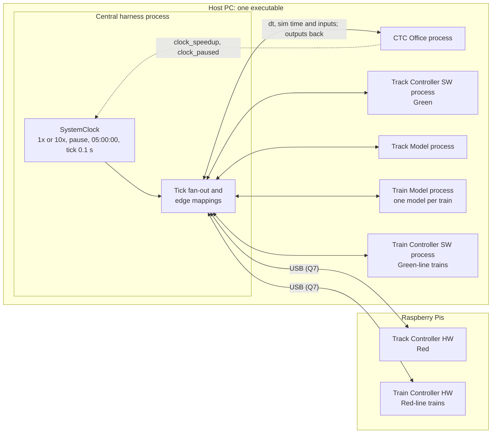

# System Integration Design: Central Harness and Shared Clock

| | |
|---|---|
| **Status** | Draft v0.2, revised after the team's review of v0.1. Not normative. |
| **Date** | 2026-10-16 |
| **Requested by** | Kevin Schillinger |
| **Prepared by** | Claude (Claude Code session) |
| **Basis** | `development` at `1aaa9a8`; `truth` at `f7c52c1`; all remote branches and open pull requests as fetched on 2026-10-16 at about 23:00 UTC; the team's review of v0.1 on 2026-10-16; test runs of 2026-10-16 |

The `truth` branch is the authoritative record. This document cites it by shard path
(`origin/truth:truth/<path>`, shortened below to the shard name) and does not override it.
Where a fact is missing or contested, the document records a gap (section 6) instead of
choosing a value. Nothing here is filled in silently.

**Changes since v0.1**

- Section 1 records the team's decisions (R1 to R32) and the questions still open.
- Every gap in section 6 is marked Resolved, Partly resolved, Closed or Open. Section 6.7
  adds risks found while checking the decisions against the code.
- The process model is one process per module (section 4.5). The tick model is concurrent,
  and each module sees its inputs only on the clock's rising edge (section 4.3).
- The event logger is out of the plan. Its conflict with the SRS is filed as a `truth`
  proposal.
- Section 3 was re-read at `1aaa9a8`, on the open branches, and on
  [Landiss04/Track-Overflow#43](https://github.com/Landiss04/Track-Overflow/pull/43).
- Section 7 lists the sixteen proposals filed from this work, plus a promote-or-deny
  recommendation for every other pending proposal that the decisions touch.

**Tags**

| Tag | Meaning |
|---|---|
| [T] | Normative fact on `truth`. |
| [R*n*] | Decision *n* from the team's review of v0.1 on 2026-10-16, as stated by Kevin Schillinger (section 1). Statements new to `truth` were filed as proposals (section 7). |
| [U] | Stated by Kevin Schillinger on 2026-10-16 when requesting this design. |
| [P] | Pending proposal under `truth/_inbox/`. Not a fact. |
| [C] | Observed in code at `1aaa9a8`, unless another ref is named. Current behaviour, not a decision. |
| [D] | Stated in a project document: SRS, course deck, module README or guide, or meeting log. |
| G-… | Gap or question, listed in section 6. |
| Q*n* | Open question for the team, listed in section 1.3. |

## 1. Decisions and open questions

### 1.1 The ten questions of v0.1

Quotes are verbatim from the review.

| # | v0.1 question | Decision | What it settles | What it leaves open |
|---|---|---|---|---|
| R1 | What "in parallel" means | "Direct fan out to the modules. Modules only see inputs on the rising clock edge" | The harness sends every tick straight to every module, and no module relays it. A module steps on the inputs delivered with tick *k*. Because the steps run at the same time (R4), those inputs come from outputs of tick *k*−1. | Whether the harness waits for every reply before the next tick (G-CLK-11) |
| R2 | What each module receives per tick | "Send both dt and sim time" | Every module receives dt and the simulation time. | Which simulation time: unwrapped, or time of day (G-CLK-2) |
| R3 | How pause and resume reach the harness | "Clock_paused and clock speedup signals were added to the ctc" | The CTC Office's `clock_paused` and `clock_speedup` outputs carry pause, resume and speed. | How the harness reads `clock_paused` while nothing is stepped (G-CLK-3) |
| R4 | One process, or one per module | "Central harness is one process that spawns processes for each module, the whole thing runs as one exe". Section 4.3: "Option C". Section 4.5: "Process model 2. One process per module chosen" | Process model 2 and tick option C. | The harness-to-module protocol, liveness and packaging (G-RUN-2, G-RUN-6, G-RUN-7) |
| R5 | What makes the HW variants hardware; which variant runs where | "The HW variants run on Raspberry pis and communicate with the host pc via USB. HW on the red line and SW on the green. If a train is on the green line it gets SW train controller on red a HW controller" | Track Controller: HW on Red, SW on Green. Train Controller: chosen by the line the train is on. | The USB link, and the Blue Line (G-HW-1, Q11) |
| R6 | The canonical block identifier | "Follow the block identifier used in the CTC module" | Line and block number as strings, for example `("Green", "63")`. This matches [T] `conventions/identifiers.md`. | How the case of line names fits R17 (Q15) |
| R7 | Suggestions per train or per block | `TrainSuggestion(train_id="T1", line="Green", block_id="63", suggested_speed_mps=18, authority_blocks=2)`: "this is what the ctc sends" | One suggestion per train, naming the block the train is in. The CTC Office's type already has these fields. | The train ID format (Q4) and the speed's type (Q9) |
| R8 | Readiness shape and what it gates | "Shape is 2d array : per line, per track controller. Action is fully gated per line until every track controller signals ready. One line can operate while the other is stalled but all track controllers on one line need to be ready for safe operation(i.e. no dispatch of trains until ready)" | The shape, and gating per line. | What makes a controller ready, who loads PLC programs in an integrated run, and the roster risk (Q13, G-NEW-2) |
| R9 | Who creates and retires trains | "The CTC pulls trains from the "yard" and sends them back into the yard.The yard is just a blackbox with unlimited capacity" | The CTC Office owns dispatch from the yard and return to it. | How a pulled train comes into being in the Train Model and Train Controller (Q3, G-SIG-6) |
| R10 | Stale commanded speed and authority | "The track controller sends commanded speed and authority to a block. This block is assumed to be occupied by the correct train. Then once the track model sends the commanded speed and authority to the train model and clears these values back to zero" | Per-block values that the Track Model clears to zero after delivering them. | A conflict with the Train Controller's failure detection (Q5, G-NEW-1) |

### 1.2 Other rulings from the review

| # | v0.1 section | Ruling (quoted or closely paraphrased) |
|---|---|---|
| R11 | 2.2, 3.4 | "Common/interfaces.py is stale and should not be treated as true"; "common/interfaces.py has been superseded"; "common/harness/track_model_edges.py is just the module interface". |
| R12 | 2.2 | The Train Model test UI is removed at integration and the harness becomes its single driver: "this is true for all modules". |
| R13 | 2.2, G-RUN-4 | "No event logger is needed"; "event logger does not exist". |
| R14 | 3.2 | Track Controller SW and HW: "time_s will not be used as the sim time will be sent to every module on every tick". |
| R15 | 3.2, 3.3 | Train Controller: "No SW controller exists code is the same as HW". Outputs: "bool[2] for brakes, lights, and doors, announcement_command". The speed-scaled dt "was assumed for the train controller test ui only". |
| R16 | 3.4 | The four `SystemClock` instances "are for the testing harnesses only they should be replaced by the single central harness". |
| R17 | 4.4 | "All enums should be all caps". |
| R18 | 4.6 | "the line JSON files should be loaded by default on startup". |
| R19 | 4.6, G-LIFE-4 | When a module rejects a tick: "Continue under assumption that a proper tick will be coming in the near future". G-LIFE-4: "we will come back to this, we have no clue what is going to cause a breakage". |
| R20 | G-SIG-3 | "follow CTC structure, Track controllers will only parse the block ID and suggested speed but subsequent modules need associated train IDs". |
| R21 | G-SIG-4 | "Stale". |
| R22 | G-SIG-7 | Ticket sales: "Truth never got updated, it should be sent to CTC as per station and then CTC aggregates the total ticket sales." |
| R23 | G-SIG-8 | "update software such that it should consume failures that come from track model. Track controller also only reports failures as closures". |
| R24 | G-SIG-9 | `track-info`: "it should be all 6 fields, and the speed should be a float. Train model should send the doors open signal". |
| R25 | G-SIG-10 | The driver sees the light through the windshield: "make sure that the driver is able to see next light state". |
| R26 | G-SIG-15 | Station dwell: "its 45 seconds". |
| R27 | G-SIG-17 | Maintenance: "it should reference closed-blocks and query that array before trying to open/close blocks on the track controller sides, any block that is in this array is considered to be under maintenence, hence why we dont need to send the maintenence mode boolean". |
| R28 | G-SIG-18 | "Ambient temp should be a UI input from Track Model." |
| R29 | G-RUN-2 | "the single executable that will open the central harness and then from there each module can be opened is how we are proceeding". |
| R30 | G-RUN-3 | "final iteration, all modules will be able to run on one computer". |
| R31 | G-RUN-5 | PySide6: "follow 6.11 or later". This matches [T] `conventions/toolchain.md`. |
| R32 | G-HW-1 | "Every hardware modules are running on raspberry Pis. The interfaces between the software and hardware modules are identical meaning that they will consume the same IO, but hardware will communicate over USB to the PIS". |

The review also said: section 2.1 "Ok"; section 5 "All good"; section 6.1 repeats earlier
points; for the Track Controller HW, "see pr #43 for updates"; and the CTC pause signal was
added.

### 1.3 Questions still open

The Blocks column says what each one holds up: "Core" is the harness skeleton, "Iter 3"
is the first train run, graded on 2026-11-12, and "Full" is the complete system.

| Q | Question | Gap | Blocks |
|---|---|---|---|
| Q1 | Barrier: does the harness wait for every module's reply to tick *k* before it sends tick *k*+1? What happens to a reply that is late or never comes? R19 covers a rejected tick, but a late reply is a different case. | G-CLK-11 | Core |
| Q2 | Which simulation time does every module receive? `SystemClock.sim_time_s` keeps counting past midnight, and only `time_of_day_s` wraps. The two Track Controller test drivers already differ on this. | G-CLK-2 | Core |
| Q3 | How does a train that the CTC Office pulls from the yard come into being in the Train Model and the Train Controller, and how is it retired? The CTC Office has no dispatch output. It learns that a train exists only when the yard exit block reads occupied, and that needs a train in the Train Model first. | G-SIG-6 | Iter 3 |
| Q4 | Is `T1` (R7's example) the train ID format? The CTC Office makes `T{n}` for manual dispatch and `G1` or `R1` for scheduled runs. The Train Model's link assigns `T-n` itself. | G-SIG-6 | Iter 3 |
| Q5 | R10 against the Train Controller: when a train reads exactly 0 m/s and 0 blocks right after a nonzero speed with at least 2 blocks of authority, the controller latches a signal-pickup failure and the emergency brake. Under R10 that can happen at every block boundary. Which side changes? | G-NEW-1 | Iter 3 |
| Q6 | Failures: R23 says the Track Controllers consume Track Model failures and report them as closures. PR #43 has the HW variant see failures only as occupancy and report them as occupied. The CTC Office has no input for closures from a Track Controller. Which design holds, and what carries the closures? | G-SIG-8 | Iter 3 |
| Q7 | The USB link to the Raspberry Pis: what protocol, who builds it, and what runs on each Pi? Do the Pis count toward R30's "one computer"? How many Pis serve the Red-line trains? | G-HW-1, G-RUN-3 | Full |
| Q8 | Brakes as `bool[2]` (R15): which element is which? Is `announcement_command` a rename of today's `announcement`? | G-SIG-19 | Iter 3 |
| Q9 | R24 makes commanded speed a float. Does that also cover the Track Controller's output, an int today that the SW variant rejects as a float, and the CTC Office's suggested speed, an int on [T] and in code? | G-SIG-9 | Iter 3 |
| Q10 | The next light (R25): does it reach the driver through the Train Model, or straight from the Track Model? Is the fourth aspect `SUPER_GREEN` or `SUPER GREEN`? | G-SIG-10 | Full |
| Q11 | The Blue Line: which variants serve it, or is it outside the integrated system? R5 names only Green and Red. | G-HW-2 | Full |
| Q12 | With the catalog gone (R11), does each edge map straight from the producer's type to the consumer's? What becomes of `common/harness/track_model_edges.py`, whose six functions each map one side to the old catalog? | G-SIG-13 | Core |
| Q13 | Who loads the PLC programs, and the HW wayside databases, in an integrated run? Does the harness hold the clock until a line is ready? | G-SIG-5 | Iter 3 |
| Q14 | A Train Controller applies no power until an engineer commissions its gains in the UI. How are gains set in an integrated run, and on a Pi? | G-NEW-4 | Iter 3 |
| Q15 | Are line names enumerated values under R17 (`GREEN`) or identifiers under R6 (`Green`)? | G-SIG-11 | Iter 3 |
| Q16 | Who holds the 45 s dwell once the Train Model test UI is removed? SRS REQ-FUNC-036 gives station stops to the Train Controller, and neither implementation stops at stations. | G-SIG-15 | Iter 3 |
| Q17 | R20 says modules after the Track Controller need the train ID. Which modules, and how does the ID reach them, given that the Track Controller passes on only block and speed? | G-SIG-3 | Iter 3 |
| Q18 | The Train Model rejects the whole fleet's tick when one train's input is invalid. Under R19 the run continues, but every train then misses that tick. Is a per-train rejection needed? | G-NEW-3 | Full |
| Q19 | The event logger: [T] and the SRS require one, and R13 says none is needed. The conflict is filed for its resolution owner, Kevin. Does the SRS change? | G-RUN-4 | Full |

## 2. Goal and fixed constraints

### 2.1 Goal [U] [R]

1. Integrate all seven module implementations into one functional system through a central
   harness. The seven are the CTC Office, Track Controller SW and HW, Train Controller SW
   and HW, Track Model, and Train Model.
2. The clock lives in the central harness. On every tick the harness sends dt and the
   simulation time straight to every module. Each module sees its inputs only on the
   rising clock edge [U, R1, R2].
3. The CTC Office sets the clock speed, 1x or 10x only, and pauses and resumes the clock,
   through its `clock_speedup` and `clock_paused` outputs [U, R3].
4. Commanded speed and authority come from the Track Controller, per block. The Track Model
   clears them after it delivers them to the train [U, R10].
5. The harness is one process that spawns one process per module. The system is one
   executable: it opens the harness, and each module is opened from there [R4, R29].
6. The HW variants run on Raspberry Pis connected to the host PC by USB, with the same
   inputs and outputs as the SW variants. Track Controller HW runs Red and SW runs Green.
   A train gets the Train Controller of its line [R5, R32].

### 2.2 Constraints on `truth` [T], and pending changes

| Constraint | Shard | Pending change [P] |
|---|---|---|
| A central harness sits between the modules. Each module defines only its own boundary types. The harness owns one pure mapping function per producer-to-consumer edge. | `decisions/D005-central-harness.md` | Adds the process model and the single driver (R4, R12, R29). |
| `common/interfaces.py` is the harness-side signal catalog. Edge mappings go from producer type to catalog type to consumer type. | `decisions/D008-interfaces-harness-catalog.md` | Superseded (R11). |
| One shared `SystemClock` at `utils/system_clock.py`, owned by the harness. It passes simulation time to every module, and modules run no clocks of their own. Speeds are 1x and 10x only. The clock pauses and resumes, starts at 05:00:00, shows 24-hour `HH:MM:SS`, and ticks every 0.1 s. The CTC Office sets the speed and pauses and resumes the clock through the harness. | `decisions/D017-shared-simulation-clock.md` | Sends dt and the simulation time, directly, with inputs seen on the rising edge (R1, R2). |
| Steps use a constant dt. Speed and pause change the tick rate, never dt. | `decisions/D006-fixed-time-step.md` | none |
| The CTC Office's speed command is a boolean to the harness, true for 10x. | `signals/clock-speedup.md` | `signals/clock-pause.md` adds pause (from `ctc-deployment`) |
| Values crossing a boundary are in backend SI units. | `decisions/D002-two-unit-systems.md`, `conventions/units.md` | none |
| The Train Model test UI is removed at integration, and the harness becomes the Train Model's single driver. | `decisions/D010-train-model-test-ui-boundary.md` | R12 extends this to every module, through the D005 proposal. |
| The Train Model is physics only. Speed regulation belongs to the Train Controller. | `decisions/D009-train-model-control-boundary.md` | none |
| Authority is a non-negative count of blocks. | `decisions/D013-authority-block-count.md` | none |
| Station dwell is 45 s, with a recorded conflict against a 60 s schedule. | `decisions/D007-station-dwell.md` | Conflict resolved for 45 s (R26). |
| One runnable executable, with no external services or network at runtime. The clock and an event logger are standalone shared utilities. | `conventions/files-and-paths.md` | The event logger is recorded as a conflict with R13. |
| A block is named by its line and block number, as strings: `("Green", "12")`. | `conventions/identifiers.md` | none. R6 agrees. |
| Five modules. The Track Controller and the Train Controller each have a SW and a HW instance. Enum members are UPPER_CASE. | `conventions/naming.md` | Every enumerated value is all caps, including values that cross a boundary (R17). |
| PySide6 6.11 or later; PyInstaller 6.22.2 or later. | `conventions/toolchain.md` | none. R31 agrees. |

### 2.3 Course and customer requirements that bear on integration [D]

From `documents/srs-filled.md` (line numbers in parentheses):

- Clock and timing:
  - REQ-INTF-013 (211): all submodules share a single simulation clock.
  - REQ-FUNC-001, -002 and -003 (237-241): real-time speed, "at least 10x", and pause.
  - REQ-NFR-001.1 (443): the simulation *should* advance in 1 ms ticks.
  - REQ-NFR-001.2 (444): the simulation *shall not* drop any ticks.
  - REQ-NFR-007 (462): ready within 20 s of launch. Under R4 that covers seven processes.
- Channels:
  - REQ-INTF-017 (223): the track circuit carries speed and authority from the Track
    Controller to the Train Controller.
  - REQ-INTF-018 (225): the Track Model tells the Track Controller about occupancy and
    train presence.
  - REQ-INTF-019 and -020 (227-229): the CTC Office sends speed and authority to the Track
    Controller, which reports occupancy back.
  - REQ-INTF-021 (231): every channel is non-vital.
- Variants: REQ-INTF-009 and -010 (199-201): the HW and SW variants expose equivalent
  external interfaces. R32 says they are identical.
- Event log: REQ-NFR-008 (466), REQ-INTF-015 (215) and REQ-DSN-005 (512) require one, in
  CSV. R13 drops it, and the conflict is filed (Q19).
- Delivery: REQ-DSN-001, -002 and -003 (496-504): a standalone, pre-compiled executable on
  a single machine with no network. R5 adds Raspberry Pis on USB (Q7).

Schedule (`documents/Track_Overflow_Schedule.gan`): Design Review on 2026-10-22; Iteration 3,
the System Group Review, on 2026-11-12; Iteration 4, the final, on 2026-12-10. The
Iteration 3 rubric gives 35 points each to "Do the Sub-systems Communicate" and "Does the
Train Move from Yard to Destination Block". The course deck (`Final Project vF.pdf`, p.80)
advises integrating in the order "Train -> Train Controller -> Track -> Wayside Controller
-> CTC", after "All at once… FAILED".

## 3. Current state (re-read on 2026-10-16)

### 3.1 Integration guides

The request assumed that every module already had an integration guide. On `development`
only the Train Model has one. The Track Model's is on a branch.

| Module | Guide | Nearest material, and how it stands against the decisions |
|---|---|---|
| CTC Office | Partial | `CTC-Office/ctc_ui/README.md` covers the boundary, the test links and the snapshot fields, `clock_paused` included (lines 123-126). It has nothing on stepping, startup or shutdown. |
| Track Controller SW | None | One paragraph in `TrackCtrlSW/README.md`, and `TrackCtrlSW/INTEGRATION_DISCREPANCIES.md`. |
| Track Controller HW | Partial | `TrackCtrlHw/README.md`, "Integrating the module" (lines 66-160). It keeps the test UI and has the harness hand the window its controller in the same process. Both contradict R4 and R12. PR #43 rewrites the boundary. |
| Train Controller (SW and HW) | None | R15: one code base. The only integration material is the `TrainControllerFleet` docstring and `Train-Ctrl_HW/harness_sim.py`, both on branches (section 3.6). |
| Track Model | On a branch | `origin/track-model:TrackModel/INTEGRATION.md`, 365 lines. It runs the Track Model in the harness's process, contradicting R4. It has no shutdown section, and it says to delete `test_ui/`, `test_link/` and the link server at integration. The branch is 132 commits behind `development`. |
| Train Model | Yes, needs an update | `TrainModel/docs/integration.md` §3 says "Every train runs in the system process… There is no process per train and no IPC" (lines 162-164), which contradicts R4. It also says to delete `link.py`, the only transport the Train Model has. |

### 3.2 Module status at a glance [C]

| Module | Callable boundary | Time input | Clock or timer of its own | Scope | Entry point and link | Tests |
|---|---|---|---|---|---|---|
| CTC Office | `CtcOffice.step(dt, inputs) -> CtcOutputs`; Qt-free core | dt only | Yes. The window owns a `SystemClock` and `ClockDriver` (`ctc_ui/sim_clock.py:40-45`). | One per system | `python -m ctc_ui`; link `trains-ctc-office`, plus a clock link | 208 passed |
| Track Controller SW | `step(dt, TrackControllerInputs(time_s, ctc, track_model))`; Qt-free core | dt and `time_s` | Not in the core. The test client has one. | Loads Green and Red (`track_ctrl/state.py:69-71`) | `python main.py [--no-test-link] [--load-starters]`; link `ece1140-track-controller-stimulus` | 186 passed |
| Track Controller HW | Same shape as SW; Qt-free core | dt and `time_s` | Not in the core. The test UI has one. | One line (`controller.py:75-81`) | `python TrackCtrlHw/ui/main.py`, or `launch.py` for window plus test UI; link `trains-track-controller-hw` | 61 passed, **1 failed** |
| Train Controller SW | None. R15: there is no SW controller; the HW code serves both. `TrainController/` is an earlier prototype with no boundary and is not used. | n/a | `TrainController/` has its own 1 s timer. | n/a | n/a | 24 passed (`TrainController/`) |
| Train Controller HW | `development`: `ConsoleBackend.apply_inputs`, with outputs on a Qt signal. Branches: `TrainControllerFleet.add`, `remove` and `step_all(dt, inputs_by_id)`, with no Qt. | dt only (fleet) | Yes: 20 Hz and 10 Hz timers. With a fleet only the 10 Hz UI timer runs, and it still advances the console's own clock. | Many trains per process | `python main.py [--test \| --both \| --check]`; no link | No pytest suite |
| Track Model | `TrackModel.step(dt, inputs) -> TrackModelOutputs`; Qt-free core | dt; an optional `sim_time_s` on `origin/track-model` | Not in the core. The test UI has a `QTimer`. | One instance for all lines | `python TrackModel/main.py`; link `track-overflow-track-model` | 266 passed |
| Train Model | `TrainModelFleet.add`, `remove`, `step_all(dt, inputs_by_id)`; Qt-free physics | dt only | Not in the module. The test UI has a `SystemClock`. | One model per train | `python main.py`, which creates train `T-1`; link `trains-train-model` | 760 passed, 13 skipped |

Neither HW variant has hardware or USB code. There is no serial, USB or GPIO code on any
branch, and no document says what runs on a Pi (G-HW-1).

### 3.3 Per-module notes [C], checked against the decisions

**CTC Office** (`CTC-Office/`)
- Boundary: `step(dt, CtcInputs) -> CtcOutputs`.
  - Inputs from the Track Controller: occupancy, switch reports, crossing reports and one
    `WaysideStatus` per wayside (`ctc/interface.py:86-92`). There is no input for closures.
  - Input from the Track Model: ticket sales per station (`:110`).
  - Outputs: one `TrainSuggestion` per followed train (`:124-142`), which matches R7 field
    for field with `suggested_speed_mps: int`; `closed_blocks`; switch commands;
    `clock_speedup`; and `clock_paused`, which defaults to true (`:183-193`).
- Clock (R3, R16): the window still owns a `SystemClock`. The header's Run, Pause, 1x and
  10x act on it (`ctc_ui/ui/Main.qml:73-79`), and the host copies its state into the
  module's outputs (`ctc_ui/ctc_host.py:213-229, 811-824`). The module's own setters exist
  (`ctc/interface.py:402-406`), but the header does not call them directly.
- Time (R2): the module takes dt only. It keeps its own time, 05:00:00 plus the sum of every
  dt it was given (`ctc/model.py:417-445, 754`), so a rejected step loses that dt. The
  throughput history and the current hour are updated in the window's tick handler
  (`ctc_host.py:231-247`), outside the module.
- Readiness (R8): a line is ready when a wayside on it has reported and every wayside
  that reported is ready (`ctc/model.py:346-351`). It keeps no roster of the waysides it
  expects (G-NEW-2).
- Trains (R9): the CTC Office never announces a train. It matches occupancy of the yard
  exit block, Green 63 or Red 9, against waiting orders. Trains return to the yard from
  Green 57 or Red 9 (`ctc/tracking.py:39-44`). IDs are `T{n}` for manual dispatch
  (`ctc_host.py:493-496`) and `G1` or `R1` for scheduled runs (`ctc/scheduler.py:79`).
- Against the decisions: enumerated values are lowercase (`"normal"`, `"active"`) (R17),
  and there is no closure input (R23).

**Track Controller SW** (`TrackCtrlSW/`; PR #41 merged since v0.1)
- Boundary: `step(dt, TrackControllerInputs(time_s, ctc, track_model))`. Each wayside
  reports `CtcReport(wayside_id, line, sent_at_s, ready, blocks, reason)`. While any wayside
  is not ready the whole module stalls, and its docstring tells the CTC Office to send
  nothing "on any line" (`track_ctrl/interface.py:175-215`).
- `common/harness/ctc_edges.py`, now on `development`, maps `TrainSuggestion` to a per-block
  `Suggestion` and drops the train ID, which fits R20. If two suggestions name one block, it
  takes the lower speed and the lower authority separately, as its docstring says.
- Against the decisions:
  - It loads both lines (R5: Green only). Once it loads only Green, its module-wide stall
    becomes the per-line stall of R8.
  - It takes `time_s` (R14).
  - Speed must be an int: a float rejects the tick (`track_ctrl/module.py:83-90, 330`)
    (R24, Q9).
  - Enumerated values are lowercase (R17).
  - It has no failure input (R23).
  - It treats a CTC switch command in force as maintenance (`module.py:16-18`), where R27
    makes a block under maintenance one that is in `closed-blocks`.
  - Its README installs PySide6 6.8 (R31).
- PLC programs load from the UI, from `--load-starters`, or by the test link's
  `load_starter_programs` operation.

**Track Controller HW** (`TrackCtrlHw/`; PR #43 open)
- PR #43 is open from `feature/TrackCtrl-Showcase-Feedback`: 7 commits, 32 files, merge
  blocked. It:
  - keys CTC Office inputs by `BlockRef(line, block_id)`, which fits R6;
  - drops `maintenance_mode`, which fits R27;
  - adds per-wayside readiness with a module-wide stall, which fits R8 while the module
    runs one line;
  - states that a failure "reaches it only as an occupied block, and it reports that block
    to the CTC Office as occupied" (`track_ctrl_hw/interface.py:14-16` on the PR head).
    That is against R23 (Q6).
- Data: wayside databases and PLC programs exist for three Green waysides only, 50 of the
  line's 150 blocks. There are none for Red, where R5 puts this variant (G-NEW-5).
- Still against the decisions on the PR head:
  - Track Model-side keys keep the section letter (`BlockKey(line, section, block_id)`).
  - Enumerated values are lowercase (R17).
  - It takes `time_s` (R14).
  - The README keeps the test UI (R12).
  - Databases and programs load from the window (`loadDatabase`, `loadProgram` in
    `track_ctrl_hw/state.py`). On `development` the link cannot load them (R18, Q13).
  - It has no USB or Pi code (R5).
- One test fails on `development` (section 3.5).

**Train Controller** (`Train-Ctrl_HW/`; one code base for SW and HW, R15)
- The `train_ctrl/` package with `TrainControllerFleet` is on `origin/Train-Ctrl_HW` and
  `origin/Train_Ctrl_integration` (section 3.6), not on `development`. The fleet has no Qt.
  `run(..., fleet=)` then skips the 20 Hz timer, but `main.py` never passes a fleet.
- Outputs are `TrainModelCommands(power_w, service_brake, emergency_brake, door_command,
  light_command, temperature_setpoint_c, announcement)`. Doors are (left, right) and lights
  are (interior, exterior). R15 wants the brakes as `bool[2]` and an `announcement_command`
  (Q8).
- Signal-pickup detection: if the received (speed, authority) becomes exactly (0.0, 0)
  right after a nonzero speed with authority of at least 2 blocks, the controller latches a
  signal-pickup failure. That cuts power and latches the emergency brake until the failure
  clears (`train_ctrl/control.py:219-223`; on `development`, `main.py:575-579`). See
  G-NEW-1.
- Light ahead: the input is taken only if it is `"RED"`, `"YELLOW"`, `"GREEN"` or
  `"SUPER GREEN"`, with a space. Anything else is dropped without an error
  (`train_ctrl/inputs.py:69-70`; `main.py:196`). The Track Model sends `SUPER_GREEN` (Q10).
- A train applies no power until an engineer commissions its gains in the UI (Q14).
- It has no link, no pytest suite and no hardware layer.

**Track Model** (`TrackModel/`)
- Boundary: `step(dt, TrackModelInputs(controller, trains, ambient_temp_c))`.
- Commanded speed and authority arrive per block. "A key that is absent keeps the last value
  commanded for it" (`track_model/interface.py:184`; `model.py:280-281`). That is
  against R10, under which the values are cleared to zero after delivery.
- `ambient_temp_c` is a required input, and the UI can override it (`model.py:156-158`).
  Under R28 the UI is the source, so the input becomes optional or goes.
- Enumerated values are all caps (`NORMAL`, `RED`, `SUPER_GREEN`), which fits R17. Block IDs
  look like `"GREEN K-63"`, with an upper-case line and a section letter, which differs from
  R6.
- Commanded speed is an int (`model.py:124`), against R24.
- `track-info` has six fields in code, which fits R24. `doors_open` is an input, so it needs
  the Train Model output that R24 asks for.
- Ticket sales go out per station, which fits R22. Nothing converts its list to the CTC
  Office's per-station mapping.
- `origin/track-model` (`3e7c15f`) adds `INTEGRATION.md` and an optional `sim_time_s` input
  (R2).

**Train Model** (`TrainModel/`, unchanged since v0.1)
- `TrainModelFleet.add(train_id, line)`, `remove(train_id)` and `step_all(dt, inputs_by_id)`,
  on one thread. It takes dt only (R2).
- It has no doors-open output (R24) and no field for the light ahead (R25).
- One invalid input rejects the whole fleet's tick (Q18).
- Passenger emergency brake release has no mechanism (G-SIG-16). The test UI holds the dwell,
  and R12 removes the test UI (Q16).
- Its link (`train_model/link.py`) assigns train IDs `T-n` itself (`:170-189`) and refuses
  to remove the last train (`:191-197`). `main.py` creates `T-1` at startup, and `step` must
  name exactly the current roster (`fleet.py:136-144`). All of this clashes with
  CTC-owned dispatch (R9, Q3).

### 3.4 Shared infrastructure [C]

- `utils/system_clock.py` implements D017: start 05:00:00, tick 0.1 s, speeds 1 and 10,
  pause, resume, reset and `HH:MM:SS`. It starts paused, which matches the CTC Office's
  `clock_paused` default. Tick listeners receive `(sim_time_s, tick_s)` and run one after
  another on the calling thread (`system_clock.py:140-149`).
- `utils/clock_driver.py` paces the clock from a Qt event loop. Owed ticks run back to back
  in one timer fire. With more than 100 owed it runs one and drops the rest, so simulated
  time slips (`clock_driver.py:27-30, 155-177`).
- The CTC window, the Train Model test UI, the Track Controller HW test UI and the Track
  Controller SW test client each have a clock. R16 replaces them with the harness's clock.
- `common/interfaces.py` is superseded (R11).
- `common/harness/` holds `ctc_edges.py` (CTC Office to Track Controller SW) and
  `track_model_edges.py`, six one-sided Track Model edges to the old catalog (Q12).
- Six `QLocalServer` test links exist (Appendix B). None was built as a harness channel, and
  the docs of three modules say to delete theirs at integration. Neither Train Controller
  has a link.
- Encoders and decoders for boundary types exist only in that test scaffolding:
  `ctc/wire.py`, `track_ctrl/wire.py`, `track_ctrl_hw/wire.py`, `TrackModel/test_link/codec.py`
  and `train_model/link.py:95-126`. There are none for the Train Controller. A block is
  encoded four different ways among them.
- Packaging:
  - `requirements.txt` pins PyInstaller 6.22.2 and PySide6 6.11.2.
  - The only build recipe is in `TrainModel/README.md` (lines 226-263): two separate
    `--onedir` executables.
  - Only the Train Model handles `sys._MEIPASS`.
  - There is no `.spec` file, no `freeze_support`, no build script and no packaging CI.
  - `TrackCtrlHw/launch.py` is the only code that spawns processes. It runs
    `[sys.executable, <script>.py]`, which assumes a Python interpreter and `.py` files on
    disk.

### 3.5 Tests (re-run 2026-10-16 at `1aaa9a8`)

Environment: a scratch virtual environment outside the repository, with Python 3.13.16,
PySide6 6.11.2 and pytest 9.1.1, `QT_QPA_PLATFORM=offscreen` and `-p no:cacheprovider`. Each
suite ran from its module folder, one after another. The runs changed no file in the
repository.

| Suite | Result |
|---|---|
| `utils` | 31 passed, **1 failed**: `test_clock_driver.py::ClockDriverAccuracyTest::test_stall_drops_backlog_instead_of_bursting` (12.4 s against 13.0 ± 0.5 s). It is a wall-clock test. It passed in the v0.1 run with `utils/` unchanged since, and on three isolated reruns it passed twice and failed once. |
| `CTC-Office` | 208 passed |
| `TrackCtrlSW` | 186 passed |
| `TrackCtrlHw` | 61 passed, **1 failed**: `tests/test_territory.py`, where the sample waysides lack the `next_blocks` field that `TrackModel/green_line.json` gained in PR #24 |
| `TrainController` | 24 passed |
| `TrackModel` | 266 passed |
| `TrainModel` | 760 passed, 13 skipped |
| `Train-Ctrl_HW` | No pytest suite |

No integration or system test exists.

### 3.6 Work outside `development`

- Merged since v0.1:
  - PR #41 (`Track-Ctrl-SW`): `ctc_edges.py` and per-wayside readiness.
  - PR #39: Track Controller HW example PLC programs.
  - PR #42 (`ctc-deployment`): the CTC Office's `clock_paused`.
- Open: [Landiss04/Track-Overflow#43](https://github.com/Landiss04/Track-Overflow/pull/43),
  Track Controller HW (section 3.3).
- `origin/track-model` (`3e7c15f`) holds `INTEGRATION.md` and `sim_time_s`. It is 132 commits
  behind `development`.
- `origin/Train_Ctrl_integration` (`b9e3f6a`) and `origin/Train-Ctrl_HW` (`1bc21d1`) hold the
  `train_ctrl/` package and its fleet. The first also has `harness_sim.py`, a stand-in
  harness in one process: it spawns three trains, feeds each a fixed 55 mph command and
  integrates a toy plant. It is not a harness for the real modules.
- Both Train Controller branches fork far behind `development`, delete `TrainModel/`, and
  have no `utils/`. Take only `Train-Ctrl_HW/` from them.

## 4. Architecture

### 4.1 Topology (decided: R1, R4, R5)

All module-to-module data passes through the harness's edge mappings (D005). Appendix A
lists what each edge carries.

### 4.2 Clock

| Aspect | Design | Source | Open |
|---|---|---|---|
| Owner | One `SystemClock` in the harness process. Every module clock and test clock goes. | [T] D017; [R16] | The CTC window clock (G-CLK-7) |
| Per tick | The harness sends dt and the simulation time, with each module's inputs, straight to every module. | [R1, R2] | Which simulation time (Q2) |
| dt | 0.1 s, fixed. Speed and pause change the tick rate only. The Train Controller's speed-scaled dt belonged to its test UI. | [T] D006, D017; [R15] | none |
| Speed | `clock_speedup` true makes the harness call `set_speed(10)`, and false `set_speed(1)`. | [T] `clock-speedup`; [R3] | none |
| Pause and resume | `clock_paused` true makes the harness call `pause()`, and false `resume()`. While paused nothing is stepped, so the CTC Office cannot report a resume as a step output. The harness has to read `clock_paused` outside a step, for example from a state message the CTC Office's process sends when the value changes. [P] `ctc-deployment/20261016-1517-clock-pause.md` proposes exactly that. | [R3]; [P] | G-CLK-3 |
| Start | Paused at 05:00:00. | [T] D017 | none |
| Display | Every window shows the time the harness sends. | [T] D017 | G-CLK-8 |
| Pacing | `ClockDriver` on the harness's Qt event loop. | [C] | Q1, G-CLK-5 |

### 4.3 One tick (decided: option C with R1)

Tick *k*:

1. The clock fires tick *k*, with its simulation time and dt.
2. The harness maps the outputs it holds from tick *k*−1 into each module's inputs.
3. It sends dt, the simulation time and the inputs to every module process at once.
4. Every module steps in its own process at the same time and replies with its outputs.
5. The harness stores the replies for tick *k*+1.
6. Windows refresh from their own module's state. What an operator changes in a window
   reaches the other modules through that module's next outputs (G-RUN-8).

Open (Q1, G-CLK-11): whether step 5 waits for every reply before tick *k*+1, and what
happens to a reply that is late. A rejected tick is skipped and the run continues (R19).

Latency: a suggestion travels CTC Office → Track Controller → Track Model → Train Model →
Train Controller in four ticks, 0.4 s simulated. A block change goes round in about five
ticks: from the Track Model's occupancy, through the Track Controller to the CTC Office, and
back as a new suggestion through the Track Controller and the Track Model to the train.
G-NEW-1 depends on this.

Budget: at 10x a tick comes every 10 ms of real time. Seven module processes make 700 step
messages a second, two of them over USB. Nothing has been measured (G-CLK-6).

### 4.4 Data exchange

- One mapping function per edge (D005). The catalog is gone (R11), so each mapping
  presumably goes straight from producer type to consumer type (Q12).
- Blocks are named as the CTC Office names them, `("Green", "63")` (R6). The Track Model
  (`"GREEN K-63"`) and the Track Controller HW's Track Model side (with the section letter)
  need translating.
- Every enumerated value is all caps (R17). The CTC Office and both Track Controllers spell
  theirs in lower case today. The Track Model is all caps. The Train Controller spells the
  fourth aspect `"SUPER GREEN"`, with a space.
- Suggestions: the CTC Office sends one `TrainSuggestion` per train, naming the block (R7).
  The Track Controllers read the block and speed (R20). How the train ID reaches later
  modules is Q17.
- Commanded speed is a float (R24). Its reach is Q9.
- Process boundary: every edge now crosses two process boundaries, module to harness and
  harness to module. So every module needs an encoder and decoder for its boundary types, in
  one wire format shared by all (G-RUN-6). Today these exist only in test scaffolding
  (section 3.4).

### 4.5 Process model (decided: option 2)

The harness is one process. It spawns one process per module, and the HW variants run on
Pis on USB (R4, R5). The executable opens the harness, and the harness opens each module
(R29).

What each module needs when the harness launches it [C]:

| Module | Today's entry point | Must be off or replaced under the harness |
|---|---|---|
| CTC Office | `python -m ctc_ui` | The window's own clock and its clock link (`ctc_ui/__main__.py:76-77`). The header must drive the module's `clock_paused` and `clock_speedup`. Its time of day and hourly history must come from the harness's time. |
| Track Controller SW | `python main.py` | Loading Red. The test client is simply not launched. PLC programs must be loaded (Q13). |
| Track Controller HW | `python TrackCtrlHw/ui/main.py` | The test UI (R12). Its databases and programs load only from the window (Q13). |
| Train Controller | `python main.py` in `Train-Ctrl_HW/` | The test bench, the console's own timers and clock, and commissioning through the UI (Q14). Its fleet must be passed in. |
| Track Model | `python TrackModel/main.py` | The test UI (R12). |
| Train Model | `python main.py` in `TrainModel/` | The test UI (R12), and the `T-1` it creates at startup (Q3). |

Existing links, measured against what a harness channel needs [C] (Appendix B):

| Link | Usable as is | Missing |
|---|---|---|
| CTC Office | It has request IDs and `step`, and it pushes a snapshot on change, `clock_paused` and `clock_speedup` included. | Simulation time in `step`. Each reply is the whole snapshot. The client blocks for up to 2 s. Any number of clients may drive it. The code calls itself "only for testing". |
| Track Controller SW | `step` carries `time_s`, and PLC programs load over the link. | Up to 25 full UI snapshots a second interleave with replies. A second client is refused, so a test UI left running would lock out the harness. There is no reusable client. |
| Track Controller HW | It has `step` and `reset`. | Territories and PLC programs cannot load over the link. |
| Track Model | It has `step`. | It has no request IDs, so an error cannot be matched to its request. Pushes and replies both carry `outputs`. Any number of clients may drive it. |
| Train Model | It has request IDs, `step`, `add` and `remove`. | `add` picks the train ID itself, and the last train cannot be removed. `step` must name exactly the current roster. |
| Train Controller | none | Everything |

Decisions this leaves open:

- **G-RUN-6, protocol.** One harness-to-module protocol and wire format for all seven, over
  local sockets on the PC and over USB to the Pis. It needs request IDs, a guard so the
  harness is the only driver, a client that does not block the harness, simulation time in
  every step, and a way to deliver state that changes between ticks.
- **G-RUN-7, liveness.** No module prints a ready line or has a quit operation. Closing a
  window ends its process (Qt's default). The harness has to notice a child that is up,
  dead or closed.
- **G-RUN-8, changes between ticks.** Window actions change module state outside any tick:
  dispatcher actions, Track Model failures and ambient temperature, the Train Model's
  passenger brake, PLC loads and commits, and gain commissioning. Under R1 they have to
  reach the harness as outputs of the next tick, or as pushes.
- **G-RUN-2, packaging.** How one frozen executable launches itself once per module. Data
  and QML load from paths relative to `__file__`. Several modules edit `sys.path`. There are
  seven `main.py` files and several `ui` folders. Whether `launch.py`'s pattern survives
  freezing has not been tried.

### 4.6 Lifecycle

1. **Launch.** The executable starts the harness, which creates the clock, paused at
   05:00:00 (R29).
2. **Modules.** The harness spawns each module process and chooses variants by line (R5):
   the Track Controller SW for Green, the HW on a Pi for Red, and for each train the Train
   Controller of its line. How a Pi is started is open (Q7).
3. **Layouts.** Each module loads the line JSON files by default at startup (R18). The CTC
   Office, the Track Controller SW and the Track Model already read them. The Track
   Controller HW reads its own wayside files, Green only, and only from its window.
4. **Readiness.** Gated per line (R8): no dispatch on a line until every Track Controller on
   it is ready. Who loads the programs, and whether the clock waits, is Q13.
5. **Run.** The dispatcher presses Run in the CTC Office. `clock_paused` goes false, and the
   harness resumes the clock (R3).
6. **Dispatch.** The CTC Office pulls a train from the yard (R9). How the Train Model and the
   Train Controller learn of it is Q3.
7. **Retire.** The CTC Office returns the train to the yard (R9). The same question applies.
8. **Errors.** A rejected tick is skipped and the run continues (R19). What can break is to
   be revisited (G-LIFE-4).
9. **Shutdown.** Undefined, and it now includes the child processes (G-LIFE-3).

There is no event logger (R13).

## 5. Integration plan

The team accepted the phases ("All good"). Phase 0 changes to fit process model 2. Each
phase still ends with a runnable harness test, following the course deck's advice against
integrating everything at once.

| Phase | Content | Needs first |
|---|---|---|
| 0 | Harness process: `SystemClock` and `ClockDriver`; spawning and watching the child processes; the protocol and wire format; tick fan-out to stub module processes; reading the CTC Office's speed and pause; an end-to-end tick test with stubs. | Q1, Q2, G-RUN-6, G-RUN-7 |
| 1 | Train Model and one Train Controller on a fixed track feed, for one Green train: fleet `add`, the commands, `bool[2]` brakes. | Q3, Q4, Q8, Q14 |
| 2 | Track Model: track feeds, position reports, doors open, and clearing after delivery (R10). | Q5, Q9 |
| 3 | Track Controller SW on Green: commanded speed and authority per block, switches, signals, readiness, failures as closures. | Q6, Q13 |
| 4 | CTC Office: dispatch from the yard, suggestions, occupancy, ticket sales and clock control. The Iteration 3 scenario on Green: dispatch a train from the yard to a station (2026-11-12). | Q3, Q17 |
| 5 | Red: Track Controller HW and Train Controller HW on Pis over USB; packaging as one executable. | Q7, G-RUN-2, G-NEW-5 |

The missing integration guides (section 3.1) should be written as each module joins.

## 6. Gaps and open questions

"Owner" is the owner named on the governing `truth` entry, or "unassigned". Status is one
of: **Resolved** (by a decision; any leftover work is noted), **Partly** resolved, **Closed**
(dropped by a decision), or **Open**.

### 6.1 Clock and timing

| ID | Status | Gap, and what remains | Owner |
|---|---|---|---|
| G-CLK-1 | Resolved (R1, R4) | Meaning of "in parallel": direct fan-out, concurrent steps, inputs on the rising edge. The barrier question moved to G-CLK-11. | D017 owner Landis |
| G-CLK-2 | Partly (R2) | Every module gets dt and the simulation time. Open: which time (Q2). The CTC Office, Track Model, Train Model and Train Controller take dt only and need the new input. The Track Controllers' `time_s` gives way to the common field (R14). | D017 owner Landis; module owners |
| G-CLK-3 | Partly (R3) | The carrier is the CTC Office's `clock_paused` and `clock_speedup`. Open: how the harness reads `clock_paused` while paused ([P] `ctc-deployment/20261016-1517-clock-pause.md`, whose form waits for Landis to confirm). The header must drive the module's values, not the window's clock. | signal owner CTC Office |
| G-CLK-4 | Open | Tick length: REQ-NFR-001.1 asks for 1 ms ticks, and D017 sets 0.1 s. | D017 owner Landis |
| G-CLK-5 | Open | Dropped ticks: REQ-NFR-001.2 forbids them, and `ClockDriver` drops the backlog beyond 100 owed ticks. Under process model 2 the reply timeouts of the existing links (2000 ms, or 200 ticks at 10x) exceed that cap. | D017 owner Landis |
| G-CLK-6 | Open | Real-time budget: 10 ms per tick at 10x across seven processes and USB. Only the Train Model is measured: 20 trains step in under 10 ms in one process. The wall-clock driver test fails intermittently on this machine (section 3.5). | unassigned |
| G-CLK-7 | Partly (R15, R16) | The test-UI clocks go, and the speed-scaled dt was test-only. Left: the CTC window's clock; the Train Controller's 10 Hz UI timer, which advances the console's own clock; and wall-clock UI timers (announcement lockout, gains hand-over, Train Model ads). May those stay on wall-clock time? | module owners |
| G-CLK-8 | Open | Displayed time: the Train Model and Track Model windows show elapsed time from 00:00:00, and the Train Controller starts at 00:00:00. D017 requires time of day from 05:00:00. | module owners |
| G-CLK-9 | Open (low) | Location: the `SystemClock` code is in `utils/`, and the harness owns the instance. Confirm the code stays there. | D017 owner Landis |
| G-CLK-10 | Open | Clock reset is not passed to modules. Do modules reset with it? | D017 owner Landis |
| G-CLK-11 | Open (new) | Barrier and late replies (Q1). | D017 owner Landis |

### 6.2 Signals and edges

| ID | Status | Gap, and what remains | Owner |
|---|---|---|---|
| G-SIG-1 | Partly (R10) | Track Controller → Track Model. Commanded speed and authority go per block and are cleared after delivery ([P] `track-signal`). Open: `truth` entries for the switch, signal and crossing commands; the signal is [P] `signal-light-command`, with its aspect names in conflict and Braden named to resolve it. | Track Controller and Track Model owners |
| G-SIG-2 | Partly (R23) | Track Model → Track Controller. R23 sends failures this way. Open: `truth` entries for occupancy, the read-back states and failures. | unassigned |
| G-SIG-3 | Resolved (R7, R20) | One suggestion per train, naming the block ([P] `suggested-speed`, `suggested-authority`). The Track Controller reads block and speed. Left: Q17. | signal owner CTC Office |
| G-SIG-4 | Closed (R21) | Track Controller → CTC Office reports. The team ruled it stale. The crossing spelling difference (`"active"` against a bool) falls under R17 and the mappings. | none |
| G-SIG-5 | Partly (R8) | Readiness: a 2-D array, per line and per Track Controller, gated per line ([P] `track-controller-ready`). Open: what makes a controller ready, and who loads its programs (Q13). Three competing proposals hold every line (section 7.2). | Track Controller owners |
| G-SIG-6 | Partly (R9) | Train creation: the CTC Office pulls trains from a black-box yard and returns them ([P] D022). Open: the signal that creates and retires a train in the Train Model and the Train Controller, and the ID format (Q3, Q4). The Train Model link's own ID scheme and its `T-1` at startup must go. | identifiers owner Kevin; unassigned |
| G-SIG-7 | Resolved (R22) | Ticket sales per station, summed by the CTC Office. `truth` still says per line. Two pending proposals are per station (section 7.2). Left: a converter from the Track Model's list to the CTC Office's mapping. | signal owner Track Model |
| G-SIG-8 | Partly (R23) | Failures: the Track Controllers consume Track Model failures and report them as closures. Open: PR #43 does the opposite for HW (Q6). The SW variant has no failure input. The CTC Office has no closure input. | Track Controller owners |
| G-SIG-9 | Resolved (R24) | `track-info` has six fields, commanded speed is a float, and the Train Model sends doors open ([P] `track-info`, `door-state`). Left in code: the Track Model's commanded speed is an int; the Train Model has no doors-open output; how far the float reaches (Q9); Blue Line beacons with side `""`, which the Train Model rejects (Q11); and beacons sent every tick against one event. | signal owner Track Model; Train Model owner Kevin Schillinger |
| G-SIG-10 | Partly (R25) | The driver sees the next light. Open: the path and the fourth aspect's spelling (Q10). The Train Controller silently drops an aspect it does not know. | unassigned |
| G-SIG-11 | Resolved (R6) | The block identifier is the CTC Office's. Left: mappings for the Track Model's and the HW variant's keys, and the case of line names (Q15). | identifiers owner Kevin |
| G-SIG-12 | Resolved (R10) | Stale values: the Track Model clears them to zero after delivery ([P] `track-signal`). Left: the Track Model still keeps the last value, and G-NEW-1. | Track Model owner |
| G-SIG-13 | Resolved (R11) | Catalog drift: the catalog is superseded ([P] D008). Left: Q12. | D008 owner Kevin |
| G-SIG-14 | Open | Edge coverage: only CTC Office → Track Controller SW is mapped end to end. Nothing maps Track Controller → CTC Office, Train Model ↔ Train Controller, or the clock. | unassigned |
| G-SIG-15 | Resolved (R26) | Dwell is 45 s ([P] D007). Left: who holds it (Q16). | D007 owner Kevin |
| G-SIG-16 | Open | Nothing enforces the door interlock, and nothing releases the passenger emergency brake. | Train Controller; Train Model |
| G-SIG-17 | Resolved (R27) | Maintenance is `closed-blocks`, with no boolean, as [T] already says. PR #43 drops the HW flag. Left: the SW variant reads maintenance from switch commands, and SRS REQ-FUNC-057 still names maintenance mode. | signal owner CTC Office |
| G-SIG-18 | Partly (R28) | Ambient temperature comes from the Track Model UI. Left: the Track Model input is still required. The Track Model runs heaters only when commanded, and the SW variant does not command them. | unassigned |
| G-SIG-19 | Open (new) | Train Controller → Train Model shapes: brakes as `bool[2]` and the `announcement_command` name (R15, Q8). The [T] signals are one per brake. | Train Controller |

### 6.3 Lifecycle

| ID | Status | Gap, and what remains | Owner |
|---|---|---|---|
| G-LIFE-1 | Partly (R18) | Layouts load by default at startup. Left: the Track Controller HW's wayside files load only from its window, and none exist for Red (G-NEW-5). | unassigned |
| G-LIFE-2 | Open | Startup order, and 20 s to ready (REQ-NFR-007) for seven processes. Nothing is measured. | unassigned |
| G-LIFE-3 | Open | Shutdown, now including child processes and the Pis. | unassigned |
| G-LIFE-4 | Partly (R19) | Rejected ticks: continue. The team will return to what can break. | unassigned |
| G-LIFE-5 | Resolved (R12) | Every test UI goes at integration, and the harness is every module's single driver ([P] D005). Left: [P] D018 and the Track Controller HW README keep that test UI. | D010 owner Kevin Schillinger |

### 6.4 Process, packaging and runtime

| ID | Status | Gap, and what remains | Owner |
|---|---|---|---|
| G-RUN-1 | Resolved (R4) | Process model 2. The work it creates is G-RUN-6, -7 and -8. | none |
| G-RUN-2 | Partly (R29) | One executable that opens the harness, which opens the modules. Left: how it launches itself per module, and frozen-build behaviour (section 4.5). The course deck (p.17) also asks for each subsystem as its own installable executable. | unassigned |
| G-RUN-3 | Partly (R30) | Everything runs on one computer in the final iteration. Left: how that fits the Pis (Q7). | unassigned |
| G-RUN-4 | Closed (R13) | No event logger. The conflict with the SRS is filed (Q19). | files-and-paths owner Kevin |
| G-RUN-5 | Resolved (R31) | PySide6 6.11 or later. Left: `TrackCtrlSW/README.md` still installs 6.8. | toolchain owner Kevin |
| G-RUN-6 | Open (new) | The harness-to-module protocol and wire format (section 4.5). | unassigned |
| G-RUN-7 | Open (new) | Knowing whether a child process is up, dead or closed (section 4.5). | unassigned |
| G-RUN-8 | Open (new) | State that windows change between ticks (section 4.5). | unassigned |

### 6.5 Hardware variants and variant selection

| ID | Status | Gap, and what remains | Owner |
|---|---|---|---|
| G-HW-1 | Partly (R5, R32) | Pis on USB, with the same inputs and outputs as SW. Open: the USB protocol, what runs on a Pi, and who builds it (Q7). No code exists. | unassigned |
| G-HW-2 | Resolved (R5) | Track Controller HW on Red and SW on Green; Train Controller by the train's line ([P] D021). Left: the Blue Line (Q11); no HW data for Red (G-NEW-5); the SW variant still loads both lines. | D021 owner Kevin |
| G-HW-3 | Partly (R32) | The interfaces are to be identical. Left: the Track Controller variants still differ in block keys, failures and line scope (PR #43 closes some of it). Neither contract shard on `truth` names an owner. | unassigned |

### 6.6 Truth and process

| ID | Status | Gap, and what remains | Owner |
|---|---|---|---|
| G-TR-1 | Open | Commit `201708b` removed five `ctc-deployment` proposals as "promoted and denied", but `truth` records no promotion after 2026-10-08. Two of them are re-filed here (section 7.1). | humans who promote |
| G-TR-2 | Open | Eight of nine module shards are placeholders with no owner. | unassigned |
| G-TR-3 | Partly | The decisions settle several contradictions between pending proposals. Section 7.2 recommends what to promote and what to deny. | humans who promote |
| G-TR-4 | Open | Stale integration documents: the Train Model guide (one process, no IPC); the Track Model guide (in-process); the Track Controller HW README (keeps the test UI); and the Track Controller SW README (PySide6 6.8). | module owners |

### 6.7 Risks found while checking the decisions against the code

| ID | Risk | Evidence | Owner |
|---|---|---|---|
| G-NEW-1 | **Block boundaries can trip the emergency brake (safety-relevant).** Under R10 the Track Model clears a block's values after delivering them. When a train enters a block that has not yet received its own values, the train reads (0 m/s, 0 blocks), and keeps reading it until the new block's values arrive, about five ticks after the block change (section 4.3). The Train Controller treats exactly that reading, after a nonzero speed with at least 2 blocks of authority, as a signal-pickup failure, and latches the emergency brake (Q5). | `Train-Ctrl_HW/main.py:575-579`; `train_ctrl/control.py:219-223` on the Train Controller branches; `PICKUP_DETECT_MIN_BLOCKS = 2` | Train Controller and Track Model owners |
| G-NEW-2 | **A wayside that never reports does not hold its line.** The CTC Office treats a line as ready when every wayside that has reported is ready, and it has no roster. If the harness drops one wayside's report, for example because its process died, its line still reads ready. R8 needs every Track Controller on the line. | `ctc/model.py:346-351` | CTC Office; harness |
| G-NEW-3 | **One bad input stops every train for that tick.** The Train Model rejects the whole fleet's tick. Under R19 the run continues, but a repeated rejection freezes every train (Q18). | `TrainModel/train_model/fleet.py:124-146` | Train Model owner Kevin Schillinger |
| G-NEW-4 | **No power without commissioning.** A train applies no power until an engineer sets its gains in the UI. An integrated run, and a Pi, need another way (Q14). | Section 3.3 | Train Controller |
| G-NEW-5 | **No Red data for the Track Controller HW.** R5 puts the HW variant on Red, but only three Green wayside databases and programs exist. | `TrackCtrlHw/data/` | Track Controller HW |

## 7. Truth proposals

### 7.1 Filed from this work (under `truth/_inbox/claude/quirky-fermi-sickg4/`)

Each of the sixteen is a complete entry. The first two were overtaken by the review and
should be denied. Promotion is for humans only.

| File | Target | Change | Recommendation |
|---|---|---|---|
| `20261016-1828-D017-clock-to-every-module-in-parallel.md` | `decisions/D017-shared-simulation-clock.md` | "In parallel", as first stated | Deny: superseded by `20261016-2155-D017-…` |
| `20261016-1844-track-signal-from-track-controller.md` | `signals/track-signal.md` | Values come from the Track Controller | Deny: superseded by `20261016-2155-track-signal-…` |
| `20261016-2155-D017-fan-out-dt-and-sim-time.md` | `decisions/D017-shared-simulation-clock.md` | dt and simulation time sent straight to every module; inputs seen on the rising edge (R1, R2) | Promote |
| `20261016-2155-D005-harness-process-per-module.md` | `decisions/D005-central-harness.md` | One harness process that spawns a process per module, one executable, single driver, no test UIs (R4, R12, R29) | Promote |
| `20261016-2155-track-signal-per-block-cleared-after-delivery.md` | `signals/track-signal.md` | Per block, commanded speed a float, cleared after delivery (R10, R24) | Promote, with G-NEW-1 in mind |
| `20261016-2254-D021-hardware-variants-and-selection.md` | `decisions/D021-hardware-variants-and-selection.md` (new) | Pis on USB, identical interfaces, variant by line (R5, R32) | Promote |
| `20261016-2254-D022-yard-black-box.md` | `decisions/D022-yard-black-box.md` (new) | The yard is a black box of unlimited capacity; the CTC Office pulls and returns trains (R9) | Promote |
| `20261016-2254-D008-catalog-superseded.md` | `decisions/D008-interfaces-harness-catalog.md` | Superseded (R11) | Promote |
| `20261016-2254-D007-dwell-conflict-resolved.md` | `decisions/D007-station-dwell.md` | 45 s; conflict resolved (R26) | Promote |
| `20261016-2254-track-info-six-fields.md` | `signals/track-info.md` | Six fields, station name included (R24) | Promote |
| `20261016-2254-door-state-to-track-model.md` | `signals/door-state.md` | Also sent to the Track Model (R24) | Promote |
| `20261016-2254-suggested-speed-with-block.md` | `signals/suggested-speed.md` | Carries the block (R7). Re-filed from a `ctc-deployment` proposal removed in `201708b` | Promote |
| `20261016-2254-suggested-authority-with-block.md` | `signals/suggested-authority.md` | Carries the block (R7). Re-filed likewise | Promote |
| `20261016-2254-track-controller-ready-per-line.md` | `signals/track-controller-ready.md` (new) | A 2-D array, gated per line (R8) | Promote; deny the three competing versions (section 7.2) |
| `20261016-2259-files-and-paths-event-logger-conflict.md` | `conventions/files-and-paths.md` | The event logger recorded as a Conflict between the SRS and R13; resolution owner Kevin | Promote, then resolve |
| `20261016-2259-naming-enum-values-all-caps.md` | `conventions/naming.md` | Every enumerated value is all caps (R17) | Promote |

### 7.2 Other pending proposals that the decisions touch

Only proposals that `truth/_promotions.md` does not list as promoted or denied are included.

| Proposal (branch/file) | Target | Against the decisions | Recommendation |
|---|---|---|---|
| `ctc-deployment/20261016-1517-clock-pause.md` | `signals/clock-pause.md` | Fits R3, and it covers reading the value while paused. | Promote once Landis confirms its form |
| `ctc-deployment/20261016-1354-nothing-sent-until-every-wayside-ready.md` | `arbitration/nothing-sent-until-track-controller-ready.md` | Fits R8: each line is gated on its own waysides. | Promote |
| `ctc-deployment/20261015-1949-nothing-sent-until-track-controller-ready-per-line.md` | same | Superseded by the 1354 version above. | Deny |
| `Track-Ctrl-SW/20261014-0950-track-controller-ready.md` | `signals/track-controller-ready.md` | One flag for the whole module; superseded by its own branch's 1000 version. | Deny |
| `Track-Ctrl-SW/20261016-1000-track-controller-ready-per-wayside.md`; `feature/TrackCtrl-Showcase-Feedback/20261016-1430-track-controller-ready.md` | same | Hold "every wayside of every line", against R8's gating per line. | Deny, or amend the gating and promote one in place of section 7.1's |
| `track-model/20261013-1900-ticket-sales-per-station.md`; `ctc-interfacing/20261012-1704-ticket-sales-per-station.md` | `signals/ticket-sales.md` | Both per station (R22). They differ in form: a list with one pair per station every tick, against a mapping that may leave out stations that sold none. | Signal owner picks one; deny the other |
| `track-model/20261008-1824-ticket-sales-direct-to-ctc.md`; `track-model/20261013-1830-ticket-sales-no-total.md` | same | Per line, against R22, and they spell the line `"GREEN"`, against R6. | Deny |
| `feature/TrackCtrl-Module-Implementation/20261008-1314-D018-track-controller-test-ui-kept.md` | `decisions/D018-…` | Keeps the HW test UI at integration, against R12. | Deny, or the team records an exception to R12 |
| `feature/TrackCtrl-Module-Implementation/20261007-0110-maintenance-mode.md` | `signals/maintenance-mode.md` | Revives the boolean, against R27 and [T]. | Deny |
| `feature/TrackCtrl-Module-Implementation/20261007-0110-D014-track-controller-line-split.md` | `decisions/D014-…` | HW on one line and SW on the other. It leaves open which line, which R5 decides. Its databases "loaded … in the Track Controller UI" bear on Q13. | Promote alongside D021 |
| `feature/TrackCtrl-Showcase-Feedback/20261016-1430-D015-track-controller-knows-blocks.md`, and its two earlier versions | `decisions/D015-…` | Says a failure reaches the Track Controller only as occupancy and is reported as occupied, against R23. | Hold until Q6 is answered; deny the two earlier versions |
| `feature/TrackCtrl-Module-Implementation/20261007-0110-signal-light-command.md` | `signals/signal-light-command.md` | The aspect names are in conflict with Braden named to resolve it. R17 makes them all caps; the spelling of the fourth is Q10. | Hold for the aspect names |
| `feature/TrackCtrl-TestUI-PerBlock/20261006-1530-suggested-speed.md`, `…-suggested-authority.md` | `signals/suggested-*.md` | Per-train versus per-block keying is settled by R7. | Deny: superseded by section 7.1 |
| `train-model-instance-mgmt/20261008-2035-train-model-fleet.md`; `…/20261009-1928-train-model-fleet-test-ui-trains.md` | `decisions/D0NN-train-model-fleet.md` | "Runs in the system process… no IPC" against R4, and "the central harness decides when a train is dispatched" against R9. | Amend, or deny |
| `Track-Ctrl-SW/20261008-1732-test-ui-clock.md` | `decisions/track-controller-test-ui-clock.md` | Moot: R12 removes the test UI. | Deny |
| `feature/TrackCtrl-UI-Implementation/20261002-1452-track-controller-hw.md` | `modules/track-controller/track-controller-hw.md` | Lists the test UI as an entry point (R12), and a package path that no longer exists. | Refresh before promotion |

Not filed, because they wait on the questions in section 1.3: the train ID format (Q4), the
brake and announcement shapes (Q8), the reach of the float (Q9), the light path and spelling
(Q10), the Blue Line (Q11), and failures as closures (Q6).

## Appendix A: Edge map

Signals are named by their `truth` key (`signals/<key>.md`).

| Edge | On `truth` [T] | Pending [P] or decided [R] | Mapping today [C] |
|---|---|---|---|
| Harness → every module | D017: simulation time | dt and simulation time, direct [P, R1, R2] | none |
| CTC Office → harness | `clock-speedup` | `clock-pause` [P, R3] | none |
| CTC Office → Track Controller | `suggested-speed`, `suggested-authority`, `closed-blocks`, `switch-command` | Suggestions carry the block [P, R7] | `ctc_to_track_controller`, SW only |
| Track Controller → CTC Office | `block-occupancy` | `track-controller-ready` [P, R8]; failures as closures [R23], no entry | none |
| Track Controller → Track Model | none (`track-signal` runs Track Model → Train Model) | `track-signal` values come from the Track Controller, per block, cleared after delivery [P, R10]; `signal-light-command` [P] | one-sided, to the old catalog |
| Track Model → Track Controller | none | Failures [R23], no entry | one-sided, to the old catalog |
| Track Model → CTC Office | `ticket-sales` (per line) | Per station [P, R22] | one-sided, to the old catalog |
| Track Model → Train Model | `track-info`, `track-signal`, `beacon`, `passengers-boarded` | `track-info` with six fields [P, R24] | one-sided, to the old catalog |
| Train Model → Track Model | `train-position`, `block-change-event`, `actual-speed`, `passenger-capacity` | `door-state` [P, R24] | one-sided, to the old catalog |
| Train Model → Train Controller | `actual-speed`, `brake-state`, `door-state`, `light-state`, `cabin-temperature`; pass-through of `track-signal`, `beacon` and the speed limit | The next light [R25], path open (Q10) | none |
| Train Controller → Train Model | `power-command`, `service-brake-command`, `emergency-brake-command`, `door-command`, `light-command`, `temperature-setpoint`, `announcement` | `bool[2]` brakes and `announcement_command` [R15] (Q8) | none |
| Track Model → Train Controller | none | The next light [R25] (Q10) | one-sided, to the old catalog |

`failure-status` and `maintenance-mode` are superseded on `truth`.

## Appendix B: Inter-process endpoints today [C]

All six are `QLocalServer` links with newline-delimited JSON, handled on the module's GUI
thread. There are no TCP or UDP ports, and no thread or `multiprocessing` use in module code.

| Endpoint | Server | Requests and replies | Clients and pushes |
|---|---|---|---|
| `trains-ctc-office` (env `CTC_LINK`) | CTC window (`ctc/socket_link.py`) | `{id, op, args}`; replies are the whole snapshot. Operations: `step(dt, inputs)`, `set_inputs`, `batch`, `snapshot` and dispatcher actions. The client blocks: 2000 ms per reply. | Any number. Snapshot pushed on connect and on each change or new simulated second. `listen()` refuses if a CTC Office already serves. |
| `TrackOverflow.CTCOffice.clock` | CTC window (`ctc_ui/clock_link.py`) | `{type: pause, resume or set_speed}` in; `{type: "clock", time, paused, speed}` out | Any number |
| `ece1140-track-controller-stimulus` | Track Controller SW window (`track_ctrl/link.py`) | `{id, type, …}`. `step` carries dt and `inputs.time_s`; `user` covers 12 operations, PLC loading included. The test client has no reply timeout. | One; a second is told `busy` and closed. UI snapshots at up to 25 a second. |
| `trains-track-controller-hw` (env `TRACK_CTRL_HW_LINK`) | Track Controller HW window (`track_ctrl_hw/link.py`) | Integer `id` required. Operations: `step` and `reset`. The client blocks: 2000 ms per reply. | One; a second is told `busy`. Territories and last outputs pushed on connect. |
| `track-overflow-track-model` | Track Model window (`TrackModel/test_link/link.py`) | No request IDs. Operations: `step`, `set_block_failure`, `edit_block`, `reset`. | Any number. Outputs pushed on connect and after window actions. |
| `trains-train-model` (env `TRAIN_MODEL_LINK`) | Train Model window (`train_model/link.py`) | Integer `id` required. Operations: `step` (dt, per-train inputs, `clear_passenger_brake`), `add`, `remove`, `reset`. The client blocks: 2000 ms per reply. | One; a second is told `busy`. A new client resets every train the last one stepped. |

Neither Train Controller has an endpoint.

## Appendix C: How this document was gathered

- `truth` was read with `git show`, `git grep` and `git ls-tree` on `origin/truth` only.
  Nothing from `truth` was written into the repository except proposals under
  `truth/_inbox/claude/quirky-fermi-sickg4/`.
- v0.1 drew on ten read-only research passes over the seven modules, the shared clock and
  harness code, the project documents and the `truth` store.
- For v0.2, as the review asked, a second round of read-only research passes (Haiku and
  Sonnet agents) re-read each module against the decisions, PR #43 and the open branches,
  the pending proposals on every branch, and the process model.
- The facts this revision depends on were then checked directly in the code:
  - the CTC Office's clock outputs, readiness rule, yard blocks and train IDs;
  - the Track Controller SW's readiness and whole-number check;
  - PR #43's failure handling and its Green-only data;
  - the Track Model's last-value rule and ambient temperature;
  - the Train Controller's signal-pickup latch, light aspects and outputs;
  - the Train Model guide's one-process statement.
- The test suites were run again at `1aaa9a8`, as described in section 3.5.
