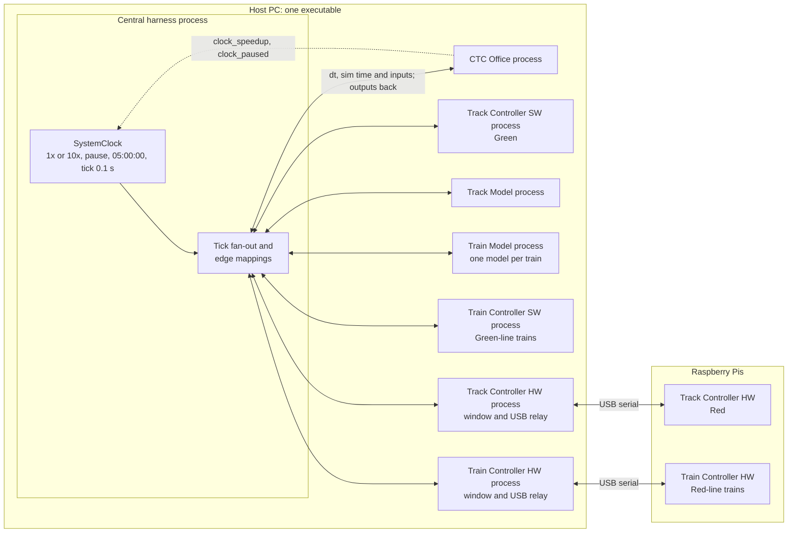

# System Integration Design: Central Harness and Shared Clock

| | |
|---|---|
| **Status** | Draft v0.16. Every question in section 1.5 is answered; the phase handovers' open questions are listed after them (section 1.5). Phases 0 to 4 are built (sections 5.1 to 5.5); Phase 5 software steps 1–9 and documentation step 13 are built and verified with simulated Pis (section 5.6); Phase 6 review path is built; multi-train acceptance remains incomplete (section 5.7). Real-Pi steps 10–11 await hardware, and Windows packaging remains deferred. Not normative. |
| **Date** | 2026-10-22 |
| **Requested by** | Kevin Schillinger |
| **Prepared by** | Claude (Claude Code session) |
| **Basis** | `development` at `1aaa9a8`; `truth` at `f7c52c1`; all remote branches and open pull requests as fetched on 2026-10-16 at about 23:00 UTC; the team's review of v0.1 on 2026-10-16; the answers of 2026-10-17 and 2026-10-20; test runs of 2026-10-16; the Phase 0 harness on `claude/quirky-fermi-sickg4`, with its tests and measurements of 2026-10-20 (section 5.1); Phase 1 on the same branch, with the Train Controller of PR #44 (section 5.2); Phase 2 on the same branch, with the `track-model` branch merged, and Kevin Schillinger's operator window and Train Model review merged from the same branch (sections 5.1 and 5.3); Phase 3 on the same branch, with its tests and measurements of 2026-10-20 (section 5.4); Phase 4 on the same branch, with its tests, measurements and frozen build of 2026-10-20 (section 5.5); the answers of 2026-10-21 and the work on the same branch since `a55b8b9` (`0305d05` to `460579b`), with its tests of 2026-10-21 (section 5.5); `truth` after the promotion of 2026-10-19 (`84c7d44`) |

The `truth` branch is the authoritative record. This document cites it by shard path
(`origin/truth:truth/<path>`, shortened below to the shard name) and does not override it.
Where a fact is missing or contested, the document records a gap (section 6) instead of
choosing a value. Nothing here is filled in silently.

**Changes in v0.16**

- Phase 6 validates Iteration 3 readiness, Red test routing and shared
  neighbor closure inputs, with the unchanged course track files (§5.7).
- Final sequential simulated-Pi samples pass at 1x but fail 10x: 9.16x
  headless and 8.36x with Wayland window launches, including explicit
  dropped-backlog events. Reliable 10x remains open; no optimization was made.
- The Phase 5 handover distinguishes unfinished due ticks from explicit
  dropped-backlog events and records the Qt-signal lint exception.
- Red yard geometry, Green follower locking, CTC Red concurrency, SW vital
  implementation and real-Pi speed remain owner questions.

**Changes in v0.15**

- Phase 5 decisions K1–K12 are R93–R107 (section 1.4.1), including the
  separately named K3b/K4b. The physical Red yard connection is settled;
  NORMAL-leg interpretation and original switch text remain owner questions.
- PR #43's source and Braden's WP2 design are merged; the GitHub PR stays
  unmerged. Section 5.6 distinguishes implementation, simulated verification
  and the deferred hardware/provisioning/packaging work.

**Changes since v0.13**

- Kevin Schillinger directly accepted the steady-fall engine check as built and
  automatic Run for `--stubs-only` on 2026-10-21 (R91/R92). Neither decision changes
  runtime code. The detector's two known limits and other owners' questions remain.
- Two new proposals record these decisions; promotion remains human-only (section 7).

**Changes in v0.13**

- The engine-detector repair `460579b` unblocks the complete Green round trip and
  retirement at 57. Q-P4-8 and G-NEW-6 are resolved as implementation defects; Kevin's
  acceptance of the extra steady-fall criterion was still pending at v0.13 and is now
  recorded in R91 (section 5.5).
- Section 5.5 records the detector as built, its two known limits and the fresh
  targeted checks of 2026-10-21. These checks are not a whole-suite rerun or a new
  timing-budget measurement.

**Changes in v0.12**

- Kevin Schillinger answered the Phase 4 handover's questions on 2026-10-21 (R83 to
  R90, section 1.4). Q-P4-1, -2, -4, -5 and -6 are closed. Q-P4-3 is closed for the
  CTC Office and the Track Controller, and Q-P4-7 stays open. Phase 3 handover Q7 is
  resolved.
- The CTC Office has a "return to yard" action and a Return to yard button (R66, R85),
  and takes its time from the harness's clock (R88; `4cc873b`).
- The Track Controller SW's starter program sets each switch for the train coming to
  it (R86; `234c353`), so a train coming round the Green Line can reach the yard entry
  block 57. Its owners have decisions left (Phase 3 Q7, section 1.5).
- A train entering a slower block is slowed by its Train Controller at once (R87). A
  test covers it (`0305d05`), and a proposal records it (`66aa348`, section 7.1).
- A window run waits for the dispatcher's Run in the CTC Office's window (R83; `68fcfa7`).
  Headless and `--stubs-only` runs press Run by themselves, and `--auto-run` does in a
  window run, for tests and demonstrations (section 5.5).
- Q-P4-8 originally recorded a full-system round trip blocked at Green 93 by a
  false engine-failure latch up the grade (G-NEW-6); repaired later in `460579b`.
- The harness window test gives system mode eight seconds, so its start no longer
  races the time limit (section 5.5).
- Gaps G-CLK-2, G-SIG-6 and G-SIG-7 are updated, and G-NEW-6 is new.

**Changes in v0.11**

- Phase 4 is built (section 5.5). The CTC Office runs under the harness as itself, with
  the Track Controller SW, the Track Model, the Train Model and the Train Controller SW.
  It dispatches a train from the yard, releases it and reports it to the harness's
  roster, follows it from occupancy, and suggests for its block and the next one. It
  runs the clock, and its inputs carry each ticket sale exactly once. The Iteration 3
  scenario runs end to end: G1 dispatched from the yard to GLENBURY, stopped there with
  its doors open. The scripted CTC Office is retired. The two HW variants are still
  stubs.
- The CTC Office's next-block suggestion and train events (Phase 3 handover Q13, Q14)
  were added in `9c440d6` at Kevin Schillinger's direction of 2026-10-20. Its owner
  should review them and the new process (section 5.5).
- Seven harness faults found during Phase 4's validation are fixed: overflowing numbers,
  invalid Unicode, over-long lines, a reply for the wrong tick, unsendable inputs, log
  files that clashed, and the window's focus and selection (section 5.5). The Phase 0
  console test is deterministic (Phase 3 handover Q15).
- The system as wired keeps 10x with a mean tick round trip under 6 ms, and the frozen
  build runs it (G-CLK-6, G-RUN-2).
- Section 1.5 lists the Phase 4 open questions, Q-P4-1 to Q-P4-7. Gaps G-SIG-3, -5, -6,
  -7 and -14, G-CLK-3 and -6, G-LIFE-2 and -4, G-RUN-2, -7 and -8, G-NEW-1, and
  Appendix A are updated for Phase 4.

v0.11 recorded Phase 4 as built, v0.10 Phase 3, v0.9 Phase 2, v0.8 Phase 1 and the
promotion of 2026-10-19, v0.7 Phase 0, v0.6 R79 to R81 and the last answers, v0.5 the
second round of answers of 2026-10-20 (R65 to R78), v0.4 the first (R44 to R64), v0.3
those of 2026-10-17 (R33 to R43), and v0.2 the review of v0.1 (R1 to R32). Git history
holds the earlier text.

**Tags**

| Tag | Meaning |
|---|---|
| [T] | Normative fact on `truth`. |
| [R*n*] | Decision *n*: R1 to R32 from the team's review of v0.1 on 2026-10-16, R33 to R43 from the answers of 2026-10-17, R44 to R82 from the answers of 2026-10-20, and R83 to R90 from the answers of 2026-10-21 (section 1). Statements new to `truth` were filed as proposals (section 7). |
| [U] | Stated by Kevin Schillinger on 2026-10-16 when requesting this design. |
| [P] | Pending proposal under `truth/_inbox/`. Not a fact. |
| [C] | Observed in code at `1aaa9a8`, unless another ref is named. Current behaviour, not a decision. |
| [D] | Stated in a project document: SRS, course deck, module README or guide, or meeting log. |
| G-… | Gap or question, listed in section 6. |
| Q*n*, TC-*n* | Question for the team (section 1.5) or for the Track Controller owners (section 1.6). |

## 1. Decisions and open questions

### 1.1 The ten questions of v0.1

Quotes are verbatim from the review.

| # | v0.1 question | Decision | What it settles | What it leaves open |
|---|---|---|---|---|
| R1 | What "in parallel" means | "Direct fan out to the modules. Modules only see inputs on the rising clock edge" | The harness sends every tick straight to every module, and no module relays it. A module steps on the inputs delivered with tick *k*. Because the steps run at the same time (R4), those inputs come from outputs of tick *k*−1. | Whether the harness waits for every reply before the next tick (G-CLK-11) |
| R2 | What each module receives per tick | "Send both dt and sim time" | Every module receives dt and the simulation time. | Which simulation time: unwrapped, or time of day (G-CLK-2) |
| R3 | How pause and resume reach the harness | "Clock_paused and clock speedup signals were added to the ctc" | The CTC Office's `clock_paused` and `clock_speedup` outputs carry pause, resume and speed. | How the harness reads `clock_paused` while nothing is stepped (G-CLK-3) |
| R4 | One process, or one per module | "Central harness is one process that spawns processes for each module, the whole thing runs as one exe". Section 4.3: "Option C". Section 4.5: "Process model 2. One process per module chosen" | Process model 2 and tick option C. | The harness-to-module protocol, liveness and packaging (G-RUN-2, G-RUN-6, G-RUN-7) |
| R5 | What makes the HW variants hardware; which variant runs where | "The HW variants run on Raspberry pis and communicate with the host pc via USB. HW on the red line and SW on the green. If a train is on the green line it gets SW train controller on red a HW controller" | Track Controller: HW on Red, SW on Green. Train Controller: chosen by the line the train is on. | The USB link (G-HW-1, Q7). R40 later put the Blue Line out of scope. |
| R6 | The canonical block identifier | "Follow the block identifier used in the CTC module" | Line and block number as strings, for example `("Green", "63")`. This matches [T] `conventions/identifiers.md`. | How the case of line names fits R17 (Q15) |
| R7 | Suggestions per train or per block | `TrainSuggestion(train_id="T1", line="Green", block_id="63", suggested_speed_mps=18, authority_blocks=2)`: "this is what the ctc sends" | One suggestion per train, naming the block the train is in. The CTC Office's type already has these fields. | The train ID format (Q4). R38 later kept the speed an int. |
| R8 | Readiness shape and what it gates | "Shape is 2d array : per line, per track controller. Action is fully gated per line until every track controller signals ready. One line can operate while the other is stalled but all track controllers on one line need to be ready for safe operation(i.e. no dispatch of trains until ready)" | The shape, and gating per line. | What makes a controller ready, who loads PLC programs in an integrated run, and a line that reads ready too early (Q13, Q20) |
| R9 | Who creates and retires trains | "The CTC pulls trains from the "yard" and sends them back into the yard.The yard is just a blackbox with unlimited capacity" | The CTC Office owns dispatch from the yard and return to it. | How the Train Model and Train Controller learn of a new train. R35 later made the CTC Office its creator (Q3, G-SIG-6). |
| R10 | Stale commanded speed and authority | "The track controller sends commanded speed and authority to a block. This block is assumed to be occupied by the correct train. Then once the track model sends the commanded speed and authority to the train model and clears these values back to zero" | Per-block values that the Track Model clears to zero after delivering them. | A conflict with the Train Controller's failure detection (Q5, G-NEW-1) |

### 1.2 Other rulings from the review

| # | v0.1 section | Ruling (quoted or closely paraphrased) |
|---|---|---|
| R11 | 2.2, 3.4 | "Common/interfaces.py is stale and should not be treated as true"; "common/interfaces.py has been superseded"; "common/harness/track_model_edges.py is just the module interface". |
| R12 | 2.2 | The Train Model test UI is removed at integration and the harness becomes its single driver: "this is true for all modules". |
| R13 | 2.2, G-RUN-4 | "No event logger is needed"; "event logger does not exist". |
| R14 | 3.2 | Track Controller SW and HW: "time_s will not be used as the sim time will be sent to every module on every tick". |
| R15 | 3.2, 3.3 | Train Controller: "No SW controller exists code is the same as HW". Outputs: "bool[2] for brakes, lights, and doors, announcement_command". The speed-scaled dt "was assumed for the train controller test ui only". R37 later kept the Train Model's `announcement` field. |
| R16 | 3.4 | The four `SystemClock` instances "are for the testing harnesses only they should be replaced by the single central harness". |
| R17 | 4.4 | "All enums should be all caps". |
| R18 | 4.6 | "the line JSON files should be loaded by default on startup". |
| R19 | 4.6, G-LIFE-4 | When a module rejects a tick: "Continue under assumption that a proper tick will be coming in the near future". G-LIFE-4: "we will come back to this, we have no clue what is going to cause a breakage". |
| R20 | G-SIG-3 | "follow CTC structure, Track controllers will only parse the block ID and suggested speed but subsequent modules need associated train IDs". |
| R21 | G-SIG-4 | "Stale". |
| R22 | G-SIG-7 | Ticket sales: "Truth never got updated, it should be sent to CTC as per station and then CTC aggregates the total ticket sales." |
| R23 | G-SIG-8 | "update software such that it should consume failures that come from track model. Track controller also only reports failures as closures". R33 later: failures are seen as occupancy. |
| R24 | G-SIG-9 | `track-info`: "it should be all 6 fields, and the speed should be a float. Train model should send the doors open signal". |
| R25 | G-SIG-10 | The driver sees the light through the windshield: "make sure that the driver is able to see next light state". |
| R26 | G-SIG-15 | Station dwell: "its 45 seconds". |
| R27 | G-SIG-17 | Maintenance: "it should reference closed-blocks and query that array before trying to open/close blocks on the track controller sides, any block that is in this array is considered to be under maintenence, hence why we dont need to send the maintenence mode boolean". |
| R28 | G-SIG-18 | "Ambient temp should be a UI input from Track Model." |
| R29 | G-RUN-2 | "the single executable that will open the central harness and then from there each module can be opened is how we are proceeding". |
| R30 | G-RUN-3 | "final iteration, all modules will be able to run on one computer". |
| R31 | G-RUN-5 | PySide6: "follow 6.11 or later". This matches [T] `conventions/toolchain.md`. |
| R32 | G-HW-1 | "Every hardware modules are running on raspberry Pis. The interfaces between the software and hardware modules are identical meaning that they will consume the same IO, but hardware will communicate over USB to the PIS". |

The review also said: section 2.1 "Ok"; section 5 "All good"; section 6.1 repeats earlier
points; for the Track Controller HW, "see pr #43 for updates"; and the CTC pause signal was
added.

### 1.3 Answers of 2026-10-17

Quotes are as written.

| # | Answers | Ruling | Effect |
|---|---|---|---|
| R33 | Q6, failures | "failures should be seen as occupancy" | A failed block reads as occupied to the Track Controller, as PR #43 has it. Either the Track Model or the edge mapping folds a failure into occupancy. |
| R34 | G-NEW-5, Red data | The HW variant's Red data "can be loaded later" | Not a blocker now. |
| R35 | Q3, train creation | "ctc creates the train" | The CTC Office creates each train it pulls from the yard ([P] D022). It needs an output that carries the new train to the Train Model and the Train Controller. |
| R36 | G-NEW-2, readiness | "wayside will never die" | A wayside that stops reporting is not a case to design for. |
| R37 | Q8, brakes and announcement | "if you mean one supersedes the other then nothing should prevent both from being applied simultaneously. use the announcement field in he train model" | Both brakes may be on at once ([P] `brakes-apply-together`). The announcement keeps the Train Model's field name, `announcement`, as on [T]. |
| R38 | Q9, speed type | "speed sent by CTC remains an int" | Suggested speed stays an int, as on [T]. Commanded speed is a float on the track signal (R24). |
| R39 | Q10, next light | "It is sent from the track model to the train controller directly. and it is spelled SUPER_GREEN" | A Track Model → Train Controller signal that bypasses the Train Model ([P] `signal-aspect-ahead`). |
| R40 | Q11, Blue Line | "The blue line was for testing on a previous iteration not for the final product nothing on the blue line should be accounted for" | The system runs the Green and Red Lines only ([P] D023). |
| R41 | Q7, USB and one computer | "open still" | Unchanged. |
| R42 | Q14, gains | "the harware versions communicate with the host machine over the usb cable but the UI still runs on the host machine" | A HW variant's UI runs on the host PC ([P] D021), so gains are set in the UI as today. |
| R43 | Q16, dwell | "assume the train controller holds this for now" | The Train Controller holds the 45 s dwell, for now ([P] D007). |

### 1.4 Answers of 2026-10-20 and 2026-10-21

Relayed by Kevin Schillinger, with the CTC Office's answers in its owner's words. Quotes
are as written. R83 to R90 are Kevin Schillinger's answers of 2026-10-21 to the Phase 4
handover's questions and to Phase 3 handover Q7. R91/R92 are his later direct
decisions of the same date, accepting the steady-fall check as built and keeping
automatic Run for `--stubs-only`.

| # | Answers | Ruling | Effect |
|---|---|---|---|
| R44 | Q13 (Track Controller) | "PLC programs and databases are not loaded by default. This is the purpose of using a ready signal. Unready system does not gate clock advancement" | A person loads them; readiness gates dispatch, never the clock ([P] `track-controller-ready`). |
| R45 | Second aspect (Track Controller) | "Will change orange to yellow" | The aspects are `RED`, `YELLOW`, `GREEN`, `SUPER_GREEN` ([P] `signal-aspect-ahead`). |
| R46 | Q3 (CTC) | Send the new train "when it releases a train from the yard", one per line at a time, only when the exit block is clear, no train is authorized into it, the line's waysides are ready, and the scheduler isn't holding the run. Retire a train when it "reaches the yard entry block (Green 57, Red 9) and stops there, with authority 0 at its destination". Events, applied exactly once. | [P] D022, D005. |
| R47 | Q4 (CTC) | "The CTC is the source of train IDs." Scheduled `G1`–`G10`, `R1`–`R10`; manual as entered (the window suggests `T1`, `T2`…); a plain string, trimmed, printable, at most 32 characters. Drop the Train Model link's `T-n` and its startup `T-1`. | [P] `identifiers`. |
| R48 | Q17 (CTC) | "Only the per-train modules need the ID, and they get it from the new-train output." | The harness drops the ID on the way to the Track Controller. |
| R49 | Q5 (CTC) | Preload the next block, only when authority is at least 1, with its speed recomputed for that block and authority one less; up to two `TrainSuggestion` entries per train; the next block is always within the train's exclusive authority. | [P] `suggested-speed`, `suggested-authority`. |
| R50 | Q15 (CTC) | Line names stay `Green`, matched exactly; the harness maps the Track Model's `GREEN`. Station names stay as written in the layout files (`GLENBURY`). | [P] `identifiers`. |
| R51 | G-CLK-3 (CTC) | Confirmed: one boolean, true while paused, starting paused. While paused the harness reads `clock_paused` from the CTC's `snapshot()`. | Promote `ctc-deployment/20261016-1517-clock-pause.md`. |
| R52 | G-SIG-7 (CTC) | A mapping from station to count, zeros optional, as sales since the last report. The CTC rejects unknown stations, so Blue stations must not reach it; each tick's sales go through exactly once. | Q22. |
| R53 | G-TR-1 (CTC) | Seven removed CTC proposals to re-file (two updated for R49), three to log as denied, three in the inbox to promote. | Re-filed here (section 7.1). |
| R54 | Q8 (Train Controller) | "We can either keep it or update it doesn't matter" | My call: the brake commands stay two separate booleans, as on [T] and in the Train Model. Nothing to change. |
| R55 | Gains (Train Controller) | "Trains must wait for engineer to set gains, can be a default value but aren't auto applied" | [P] D024. |
| R56 | Station stop (Train Controller) | "wait for cmd speed above zero then depart" | [P] D007. |
| R57 | Wall-clock timers (Train Controller) | "sure if it doesn't break anything" | Gains hand-over on simulation time. |
| R58 | Displayed time (Train Controller) | "sure" | Harness time of day. |
| R59 | Old prototype (Train Controller) | "already deleted just not pushed to dev" | Nothing to do here. |
| R60 | Q18 (Train Model) | "good" | Per-train rejection ([P] `modules/train-model.md`). |
| R61 | Passenger brake release (Train Model) | "add" | [P] `passenger-brake-release`. |
| R62 | Train Model guide | "replace" | Done in this revision. |
| R63 | Displayed time (Train Model) | "fine" | Harness time of day. |
| R64 | Everything else | "any other open question that was not directly addressed is that your suggestions were accepted" | Applied to every module except the Track Controller ("waiting on track ctrl"). Q7 and Q19 stay open: Q7 was left "open still", and Q19 had no single suggestion. |
| R65 | Q24 | "stop at scheduled only" | A train stops only at its scheduled stations, where its authority ends ([P] D007, D020). |
| R66 | Q21 | "add return to yard" | A "return to yard" action retires manual trains too ([P] D022). |
| R67 | Q22 | "track model will not load blue line" | No Blue Line station reaches the CTC Office ([P] D023). |
| R68 | Q25 | "renumber as needed" | The re-filed CTC D019 becomes D025; PR #43 keeps D019 ([P] D025). |
| R69 | TC-1 (Q6) | "yes" | A failed block is reported to the CTC Office as occupied, with no separate closure ([P] `block-occupancy`). This replaces "reports failures as closures" (R23). |
| R70 | TC-2 (Q20) | "yes, not ready until ready" | Every wayside of a line is reported from startup, not ready until loaded ([P] `track-controller-ready`). |
| R71 | TC-3 | "yes" | A wayside is ready exactly when its database and PLC program are both loaded. |
| R72 | TC-4 | "no, should match CTC command" | No change: the SW variant's maintenance state follows the CTC Office's commands. |
| R73 | TC-5 | "no, track model switches automatically" | The Track Model switches the heaters; no heater commands ([P] D026). |
| R74 | TC-6 | "no" | The Track Controller owners will not file `truth` entries for the Track Controller ↔ Track Model signals. |
| R75 | TC-7 | "Harry" | Harry Tye owns the Track Controller contract shard ([P]). |
| R76 | TC-8 | "Leave the test UI just don't call it." | The HW test UI stays, and the harness never starts it ([P] D005; pending D018). |
| R77 | TC-9 | "SW: Green line only, HW: Red line only. HW dependd just on the database file you feed it" | As D021; the HW variant's line follows the databases it is given. |
| R78 | TC-10 | "Yes" | The HW sample wayside files get `next_blocks`. |
| R79 | Q23 | "Adopt the door interlock." | The Train Controller opens doors only when stopped, on the platform side, and commands zero power while a door is open ([P] `door-command`). |
| R80 | Q19 | "keep the logger it is useful" | The harness writes one CSV event log ([P] `files-and-paths`, D005). This reverses R13. |
| R81 | Q7 | "choose whatever usb protocol makes the most sense given that this will fucntion on a strangers windows machine as an exe" | Chosen: USB serial in the standard communications class (CDC-ACM), from the Pi's device mode; the Pis are peripherals of the one computer; one Pi per hardware module ([P] D027; section 4.5). |
| R82 | Phase 1: the Train Controller's emergency brake | "Fix it here" | Under the harness the Train Controller took the echo of its own emergency brake for a passenger pull and never sent the release. Fixed in `Train-Ctrl_HW/train_ctrl` on this branch, for its owners to review (section 5.2). |
| R83 | Q-P4-1 | "yes" | The harness presses Run automatically for headless and test runs only. Otherwise the dispatcher presses Run in the CTC window (D017). Done in `68fcfa7`: `app.py` passes `--run-on-ready` only for a headless, `--stubs-only` or `--auto-run` run (section 5.5). |
| R84 | Q-P4-2 | "this should not matter for implementation" | Closed. Manual dispatch and the schedule in automatic mode are both supported. |
| R85 | Q-P4-3 (CTC) | "yes add a button" | The CTC Office's "return to yard" action, with a Return to yard button in its window (R66; `4cc873b`). |
| R86 | Phase 3 Q7 | "fix" | The starter program sets each switch for the train coming to it, so a train can reach the yard entry block 57 (`234c353`). Retirement needs only a stop at 57 (D022). The owners' decisions stay open (section 1.5). |
| R87 | Q-P4-4 | "for overspeed the train controller will handle slowing down immediately after entering the blcok" | The CTC Office does not cap a suggestion ahead of a lower limit. The Train Controller slows the train once it is in the slower block. Already true: tested in `0305d05` ([P] `lower-limit-ahead`). |
| R88 | Q-P4-5 | "use the harness clock" | The CTC Office takes its time from the step's `sim_time_s` (D017; `4cc873b`). |
| R89 | Q-P4-6 | "do not make any changes to uis" | No further UI changes. The test UI's `next_...` rows and the keying by train stay as they are. |
| R90 | Q-P4-7 | "add this to open questions" | The ticket sales rate stays open, for the Track Model owner. |
| R91 | Engine detector / OPEN_ISSUES #26 | "Accept the steady-fall check as built" | Kevin Schillinger, direct statement 2026-10-21: accept the implementation in `460579b`, including half-second speed means within 10% of the total fall of a straight line across the 6 s window (section 5.5). The two known limits remain. |
| R92 | R83 stubs-only exception | "Keep automatic Run for --stubs-only" | Kevin Schillinger, direct statement 2026-10-21: a `--stubs-only` run presses Run automatically, including window mode, because the stub CTC Office has no window. A real window run still waits for the dispatcher unless `--auto-run` is given. |

### 1.4.1 Phase 5 decisions of 2026-10-21

Kevin authorized steps 1–9 and 13 in the attached session prompt. K4 includes
Braden's answers relayed by Kevin. Quotes preserve their wording. These
implementation rulings do not promote proposals to `truth`.

| # | Source | Kevin's words | Effect |
| --- | --- | --- | --- |
| R93 | K1: Go and order | Steps 1–9 and 13 now; "no hardware is functional yet so that cant be tested" | Build against simulated Pis; steps 10–12 remain out of scope. |
| R94 | K2: Red yard (Phase 3 Q5) | "block 9 physically connects to the yard via a switch … note that block 9 is in section c" | Kevin confirmed on 2026-10-22: "the track is a given data point and can not be modified". Kevin established the physical yard connection at section-C block 9. Readers interpret the stale adjacency while preserving the given bytes; that interpretation and detailed switch legs remain owner assumptions. The earlier source-file edit was an implementation choice, not Kevin's instruction. |
| R95 | K3: PR #43 | "merge into this branch not devlopment leave the pr unmerged" | Merge the source into this branch with a merge commit. Do not merge/close/comment on the GitHub PR. |
| R96 | K3b: Vital layer | "the vital layer has been removed. everything is done by the plc code." | The no-vital policy covers both HW and SW, explicitly confirmed by Kevin: "yes", 2026-10-22. All safety belongs in PLC programs. Existing SW vital implementation is left unchanged under the original implementation scope, and is an owner follow-up. |
| R97 | K4: Red databases/programs, Braden relayed by Kevin | "use test only copies"; "it should be divided in any way that work, maybe 3 waysides. That's fine to keep 9 and 75 in the same wayside."; switches "yes"; crossings "Yes"; "Check the wp2/ branch that braden made. Many updates are found there as well." | Use about three integration test waysides, all 76 blocks once, 9/75 together. NORMAL starters, crossings 11/47 active for own/either-neighbor occupancy; take safety/speed-cap design from WP2. |
| R98 | K4b: WP2 design | The wp2/ branch has "many updates" | Merge `origin/wp2/TrackCtrl-HW-design` (f590f41) separately. Follow Braden's core-on-Pi/host-window split unless a ruling conflicts. Dual channels and five-bit speed exist in PR #43; the generated read-only vital PLC block does not. K3b puts safety in test programs; Harry confirms the planned vital block. |
| R99 | K5: Pis and USB identity | "Pi 5 set up by module owners. assign the both usb ident strigns" | Assign manufacturer/product/serial/VID:PID per module; owners provision the Pis. Write setup instructions without hardware execution. |
| R100 | K6: Pi-link additions | "accept" | Host-to-Pi HELLO (protocol/module/version/hash/session), ACTION/ACK before the next STEP, VIEW at most every 100–200 ms; harness protocol unchanged. |
| R101 | K7: Unplug or reboot recovery | "approved" | Hold the reply; reconnect by identity, redo HELLO, replay loads, re-send pending STEP, log stages. Pi caches `(id,tick)` and never advances that STEP twice. |
| R102 | K8: Pi missing at launch | "the whole clock should wait this will never happen" | No fallback. Missing Pi holds the clock; simulated agents require explicit development/test selection. |
| R103 | K9: Pi capacity at 10x | "agreed test when implemented" | Hardware USB/10x measurement is step 10 later. Record simulated output bytes/core time as groundwork only. |
| R104 | K10: Windows builder/separate installs | "kick this down the road" | Deferred; no Windows builder, separate-installer or packaging claim. |
| R105 | K11: Gains after reboot | "they should never loose connection mid run but add logic to check if connections are lost while the clock as running and if they are lost while the clock is running then the gains should be resent" | Re-send engineer gains only after a loss while running; no automatic gain application after a paused loss (D024). Log both. Kevin later explicitly approved the CLOCK_STATE exception (R107); implementation and integrated recovery checks follow that approval. |
| R106 | K12: Window Python | "any ui changes require permission" | No additional QML or Python-behind-window changes without permission. Use adapters through existing controller/fleet constructor parameters. K3 authorizes the existing owner-authored UI changes in the merge itself. |
| R107 | K11 clock metadata follow-up | Kevin explicitly approved the prepared CLOCK_STATE exception: "yes", 2026-10-22. | Add authoritative initial/change clock metadata on the harness-to-HW-host channels. Latch the state at Pi loss before timeout pause; verify running-loss gain replay and paused-loss non-application. |

### 1.5 Questions

"Blocks" says what an open question holds up: "Core" is the harness skeleton, "Iter 3"
is the first train run, graded on 2026-11-12, and "Full" is the complete system.

| Q | Question | Status | Gap | Blocks |
|---|---|---|---|---|
| Q1 | Wait for every reply before the next tick? | Answered (R64): wait, with a timeout of about 1 s that pauses the clock and names the late module. | G-CLK-11 | none |
| Q2 | Wrapped or unwrapped simulation time? | Answered (R64): unwrapped; each module derives the time of day. | G-CLK-2 | none |
| Q3 | How a new train comes into being, and how it is retired. | Answered (R46). | G-SIG-6 | none |
| Q4 | Train ID format. | Answered (R47). | G-SIG-6 | none |
| Q5 | The emergency brake at block changes. | Answered (R49, R64): the CTC Office preloads the next block, and a block not commanded on the latest tick reads zero. | G-NEW-1 | none |
| Q6 | Is a failed block reported to the CTC Office as occupied or as a closure? | Answered (R69): as occupied, with no separate closure. | G-SIG-8 | none |
| Q7 | The USB link to the Pis, and whether they count as "one computer". | Answered (R81): USB serial (CDC-ACM) in the Pi's device mode; the Pis are peripherals of the one computer; one Pi per hardware module. | G-HW-1, G-RUN-3 | none |
| Q8 | Brake commands as `bool[2]` or two booleans? | Answered (R54): two booleans. | G-SIG-19 | none |
| Q9–Q11 | Float reach, next light, Blue Line. | Answered (R38–R40). | | none |
| Q12 | Edge mappings without the catalog. | Answered (R64): straight from producer to consumer types. | G-SIG-13 | none |
| Q13 | Who loads programs and databases; does the clock wait? | Answered (R44): a person loads them; the clock does not wait. | G-SIG-5 | none |
| Q14 | How gains are set. | Answered (R42, R55). | G-NEW-4 | none |
| Q15 | Line names. | Answered (R50). | G-SIG-11 | none |
| Q16 | Who holds the dwell. | Answered (R43, R56). | G-SIG-15 | none |
| Q17 | Who needs the train ID. | Answered (R48). | G-SIG-3 | none |
| Q18 | Fleet-wide rejection. | Answered (R60). | G-NEW-3 | none |
| Q19 | The event logger. | Answered (R80): keep it; the harness writes one CSV file. | G-RUN-4 | none |
| Q20 | Should each line have a roster of its waysides, so it cannot read ready before all are loaded? | Answered (R70): every wayside is reported from startup, not ready until loaded. | G-NEW-2 | none |
| Q21 | Should the CTC Office get a "return to yard" action for manual trains? | Answered (R66): yes. | G-SIG-6 | none |
| Q22 | How to keep Blue Line stations from reaching the CTC Office. | Answered (R67): the Track Model does not load the Blue Line. | G-SIG-7 | none |
| Q23 | The door interlock. | Answered (R79): adopted. | G-SIG-16 | none |
| Q24 | Which stations does a train stop at? | Answered (R65): its scheduled stations only. | G-SIG-15 | none |
| Q25 | The D019 ID clash. | Answered (R68): the re-filed CTC proposal becomes D025. | G-TR-3 | none |

The phase handovers keep their own questions, numbered apart from the ones above. Of the
Phase 3 handover's (`documents/integration-handover-phase-3.md`, section 3), four are
settled; Q1 to Q6 and Q8 to Q12 stay open there.

| # | Question | Status |
|---|---|---|
| Phase 3 Q7 | The starter program never throws switch 58 (`57-yard`), so no train can be routed into the yard. | Resolved (R86): Kevin Schillinger said "fix" on 2026-10-21. Done in `234c353`: the starter sets each switch for the train coming to it, and retirement needs only a stop at 57 (D022). Left for Harry Tye and Landis (`TrackCtrlSW/INTEGRATION_DISCREPANCIES.md` E7): the new `SUG_n` and `REV_s` PLC inputs; switch 28 standing reverse at rest; whether the vital lock should also be on the points block; the follower case at 76; and Landis to confirm the CTC Office's two-way zone keeps trains from meeting there. |
| Phase 3 Q13 | The CTC Office sends one suggestion per train, for its head block only; R49 needs the next block too. | Resolved: Kevin Schillinger directed on 2026-10-20 "fix Q13 and Q14 in the CTC". Added in `9c440d6` (section 5.5). |
| Phase 3 Q14 | The CTC Office's outputs have no `new_trains` or `retired_trains`, which the roster needs (R35, R46, D022). | Resolved by the same direction. Added in `9c440d6` (section 5.5). |
| Phase 3 Q15 | The Phase 0 console test's startup-timeout race. | Fixed in `428852b` (section 5.5). |

The Phase 4 handover's questions (`documents/integration-handover-phase-4.md`, section
4) were answered by Kevin Schillinger on 2026-10-21 (R83 to R90). Q-P4-7 stays open,
and Q-P4-8 is resolved by `460579b`. Kevin accepted the extra detector criterion and
the stubs-only automatic Run exception on 2026-10-21 (R91/R92).

| # | Question | Who | Status | Blocks |
|---|---|---|---|---|
| Q-P4-1 | Should a normal run wait for the dispatcher's Run (D017), now that the CTC window has one? | Kevin, Landis | Answered (R83): the harness presses Run for headless and test runs only; the dispatcher presses it in the window otherwise. Done in `68fcfa7` (section 5.5). | none |
| Q-P4-2 | For the graded Iteration 3 run, manual dispatch or the course schedule in automatic mode? | Landis, Kevin | Closed (R84): both are supported, and both are tested to work. | none |
| Q-P4-3 | No train is ever retired in a real run: no "return to yard" action (R66), and the starter program never throws a switch onto the route to the yard (Phase 3 Q7). | Landis (CTC), Harry Tye (Track Controller) | Answered (R85, R86): the action and its button are in `4cc873b`; the starter sets each switch for the train coming in `234c353`. The full Green round trip and retirement at 57 now pass after `460579b` (Q-P4-8). | none |
| Q-P4-4 | Nothing slows a train before a block with a lower limit: G1 enters block 67 (40 km/h) at 18 m/s. | Landis (CTC), Train Controller owners | Answered (R87): the Train Controller slows the train once it is in the slower block; the CTC Office does not cap ahead. Already true (section 5.5). | none |
| Q-P4-5 | The CTC Office keeps its own elapsed time and does not read the step's `sim_time_s`; a refused tick puts its schedule a tick behind for good. | Landis | Answered (R88): it uses the harness's clock, in `4cc873b`. | none |
| Q-P4-6 | The test UI and `ctc_host._suggestions` key suggestions by train; the test UI names the next block's rows `next_...`. | Landis | Answered (R89): no further UI changes; the naming stays. | none |
| Q-P4-7 | The Track Model sells tickets with probability 0.02 per station per tick, about 12 a simulated minute per station. Is that the intended rate? | Track Model owner | Open (R90). | none |
| Q-P4-8 | The old detector falsely latched an engine failure at steady 5 m/s on Green 93, blocking the full round trip. | Train Controller owners (unassigned) | Resolved by `460579b` (G-NEW-6): the full Green round trip and retirement at 57 pass. Kevin accepted the extra steady-fall criterion as built on 2026-10-21 (R91); see section 5.5 and `Train-Ctrl_HW/OPEN_ISSUES.md` #26. | none |

### 1.6 Questions for the Track Controller owners

All answered on 2026-10-20.

| # | Question | Answer |
|---|---|---|
| TC-1 | Report a failed block to the CTC Office as occupied, with no separate closure, as PR #43 does? | Yes (R69). |
| TC-2 | Report every wayside of the line from startup, not ready until loaded? | Yes (R70). |
| TC-3 | Is a wayside ready exactly when its database and PLC program are both loaded? | Yes (R71). |
| TC-4 | SW: treat a block in `closed_blocks` as under maintenance, instead of a CTC switch command? | No: it should match the CTC Office's command (R72). |
| TC-5 | Heaters: does the Track Model switch them, or the Track Controller? | The Track Model, automatically (R73). |
| TC-6 | File `truth` entries for the Track Controller ↔ Track Model signals? | No (R74). |
| TC-7 | Who owns the contract shard? | Harry (R75). Both variants already name blocks to the CTC Office by line and number. |
| TC-8 | Keep the HW test UI as a standalone fallback? | Keep it; the harness never calls it (R76). |
| TC-9 | SW: Green Line only? | SW Green only, HW Red only; the HW variant's line follows its databases (R77). |
| TC-10 | Add `next_blocks` to the sample HW wayside files? | Yes (R78). |

Already decided, for both variants: enumerated values become all caps (`NORMAL`,
`REVERSE`, `RED`), and `time_s` gives way to the common unwrapped simulation time.

## 2. Goal and fixed constraints

### 2.1 Goal [U] [R]

1. Integrate all seven module implementations into one functional system through a central
   harness. The seven are the CTC Office, Track Controller SW and HW, Train Controller SW
   and HW, Track Model, and Train Model.
2. The clock lives in the central harness. On every tick the harness sends dt and the
   simulation time straight to every module. Each module sees its inputs only on the
   rising clock edge [U, R1, R2].
3. The CTC Office sets the clock speed, 1x or 10x only, and pauses and resumes the clock,
   through its `clock_speedup` and `clock_paused` outputs [U, R3].
4. Commanded speed and authority come from the Track Controller, per block. The Track Model
   clears them after it delivers them to the train [U, R10].
5. The harness is one process that spawns one process per module. The system is one
   executable: it opens the harness, and each module is opened from there [R4, R29].
6. The HW variants run on Raspberry Pis connected to the host PC by USB, with the same
   inputs and outputs as the SW variants. Their UIs run on the host PC. Track Controller HW
   runs Red and SW runs Green. A train gets the Train Controller of its line [R5, R32, R42].
7. The system runs the Green and Red Lines. The Blue Line is out of scope [R40].

### 2.2 Constraints on `truth` [T], and pending changes

| Constraint | Shard | Pending change [P] |
|---|---|---|
| A central harness sits between the modules. Each module defines only its own boundary types. The harness owns one pure mapping function per producer-to-consumer edge. | `decisions/D005-central-harness.md` | Adds the process model and the single driver (R4, R12, R29). |
| `common/interfaces.py` is the harness-side signal catalog. Edge mappings go from producer type to catalog type to consumer type. | `decisions/D008-interfaces-harness-catalog.md` | Superseded (R11). |
| One shared `SystemClock` at `utils/system_clock.py`, owned by the harness. It passes simulation time to every module, and modules run no clocks of their own. Speeds are 1x and 10x only. The clock pauses and resumes, starts at 05:00:00, shows 24-hour `HH:MM:SS`, and ticks every 0.1 s. The CTC Office sets the speed and pauses and resumes the clock through the harness. | `decisions/D017-shared-simulation-clock.md` | Sends dt and the simulation time, directly, with inputs seen on the rising edge (R1, R2). |
| Steps use a constant dt. Speed and pause change the tick rate, never dt. | `decisions/D006-fixed-time-step.md` | none |
| The CTC Office's speed command is a boolean to the harness, true for 10x. | `signals/clock-speedup.md` | `signals/clock-pause.md` adds pause (from `ctc-deployment`) |
| Values crossing a boundary are in backend SI units. | `decisions/D002-two-unit-systems.md`, `conventions/units.md` | none |
| The Train Model test UI is removed at integration, and the harness becomes the Train Model's single driver. | `decisions/D010-train-model-test-ui-boundary.md` | R12 extends this to every module, through the D005 proposal. |
| The Train Model is physics only. Speed regulation belongs to the Train Controller. | `decisions/D009-train-model-control-boundary.md` | none |
| Authority is a non-negative count of blocks. | `decisions/D013-authority-block-count.md` | none |
| Station dwell is 45 s, with a recorded conflict against a 60 s schedule. | `decisions/D007-station-dwell.md` | Conflict resolved for 45 s (R26); the Train Controller holds the dwell, for now (R43). |
| One runnable executable, with no external services or network at runtime. The clock and an event logger are standalone shared utilities. | `conventions/files-and-paths.md` | The event logger is recorded as a conflict with R13. |
| A block is named by its line and block number, as strings: `("Green", "12")`. | `conventions/identifiers.md` | none. R6 agrees. |
| Five modules. The Track Controller and the Train Controller each have a SW and a HW instance. Enum members are UPPER_CASE. | `conventions/naming.md` | Every enumerated value is all caps, including values that cross a boundary (R17). |
| PySide6 6.11 or later; PyInstaller 6.22.2 or later. | `conventions/toolchain.md` | none. R31 agrees. |

### 2.3 Course and customer requirements that bear on integration [D]

From `documents/srs-filled.md` (line numbers in parentheses):

- Clock and timing:
  - REQ-INTF-013 (211): all submodules share a single simulation clock.
  - REQ-FUNC-001, -002 and -003 (237-241): real-time speed, "at least 10x", and pause.
  - REQ-NFR-001.1 (443): the simulation *should* advance in 1 ms ticks.
  - REQ-NFR-001.2 (444): the simulation *shall not* drop any ticks.
  - REQ-NFR-007 (462): ready within 20 s of launch. Under R4 that covers seven processes.
- Channels:
  - REQ-INTF-017 (223): the track circuit carries speed and authority from the Track
    Controller to the Train Controller.
  - REQ-INTF-018 (225): the Track Model tells the Track Controller about occupancy and
    train presence.
  - REQ-INTF-019 and -020 (227-229): the CTC Office sends speed and authority to the Track
    Controller, which reports occupancy back.
  - REQ-INTF-021 (231): every channel is non-vital.
- Variants: REQ-INTF-009 and -010 (199-201): the HW and SW variants expose equivalent
  external interfaces. R32 says they are identical.
- Event log: REQ-NFR-008 (466), REQ-INTF-015 (215) and REQ-DSN-005 (512) require one, in
  CSV. R80 keeps it: the harness writes one CSV file.
- Delivery: REQ-DSN-001, -002 and -003 (496-504): a standalone, pre-compiled executable on
  a single machine with no network. R5 adds Raspberry Pis, attached by USB as peripherals
  of that one machine (R81).

Schedule (`documents/Track_Overflow_Schedule.gan`): Design Review on 2026-10-22; Iteration 3,
the System Group Review, on 2026-11-12; Iteration 4, the final, on 2026-12-10. The
Iteration 3 rubric gives 35 points each to "Do the Sub-systems Communicate" and "Does the
Train Move from Yard to Destination Block". The course deck (`Final Project vF.pdf`, p.80)
advises integrating in the order "Train -> Train Controller -> Track -> Wayside Controller
-> CTC", after "All at once… FAILED".

## 3. Current state (re-read on 2026-10-16)

### 3.1 Integration guides

The request assumed that every module already had an integration guide. On `development`
only the Train Model has one. The Track Model's is on a branch.

| Module | Guide | Nearest material, and how it stands against the decisions |
|---|---|---|
| CTC Office | Partial | `CTC-Office/ctc_ui/README.md` covers the boundary, the test links and the snapshot fields, `clock_paused` included (lines 123-126). It has nothing on stepping, startup or shutdown. |
| Track Controller SW | None | One paragraph in `TrackCtrlSW/README.md`, and `TrackCtrlSW/INTEGRATION_DISCREPANCIES.md`. |
| Track Controller HW | Partial | `TrackCtrlHw/README.md`, "Integrating the module" (lines 66-160). It keeps the test UI and has the harness hand the window its controller in the same process. Both contradict R4 and R12. PR #43 rewrites the boundary. |
| Train Controller (SW and HW) | None | R15: one code base. The only integration material is the `TrainControllerFleet` docstring and `Train-Ctrl_HW/harness_sim.py`, both on branches (section 3.6). |
| Track Model | On a branch | `origin/track-model:TrackModel/INTEGRATION.md`, 365 lines. It runs the Track Model in the harness's process, contradicting R4. It has no shutdown section, and it says to delete `test_ui/`, `test_link/` and the link server at integration. The branch is 132 commits behind `development`. |
| Train Model | Yes, needs an update | `TrainModel/docs/integration.md` §3 says "Every train runs in the system process… There is no process per train and no IPC" (lines 162-164), which contradicts R4. It also says to delete `link.py`, the only transport the Train Model has. |

### 3.2 Module status at a glance [C]

| Module | Callable boundary | Time input | Clock or timer of its own | Scope | Entry point and link | Tests |
|---|---|---|---|---|---|---|
| CTC Office | `CtcOffice.step(dt, inputs) -> CtcOutputs`; Qt-free core | dt only | Yes. The window owns a `SystemClock` and `ClockDriver` (`ctc_ui/sim_clock.py:40-45`). | One per system | `python -m ctc_ui`; link `trains-ctc-office`, plus a clock link | 208 passed |
| Track Controller SW | `step(dt, TrackControllerInputs(time_s, ctc, track_model))`; Qt-free core | dt and `time_s` | Not in the core. The test client has one. | Loads Green and Red (`track_ctrl/state.py:69-71`) | `python main.py [--no-test-link] [--load-starters]`; link `ece1140-track-controller-stimulus` | 186 passed |
| Track Controller HW | Same shape as SW; Qt-free core | dt and `time_s` | Not in the core. The test UI has one. | One line (`controller.py:75-81`) | `python TrackCtrlHw/ui/main.py`, or `launch.py` for window plus test UI; link `trains-track-controller-hw` | 61 passed, **1 failed** |
| Train Controller SW | None. R15: there is no SW controller; the HW code serves both. `TrainController/` is an earlier prototype with no boundary and is not used. | n/a | `TrainController/` has its own 1 s timer. | n/a | n/a | 24 passed (`TrainController/`) |
| Train Controller HW | `development`: `ConsoleBackend.apply_inputs`, with outputs on a Qt signal. Branches: `TrainControllerFleet.add`, `remove` and `step_all(dt, inputs_by_id)`, with no Qt. | dt only (fleet) | Yes: 20 Hz and 10 Hz timers. With a fleet only the 10 Hz UI timer runs, and it still advances the console's own clock. | Many trains per process | `python main.py [--test \| --both \| --check]`; no link | No pytest suite |
| Track Model | `TrackModel.step(dt, inputs) -> TrackModelOutputs`; Qt-free core | dt; an optional `sim_time_s` on `origin/track-model` | Not in the core. The test UI has a `QTimer`. | One instance for all lines | `python TrackModel/main.py`; link `track-overflow-track-model` | 266 passed |
| Train Model | `TrainModelFleet.add`, `remove`, `step_all(dt, inputs_by_id)`; Qt-free physics | dt only | Not in the module. The test UI has a `SystemClock`. | One model per train | `python main.py`, which creates train `T-1`; link `trains-train-model` | 760 passed, 13 skipped |

Neither HW variant has hardware or USB code. There is no serial, USB or GPIO code on any
branch, and no document says what runs on a Pi (G-HW-1).

### 3.3 Per-module notes [C], checked against the decisions

**CTC Office** (`CTC-Office/`)
- Boundary: `step(dt, CtcInputs) -> CtcOutputs`.
  - Inputs from the Track Controller: occupancy, switch reports, crossing reports and one
    `WaysideStatus` per wayside (`ctc/interface.py:86-92`). There is no input for closures.
  - Input from the Track Model: ticket sales per station (`:110`).
  - Outputs: one `TrainSuggestion` per followed train (`:124-142`), which matches R7 field
    for field with `suggested_speed_mps: int`; `closed_blocks`; switch commands;
    `clock_speedup`; and `clock_paused`, which defaults to true (`:183-193`).
- Clock (R3, R16): the window still owns a `SystemClock`. The header's Run, Pause, 1x and
  10x act on it (`ctc_ui/ui/Main.qml:73-79`), and the host copies its state into the
  module's outputs (`ctc_ui/ctc_host.py:213-229, 811-824`). The module's own setters exist
  (`ctc/interface.py:402-406`), but the header does not call them directly.
- Time (R2): the module takes dt only. It keeps its own time, 05:00:00 plus the sum of every
  dt it was given (`ctc/model.py:417-445, 754`), so a rejected step loses that dt. The
  throughput history and the current hour are updated in the window's tick handler
  (`ctc_host.py:231-247`), outside the module.
- Readiness (R8): a line is ready when a wayside on it has reported and every wayside
  that reported is ready (`ctc/model.py:346-351`). It keeps no roster of the waysides it
  expects (G-NEW-2).
- Trains (R9, R35): the CTC Office creates each train, but today it never announces one. It
  matches occupancy of the yard exit block, Green 63 or Red 9, against waiting orders. Trains return to the yard from
  Green 57 or Red 9 (`ctc/tracking.py:39-44`). IDs are `T{n}` for manual dispatch
  (`ctc_host.py:493-496`) and `G1` or `R1` for scheduled runs (`ctc/scheduler.py:79`).
- Against the decisions: enumerated values are lowercase (`"normal"`, `"active"`) (R17), and
  no output announces a new train (R35). It also has no input for closures, which matters
  only if Q6 keeps closures.

**Track Controller SW** (`TrackCtrlSW/`; PR #41 merged since v0.1)
- Boundary: `step(dt, TrackControllerInputs(time_s, ctc, track_model))`. Each wayside
  reports `CtcReport(wayside_id, line, sent_at_s, ready, blocks, reason)`. While any wayside
  is not ready the whole module stalls, and its docstring tells the CTC Office to send
  nothing "on any line" (`track_ctrl/interface.py:175-215`).
- `common/harness/ctc_edges.py`, now on `development`, maps `TrainSuggestion` to a per-block
  `Suggestion` and drops the train ID, which fits R20. If two suggestions name one block, it
  takes the lower speed and the lower authority separately, as its docstring says.
- Against the decisions:
  - It loads both lines (R5: Green only). Once it loads only Green, its module-wide stall
    becomes the per-line stall of R8.
  - It takes `time_s` (R14).
  - Enumerated values are lowercase (R17).
  - It has no failure input. Under R33 a failed block reaches it as occupancy, so it needs
    none once the Track Model or the mapping folds failures into occupancy.
  - It treats a CTC switch command in force as maintenance (`module.py:16-18`), where R27
    makes a block under maintenance one that is in `closed-blocks`.
  - Its README installs PySide6 6.8 (R31).
- Speed must be an int, and a float rejects the tick (`track_ctrl/module.py:83-90, 330`).
  That stands, since the CTC Office's speed stays an int (R38).
- PLC programs load from the UI, from `--load-starters`, or by the test link's
  `load_starter_programs` operation.

**Track Controller HW** (`TrackCtrlHw/`; PR #43 open)
- PR #43 is open from `feature/TrackCtrl-Showcase-Feedback`: 7 commits, 32 files, merge
  blocked. It:
  - keys CTC Office inputs by `BlockRef(line, block_id)`, which fits R6;
  - drops `maintenance_mode`, which fits R27;
  - adds per-wayside readiness with a module-wide stall, which fits R8 while the module
    runs one line;
  - states that a failure "reaches it only as an occupied block, and it reports that block
    to the CTC Office as occupied" (`track_ctrl_hw/interface.py:14-16` on the PR head).
    Seeing failures as occupancy fits R33. Reporting them as occupied rather than as
    closures (R23) waits on Q6.
- Data: wayside databases and PLC programs exist for three Green waysides only, 50 of the
  line's 150 blocks. Red's, where R5 puts this variant, will be loaded later (R34).
- Still against the decisions on the PR head:
  - Track Model-side keys keep the section letter (`BlockKey(line, section, block_id)`).
  - Enumerated values are lowercase (R17).
  - It takes `time_s` (R14).
  - The README keeps the test UI (R12).
  - Databases and programs load from the window (`loadDatabase`, `loadProgram` in
    `track_ctrl_hw/state.py`). On `development` the link cannot load them (R18, Q13).
  - It has no USB or Pi code (R5).
- One test fails on `development` (section 3.5).

**Train Controller** (`Train-Ctrl_HW/`; one code base for SW and HW, R15)
- The `train_ctrl/` package with `TrainControllerFleet` is on `origin/Train-Ctrl_HW` and
  `origin/Train_Ctrl_integration` (section 3.6), not on `development`. The fleet has no Qt.
  `run(..., fleet=)` then skips the 20 Hz timer, but `main.py` never passes a fleet.
- Outputs are `TrainModelCommands(power_w, service_brake, emergency_brake, door_command,
  light_command, temperature_setpoint_c, announcement)`. Doors are (left, right) and lights
  are (interior, exterior). The announcement keeps the Train Model's name, `announcement`
  (R37). R15 wants the brakes as `bool[2]`; which element is which is Q8.
- Signal-pickup detection: if the received (speed, authority) becomes exactly (0.0, 0)
  right after a nonzero speed with authority of at least 2 blocks, the controller latches a
  signal-pickup failure. That cuts power and latches the emergency brake until the failure
  clears (`train_ctrl/control.py:219-223`; on `development`, `main.py:575-579`). See
  G-NEW-1.
- Light ahead: the input is taken only if it is `"RED"`, `"YELLOW"`, `"GREEN"` or
  `"SUPER GREEN"`, with a space. Anything else is dropped without an error
  (`train_ctrl/inputs.py:69-70`; `main.py:196`). R39 fixes the spelling as `SUPER_GREEN`,
  which the code as written would drop.
- A train applies no power until an engineer commissions its gains in the UI. That stays:
  the UI runs on the host PC for the HW variant too (R42), so each new train waits for its
  gains.
- It has no dwell or station-stop logic, which R43 now gives it.
- It has no link, no pytest suite and no hardware layer.

**Track Model** (`TrackModel/`)
- Boundary: `step(dt, TrackModelInputs(controller, trains, ambient_temp_c))`.
- Commanded speed and authority arrive per block. "A key that is absent keeps the last value
  commanded for it" (`track_model/interface.py:184`; `model.py:280-281`). That is
  against R10, under which the values are cleared to zero after delivery.
- `ambient_temp_c` is a required input, and the UI can override it (`model.py:156-158`).
  Under R28 the UI is the source, so the input becomes optional or goes.
- Enumerated values are all caps (`NORMAL`, `RED`, `SUPER_GREEN`), which fits R17. Block IDs
  look like `"GREEN K-63"`, with an upper-case line and a section letter, which differs from
  R6.
- Commanded speed is an int (`model.py:124`), against R24.
- `track-info` has six fields in code, which fits R24. `doors_open` is an input, so it needs
  the Train Model output that R24 asks for.
- Ticket sales go out per station, which fits R22. Nothing converts its list to the CTC
  Office's per-station mapping.
- `origin/track-model` (`3e7c15f`) adds `INTEGRATION.md` and an optional `sim_time_s` input
  (R2).

**Train Model** (`TrainModel/`, unchanged since v0.1)
- `TrainModelFleet.add(train_id, line)`, `remove(train_id)` and `step_all(dt, inputs_by_id)`,
  on one thread. It takes dt only (R2).
- It has no doors-open output (R24). The light ahead does not pass through it (R39).
- One invalid input rejects the whole fleet's tick (Q18).
- Passenger emergency brake release has no mechanism (G-SIG-16). The test UI holds the dwell
  today. R12 removes the test UI, and R43 moves the dwell to the Train Controller.
- Its link (`train_model/link.py`) assigns train IDs `T-n` itself (`:170-189`) and refuses
  to remove the last train (`:191-197`). `main.py` creates `T-1` at startup, and `step` must
  name exactly the current roster (`fleet.py:136-144`). All of this clashes with
  CTC-owned dispatch (R9, Q3).

### 3.4 Shared infrastructure [C]

- `utils/system_clock.py` implements D017: start 05:00:00, tick 0.1 s, speeds 1 and 10,
  pause, resume, reset and `HH:MM:SS`. It starts paused, which matches the CTC Office's
  `clock_paused` default. Tick listeners receive `(sim_time_s, tick_s)` and run one after
  another on the calling thread (`system_clock.py:140-149`).
- `utils/clock_driver.py` paces the clock from a Qt event loop. Owed ticks run back to back
  in one timer fire. With more than 100 owed it runs one and drops the rest, so simulated
  time slips (`clock_driver.py:27-30, 155-177`).
- The CTC window, the Train Model test UI, the Track Controller HW test UI and the Track
  Controller SW test client each have a clock. R16 replaces them with the harness's clock.
- `common/interfaces.py` is superseded (R11).
- `common/harness/` holds `ctc_edges.py` (CTC Office to Track Controller SW) and
  `track_model_edges.py`, six one-sided Track Model edges to the old catalog (Q12).
- Six `QLocalServer` test links exist (Appendix B). None was built as a harness channel, and
  the docs of three modules say to delete theirs at integration. Neither Train Controller
  has a link.
- Encoders and decoders for boundary types exist only in that test scaffolding:
  `ctc/wire.py`, `track_ctrl/wire.py`, `track_ctrl_hw/wire.py`, `TrackModel/test_link/codec.py`
  and `train_model/link.py:95-126`. There are none for the Train Controller. A block is
  encoded four different ways among them.
- Packaging:
  - `requirements.txt` pins PyInstaller 6.22.2 and PySide6 6.11.2.
  - The only build recipe is in `TrainModel/README.md` (lines 226-263): two separate
    `--onedir` executables.
  - Only the Train Model handles `sys._MEIPASS`.
  - There is no `.spec` file, no `freeze_support`, no build script.
  - `TrackCtrlHw/launch.py` is the only code that spawns processes. It runs
    `[sys.executable, <script>.py]`, which assumes a Python interpreter and `.py` files on
    disk.

### 3.5 Tests (re-run 2026-10-16 at `1aaa9a8`)

Environment: a scratch virtual environment outside the repository, with Python 3.13.16,
PySide6 6.11.2 and pytest 9.1.1, `QT_QPA_PLATFORM=offscreen` and `-p no:cacheprovider`. Each
suite ran from its module folder, one after another. The runs changed no file in the
repository.

| Suite | Result |
|---|---|
| `utils` | 31 passed, **1 failed**: `test_clock_driver.py::ClockDriverAccuracyTest::test_stall_drops_backlog_instead_of_bursting` (12.4 s against 13.0 ± 0.5 s). It is a wall-clock test. It passed in the v0.1 run with `utils/` unchanged since, and on three isolated reruns it passed twice and failed once. |
| `CTC-Office` | 208 passed |
| `TrackCtrlSW` | 186 passed |
| `TrackCtrlHw` | 61 passed, **1 failed**: `tests/test_territory.py`, where the sample waysides lack the `next_blocks` field that `TrackModel/green_line.json` gained in PR #24 |
| `TrainController` | 24 passed |
| `TrackModel` | 266 passed |
| `TrainModel` | 760 passed, 13 skipped |
| `Train-Ctrl_HW` | No pytest suite |

No integration or system test exists.

### 3.6 Work outside `development`

- Merged since v0.1:
  - PR #41 (`Track-Ctrl-SW`): `ctc_edges.py` and per-wayside readiness.
  - PR #39: Track Controller HW example PLC programs.
  - PR #42 (`ctc-deployment`): the CTC Office's `clock_paused`.
- Open: [Landiss04/Track-Overflow#43](https://github.com/Landiss04/Track-Overflow/pull/43),
  Track Controller HW (section 3.3).
- `origin/track-model` (`3e7c15f`) holds `INTEGRATION.md` and `sim_time_s`. It is 132 commits
  behind `development`.
- `origin/Train_Ctrl_integration` (`b9e3f6a`) and `origin/Train-Ctrl_HW` (`1bc21d1`) hold the
  `train_ctrl/` package and its fleet. The first also has `harness_sim.py`, a stand-in
  harness in one process: it spawns three trains, feeds each a fixed 55 mph command and
  integrates a toy plant. It is not a harness for the real modules.
- Both Train Controller branches fork far behind `development`, delete `TrainModel/`, and
  have no `utils/`. Take only `Train-Ctrl_HW/` from them.

## 4. Architecture

### 4.1 Topology (decided: R1, R4, R5)

All module-to-module data passes through the harness's edge mappings (D005). Appendix A
lists what each edge carries. A HW variant's process on the host shows its window and
relays the harness's messages to its Pi over USB serial (R42, R81).

### 4.2 Clock

| Aspect | Design | Source | Open |
|---|---|---|---|
| Owner | One `SystemClock` in the harness process. Every module clock and test clock goes. | [T] D017; [R16] | The CTC window clock (G-CLK-7) |
| Per tick | The harness sends dt and the simulation time, with each module's inputs, straight to every module. | [R1, R2, R64] | none: unwrapped |
| dt | 0.1 s, fixed. Speed and pause change the tick rate only. The Train Controller's speed-scaled dt belonged to its test UI. | [T] D006, D017; [R15] | none |
| Speed | `clock_speedup` true makes the harness call `set_speed(10)`, and false `set_speed(1)`. | [T] `clock-speedup`; [R3] | none |
| Pause and resume | `clock_paused` true makes the harness call `pause()`, and false `resume()`. While paused nothing is stepped, so the CTC Office cannot report a resume as a step output. The harness has to read `clock_paused` outside a step, for example from a state message the CTC Office's process sends when the value changes. [P] `ctc-deployment/20261016-1517-clock-pause.md` proposes exactly that. | [R3, R51]; [P] | none |
| Start | Paused at 05:00:00. | [T] D017 | none |
| Display | Every window shows the time the harness sends. | [T] D017 | G-CLK-8 |
| Pacing | `TickPacer` on the harness's Qt event loop. It keeps `ClockDriver`'s real-time accounting, but starts no tick until every reply to the last one is in. | [C] section 5.1; [R64] | none |

**Wrapped or unwrapped simulation time (Q2).** `SystemClock.sim_time_s` starts at 18 000 s
(05:00:00) and keeps counting. One simulated day later it reads 104 400 s, not 18 000 s.
That is unwrapped time. `SystemClock.time_of_day_s` is the same value modulo 86 400 s, so
it drops back to 0 at midnight. That is wrapped time (`utils/system_clock.py:126-133`).

| Send | For | Against |
|---|---|---|
| Unwrapped (`sim_time_s`) | It never goes backwards, so a duration (a dwell, tickets per hour, a timeout) is a plain subtraction. | Every display and schedule lookup takes the value modulo 86 400 s itself. |
| Wrapped (`time_of_day_s`) | It matches the `HH:MM:SS` on every window and the schedule's times of day. The Track Controllers' `time_s` already means seconds since midnight. | It jumps from 86 399 s back to 0 at midnight, which breaks any duration measured across it. |

A run reaches midnight only after 19 simulated hours, or 1.9 hours of real time at 10x.
Decided (R64): send unwrapped time, and each module derives the time of day.

### 4.3 One tick (decided: option C with R1)

Tick *k*:

1. The clock fires tick *k*, with its simulation time and dt.
2. The harness maps the outputs it holds from tick *k*−1 into each module's inputs.
3. It sends dt, the simulation time and the inputs to every module process at once.
4. Every module steps in its own process at the same time and replies with its outputs.
5. The harness stores the replies for tick *k*+1.
6. Windows refresh from their own module's state. What an operator changes in a window
   reaches the other modules through that module's next outputs (G-RUN-8).

Decided (Q1, R64): step 5 waits for every reply before tick *k*+1, with a timeout of
about 1 s that pauses the clock and names the late module. A rejected tick is skipped and
the run continues (R19).

**Wait or continue (Q1).** "Wait" means the harness sends tick *k*+1 only after every
module has replied to tick *k*. "Continue" means it sends tick *k*+1 on time, and a module
that has not replied yet counts as having sent its last outputs again.

| | Wait for every reply | Continue on time |
|---|---|---|
| Results | Deterministic: the same inputs give the same run. Every module always sees outputs exactly one tick old. | They depend on timing. A late module steps on older inputs, and the others see its stale outputs. A run cannot be reproduced. |
| Speed | The slowest module sets the pace. At 10x the slowest round trip, USB included, must fit in 10 ms, or the run falls below 10x. A short hold-up is made up afterwards, because the clock driver runs owed ticks back to back, up to 100. | The clock keeps real time. A slow module does not slow the others. |
| A module that hangs | It stops the whole simulation, clock included, until it replies, so a timeout is needed. | The others carry on, with that module's outputs frozen. |
| The late module itself | It never misses a tick. | It either skips ticks, losing their dt (the CTC Office's time and the Train Model's physics fall behind), or works through a backlog later. Every message needs a tick number to tell which. |
| Rules that count ticks | The block change below takes the same number of ticks on every run. | The same rules see varying gaps, so a check like the Train Controller's pickup check can trip on one run and not the next. |
| Work | Count the replies. | Tick numbers, staleness tracking, and a catch-up rule in every module. |

Decided (R64): wait, with that timeout.

Latency: a suggestion travels CTC Office → Track Controller → Track Model → Train Model →
Train Controller in four ticks, 0.4 s simulated. A block change takes seven ticks to come
back to the train's controller as new values, as traced below. G-NEW-1 depends on this.

**A block change, tick by tick (G-NEW-1).** A train enters block B during tick *j*. Under
R10, B holds no values until the Track Controller sends some, and the CTC Office still names
the train's old block. With each module seeing the previous tick's outputs (R1):

| Tick | What happens |
|---|---|
| *j* | The Train Model moves the train into B. |
| *j*+1 | The Track Model puts the train in B and sends it B's values: 0 m/s and 0 blocks. It reports B occupied. |
| *j*+2 | The Train Model passes 0 and 0 on. The Track Controller reports B occupied to the CTC Office. |
| *j*+3 | The Train Controller reads 0 and 0 right after reading, say, 18 m/s and 2 blocks. It latches a signal-pickup failure and the emergency brake. The CTC Office moves the train's suggestion to B. |
| *j*+4 | The Track Controller sends B's values. |
| *j*+5 | The Track Model delivers them to the train. |
| *j*+6 | The Train Model passes them on. |
| *j*+7 | The Train Controller reads them, but the emergency brake stays latched until the failure is cleared. |

The 2 in the check is the authority the train held before the change, not blocks travelled,
so one block change is enough. The train never needs to cover 2 blocks in 5 ticks.

The same trace shows a second edge of R10. Until *j*+3 the Track Controller keeps sending
values to the old block, which the Track Model has shown empty since *j*+1. Nothing delivers
them, so nothing clears them, and the next train to enter that block reads them first.

Decided (Q5, R49, R64): the CTC Office preloads the next block on the train's route, a
form of the first way below, and a block the Track Controller did not command on the
latest tick reads zero, which also closes the second edge above. The ways that were on
the table:

- The Track Controller also sends values to the blocks ahead of the train, within its
  authority, so a block holds values before the train enters it. This changes R10's "This
  block is assumed to be occupied by the correct train".
- The Train Controller counts 0 m/s and 0 blocks as a pickup failure only when it lasts
  longer than a block change takes. The train would still service-brake for those ticks,
  because the controller stops on zero authority (`enforce_safety` in
  `train_ctrl/control.py`), so every block change would jolt it.
- The Track Model keeps delivering a train's last values after it enters a new block, until
  that block's own values arrive. This changes R10's clearing to zero.

Budget: at 10x a tick comes every 10 ms of real time. Seven module processes make 700 step
messages a second, two of them over USB. Measured with seven stub processes (section 5.1),
a tick's round trip averages 1 to 3 ms for replies up to 30 KB, and 8 ms at 100 KB. The real
modules and the USB hops are still to measure (G-CLK-6).

### 4.4 Data exchange

- One mapping function per edge (D005). The catalog is gone (R11), so each mapping
  presumably goes straight from producer type to consumer type (Q12).
- Blocks are named as the CTC Office names them, `("Green", "63")` (R6). The Track Model
  (`"GREEN K-63"`) and the Track Controller HW's Track Model side (with the section letter)
  need translating.
- Every enumerated value is all caps (R17). The CTC Office and both Track Controllers spell
  theirs in lower case today. The Track Model is all caps. The Train Controller spells the
  fourth aspect `"SUPER GREEN"`, with a space, where R39 fixes `SUPER_GREEN`.
- Suggestions: the CTC Office sends up to two `TrainSuggestion`s per train, one for the
  block it is in and one for the next block on its route (R7, R49). The Track Controllers
  read the block and speed (R20), and the harness drops the train ID on the way (R48).
- Speeds: the CTC Office's suggested speed stays an int (R38), and commanded speed on the
  track signal is a float (R24). Nothing sends the Track Controllers a float, so their int
  check stands.
- Process boundary: every edge now crosses two process boundaries, module to harness and
  harness to module. So every module needs an encoder and decoder for its boundary types, in
  one wire format shared by all (G-RUN-6). Today these exist only in test scaffolding
  (section 3.4).

### 4.5 Process model (decided: option 2)

The harness is one process. It spawns one process per module, and the HW variants run on
Pis on USB (R4, R5). The executable opens the harness, and the harness opens each module
(R29).

What each module needs when the harness launches it [C]:

| Module | Today's entry point | Must be off or replaced under the harness |
|---|---|---|
| CTC Office | `python -m ctc_ui` | The window's own clock and its clock link (`ctc_ui/__main__.py:76-77`). The header must drive the module's `clock_paused` and `clock_speedup`. Its time of day and hourly history must come from the harness's time. |
| Track Controller SW | `python main.py` | Loading Red. The test client is simply not launched. PLC programs must be loaded (Q13). |
| Track Controller HW | `python TrackCtrlHw/ui/main.py` | The test UI (R12). Its databases and programs load only from the window (Q13). |
| Train Controller | `python main.py` in `Train-Ctrl_HW/` | The test bench, and the console's own timers and clock. Its fleet must be passed in. Gains are still commissioned in its UI (R42). |
| Track Model | `python TrackModel/main.py` | The test UI (R12). |
| Train Model | `python main.py` in `TrainModel/` | The test UI (R12), and the `T-1` it creates at startup (Q3). |

Existing links, measured against what a harness channel needs [C] (Appendix B):

| Link | Usable as is | Missing |
|---|---|---|
| CTC Office | It has request IDs and `step`, and it pushes a snapshot on change, `clock_paused` and `clock_speedup` included. | Simulation time in `step`. Each reply is the whole snapshot. The client blocks for up to 2 s. Any number of clients may drive it. The code calls itself "only for testing". |
| Track Controller SW | `step` carries `time_s`, and PLC programs load over the link. | Up to 25 full UI snapshots a second interleave with replies. A second client is refused, so a test UI left running would lock out the harness. There is no reusable client. |
| Track Controller HW | It has `step` and `reset`. | Territories and PLC programs cannot load over the link. |
| Track Model | It has `step`. | It has no request IDs, so an error cannot be matched to its request. Pushes and replies both carry `outputs`. Any number of clients may drive it. |
| Train Model | It has request IDs, `step`, `add` and `remove`. | `add` picks the train ID itself, and the last train cannot be removed. `step` must name exactly the current roster. |
| Train Controller | none | Everything |

Decided on 2026-10-20 (R64; [P] D005 and `files-and-paths`):

- **G-RUN-6, protocol.** One protocol for all seven modules: newline-delimited JSON, over
  local sockets on the PC and over USB serial to the Pis. Every message carries an integer
  request ID and the tick number. A module accepts one driver, the harness, and the
  harness side never blocks.
- **G-RUN-7, liveness.** Each module tells the harness when it is ready. A module's window
  hides instead of closing, and only the harness ends a module process.
- **G-RUN-8, changes between ticks.** A window action changes its module's state at once
  and shows up in that module's next outputs. Pause and resume are read from the CTC
  Office's state, because nothing ticks while the clock is paused.
- **G-RUN-2, packaging.** One executable: run with no arguments it starts the harness, and
  with `--module <name>` one module. The harness starts each module by running the same
  executable again. One path helper finds data files both from source and from the built
  executable. Try the frozen build on Windows early.

**USB link to the Pis (R81, [P] D027).** Chosen for a stranger's Windows machine running
the built executable:

- **What:** each Pi runs in USB device ("gadget") mode and presents itself as a USB
  serial device of the standard communications class (CDC-ACM). The host sees a COM port.
- **Why this one:**
  - Windows 10 and 11 drive it with their built-in serial driver, so nothing is
    installed, nothing is downloaded, and no administrator rights are needed.
  - It is not a network, so it keeps REQ-DSN-003.
  - Qt's serial-port module (`QSerialPort`, `QSerialPortInfo`) is part of PySide6,
    already pinned at 6.11.2, so the executable gains no dependency. Its event-driven
    reads match the harness's non-blocking design.
- **Finding the Pi:** the host never assumes a COM number, since that differs on every
  machine. It picks the port by the Pi's USB identity (a product name or serial number
  set on the Pi), and the Pi states which module it runs when it connects.
- **Messages:** the same newline-delimited JSON as the local links.
- **Who talks to the Pi:** the HW variant's process on the host owns the port, shows the
  window, and relays the harness's messages and the Pi's replies. The harness drives it
  like any other module.
- **Hardware:** one Pi per hardware module, with USB device mode: a Pi Zero 2 W on its
  data port (it can also draw its power through that cable), or a Pi 4 on its USB-C
  port. A Pi 3 Model B cannot act as a USB device.
- **Rejected:**
  - USB networking: Windows sees a network adapter, which can bring firewall prompts,
    and it is a network.
  - USB HID: small reports, and a HID library to package.
  - Raw USB: needs a driver bound on each machine.
  - USB-to-UART adapter cables: their vendor drivers usually come from Windows Update,
    which an offline machine cannot reach.

### 4.6 Lifecycle

1. **Launch.** The executable starts the harness, which creates the clock, paused at
   05:00:00 (R29).
2. **Modules.** The harness spawns each module process and chooses variants by line (R5):
   the Track Controller SW for Green, the HW on a Pi for Red, and for each train the Train
   Controller of its line. A HW variant's process on the host finds its Pi by USB
   identity, and the Pi states which module it runs (R81).
3. **Layouts.** Each module loads the line JSON files by default at startup (R18). The CTC
   Office, the Track Controller SW and the Track Model already read them. The Track
   Controller HW reads its own wayside files, Green only for now (R34), and only from its
   window.
4. **Readiness.** Gated per line (R8): no dispatch on a line until every Track Controller on
   it is ready. A person loads the PLC programs and wayside databases, and the clock does
   not wait for readiness (R44). Every wayside is reported from startup, so a line
   cannot read ready before all its waysides are loaded (R70).
5. **Run.** The dispatcher presses Run in the CTC Office. `clock_paused` goes false, and the
   harness resumes the clock (R3).
6. **Release.** A dispatch only creates an order. The CTC Office releases one train per
   line at a time, under the conditions in R46, and reports it as a `new_trains` event.
   The harness adds the train to the Train Model and the Train Controller and puts it on
   the line's yard exit block. An engineer sets its gains before it moves (R55).
7. **Retire.** A train sent back to the yard stops at the yard entry block with authority
   0. The CTC Office reports a `retired_trains` event, and the harness removes the train.
   Manual trains go back through a "return to yard" action (R66).
8. **Errors.** A rejected tick is skipped and the run continues (R19). What can break is to
   be revisited (G-LIFE-4).
9. **Shutdown.** The harness tells every module to quit, and ends any that do not (R64).

The harness writes the event log, one CSV file (R80).

## 5. Integration plan

The team accepted the phases ("All good"). Phase 0 changes to fit process model 2. Each
phase still ends with a runnable harness test, following the course deck's advice against
integrating everything at once.

| Phase | Content | Needs first |
|---|---|---|
| 0 | **Built (section 5.1).** Harness process: `SystemClock` and a pacer that waits for every reply; spawning and watching the child processes; the protocol and wire format; tick fan-out to stub module processes; reading the CTC Office's speed and pause; an end-to-end tick test with stubs. | Done: the budget is measured with stubs (G-CLK-6) |
| 1 | **Built (section 5.2).** Train Model and one Train Controller on a fixed track feed, for one Green train: fleet `add`, the commands, the release command, the door interlock. | none |
| 2 | **Built (section 5.3).** Track Model: track feeds, position reports, doors open, clearing after delivery (R10), and zero for blocks not commanded. | none |
| 3 | **Built (section 5.4).** Track Controller SW on Green: commanded speed and authority per block, switches, signals, readiness, failures. | none |
| 4 | **Built (section 5.5).** CTC Office: dispatch from the yard, suggestions, occupancy, ticket sales and clock control. The Iteration 3 scenario on Green: dispatch a train from the yard to a station (2026-11-12). | none |
| 5 | Red: Track Controller HW and Train Controller HW on Pis over USB serial, with the Red wayside data loaded (R34); packaging as one executable. | Measure the USB round trip (G-CLK-6) |

The missing integration guides (section 3.1) should be written as each module joins.
`common/harness/README.md` says how a module joins the harness.

### 5.7 Phase 6 review path built; acceptance incomplete [C]

Phase 6 targets Iteration 3 full system integration on 2026-11-12. Kevin's
2026-10-22 instructions authorize Green-style routing in the Red integration
test PLC copies, at least two trains per line without a hardcoded train
count, shared Pi plumbing with only transport differences, and deferral of
the speed decision until real-Pi measurements. Windows packaging remains
deferred. No automatic reversal or track-data edit is authorized.

The Track Model's yard-entry validation exception is limited to Red block
9. Regressions reject an added Green-63 yard return and a missing Green-57
yard exit; the focused layout/direction suites pass 59 tests. The
orchestrator's full Track Model suite passes 312. The CTC owner changelog
records the block-9 `to_yard` assumption in `5d51051`; D028 now separates
Kevin's physical-connection and immutable-data decisions from unconfirmed
reader geometry. Phase 5's source-file edit was an implementation choice,
not an instruction quoted from Kevin.

The Red routing input review found that Red-2 received occupancy for
switch 27's reverse leg 76 but not its closure. Kevin explicitly approved
"Approve shared read-only neighbor closure inputs" on 2026-10-22. The
existing adjacency helper now shares occupancy and closure names/images,
with line scoping and output ownership preserved. All seven switches use
the Green-style test pattern. Four boundary tests pass; Red routing,
controller and follower tests pass 51 tests and 2494 subtests. Reusing the
existing seven-core `RedLoop` helper, Red outbound 9 … 16 and return
17 … 66 → 52 … 9 complete with one retirement event (one test, 26.69 s),
without automatic reversal.

The final four sequential simulated-Pi measurements on `kevin-framework`
at 12:24:45–12:26 EDT ran committed `5223f1f`, including routing commit
`16a64b8`. Both 1x samples pass; both 10x samples fail the 99% tick-completion
criterion. Headless 10x completes 1376/1502 due ticks (9.16x), with 10.56 ms
mean and 100 explicit dropped-backlog ticks. Wayland 10x completes
1260/1507 (8.36x), with 11.53 ms mean and 200 explicit drops. Deficits
beyond reported drops are 26/47 unfinished due ticks, not additional drop
events or a precise in-flight count. There are no late replies. Startup is
0.50–0.61 s. Reliable simulated 10x remains open; no Phase 6 profiling or
optimization was authorized or performed. The speed decision waits for
real-Pi measurements.

The Wayland runs launched windows on the actual desktop; no screenshot
or visual inspection verified their appearance. The audit had finished,
no deliberate concurrent heavy job was run, and initial CPU pressure was
zero, but this does not establish full benchmark isolation. The earlier
11:10 checkpoint reached rounded 10x before final routing/closure changes,
with an audit running; it does not establish final-revision performance.
The rerun does not causally isolate source changes, CPU state or general
variability.

The user-supplied Phase 5 fix-check on a four-core cloud host reported
3.6–4.3x at requested 10x and about 2 s startup, versus earlier framework
9.69x/about 0.5 s and current 9.16x/8.36x with 0.50–0.61 s startup.
Different host/CPU, process startup, scheduling, workload, profiling and
display circumstances make this an unpaired comparison; no individual
cause can be quantified. The cloud fix-check is separate from the
historical Phase 0 Xeon/stub table. No Pi performance follows from it.

Implementation commits are `7af402a` (yard guard and decisions),
`ede5c89` (shared Pi tooling), `16a64b8` (routing/closures) and `5223f1f`
(review CLI/scenarios/Linux recipe); the orchestrator inspected every
commit's stat and independently ran the final regressions.

The Green follower boundary snapshot reproduces the existing lock at
76 with the switch reverse after a head on 77 clears toward 101; owner
rules were not changed. The final HW suite passes 89 tests and 50538
subtests; shared Pi/recovery passes 44. Manual/scheduled seven-process
review scenarios pass three tests. The complete harness with both slow
opt-ins records 185 passed and three failed: mixed two-train, mixed
three-train and Green-only three-train probes. Green's five-test round
trip and Green two-train schedule pass. Red remains at one concurrent
train under the existing shared-zone rule; Green three-train completion
stalls at 65/64 through a 2400 simulated-second bound. These are CTC owner
questions; no scheduler rule was changed and permanent deadlock is not
established.

A final post-closure Linux build runs outside the checkout for 20 s with
simulated Pis, matching HELLO hashes, both lines ready, both trains added,
seven module exits at code 0 and no fault events. This is a startup/release
smoke, while source-process tests establish station stops. Physical Pi
performance and USB behavior remain unverified. Completed evidence and
remaining owner questions are tracked in
[`integration-handover-phase-6.md`](integration-handover-phase-6.md).
No optimization-derived speed improvement or real Pi execution is inferred
from the simulated measurements.

### 5.6 Phase 5 as built (steps 1–9) [C]

Kevin authorized the software work in the attached Phase 5 session prompt,
with no functional Pis available. Software steps 1–9 and documentation
step 13 are complete against explicit simulated Pis. Real hardware steps
10–12 have not started. R93–R107 preserve the decisions. The two
source merges are `8407baf` (PR #43 source branch, GitHub PR unchanged) and
`2335197` (Braden's WP2 design). `f27ba4e` repairs the Green sample cuts,
adds Red integration test databases/PLCs and aligns the Red yard readers.
`cb8a326`/`d4db358` supply HW mappings, mixed-line routing and deferred replies.

**Red topology and safety.** The three test databases cover 76 blocks exactly
once: Red-1 has 1–24/73–76, Red-2 has 25–45/67–72, and Red-3 has 46–66.
9 and 75 share Red-1. Files say they are integration test copies, not
Braden's, for him to replace or approve. All rows include `next_blocks`.
Kevin superseded K2's data edit on 2026-10-22: "the track is a given data
point and can not be modified". `5d51051` restores `TrackModel/red_line.json`
byte for byte to before `f27ba4e` (SHA-256
`42afbb5505d4cb16e9efb8a3d995409973cd53fdafed4104be997a52c123ca33`).
The integration territory copy preserves the same course rows. The readers
interpret the yard at section-C block 9 and remove the stale yard adjacency
at 75. Assumption for the Track Model owner and Braden: point 9, NORMAL to
8, REVERSE to yard, fixed side 10 and light on 10. A yard release trails
through 9 toward 10. The original `75-yard` text remains unchanged.
HW territory,
Track Model, harness devices and SW topology readers agree. No SW vital
logic changed. Kevin subsequently confirmed the no-vital policy covers SW
too; its existing vital implementation is a deferred owner follow-up.

PR #43 has dual PLC channels and five-bit speed input/output, but no
read-only generated vital PLC block. The Red programs contain speed caps,
separation, closures, switch correspondence/occupied locking, signals and
crossings. Switches remain NORMAL at rest. Crossings 11/47 activate for own
or either-neighbor occupancy. Read-only `OCC_n` inputs extend across declared
neighbors without duplicating output ownership. The full Red occupied set
must reach the mapping; missing set membership has the existing meaning
clear, and a disconnected harness module stops clock advancement. The WP2
planned generated vital block remains for Harry and Braden to confirm;
K3b takes precedence for this implementation.

**Mixed-line run.** In the seven-core in-process scenario, R1 is released at
9 and traverses 9–16, with each module receiving the train one tick apart.
There is no emergency brake or signal-pickup latch, and Green G1 continues
under its SW controller. An onward order is issued immediately after the
Red doors open: first open tick 657, close tick 1107, exactly 45.0 s later.
Red return is not complete: the return request is accepted after the dwell,
R1 continues to 66 and is held by the NORMAL-only route at switch 52.
After 600 simulated seconds it has not retired at 9; no train-left-track,
removal, emergency-brake or pickup-failure event occurs. The return
diagnosis is covered by
`CTC-Office/tests/test_red_return.py`: arriving at 16 from 15, the route
continues 16 → 17 … 66 → 52 … 9. The shorter 16 → 15 … 9 path reverses
at 16, which truth `arbitration/no-automatic-reversal.md` forbids the CTC
Office to do automatically. CTC two-way zones cover the outbound/return
conflict; they do not command a reversal or align a switch. At 52 the
return leg from 66 requires REVERSE; outbound toward 53 requires NORMAL.
A correct return therefore needs Braden's real switch-routing programs,
or a separate dispatcher-controlled reversal decision. Kevin said "wait
for real" for the Red PLCs, so the test programs remain unchanged and
this return remains open.

**Pi link implementation and verification boundary.** `common/hw_link/`
contains a Qt-free Pi agent, strict newline framing and HELLO/ACTION/ACK/VIEW,
remote adapters, event-driven QSerialPort, explicit local QProcess agents
and Linux pty transports. The host's reply is deferred until the Pi answers.
USB discovery uses the assigned serial plus VID/PID, with HELLO module/version
validation and no production fallback. Agents run no clock. The current
recovery code and tests exercise reply caching, durable journal reconstruction,
loads, pending STEP replay, reconnect logging and gain replay policy.

The durable journal stores full accepted requests and replies per session;
the session cache/history grows with the run. Cold restart reconstructs the
core from that history, so replay cost grows too. The earlier in-process
core timings below
exclude disk synchronization, serial transit and replay. The October 22
process measurements include the existing durable journals and fsync.
A real Pi power-loss
and long-session journal test remains part of later hardware acceptance.
The relay implements the running-loss/paused-loss gain replay policy. Kevin
subsequently approved authoritative CLOCK_STATE metadata on the harness-to-HW
host channel (R107). Commit `9325523` implements that explicit protocol/core exception. The
orchestrator independently reran 34 focused clock/protocol/link/channel
checks with 22 subtests and the full Pi suite: 31 passed at `baed0cd`.
CLOCK_STATE has a strict schema and a pause notification never runs STEP.
Gain replay uses the current armed train roster, including rapid retirement/
ID reuse: running-loss replay is distinct from paused-loss non-application.

**Simulated cost groundwork (K9).** One 1,107-tick mixed run measured module
step plus wire encoding/compact JSON round-trip, without serial or windows:

| Module | Mean / p95 / maximum (ms) | Mean / maximum output bytes per tick |
| --- | --- | --- |
| Track Controller HW | 1.3453 / 1.3828 / 1.5307 | 12,410.48 / 12,428 |
| Train Controller HW | 0.02863 / 0.03258 / 0.04961 | 219.80 / 241 |

The two maximum outputs total 12,669 bytes/tick, about 1.27 MB/s at 100
ticks/second, before inputs, framing, VIEW traffic, journaling and recovery.
This sizes the workload; it establishes no actual USB latency or Pi 10x
feasibility result. G-CLK-6 remains open for the USB and Windows measurements.

**Original October 21 software verification.** The HW baseline after merges
was 73 passed/48,074 subtests and one known missing-`next_blocks` failure;
after the repair it is 80 passed/50,506 subtests. The orchestrator independently
reran that full HW suite and 14 mapping/mixed-loop/deferred-reply tests.
The delegated post-default harness+utils run reports 252 passed, 5 skipped
and 540 subtests in 99.69 s (harness 166 passed/5 skipped; utils 86 passed).
The broad module suites report CTC Office 259/284 subtests; Track Controller SW 213/16;
Track Model 309; Train Controller 23/18; Train Model 879 passed/13 skipped.
The Train Controller `main.py --check` exits zero, with zero QML warnings and
zero behaviour problems. The post-default opt-in Green round trip passes all five checks in 40.56 s.
The final independent slices below include the real-process Pi acceptance.

**Host/default acceptance.** The seven-real-process tests report
three passing scenarios: clean run, injected disconnect and injected reboot.
They assert Green/Red routes, seven zero exits and empty stderr. Journal
evidence records each STEP once, the repeated pending tick is served from
cache, and the harness logs REPLY_LATE followed by LATE_REPLY_RECEIVED.
The orchestrator independently checked these acceptance slices; overlapping
checks are not summed into a new suite total:

| Independent rerun | Result |
| --- | --- |
| Final default-tree faults, launcher arguments and all-seven-process clean/drop/reboot | 27 passed, 7 subtests, 33.42 s; strict empty stderr |
| Full Pi protocol/transport/recovery/window suite | 31 passed, 7.76 s |
| CLOCK_STATE schema, initial/change state, link and Pi channel | 34 passed, 22 subtests, 4.06 s |
| Full Track Controller HW | 80 passed, 50,506 subtests, 4.61 s |
| Mixed route, mappings and deferred replies | 14 passed, 4.62 s |

Kevin approved the concrete CLOCK_STATE exception to the otherwise unchanged
harness protocol/core. It supplies authoritative initial/change clock metadata
to HW hosts; the relay latches it at loss before late-reply timeout pauses the
clock. K11 and the production-default patch are now authorized. CLOCK_STATE is
implemented in `9325523`, and the final gain-cache/armed-roster behavior
is verified in `baed0cd`, including rapid train ID reuse. Both HW variants
are now real modules by default. `--test-pi process` or `--test-pi pty`
explicitly selects development agents; `--stubs-only` remains seven stubs.
Production hosts wait for their USB identities with no fallback. The final
post-default broad regression and Green round trip pass as recorded above.

**Static checks at the original October 21 checkpoint.** The original
claim that all 15 Pi Python files passed mypy was incorrect: the October
22 independent check found five errors (transport at 71/194/199, relay at
28, host at 104), including a real dict-versus-Mapping callback mismatch.
The correction and current verification are recorded below. The original
nine-file harness type check had one preexisting
`common/harness/app.py:106` Qt application argument mismatch; the other
eight checked files are clean. That unrelated UI-facing annotation was not
changed, and this is not a claim that all repository type checks are green.

**Proposals and deferred work.** Commit `17beefc` files five new full proposals
for K2, K5, K6, K7 and K11. Two further full proposals record the confirmed both-variant K3b policy
and approved CLOCK_STATE exception. This branch's inbox has 27 proposals,
plus four
owner-source proposals brought in under PR #43's original branch directory.
All await human promotion. On October 22, Kevin authorized amendments to
D028, D031 and the both-variant PLC-only proposal (`4b9536b`). D031 and
PLC-only provenance now quote his "yes" of 2026-10-22. The two D019 proposals
remain in explicit conflict, with Harry Tye as resolution owner and Braden
responsible for the HW interpretation; Braden's proposal is untouched.
D028 records the immutable course data decision without turning switch-leg
assumptions into normative facts. No proposal was deleted. Pi owner
setup is documented in `documents/pi-owner-setup.md`, untested on hardware.
Steps 10 (USB measurements), 11 (owner Pi provisioning) and 12 (packaging/
Windows builder/separate installs) have not started.

**October 22 corrections and current verification.** `5d51051` restores
the original course Red data and aligns the readers; `4b9536b` records
owner changelogs and authorized D028/D031/D019 proposal corrections.
The CLOCK_STATE and both-variant PLC-only proposals now quote Kevin's
"yes" of 2026-10-22. D019 remains explicitly in conflict with Braden's
proposal; Harry Tye resolves it with Braden responsible for the HW
interpretation. No proposal was promoted or deleted.

`6797a3a` adds explicit `measure --system --test-pi process|pty` selection
for both HW hosts, with no fallback; starter programs are loaded for Red.
Startup events name the sought module/K5 identity and zero/multiple
matching ports immediately and every five seconds, before READY, without
releasing the readiness barrier. Kevin approved the exact optional
`state_factory` constructor change in `TrackCtrlHw/ui/app.py`: "Approve
this exact constructor change". The window constructs its existing state
with `RemoteTrackController` as the core before QML binds it; the host no
longer swaps state after construction. No QML changed. Kevin kept SW
vital-layer removal open: "Keep it open for separate follow-up".

The orchestrator independently reran the explicit 16-production-file mypy
scope (`common/hw_link/*.py`, harness core/supervisor/measure/track_devices, utils
module_link/harness_protocol) with explicit package bases, no untyped defs,
silent import following and ignored missing imports: clean. This scope
excludes tests; checking the whole Pi-link directory with the same rule
reports 61 missing-annotation errors. Production and four Phase 5 harness
test files pass `flake8 -j1 --extend-ignore=N815` (Qt signal names).
All Pi-link tests, startup diagnostics and the
three G1/R1 full-process clean/disconnect/reboot scenarios independently
pass: 44 tests in 34.64 s. The module agent's sequential full results are
HW 80 tests/50,506 subtests; SW 213/16; Track Model 310; CTC 261/284.

The orchestrator's remaining full regressions report harness + utils
260 passed/5 skipped/540 subtests; Train Controller SW 24 passed; Train
Controller HW 23 passed/18 subtests; Train Model 879 passed/13 skipped.
The opt-in Green round trip passes all five checks in 37.04 s.
The supported `Train-Ctrl_HW/main.py --check` reports zero QML warnings
and zero behaviour problems.

Profiling identifies substantial VIEW snapshot unpack/refresh work and
material instrumentation overhead; inclusive component numbers are in
[the Phase 5 handover](integration-handover-phase-5.md#6-october-22-correction-and-revalidation).
`c9498e4` changes periodic VIEW from 100 ms to 200 ms within K6. It leaves
STEP/ACTION ordering and K7 journaling, fsync and replay intact. The final
measurements do not demonstrate an end-to-end performance improvement.

Four final sequential 15-second process runs use the project environment
and offscreen Qt. "Headless" hides the harness frontend only; `--system`
constructs module windows in both modes. These are not visible-desktop
responsiveness checks or actual Pi/USB results.

| Harness frontend | Requested | Completed / due | Achieved | Mean / p95 / max round trip (ms) |
| --- | --- | --- | --- | --- |
| Headless | 1x | 151 / 150 | 1.01x | 20.74 / 31.69 / 38.21 |
| Window, offscreen | 1x | 150 / 150 | 1.00x | 20.54 / 28.23 / 41.12 |
| Headless | 10x | 1,455 / 1,502 | 9.69x | 10.00 / 21.83 / 62.28 |
| Window, offscreen | 10x | 1,414 / 1,502 | 9.42x | 10.27 / 23.20 / 73.09 |

All four report zero explicit dropped-backlog events and late replies.
The 10x runs finish 47 and 88 ticks below due without reporting those
unfinished ticks as dropped; both fail the 99% completion criterion. Earlier 100 ms-cadence runs achieved
10.00x headless and 9.70x offscreen; variation is unresolved. Phase 4
measured 10.00x at 5.1–5.8 ms mean with a different workload, before both
HW agent paths and journals. Reliable simulated 10x remains open, with
K7 unchanged. Options are to accept the observed simulated rate,
authorize separate snapshot/refresh optimization and review, or wait
for real Pi/USB measurement. No further tuning or durability relaxation
was chosen in Phase 5. At that phase's close, Red return awaited real
switch-routing programs and the test PLCs remained unchanged. Kevin's
Phase 6 authorization and completed test-copy routing supersede that wait
(section 5.7); automatic train reversal remains excluded.

### 5.5 Phase 4 as built [C]

Built on this branch on 2026-10-20. `common/harness/README.md` describes the CTC Office
process, its edges and how a run starts. `documents/integration-handover-phase-4.md`
lists every changed file and the questions left open. The CTC Office's own changes for
the next-block suggestion and the train events (Phase 3 handover Q13, Q14) were made in
`9c440d6`, at Kevin Schillinger's direction of 2026-10-20: "fix Q13 and Q14 in the CTC".

**What runs.** `python track_overflow.py` starts the harness, with its operator window
(section 5.1), and seven module processes. Five run as themselves, each in its window:

- the CTC Office, `--module ctc-office`, which runs `CTC-Office/ctc/module_process.py`;
- the Track Controller SW, the Track Model, the Train Model and the Train Controller SW,
  as in Phase 3.

The other two are stubs: the Track Controller HW and the Train Controller HW. In order:

1. The clock starts paused (D017). The dispatcher presses Run in the CTC Office's window,
   or the CTC Office presses it once ready in a headless or `--auto-run` run (R83). The
   harness reads Run, Pause and 1x / 10x from its outputs and its `STATE` (R3, R51).
2. A person loads the PLC programs (R44), or `--load-starters` commits the starters.
   Until every Green wayside is ready, the CTC Office sends nothing for Green and
   refuses a dispatch on it.
3. The dispatcher dispatches a train from the yard in the CTC Office's window.
   `--dispatch TRAIN:LINE:BLOCK` on the harness command line gives that dispatch once
   the line is ready, for a demonstration.
4. The CTC Office releases the train itself and reports it once in `new_trains` (D022,
   R46). The Track Model places it on the yard exit block (Green 63), and it joins the
   Train Model and the Train Controller a tick apart, as before. It waits for an
   engineer to set its gains (D024).
5. The CTC Office finds the train at 63 when that block fills, and follows it from
   occupancy. Its suggestions, for the train's block and the next one (R49), reach the
   train through the Track Controller.

**Built:**

| Part | Where |
|---|---|
| The CTC Office process the harness starts: its window, stepped once per `STEP` on its own JSON forms (`ctc.wire`), no clock, socket link or clock link of its own (D005, D017, D025); the test options `--run-on-ready`, `--speedup-at-tick`, `--dispatch`, `--schedule` | `CTC-Office/ctc/module_process.py` |
| The window's clock face on the harness's time; each press sets the module's output and goes to the harness as `STATE` | `CTC-Office/ctc_ui/harness_clock.py` |
| The window's host without its test link, stepped once per harness tick | `CTC-Office/ctc_ui/ctc_host.py` |
| The test UI's rows for the next-block suggestion, named `next_...` | `CTC-Office/ctc_ui/test_harness.py` |
| The CTC Office wired and registered | `common/harness/modules.py`, `track_overflow.py` |
| The CTC Office's inputs (every wired Track Controller's report, joined; ticket sales), the Track Controller's `ctc` input from the CTC Office's outputs, the roster from the CTC Office's events, readiness events from the Track Controller's own outputs | `common/harness/edges.py` |
| The Track Controllers' reports joined, list by list, for the HW variant in Phase 5 | `common/harness/wayside_edges.py` (`merge_ctc_inputs`) |
| Ticket sales, Track Model → CTC Office, each sale exactly once | `common/harness/track_edges.py` (`track_model_to_ctc`, `TicketSales`) |
| `--dispatch` passed to the CTC Office; `measure --system` dispatches G1 to DORMONT | `common/harness/app.py`, `measure.py` |
| The scripted CTC Office, retired with its tests | `common/harness/ctc_script.py` (deleted) |

**How it behaves, as tested:**

- The Iteration 3 scenario (starters loaded, gains by test option, `--dispatch
  G1:Green:65`): the waysides report ready at tick 1; the CTC Office reads that at tick
  2, takes the order, and releases G1 at tick 3. The Track Model has G1 at tick 4, the
  Train Model at 5, the Train Controller at 6. G1 runs 63, 64, 65 at up to 18 m/s and
  stops in GLENBURY with its right-hand doors open about 37 simulated seconds after the
  release. No emergency brake, no pickup-failure latch, no fault event.
- The CTC Office finds the train it released at 63 ("leaving the yard"), every time, in
  the loop and end to end. Occupancy reaches it about 3 ticks after a block change:
  Track Model, Track Controller, CTC Office. Its too-early inference was not tripped:
  the loop test follows its view of G1 from 63 to 73, and the heads are exactly the
  route, with no train lost.
- With block 68 broken while G1 is in 64, the CTC Office takes 68 as a failure and
  stops G1's authority short of it. G1 stops in 67 on the service brake, and goes on
  once the rail is repaired.
- Ticket sales reach the CTC Office exactly once (R52). Sales wait until the CTC Office
  replies with outputs to the tick they were sent on, so a refused or missed tick is
  sent again with the next, and the Track Model's repeated last outputs are never
  counted twice.
- A malformed input refuses the CTC Office's tick and changes nothing (R19). The window
  redraws at most every 200 ms, after the reply.
- Run, Pause and 1x / 10x go to the harness as `STATE` on every press, not only while
  paused, and only after `READY`.
- Automatic mode also runs: with `--schedule utils/schedule_v4.json` on the CTC Office
  process, G1 is released at 05:00 and G2 at 05:03, and both run their first legs.
  Checked in one process only.

**Changed in the CTC Office, for its owner to review:**

- **Next-block suggestion and train events** (`9c440d6`; Phase 3 handover Q13, Q14).
  While a train's authority is at least 1, the CTC Office also suggests for the next
  block on its route, with one block less authority and a speed for that block (R49).
  `CtcOutputs` gains the one-time `new_trains` and `retired_trains` (R35, R46, R47,
  D022). A waiting train is released only while the line is ready, the yard exit block
  is clear, no train is authorized into it and the schedule is not holding the run.
- **The process and its clock face** (`97a2fd1`): `module_process.py`,
  `harness_clock.py`, `CtcHost(serve_test_ui=False)`, `step_at`, `refresh` and
  `start_at`. Standalone use is unchanged. A pre-existing mypy error in `ctc_host.py`
  is fixed.
- **Test UI:** the next-block suggestion's rows are named `next_block`,
  `next_suggested_speed` and `next_authority`, so a train no longer shows two rows of
  one name.

**Tests:**

- `common/harness/tests` has 150 tests in one run on 2026-10-20 (495 subtests):
  - 53 for the edges: readiness events, the CTC Office's inputs, the Track
    Controller's `ctc` input from the CTC Office, ticket sales once across accepted
    and refused ticks, `merge_ctc_inputs`, and the real Track Model's stations
    accepted by the CTC Office's own validator;
  - 23 that loop the five modules' own code, the CTC Office's included, through the
    edges in one process (about 13 s);
  - 11 end to end, with the real processes: the Iteration 3 scenario and a run with no
    programs loaded (about 8 s).
- The scripted CTC Office's tests went with it. Every loop scenario (dwell, failure,
  emergency brake, switch and light) runs on the CTC Office's own code.
- `CTC-Office/tests` has 244, 13 of them new for the process; `TrackCtrlSW/tests` 194;
  `utils/tests` 82.

**Budget (G-CLK-6).** `python -m common.harness.measure --system --seconds 15`, on a
four-core Linux VM, every window offscreen: five modules as themselves, starters
loaded, G1 dispatched to DORMONT and running, two stubs.

| Front end | Speed | Ticks / due | Speed reached | Round trip, mean | p95 | p99 | Max | Ready after | Harness CPU |
|---|---|---|---|---|---|---|---|---|---|
| Headless | 10x | 1,502 / 1,503 | 9.99x | 5.8 ms | 16.7 ms | 26.1 ms | 37.4 ms | 1.13 s | 22% |
| Headless | 10x | 1,505 / 1,505 | 10.00x | 5.1 ms | 16.2 ms | 24.5 ms | 46.2 ms | 1.41 s | 22% |
| Window | 10x | 1,503 / 1,505 | 9.99x | 5.8 ms | 17.0 ms | 26.1 ms | 45.9 ms | 1.02 s | 25% |
| Headless | 1x | 151 / 150 | 1.01x | 7.1 ms | 17.4 ms | 23.7 ms | 31.0 ms | 1.29 s | 3% |

- No tick slipped and no reply was late.
- The mean round trip is about 1 ms above Phase 3's (4.4 to 5.2 ms), and p95 about
  4 ms, from the CTC Office's step and its window redraw. In one process the CTC
  Office's step costs 0.7 ms a tick.
- About one tick in twenty runs over 10 ms at 10x. The ticks after it make the time up.

**Frozen build (G-RUN-2).** The recipe in `common/harness/README.md`, with
`--paths "$PWD/CTC-Office"` and
`--add-data "$PWD/CTC-Office/ctc_ui/ui:CTC-Office/ctc_ui/ui"` added, built with
PyInstaller 6.22.2 (483 MB). The process finds its window and layouts under the bundle;
`ctc.track_layout`'s default layout folder, found from its source file, is not used on
any running path, since the process always passes the layout. Alone, the bundled
`--module ctc-office` loaded its window, then ended with code 2 because no harness was
there. `track-overflow --headless --speedup --load-starters --dispatch G1:Green:65
--run-seconds 15`, run from outside the checkout with an empty `PYTHONPATH`, logged
`WAYSIDES_READY` at tick 1 and `TRAIN_ADDED` at tick 3, ran 1,381 ticks with no faults,
and ended with seven exits of code 0. The same in window mode, offscreen, for 8 s: the
same events and seven exits of code 0.

**Departures and limits:**

- **Dispatch in the scenario:** a test option on the CTC Office process plays the
  dispatcher (`--dispatch`), as `--load-starters` plays the person loading programs.
  Manual dispatch and the schedule are both supported (R84).
- **Run on ready:** `app.py` passes `--run-on-ready` only for a headless run, a
  `--stubs-only` run (its stub CTC Office has no window) and a run with `--auto-run`, a
  test and demonstration option. Kevin explicitly kept the stubs-only automatic Run
  exception on 2026-10-21 (R92). A real window run waits for the dispatcher's Run (R83;
  `68fcfa7`).
- **The CTC window's header** shows the dispatcher's Run/Pause and speed, not whether
  the harness clock is running; it also waits for every module and for a late reply.
  The harness window gives the hold reason.
- **The full Green round trip and retirement at 57 pass.** The "return to yard"
  action and starter switches (R85, R86), followed by the engine-detector repair
  `460579b`, unblock Q-P4-8. Kevin accepted the extra steady-fall criterion as built
  on 2026-10-21 (R91); the successful one-train run does not settle the starter's follower
  or vital-lock questions.
- **Speed at a lower limit ahead:** G1 enters block 67 (40 km/h) at 18 m/s, and the
  Train Controller slows it there (R87).
- **Red Line:** waits for the Track Controller HW (Phase 5). Its reports will join the
  CTC Office's input through `merge_ctc_inputs`.
- **Not seen by eye:** the CTC Office's window at 10x ran offscreen only.

**Harness faults fixed in the same session.** Seven faults found while validating
Phase 4, each reproduced by a test first (`d6066e2`, `122b279`, `bab5599`). Sections 5.1
and G-LIFE-4 cover what a protocol fault does; these change it as follows:

- A number that is not finite or is past the range of a double, such as `1e999`, is
  refused when decoded. The line is logged as `PROTOCOL_ERROR`, and the missing reply
  pauses the clock and names the module, as for a late reply. Before, the next `STEP`
  failed to encode, and modules were silently not stepped or the clock stalled while
  showing it ran.
- Text that is not valid Unicode is refused the same way, at both ends. The event log
  escapes such text rather than raise, and a module's rejection reason is escaped so
  the `STEP` is always answered. Messages are written as raw UTF-8.
- A line past the length limit is reported in its place, and reading goes on at its
  newline. Before, it closed the link and the module was taken for gone.
- A reply with the awaited request ID but another tick is logged as `UNEXPECTED_REPLY`
  and ignored.
- Inputs an edge builds that JSON cannot carry are logged as `INPUTS_FAILED`; that
  module misses the tick, and the others still get theirs.
- Two runs started in the same second wrote one log file, the second truncating the
  first. Each run now creates its own, `events-YYYYMMDD-HHMMSS.csv`, then `-2`, `-3`
  on a clash.
- The harness window lost a focused **Show window** button whenever any module's status
  changed, and kept inspecting whichever event took a dropped event's place. The rows
  now update in place, and a selection whose event is dropped is cleared.

`428852b` also made the Phase 0 console test deterministic (Phase 3 handover Q15): its
startup timeout is 2.0 s and the late stub takes 4.0 s, and it requires that exactly
the Train Model is named.

**Since Phase 4 (2026-10-21).** Work on the answers of 2026-10-21 (R83 to R90), from
`a55b8b9`:

- **Overspeed into a slower block** (`0305d05`, R87). A test of the Train Controller
  under the harness (`Train-Ctrl_HW/tests/test_harness_driven.py`): a train entering a
  block whose commanded speed is below its own applies the service brake and cuts
  power on the first tick, and holds it until it is under the new speed, with no
  emergency brake. In the run, G1 enters 67 at 17.9 m/s and is under 11.1 m/s in
  4.8 s, about 70 m. Nothing needed changing. The proposal is in `66aa348`
  (section 7.1).
- **Return to yard and the harness's clock** (`4cc873b`, R85, R88). The dispatcher's
  "return to yard" orders a manual train on the track to its line's yard entry block
  (Green 57, Red 9). The existing retirement path retires it once, in
  `retired_trains`, when it has stopped there with authority 0. It goes through
  dispatch, so the same refusals apply; a train not on the track, or a run of the
  loaded schedule, is refused. The CTC window has one button for it, Return to yard,
  in the Selected train panel's Manual-mode row. `CtcOffice.step` takes the step's
  `sim_time_s` when given, so a refused or missed tick no longer leaves its schedule
  behind the harness. The standalone window and the tests count their own steps, as
  before.
- **The starter program's switches** (`234c353`, R86). The generated starter now sets
  each switch for the train coming to its points, so switches 76 and 28 leave normal
  and a train coming round the Green Line reaches 57. Two new PLC inputs, `SUG_n` and
  `REV_s`, read from what the module already has; existing programs are unaffected.
  The vital layer is unchanged. 58 and 62 stay normal: no route enters the yard. The
  harness's `ReturnToYardTest` (5 tests, about 140 s, run only with
  `TRACK_OVERFLOW_ROUND_TRIP=1`) runs a scheduled Green run round the line to 57. It
  initially failed at Green 93 (Q-P4-8); holding the old engine detector off isolated
  that defect. With `460579b`, all five tests pass with the detector enabled.
- **The harness window test** (`common/harness/tests/test_harness_window.py`). System
  mode ran for two seconds from launch, and seven real modules take about two seconds
  to be ready, so about one run in three stopped before `ALL_READY`. System mode now
  runs for eight seconds; the checks are unchanged. The `TIME_SLIPPED` in the short
  runs was logged at shutdown, not at startup: stopping the pacer drops the few ticks
  owed. It does not appear in the longer run.
- **Run in window mode** (`68fcfa7`, R83). `app.py` passes `--run-on-ready` to the CTC Office
  only for a headless run, a `--stubs-only` run and a run with `--auto-run`, a new
  harness option for tests and demonstrations. A window run stays paused until the
  dispatcher presses Run in the CTC Office's window, which reaches the harness as
  `STATE`. `AutoRunTest` checks the CTC Office's arguments for each kind of run; the
  window test's system run passes `--auto-run`.
- **No `TIME_SLIPPED` at shutdown** (`68fcfa7`). Ticks still owed when the harness stops are
  dropped but no longer logged as `TIME_SLIPPED`: nothing was behind. Tested in
  `test_harness_faults.py` (`StopWithTicksOwedTest`).

**Engine detection as built (`460579b`).** The detector never latches a new engine
failure while speed is within 0.05 m/s of target. Otherwise it requires a steady fall
of more than 0.05 m/s over a 6 s simulation-time window, with power commanded above
zero and no service or emergency brake commanded or reported throughout. It compares
half-second speed means: every mean must be within 10% of the total fall of the
straight line from the first to the last. This extra shape check prevents the
recoverable Green 7 grade sag from latching. Kevin Schillinger directly accepted the
steady-fall check as built on 2026-10-21 (R91). This accepts the implementation
under review; it does not require every independent variant to adopt identical
numerical constants. See `Train-Ctrl_HW/OPEN_ISSUES.md` #26 and
[the accepted-check proposal](../truth/_inbox/claude/quirky-fermi-sickg4/20261021-1220-engine-failure-steady-fall-accepted.md).
The earlier `20261021-1536-engine-failure-detection.md` proposal remains unchanged.

Two known limits remain: a train at a stand with a dead engine is not flagged because
its speed never falls; a heavily loaded train that cannot hold speed on Green 7's
5 % grade is flagged. Neither limit is settled by completing the one-train round trip.

Fresh targeted verification on 2026-10-21, independently rerun by the orchestrator in
Python 3.14.4 / PySide6 6.11.2 with `QT_QPA_PLATFORM=offscreen`: 258 passed and 66
subtests across CTC, Track Controller SW, engine/harness-drive, harness edges/faults/
system and the opt-in round trip. `ReturnToYardTest` passed all five in 38.95 s with
`TRACK_OVERFLOW_ROUND_TRIP=1`; the earlier environment took about 140 s. These are
selected checks, not a whole-suite rerun or a new timing-budget measurement; targeted
test files and results are in `documents/integration-summary.md`.

Historical tests before `460579b`, on 2026-10-21, offscreen, in a Linux cloud container
(Python 3.13, PySide6 6.11.2): `common/harness/tests` 150 passed and 5 skipped (`ReturnToYardTest`), 495
subtests; `CTC-Office/tests` 259; `TrackCtrlSW/tests` 213; `Train-Ctrl_HW/tests` 12.

### 5.4 Phase 3 as built [C]

Built on this branch on 2026-10-20. `common/harness/README.md` described the edges, the
scripted CTC Office and how a run starts, until Phase 4 retired the stand-in. `documents/integration-handover-phase-3.md`
lists every changed file and the questions left open.

**What runs.** `python track_overflow.py` starts the harness, with its operator window
(section 5.1), and seven module processes. Four run as themselves, each in its window:

- the Track Controller SW, `--module track-controller-sw`, which runs
  `TrackCtrlSW/track_ctrl/module_process.py`, on the Green Line only (R77): six
  waysides, `GTC-01` to `GTC-06`;
- the Track Model, the Train Model and the Train Controller SW, as in Phase 2.

The other three are stubs: the CTC Office, the Track Controller HW and the Train
Controller HW. In order:

1. The Track Controller starts not ready. A person loads a PLC program on every wayside
   in its window: RUN then COMMIT on each, or **Load starters** (R44). `--load-starters`
   on the harness command line commits the starter programs at launch instead.
2. Until then the clock runs and nothing is released. The harness logs
   `WAYSIDES_NOT_READY` with the waysides and the reason, and `WAYSIDES_READY` once all
   are ready.
3. A scripted CTC Office in the harness releases G1 once Green is ready and its yard exit
   block (63) is clear. The CTC Office's stub still presses Run and sets 10x.
4. The Track Model places G1 on block 63 a tick later. It joins the Train Model and the
   Train Controller a tick apart, and waits for an engineer to set its gains (D024).
5. The stand-in suggests a speed and an authority for G1's block, and for the next block
   with one block less (R49). The Track Controller passes them down each block's track
   circuit through its PLC program and vital layer. G1 stops at GLENBURY (65) for the
   45 s dwell, which the Train Controller enforces (D007), and ends at DORMONT (73).

**Built:**

| Part | Where |
|---|---|
| The Track Controller process the harness starts: Green only, its window, `--load-starters`, steps on its own JSON forms (`track_ctrl.wire`) | `TrackCtrlSW/track_ctrl/module_process.py`; `state.py` (the lines to start with); `layout.py` (layouts found in a built bundle) |
| The starter program's separation rule, for the owners to review | `TrackCtrlSW/track_ctrl/controller.py` |
| The switch dialog's signals renamed, for the owners to review | `TrackCtrlSW/ui/components/SwitchDialog.qml`, `ProgramView.qml`, `StatusView.qml` |
| Each switch's ID, point and light block, from the layout files | `common/harness/track_devices.py` |
| The four edges into and out of the Track Controller, and `line_ready` | `common/harness/wayside_edges.py` |
| The scripted CTC Office, in place of the scripted wayside (`wayside_script.py`, deleted) | `common/harness/ctc_script.py` |
| The stand-in's timing, the readiness events, the Track Controller's commands to the Track Model, the roster from the stand-in's release | `common/harness/edges.py` |
| The Track Controller wired and registered; `--load-starters`; no stub release cue | `common/harness/modules.py`, `track_overflow.py`, `app.py`, `measure.py` |

**How it behaves, as tested:**

- With starters loaded: release at tick 2. The Track Model takes G1 at tick 3, the
  Train Model at 4, the Train Controller at 5.
- With no programs loaded, nothing is released and every wayside reports why.
- The stand-in steps on the Track Controller's outputs of the tick before (R1). Its
  suggestions reach the Track Controller over the edge the CTC Office will use
  (`ctc_to_track_controller`), which drops the train ID (R48). Of two suggestions for
  one block, the lower speed and the lower authority win.
- A block's track circuit carries only the commands of the latest tick. The next block
  is preloaded, so G1 never enters a block that reads zero, and no pickup failure
  latches (G-NEW-1).
- The Track Controller names a switch by the block it is listed on (truth
  `identifiers`), the Track Model by its point. The harness maps both ways from the
  layout files: Green 12/13/14, 28/28/27, 58/57/56, 62/63/64, 76/77/78, 85/85/84
  (switch, point, light block). Each light goes through its switch. Switch and light
  read-back reach the Track Controller by its own names.
- The driver sees YELLOW on block 64. The Track Model stands the yard switch's light
  there, and the starter shows it YELLOW while 63 or 64 is occupied. Phase 2's scripted
  wayside commanded GREEN.
- With block 68 broken, it reads occupied (R33). The stand-in's authority drops from 9
  to 3, then counts down to 0. G1 stops in 67 on the service brake, with no emergency
  brake and no latch, and goes on once the rail is repaired. The failure reaches the CTC
  Office's input only as occupancy (R69).
- Not ready, every wayside holds its crossings down (fail-safe). Once started up, they
  lift.
- No heater commands go to the Track Model (D026). It runs heaters only when commanded,
  so they never run.

**Changed in the Track Controller SW, for its owners to review:**

- **Starter program.** Its separation rule held every block beside an occupied one,
  including the empty next block the CTC Office preloads (R49, truth `track-signal`). A
  train read 0 and 0 at every block it entered, and the Train Controller latched a
  pickup failure. Now only a block with a train in it is held:
  `AUTH_n := NOT (OCC_n AND (OCC_n-1 OR OCC_n+1))`. Two trains side by side are still
  both held, and stay held.
- **Switch dialog.** Its `applied` signal clashed with `Dialog.applied()`, and PySide6
  6.11 warned on every launch; the harness's tests need an empty stderr. Renamed
  `switchApplied`, and `released` `switchReleased`.

**Tests:**

- `common/harness/tests` has 140 tests. Phase 3 brings 28:
  - 19 for the edges, the switch places and the stand-in (55 in all), with the switch
    places checked against both modules' own layout readers on Green and Red, and each
    edge's output fed to the receiving module's own decoder (`track_ctrl.wire`,
    `track_model.wire`, `ctc.wire`);
  - 7 that loop the four modules' own code through the edges in one process (21 in
    all): readiness, the route, the dwell, switch and light read-back, crossings, a
    broken rail ahead, the emergency brake;
  - 2 end to end, with the real processes (11 in all, about 15 s), one with no programs
    loaded.
- `TrackCtrlSW/tests` has 194: 6 new for the process, 2 for the starter rule, and two
  world tests rewritten for the new rule.
- The whole harness suite in one run: 140 tests, all passing in 4 of 8 runs on
  2026-10-20. The other 4 failed one Phase 0 console test, a startup-timeout race older
  than Phase 3, described under "Departures and limits".
- The Track Model has 309, utils 64, the Train Model 855 passing and 13 skipped, the
  Train Controller 10 and its self-check 0 QML warnings and 0 problems, the CTC Office
  208. The Track Controller HW keeps its one known failure (section 3.5). The utils
  suite failed one test on its first run and passed in full on the next two.

**Budget (G-CLK-6).** `python -m common.harness.measure --system`, 15 s each, on a
four-core 2.1 GHz Xeon under Linux, every window offscreen: the Track Controller SW, the
Track Model, the Train Model and the Train Controller as themselves, starters loaded,
one train running, three stubs. The first row is from the session that built Phase 3.

| Front end | Speed | Ticks / due | Speed reached | Round trip, mean | p95 | p99 | Max | Ready after | Harness CPU |
|---|---|---|---|---|---|---|---|---|---|
| Headless | 10x | 1,510 / 1,509 | 10.00x | 4.8 ms | 12.8 ms | 19.9 ms | 94.7 ms | 1.03 s | 25% |
| Headless | 10x | 1,504 / 1,504 | 10.00x | 4.4 ms | 12.0 ms | 16.9 ms | 36.5 ms | 1.12 s | 22% |
| Headless | 1x | 151 / 150 | 1.01x | 4.8 ms | 6.9 ms | 8.3 ms | 10.2 ms | 1.36 s | 3% |
| Window | 10x | 1,508 / 1,508 | 10.00x | 5.2 ms | 12.3 ms | 18.6 ms | 82.5 ms | 1.38 s | 26% |

- No tick slipped and no reply was late.
- The mean round trip is about 1 ms above Phase 2's (3.5 to 3.8 ms), and the harness's
  CPU about 5 points higher at 10x (Phase 2: 17 to 20%). The Track Controller's window
  redraws on its own timer, at most every 200 ms (`state.UI_REFRESH_MS`), never inside a
  step; it ran in every row above.
- As in Phase 2, about one tick in ten runs over 10 ms at 10x. The ticks after it make
  the time up.

**Frozen build (G-RUN-2).** The recipe in `common/harness/README.md`, with
`--paths "$PWD/TrackCtrlSW"` and `--add-data "$PWD/TrackCtrlSW/ui:TrackCtrlSW/ui"` added,
built with PyInstaller 6.22.2 (483 MB). The layouts were bundled already. Alone, the
bundled `--module track-controller-sw` loaded the Green layout and its window, then ended
with code 2 because no harness was there. `track-overflow --headless --speedup
--load-starters --run-seconds 12`, run from outside the checkout with an empty
`PYTHONPATH`, logged `WAYSIDES_READY` and `TRAIN_ADDED` at tick 2, ran 974 ticks with no
faults, and ended with seven exits of code 0.

**Departures and limits:**

- **CTC Office:** a stand-in for its dispatch and suggestions until Phase 4. It serves
  one train once, closes no block and sends no switch command. It suggests for the
  train's block and the next one. At `1a9ce27` the CTC Office suggested for the head
  block only (handover Q13), and had no `new_trains` or `retired_trains` (Q14);
  `9c440d6` adds both to the CTC Office's own code. Phase 4 wired it in and retired the
  stand-in (section 5.5).
- **Track Controller header:** the harness sends no speed or pause, so the header shows
  the clock paused once no step has come for 1 s, and never shows 10x (Q8).
- **Lights:** the harness maps each light through its switch. Whether that is right,
  and the light on block 64 that faces away from G1, are open with both owners (Q4,
  `TrackModel/BUGS.md` B1).
- **Red Line:** the Track Controller SW holds Green only. Red waits for the Track
  Controller HW (Phase 5). Red `75-yard` reads NORMAL as different blocks in the two
  modules (Q5).
- **Heaters:** none commanded, so none run (G-SIG-18, Q6).
- **Console test race:** `test_harness_console.py`'s fault run gives the stubs a 0.3 s
  startup timeout, to catch the Train Model stub's 600 ms delay. The stubs take 0.13 to
  0.27 s to be ready on this machine. When the Train Controller SW stub also misses
  0.3 s, it is named a straggler, and once it crashes at tick 8 by script it is not
  ready again, so `startup_timed_out_modules` still names it and the test fails. It is
  older than Phase 3: the commit before Phase 3 failed the same test in 4 of 12
  full-suite runs here, and this one in 4 of 8. Run alone, the file passed 10 runs of
  10 at both. Left for the harness owner (handover Q15). Fixed in `428852b` (section
  5.5).

### 5.3 Phase 2 as built [C]

Built on this branch on 2026-10-20. `common/harness/README.md` describes the edges, the
Track Model's block names and the scripted wayside, and how a module joins.

**What runs.** `python track_overflow.py` starts the harness, with its operator window
(section 5.1), and seven module processes. Three run as themselves, each in its window:

- the Track Model, `--module track-model`, which runs `TrackModel/track_model/module_process.py`;
- the Train Model and the Train Controller SW, as in Phase 1.

The other four are stubs. In order:

1. The CTC Office's stub releases G1 onto the Green Line on the first tick.
2. The Track Model places G1 on the yard exit block (63, D022) on the next tick. G1 joins
   the Train Model a tick later, and the Train Controller a tick after that.
3. It waits for an engineer to set its gains (D024).
4. A scripted wayside, standing in for the Track Controller, takes it out of block 63,
   through a stop at GLENBURY (65, platform on the right), to DORMONT (73), where its
   route ends.

**Built:**

| Part | Where |
|---|---|
| The `track-model` branch's two commits, merged: the integration guide (`4b31f39`) and the window's time of day from the harness (`3e7c15f`) | `TrackModel/` |
| The track circuit: commanded speed and authority last one tick (R10, R64); commanded speed a float (R24); the ambient temperature optional (R28) | `TrackModel/track_model/interface.py`, `model.py` |
| The Track Model process the harness starts, and its types as JSON | `TrackModel/track_model/module_process.py`, `wire.py` |
| The edges between the Track Model and the trains, and the Track Model's block names | `common/harness/track_edges.py` |
| The scripted wayside that stands in for the Track Controller | `common/harness/wayside_script.py` |
| The order trains join the modules, the wayside's timing, and trains that leave the track | `common/harness/edges.py` |
| Shared tables that update their rows in place | `ui/DataTable.qml` |

**How it behaves, as tested:**

- A released train joins the modules a tick apart, each once the module it needs input
  from has it: the Track Model at tick 2, from a report the harness sends that places it
  at rest on the yard exit block; the Train Model at tick 3, once the Track Model feeds
  it; the Train Controller at tick 4, once the Train Model reports it.
- The Track Model names blocks `GREEN K-63`. The harness learns those names from its
  outputs and gives every other module line and number (R6, R50).
- The Track Model moves the train block by block from the Train Model's reports, 63 to
  73 in order, and feeds it each block's track info, track signal and beacon.
- A block's track circuit carries only the commands of the latest tick; a block not
  commanded reads zero (R10, R64). The wayside commands the occupied block and preloads
  the next one, as the CTC Office will (R49). Authority counts down to each stop and
  never falls from 2 or more blocks to none, so the Train Controller never latches a
  signal pickup failure (G-NEW-1).
- At GLENBURY the train stops on the service brake. The right-hand doors open at a
  stand, and passengers board from the Track Model's waiting count. The doors close and
  the train moves off once the wayside gives authority again, 60 s after the train
  entered the block.
- The light on block 64, commanded GREEN, reaches the driver as the train enters it.
- The train ends at a stand at DORMONT with its doors open and no authority.
- The driver's release of the emergency brake, and a passenger pull and its release,
  work as in Phase 1, now on the Track Model's feed.

**Changed in the Track Model, for its owner to review.** The three changes in the
second row above, which `truth` and the decisions call for. The test UI and the test
link follow. `TrackModel/INTEGRATION.md` gains a section on the harness as built.

**Fixed in the shared table (`ui/DataTable.qml`).** Its rows were a Repeater over the
rows array, so any change to a row's content rebuilt every row. For the Track Model's
150-block table that took 0.4 to 1.2 s per window refresh, every time a train changed
block or a command changed. Under the harness that stalled the Track Model process and
its replies. Rows are now kept by index and updated in place: 6 to 16 ms per refresh.
The CTC Office and the Track Controller HW use the same component and pass their
suites. The Track Model's process also redraws its window at most every 100 ms, after
the reply.

**Tests:**

- `common/harness/tests` has 110 tests, the window's among them. Phase 2 brings:
  - 36 for the edges, the roster, the block names and the wayside;
  - 13 that loop the three modules' own code through the edges in one process, every
    message through JSON, over the whole route;
  - 8 end to end, with the real processes (about 10 s).
- `TrackModel/tests` has 309: 23 new for the process and its JSON form, 5 for the track
  circuit and the ambient temperature, and 7 for the beacon checks of the October 20
  review.
- The Train Model has 854 passing and 13 skipped, the Train Controller 10, utils 64, the
  CTC Office 208. The Track Controller HW keeps its one known failure (section 3.5).
  The utils clock-driver test, which measures wall-clock time, fails now and then under
  load and passes on a rerun.

**Budget (G-CLK-6).** `python -m common.harness.measure --system`, 15 s each, on a
four-core 2.1 GHz Xeon under Linux, every window offscreen: the Track Model, the Train
Model and the Train Controller as themselves, one train running, four stubs.

| Front end | Speed | Speed reached | Round trip, mean | p95 | p99 | Max | Ready after | Harness CPU |
|---|---|---|---|---|---|---|---|---|
| Headless | 10x | 10.00x | 3.5 ms | 11.7 ms | 18.6 ms | 32.6 ms | 1.15 s | 17% |
| Headless | 10x | 10.00x | 3.8 ms | 12.3 ms | 19.2 ms | 145.9 ms | 1.02 s | 17% |
| Headless | 1x | 1.01x | 3.5 ms | 4.7 ms | 6.2 ms | 7.2 ms | 0.87 s | 2% |
| Window | 10x | 10.01x | 3.6 ms | 11.4 ms | 19.5 ms | 49.4 ms | 1.07 s | 20% |

- No tick slipped and no reply was late.
- At 10x about one tick in ten runs over 10 ms: the Track Model redrawing its window.
  The ticks after it make the time up.

**Frozen build (G-RUN-2).** Kevin Schillinger's one-folder recipe, with the Track Model's
package, window and two layout files added (`common/harness/README.md`), built with
PyInstaller 6.22.2 (483 MB). It ran headless at 10x from outside the checkout, with an
empty `PYTHONPATH`: G1 released, 1,075 ticks in 12 s, no fault, seven exits with code 0.
Alone, the bundled Track Model process found its layouts and window.

**Departures and limits:**

- **Wayside:** a stand-in for the Track Controller and for the CTC Office's suggestions.
  It reads occupancy only, serves one train once, and holds a stop for a fixed 60 s
  from the train's entry, as a schedule would. The Train Controller enforces the 45 s
  dwell itself since 2026-10-20 (D007). The Track
  Controller replaced it in Phase 3, with a scripted CTC Office for the suggestions
  (section 5.4), and the CTC Office replaces that in Phase 4.
- **Light ahead:** the Track Model sends the light a train sees only on the tick it
  enters a block with a signal, and the Train Controller keeps the last one. `truth`'s
  `signal-aspect-ahead` asks for the next light ahead on every tick (G-SIG-10). The
  Track Model shows a train the light of any signal block it enters, whichever way it
  runs: block 64's light guards the switch at 63 for trains heading toward it. Logged
  as a Track Model bug (`TrackModel/BUGS.md` B1).
- **Ambient temperature:** the harness sends none, so it starts at 0 °C until someone
  sets it in the Track Model window (R28).
- **Beacons:** the edge passes each one unchanged, and the Train Model checks it
  (`utils/beacon_codec.py`): a malformed one makes only its own train miss the tick
  (R60). Kevin Schillinger chose this on 2026-10-20 over checking at the edge, which
  would have failed the Train Model's inputs for every train.
- **Old edges:** `common/harness/track_model_edges.py` and the catalog it maps through
  are off the running path. They remain for the Track Model's own tests.
- **Red Line:** the harness would place a Red train on block 9, but its Train
  Controller, the HW variant, is still a stub, so the train would wait on inert
  commands.

### 5.2 Phase 1 as built [C]

Built on this branch on 2026-10-20. `common/harness/README.md` describes the roster, the
edges and the track feed, and how a module joins.

**What runs.** `python track_overflow.py` starts the harness and seven module processes.
Two of them run as themselves, each in its window:

- the Train Model, `--module train-model`, which runs `TrainModel/train_model/module_process.py`;
- the Train Controller SW, `--module train-controller-sw`, which runs `Train-Ctrl_HW/train_ctrl/module_process.py`.

The other five are stubs. In order:

1. The CTC Office's stub releases G1 onto the Green Line on the first tick.
2. G1 joins the Train Model, and a tick later the Train Controller.
3. It waits for an engineer to set its gains (D024).
4. It runs a fixed script out of the yard exit block (63), stops at GLENBURY (65, platform
   on the right), and goes on into block 66.

**Built:**

| Part | Where |
|---|---|
| Train Controller with its `TrainControllerFleet`, merged from PR #44 (`ed7f813`, Jonathan Tsang) | `Train-Ctrl_HW/` |
| The Train Model process the harness starts, and its types as JSON | `TrainModel/train_model/module_process.py`, `wire.py` |
| The Train Controller process the harness starts | `Train-Ctrl_HW/train_ctrl/module_process.py` |
| The release command: a Train Model input, and a Train Controller output | `TrainModel/train_model/interface.py`, `model.py`; `Train-Ctrl_HW/train_ctrl/state.py`, `control.py` |
| Windows that hide instead of closing (G-RUN-7) | `utils/module_window.py` |
| The roster from the CTC Office's `new_trains` and `retired_trains` (D022) | `common/harness/roster.py` |
| The edges into the wired modules, and stub edges for the rest | `common/harness/edges.py`, `train_edges.py` |
| The fixed track feed, standing in for the Track Model until Phase 2 | `common/harness/track_feed.py` |
| The CTC Office's stub releasing and retiring trains on cue | `common/harness/stub_module.py` |

**How it behaves, as tested:**

- A released train joins the Train Model on the next tick. It joins its line's Train
  Controller (Green: SW, Red: HW, D021) one tick later: the Train Controller needs the
  Train Model's report of the train every tick, and there is none before the first.
  Until the train's first commands arrive, the Train Model holds it with no power and
  the service brake on.
- Each train's inputs and outputs travel keyed by train ID, and each module names its
  own fields; the harness maps them (D005).
- The Train Model steps each train on its own. A train whose inputs it refuses misses
  the tick, and the harness logs it by name (R60).
- G1 reaches 10 m/s and holds it. Authority counts down to the stop, and the train
  stops on the service brake.
- At a stand the Train Controller opens the platform-side door only. Power stays zero
  while a door is open. When the track signal resumes, the doors close, and the train
  moves off once the Train Model reports them closed (R79).
- The driver's release of the emergency brake holds. A passenger pull latches the
  Train Controller's emergency brake. The driver's release turns that brake off,
  and the Train Model clears the pull when it goes from true to false (R61,
  revised by Kevin Schillinger 2026-10-28; the one-shot release is withdrawn).

**Fixed in the Train Controller (R82).** Every module reads the others' outputs from the
tick before (R1), so a command comes back in a Train Model report two ticks after it is
sent. The Train Controller took the report of its own emergency brake for a passenger
pull and latched again, so the driver could never release the brake. Its owners listed
this as an open issue in `Train-Ctrl_HW/HARNESS_INTEGRATION.md`. The fix, in
`train_ctrl`:

- The fleet takes `echo_ticks`: 2 under the harness, 0 for the console's own fleet, so
  the console behaves as before.
- A reported emergency brake that the controller commanded within that many steps is its
  own command coming back.
- The driver's release also sends the one-shot release.

The Train Controller owners should review it: `Train-Ctrl_HW/CHANGELOG.md`.

**Tests:**

- `common/harness/tests` has 76 tests in all. Phase 1 adds:
  - 22 for the edges, the roster and the track feed;
  - 7 that loop both modules' own code through the edges in one process;
  - 6 end to end, with the real processes (about 7 s).
- The modules' own sides add 13 tests (`TrainModel/tests/test_module_process.py`) and 10
  (`Train-Ctrl_HW/tests/test_harness_driven.py`).
- The Train Controller's `--check` self-test still passes.
- Every other suite passes, but for the Track Controller HW sample-wayside failure that
  predates this work (section 3.5).

**Budget (G-CLK-6).** The system as wired, measured with `python -m common.harness.measure
--system` on the same machine as section 5.1: the Train Model and the Train Controller
with their windows offscreen, one train running, five stubs, 15 s each.

| Speed | Speed reached | Round trip, mean | p95 | p99 | Max | Ready after |
|---|---|---|---|---|---|---|
| 10x | 10.00x | 1.8 ms | 4.0 ms | 6.3 ms | 39.9 ms | 0.66 s |
| 10x | 10.00x | 1.6 ms | 2.4 ms | 5.1 ms | 33.5 ms | 0.53 s |
| 1x | 1.01x | 2.9 ms | 5.1 ms | 7.3 ms | 21.8 ms | 0.46 s |

- No tick slipped and no reply was late.
- The few ticks over 10 ms were made up by the ticks after them.
- The windows ran offscreen. Drawing them on a real display, on the Windows lab
  machines, is still to measure.

**Departures and limits:**

- **Track feed:** it runs on time since release, not on where the train is. The blocks
  it names are the train's as far as the Train Model is told. The Track Model replaced
  it in Phase 2 (section 5.3).
- **CTC Office:** its stub's `new_trains` and `retired_trains` are lists of objects with
  `train_id`, and `line` for a release. The real CTC Office's form is mapped when it joins
  (Phase 4).
- **Testing hook:** `--engineer-gains KP KI` on the Train Controller's process plays the
  engineer, for tests and measurements only. A real run never passes it, so every train
  waits for an engineer (D024).
- **Light ahead:** the Train Controller still spells the fourth light `SUPER GREEN`, so the
  harness maps `SUPER_GREEN` on the way in (`Train-Ctrl_HW/OPEN_ISSUES.md` #24).
- **Dwell:** the Train Controller holds a station stop until the track signal resumes,
  not for D007's 45 s dwell. Under the fixed feed the signal resumes after about 50 s,
  so Phase 1 does not show the gap (`Train-Ctrl_HW/OPEN_ISSUES.md` #23).
- **Speed limit:** the Train Model passes the speed limit through. The Train Controller
  takes commanded speed as its limit (its rule M1), so the edge drops the speed limit.
- **Hidden windows:** a module window, once closed, hides. The harness window's **Show
  window** brings it back (section 5.1).

### 5.1 Phase 0 as built [C]

Built on this branch on 2026-10-20. `common/harness/README.md` is the guide. This section
records what was built and measured, and where it departs from the plan.

`python track_overflow.py` starts the harness. The harness starts seven module processes
by running the same program again with `--module stub --as <module>`, and drives them
over local sockets. Each stub answers every step with outputs that echo what it was given,
so the tests can check the harness without any real module.

| Part | Where |
|---|---|
| Entry point: no arguments for the harness, `--module <name>` for one module | `track_overflow.py` |
| Wire protocol, shared by both ends | `utils/harness_protocol.py` |
| A module's end of the link | `utils/module_link.py` |
| CSV event log (R80) | `utils/event_log.py` |
| Tick loop, timeouts, rejections, the CTC Office's clock controls | `common/harness/core.py` |
| Real-time pacing, one tick in flight at a time | `common/harness/pacer.py` |
| Module processes and their links | `common/harness/supervisor.py` |
| Module names, and the edge map of Appendix A | `common/harness/modules.py` |
| Stub modules with scripted faults, and their inputs | `common/harness/stub_module.py`, `stub_edges.py` |
| Budget measurement | `common/harness/measure.py` |

**Protocol (G-RUN-6).**

- Every message is one JSON object on one line, with `op`, an integer `id` and the `tick`.
- The harness sends `STEP`, with `dt`, `sim_time_s` and `inputs`, and `QUIT`.
- A module sends:
  - `READY`, with its name and the protocol version;
  - `OUTPUTS`, or `REJECTED` with a reason, in answer to a `STEP`;
  - `STATE` for a change between ticks.
- The harness's server is open only to the same user. A connection must name an expected
  module in its first message. A second connection for the same module is refused.

**Behaviour, as tested.**

- Every module gets every tick, in order, with `dt` 0.1 s and the unwrapped time at the
  end of the step. Its inputs are the outputs of the tick before (R1, R2).
- The clock runs only while every module is ready, none is late or down, and the CTC Office
  asks it to. The CTC Office's `clock_paused` and `clock_speedup` come from its outputs,
  and while paused from its `STATE` (R3, R51).
- A rejected tick is logged. The module keeps its previous outputs, and the run goes on
  (R19).
- A reply later than 1 s pauses the clock and names the module. The clock resumes when
  the reply comes (R64).
- A reply nobody is waiting for is logged and ignored, so each request is answered once.
- A module that exits or drops its link holds the clock for the rest of the run, since
  there is no reset mid-run (R64).
- Shutdown sends `QUIT`, waits up to 5 s, and kills what is left (R64).
- When the run falls more than 100 ticks behind real time, the backlog is dropped and
  logged as `TIME_SLIPPED`. No module misses a tick; simulation time runs slow (G-CLK-5).

There are 41 tests in `common/harness/tests`, among them four end-to-end runs of seven
stub processes each, about 5 s in all. Another 30 in `utils/tests` cover the protocol,
the event log and the module's link.

**Budget (G-CLK-6).** Seven stub processes at 10x for 10 s each, on a four-core 2.8 GHz
Xeon under Linux. The reply size is filler added to every stub's outputs. Each module's
inputs carry its producers' outputs whole, so a tick moves about 24 times that size.

| Reply size | Speed reached | Round trip, mean | p95 | p99 | Max | Harness CPU |
|---|---|---|---|---|---|---|
| none | 10.00x | 1.1 ms | 1.6 ms | 2.4 ms | 8.7 ms | 9% |
| 1 KB | 10.01x | 1.2 ms | 1.9 ms | 3.1 ms | 6.4 ms | 10% |
| 10 KB | 10.00x | 1.8 ms | 2.7 ms | 3.9 ms | 9.4 ms | 18% |
| 30 KB | 10.00x | 2.8 ms | 4.3 ms | 6.1 ms | 10.8 ms | 27% |
| 100 KB | 9.99x | 8.4 ms | 11.9 ms | 14.0 ms | 19.2 ms | 75% |

- No run slipped a tick or had a late reply. A round trip over 10 ms is made up by the
  ticks after it, which run back to back.
- 100 KB is the limit: the harness spends most of a core on JSON. An earlier 100 KB run,
  with other work on the machine, fell to 8.9x.
- At 1x the mean round trip is 1.5 ms against a 100 ms budget.
- Every stub is ready about 0.25 s after launch, against G-LIFE-2's 20 s.
- Still to measure: the real modules, the Windows lab machines, and the two USB hops
  (Phase 5).

**Frozen build (G-RUN-2).** A one-folder PyInstaller 6.22.2 build on Linux, with no
options, ran the harness at 10x. It re-ran itself as each of the seven modules, and every
module quit cleanly. The build is 91 MB. The Windows build is still to try.

**Departures from the plan.**

- **Pacing:** `TickPacer`, not `ClockDriver`. `ClockDriver` runs owed ticks back to back
  inside one timer fire, so it cannot wait for replies that come later. `TickPacer` keeps
  its accounting: owed ticks run back to back, up to 100, and past that the backlog is
  dropped. It starts no tick while one is in flight. A pause keeps at most the next tick
  owed, so a run resumes without a burst.
- **Module names:** on the command line and in the protocol they are the `truth` shard
  keys: `ctc-office`, `track-controller-sw`, `track-controller-hw`, `track-model`,
  `train-model`, `train-controller-sw` and `train-controller-hw`.
- **The CTC Office's state while paused:** R51 and the pending clock-pause proposal have
  the harness read it from the CTC Office's snapshot. In this build the module pushes the
  changed values as a `STATE` message, rather than the harness asking for them. The CTC
  Office owner should confirm that.
- **Ctrl+C:** module processes ignore it, since it reaches every process in a console.
  The harness alone ends them, with `QUIT` (G-RUN-7).
- **Not decided:** the op names and message fields are this build's, not a team decision.
  They can go to `truth` as an interface entry once the team accepts them.

**Operator window.** Added by Kevin Schillinger on 2026-10-20 (`b8e63b9`), and merged
with Phase 1. `python track_overflow.py` opens it, titled "Track Overflow — Central
Harness"; `--headless` keeps the console instead. It has no clock controls, since the
CTC Office owns them. It shows:

- the 24-hour simulation time, the tick, the speed, whether the clock runs, and why
  it is held;
- startup progress, and the modules a startup timeout names;
- each module's process ID, state and exit;
- the event history, with faults labelled, and the selected module's outputs as
  read-only JSON;
- the mean and longest round trip of the last five seconds.

**Show window** sends a module the additive `SHOW` message, which reopens its main
window (`utils/module_window.py`). Closing the harness window asks first, then ends the
run as Ctrl+C does. The four decisions behind it are proposals in the inbox (section
7.1). Kevin's measurements (`common/harness/README.md`), at 10x: seven stubs headless,
2.1 ms mean; seven stubs with the window, 2.2 ms; the Phase 1 system with the window,
3.2 ms; none slipped a tick. His frozen build carries the window's QML and the logo.

**Not built yet:**

- the real modules (Phase 1 on);
- the USB relay and the Pi side (Phase 5).

## 6. Gaps and open questions

"Owner" is the owner named on the governing `truth` entry, or "unassigned". Status is one
of: **Resolved** (by a decision; any leftover work is noted), **Partly** resolved, **Closed**
(dropped by a decision), or **Open**.

### 6.1 Clock and timing

| ID | Status | Gap, and what remains | Owner |
|---|---|---|---|
| G-CLK-1 | Resolved (R1, R4) | Meaning of "in parallel": direct fan-out, concurrent steps, inputs on the rising edge. The barrier question moved to G-CLK-11. | D017 owner Landis |
| G-CLK-2 | Resolved (R2, R64); partial integration | D017 fans out dt and unwrapped end-of-tick time. Phase 1 sends both through `ModuleLink`; Train Model now uses supplied time for display and independent diagnostics. Remaining modules must adopt the process boundary; Track Controllers’ `time_s` gives way to shared simulation time (R14). Phase 4: the CTC Office shows the step's time, and since `4cc873b` takes its schedule's time from it too (R88). | D017 owner Landis; module owners |
| G-CLK-3 | Resolved (R3, R51) | `clock_paused` is one boolean, true while paused, starting paused. While paused the harness reads it from the CTC Office's `snapshot()` ([P] `ctc-deployment/20261016-1517-clock-pause.md`, form confirmed). Phase 0 has the module push the value as a `STATE` message (section 5.1). Built in Phase 4: the CTC window's Run, Pause and speed set the module's `clock_paused` and `clock_speedup`, not a clock of the window's own, and go to the harness as `STATE` on every press (section 5.5). Left: the CTC Office owner to confirm the `STATE` push. | signal owner CTC Office |
| G-CLK-4 | Resolved (R64) | The 0.1 s tick is a recorded deviation from REQ-NFR-001.1's 1 ms "should" ([P] D017). | D017 owner Landis |
| G-CLK-5 | Resolved (R64) | No tick is skipped: when the harness falls behind, simulated time runs slower than real time ([P] D017). | D017 owner Landis |
| G-CLK-6 | All seven integrated; simulated 10x incomplete | Final committed-revision process samples complete 1x, but requested 10x reaches 9.16x headless / 8.36x with Wayland window launches, with 100/200 explicit dropped-backlog ticks and no late replies (section 5.7). No visual inspection verified window appearance. Real Pi/USB performance remains unmeasured; Kevin defers the speed decision until those measurements. No Phase 6 optimization or profiling was performed. | Kevin; module owners |
| G-CLK-7 | Resolved (R15, R16, R57) | The test-UI clocks and the CTC window's clock go. The Train Controller's gains hand-over moves to simulation time; its announcement lockout and the Train Model's ads and popups stay on wall-clock time. | module owners |
| G-CLK-8 | Resolved design; Train Model code inspected 2026-10-20 | Train Model now displays harness time and checks independent per-train time every 15 harness ticks, including rejections, using fixed creation epochs and 1e-6 s tolerance. The harness window shows the 24-hour time (section 5.1), and the Track Model window the harness's time of day (`3e7c15f`, merged in Phase 2). Train Controller display adoption remains separate integration work. | module owners |
| G-CLK-9 | Resolved (R64) | The `SystemClock` code stays in `utils/system_clock.py`, and the harness owns the instance. | D017 owner Landis |
| G-CLK-10 | Resolved (R64) | No reset during a run; resetting means restarting the system ([P] D017). | D017 owner Landis |
| G-CLK-11 | Resolved (R64) | The harness waits for every reply, with a timeout of about 1 s that pauses the clock and names the late module ([P] D017). | D017 owner Landis |

### 6.2 Signals and edges

| ID | Status | Gap, and what remains | Owner |
|---|---|---|---|
| G-SIG-1 | Partly (R10, R39, R45, R74) | Track Controller → Track Model. Commanded speed and authority go per block ([P] `track-signal`), and the aspects are `RED`, `YELLOW`, `GREEN` and `SUPER_GREEN`. The switch, signal and crossing commands have no `truth` entries, and the Track Controller owners will not file them (R74); the harness mappings follow the code. Built in Phase 3 (`wayside_edges.track_controller_to_track_model`): a switch goes from the block it is listed on to the Track Model's point, and a light through its switch to the block it stands on (`track_devices`, section 5.4). Left: whether the light mapping is right (handover Q4), and Red `75-yard` (Q5). | unassigned |
| G-SIG-2 | Partly (R33, R69, R73, R74) | Track Model → Track Controller. Failures arrive as occupancy, and no heater commands go the other way. Occupancy and the read-back states have no `truth` entries (R74); the mappings follow the code. Built in Phase 3 (`wayside_edges.track_model_to_track_controller`): occupancy, with a failed block occupied, and switch, crossing and light read-back by the Track Controller's names (section 5.4). | unassigned |
| G-SIG-3 | Resolved (R7, R20, R48) | One suggestion per train, naming the block. Only the per-train modules need the train ID, and they get it from the new-train event; the harness drops it on the way to the Track Controller. Built in Phase 3 (`wayside_edges.ctc_to_track_controller`), fed by a scripted CTC Office (section 5.4). Built in Phase 4: the CTC Office's own suggestions, for the train's block and the next one (R49; `9c440d6`), reach the Track Controller over that edge (section 5.5). | signal owner CTC Office |
| G-SIG-4 | Closed (R21) | Track Controller → CTC Office reports. The team ruled it stale. The crossing spelling difference (`"active"` against a bool) falls under R17 and the mappings. | none |
| G-SIG-5 | Resolved (R8, R44, R70, R71) | A 2-D array, gated per line. A wayside is ready when its database and PLC program are loaded by hand, every wayside is reported from startup, and readiness never holds the clock ([P] `track-controller-ready`). Built in Phase 3 for the SW variant: each wayside's readiness reaches the CTC Office's input, the harness logs `WAYSIDES_NOT_READY` and `WAYSIDES_READY`, and the scripted CTC Office releases nothing until the line is ready (section 5.4). In Phase 4 the CTC Office itself sends nothing for a line, and refuses a dispatch on it, until the line is ready; the readiness events come from the Track Controller's own outputs (section 5.5). Left: the HW variant (Phase 5). | Track Controller owners |
| G-SIG-6 | Resolved (R9, R35, R46, R47, R66) | The CTC Office creates a train when it releases it from the yard and retires it at the yard entry block; a "return to yard" action covers manual trains. Both go out as one-time events, applied exactly once, and the CTC Office's IDs are the train IDs ([P] D022, `identifiers`). Built in Phase 4: the CTC Office reports each release once in `new_trains` and each retirement in `retired_trains` (`9c440d6`), and the harness's roster applies each once (section 5.5). The "return to yard" action and its button (`4cc873b`, R85), and a starter program that sets the switches round to the yard entry block (`234c353`, R86), are built. The full Green round trip now completes and retires at 57 after `460579b` (Q-P4-8, G-NEW-6); the opt-in five-test check passes. | identifiers owner Kevin |
| G-SIG-7 | Resolved (R22, R52, R67) | A mapping from station to count, zeros optional, as sales since the last report, passed on exactly once. The Track Model does not load the Blue Line, so no unknown station reaches the CTC Office ([P] D023). Built in Phase 4: `track_edges.TicketSales` passes each sale on exactly once, across refused and missed ticks (section 5.5). Left: whether the Track Model's sales rate is intended (Q-P4-7, open by R90). | signal owner Track Model |
| G-SIG-8 | Resolved (R33, R69) | A failed block reads as occupied, and the Track Controller reports it to the CTC Office as occupied, with no closure ([P] `block-occupancy`; pending D015). Built in Phase 3: a broken rail ahead stops the train short on the service brake, with no latch (section 5.4). | Track Controller owners |
| G-SIG-9 | Resolved (R24, R38, R40, R64) | Six-field `track-info`, a float commanded speed, doors open from the Train Model, and each beacon sent once, on block entry. Built in Phase 2: the Track Model's commanded speed is a float, and the harness maps doors open from the Train Model's door state, either door, without a new Train Model output (section 5.3). | signal owner Track Model; Train Model owner Kevin Schillinger |
| G-SIG-10 | Resolved (R25, R39, R45) | The next light goes from the Track Model to the Train Controller directly: `RED`, `YELLOW`, `GREEN` or `SUPER_GREEN` ([P] `signal-aspect-ahead`). Left: the Train Controller must accept `SUPER_GREEN` (the harness maps it meanwhile), and the Track Model must produce the light ahead of each train on every tick; it sends the light only as a train enters a signal block (section 5.3), logged as a bug on 2026-10-20 (`TrackModel/BUGS.md` B1). | signal owner Track Model |
| G-SIG-11 | Resolved (R6, R50) | Blocks are named as the CTC Office names them. Line names match exactly (`Green`); station names are written as in the layout files (`GLENBURY`) ([P] `identifiers`). Built in Phase 2: the harness maps the Track Model's block names, `GREEN K-63`, both ways (section 5.3). Phase 5 maps HW section keys directly through BlockNames (section 5.6). | identifiers owner Kevin |
| G-SIG-12 | Resolved (R10, R64) | The Track Model clears values after delivery, and a block not commanded on the latest tick reads zero ([P] `track-signal`). Built in Phase 2: each tick's commands replace the last (section 5.3). | Track Model owner |
| G-SIG-13 | Resolved (R11, R64) | Each edge maps straight from producer to consumer types. The six Track Model edges are rewritten that way, and `common/interfaces.py` goes ([P] D005). Phase 2 maps the Track Model's edges to the trains directly (`track_edges.py`); the legacy `track_model_edges.py` stays for the Track Model's own tests, and other modules still import `common/interfaces.py`. | D008 owner Kevin |
| G-SIG-14 | Partial: Phases 1 to 4 built | Mapped directly: Train Model ↔ Train Controller (Phase 1), Track Model ↔ Train Model and Track Model → Train Controller (Phase 2), and Track Controller ↔ Track Model, CTC Office → Track Controller and Track Controller → CTC Office (Phase 3, `wayside_edges.py`). `ModuleLink` supplies the shared time. Phase 4 puts the CTC Office's own process on the CTC Office's edges in place of Phase 3's scripted stand-in, adds Track Model → CTC Office (ticket sales, `track_edges.py`), and takes the roster from the CTC Office's events (section 5.5). Phase 5 adds the HW edges and merges the per-line commands/reports (section 5.6). | module owners |
| G-SIG-15 | Resolved (R26, R43, R56, R65) | A train stops only at its scheduled stations, where the Train Controller holds the 45 s dwell and departs once commanded speed is above zero ([P] D007, D020). Kevin Schillinger set on 2026-10-20 that the CTC Office schedules the dwell and the Train Controller enforces it ([P] D007 update, section 7.1). Built: the Train Controller holds the doors open at least 45 s, however soon its authority comes back (`Train-Ctrl_HW/CHANGELOG.md`). Left: a station the train runs through stays pending until its next stop (`Train-Ctrl_HW/OPEN_ISSUES.md` #25). | D007 owner Kevin |
| G-SIG-16 | Resolved (R61, R79) | The Train Controller releases a passenger pull by turning its emergency brake off; the Train Model clears the pull when that command goes from true to false (2026-10-28; the one-shot `passenger-brake-release` is withdrawn), and enforces the door interlock: doors open only when stopped, on the platform side, and no power while a door is open ([P] `door-command`). | Train Controller |
| G-SIG-17 | Resolved (R27, R72) | Maintenance is `closed-blocks`, with no boolean. The SW variant's maintenance state follows the CTC Office's commands, as it already does. Left: SRS REQ-FUNC-057 still names maintenance mode. | signal owner CTC Office |
| G-SIG-18 | Resolved (R28, R64, R73) | Ambient temperature comes from the Track Model UI, and that input becomes optional. The Track Model switches the heaters itself ([P] D026). Built in Phase 2: the input is optional, and the harness sends none. Phase 3 sends the Track Model no heater commands, so its heaters, which run only when commanded, never run. Left: the Track Model's switching rule (handover Q6). | Track Model owner |
| G-SIG-19 | Resolved (R37, R54), clarified by October 20 SDD review | Brake commands remain separate booleans; independent engaged states may both be true and their configured forces sum. Service failure blocks service only. The inspected working-tree `model.py` implements that rule. `announcement` keeps the Train Model field name. | Train Controller / Train Model |

### 6.3 Lifecycle

| ID | Status | Gap, and what remains | Owner |
|---|---|---|---|
| G-LIFE-1 | Resolved (R18, R44) | Layout files load by default at startup; PLC programs and wayside databases are loaded by hand. Phase 5 supplies marked Red test copies for owner approval; manual load/readiness remains (section 5.6). | unassigned |
| G-LIFE-2 | Seven-process simulated startup measured | Final samples have every module ready in 0.50–0.61 s against the 20 s target (section 5.7). Both hardware variants use explicit simulated Pi agents. Physical Pi power-on, USB discovery and cold-boot timing remain untested. | module owners |
| G-LIFE-3 | Resolved (R64), built | On exit the harness tells every module to quit, and ends any that do not ([P] D005). Built: `QUIT`, up to 5 s, then kill (section 5.1). | unassigned |
| G-LIFE-4 | Partly (R19, R64, R80) | A rejected tick is skipped, the run continues, and the harness shows it in its window and writes it to the event log. The team will return to what can break. Built: the skip, the log, and the harness window, which lists every event with faults labelled (section 5.1). Phase 4 fixed seven faults found in validation: a reply with a non-finite number, invalid Unicode or an over-long line, a reply for the wrong tick, inputs that cannot be sent, and two in the log and the window. Each is now logged and its module named, rather than stalling the clock or closing the link (section 5.5). | unassigned |
| G-LIFE-5 | Resolved (R12, R76) | Every test UI goes at integration except the Track Controller HW test UI, which stays and is never started by the harness ([P] D005; pending D018). | D010 owner Kevin Schillinger |

### 6.4 Process, packaging and runtime

| ID | Status | Gap, and what remains | Owner |
|---|---|---|---|
| G-RUN-1 | Resolved (R4) | Process model 2. The work it creates is G-RUN-6, -7 and -8. | none |
| G-RUN-2 | All-module Linux build smoked; Windows deferred | The one-folder build includes every module, HW data and the Pi source manifest. A final external-directory 20 s simulated-Pi smoke records matching HELLO hashes, both lines ready, G1/R1 added, seven clean module exits and HARNESS_STOPPED (section 5.7). This does not establish frozen station stops or physical USB delivery. Windows packaging remains deferred by Kevin. | unassigned |
| G-RUN-3 | Resolved (R30, R81) | Everything runs on one computer, with the Pis as USB peripherals of it ([P] D027). | unassigned |
| G-RUN-4 | Resolved (R80) | The event logger stays: the harness writes one CSV file ([P] `files-and-paths`, D005). This reverses R13, so no conflict with the SRS remains. | files-and-paths owner Kevin |
| G-RUN-5 | Resolved (R31) | PySide6 6.11 or later. Left: `TrackCtrlSW/README.md` still installs 6.8. | toolchain owner Kevin |
| G-RUN-6 | Resolved (R64), built | Newline-delimited JSON, each message with a request ID and the tick number; one driver per module ([P] D005). Built in `utils/harness_protocol.py` (section 5.1). | unassigned |
| G-RUN-7 | Seven module processes integrated | Both HW hosts now join the existing module lifecycle alongside the five earlier processes. The final frozen simulated-Pi smoke records all seven MODULE_EXITED events at code 0 followed by HARNESS_STOPPED; source station scenarios also pass. Window appearance was not visually inspected. Physical USB lifecycle/fault checks remain pending (section 5.7). | module owners |
| G-RUN-8 | Resolved (R64), built | Window changes show up in the module's next outputs; pause is read from the CTC Office's state ([P] D005). Built: the harness reads the CTC Office's `STATE` (section 5.1), and the CTC Office's process sends it on every press of Run, Pause or the speed (section 5.5). | unassigned |

### 6.5 Hardware variants and variant selection

| ID | Status | Gap, and what remains | Owner |
|---|---|---|---|
| G-HW-1 | Shared plumbing implemented; real USB pending | Shared common.hw_link agent/transports, provisioning bundles, HELLO source manifests, echo/replay probes and existing-test fault selectors are implemented. Process and Linux pty checks, twelve short echo cases and four recorded 658-STEP replays provide software evidence only (section 5.7 and Pi bring-up checks). Owners still provision real Pi 5 boards; USB buffering, power loss, cold boot and actual throughput are unverified. | module owners |
| G-HW-2 | Red/HW and Green/SW integrated; Red copies await review | Red uses HW Track/Train Controller variants with explicit simulated Pi transport; Green uses SW. All seven Red test switches use the approved Green-style routing pattern and shared read-only neighbor closure inputs. Red outbound and return via 66 → 52 → 9 pass without automatic reversal. Braden must review or replace the marked test copies; Red-9 geometry remains an owner assumption. Physical Pi execution is pending (section 5.7). | Braden; Track Model owner; Kevin |
| G-HW-3 | Resolved (R32, R75) | The interfaces are to be identical, and Harry Tye owns the Track Controller contract shard ([P]). Both variants already name blocks to the CTC Office by line and number. | Harry Tye |

### 6.6 Truth and process

| ID | Status | Gap, and what remains | Owner |
|---|---|---|---|
| G-TR-1 | Resolved (R53) | Commits `61f4a28` and `201708b` removed eleven `ctc-deployment` proposals without promotion. Seven are re-filed on this branch (section 7.1). Three should be logged as denied, and `20261014-1702` is replaced by the pending `20261016-1354` (section 7.2). | humans who promote |
| G-TR-2 | Open, action agreed (R64) | Eight of nine module shards are placeholders; each owner fills in their own. | module owners |
| G-TR-3 | Partly | Section 7.2 recommends what to promote and what to deny. The D019 clash is settled by renumbering the CTC one (R68). | humans who promote |
| G-TR-4 | Documentation aligned for Train/Track Model (2026-10-20) | Both guides now describe separate processes, module-owned types, direct edge mappings and a shared harness clock. The running path no longer uses the legacy Track Model adapters: Phase 2 maps the Track Model directly, and its guide has a section on the harness as built. Track Controller SW toolchain documentation remains its owner’s follow-up. | module owners |

### 6.7 Risks found while checking the decisions against the code

| ID | Risk | Evidence | Owner |
|---|---|---|---|
| G-NEW-1 | Resolved (R49, R64). The CTC Office also suggests values for the next block on the train's route, and a block not commanded on the latest tick reads zero ([P] `suggested-speed`, `suggested-authority`, `track-signal`). Built in Phase 2's stand-in wayside: no block change reads zero, and no pickup failure latches (section 5.3). In Phase 3 the scripted CTC Office does the same through the Track Controller, whose starter program needed a change to pass the next block's values (section 5.4). In Phase 4 the CTC Office does it itself (`9c440d6`), and the Iteration 3 run has no pickup-failure latch (section 5.5). | Section 4.3 | CTC Office; Track Model |
| G-NEW-2 | Resolved (R70). Every wayside is reported from startup and is not ready until loaded, so a line cannot read ready early ([P] `track-controller-ready`). | `ctc/model.py:346-351`; `track_ctrl_hw/controller.py:67-76` on PR #43 | Track Controller |
| G-NEW-3 | Resolved (R60), built. Only the train whose input is invalid misses the tick ([P] `modules/train-model.md`). The Train Model's process steps each train on its own and names a rejected one (section 5.2). | `TrainModel/train_model/module_process.py` | Train Model owner Kevin Schillinger |
| G-NEW-4 | Closed (R42). Gains are set in the UI, which runs on the host PC for the HW variant too. Each new train still waits for an engineer to set its gains before it moves. | Section 3.3 | Train Controller |
| G-NEW-5 | Software built (R34/K4). Red integration test databases/PLCs cover all 76 blocks; owner approval/replacement remains (section 5.6). | `TrackCtrlHw/data/` | Track Controller HW |
| G-NEW-6 | Resolved by `460579b` (Q-P4-8). The old detector falsely latched at steady speed on Green 93. The full Green round trip now completes and retires at 57 (five opt-in tests pass). Kevin accepted the extra steady-fall criterion as built on 2026-10-21 (R91); the dead-engine-at-stand and heavily-loaded-grade limits remain (section 5.5). | `Train-Ctrl_HW/train_ctrl/constants.py`, `control.py`; `ReturnToYardTest` in `common/harness/tests/test_harness_train_loop.py` | Train Controller (unassigned) |

## 7. Truth proposals

### 7.1 Filed from this work (under `truth/_inbox/claude/quirky-fermi-sickg4/`)

**Promoted on 2026-10-19.** Kevin Schillinger promoted thirty of the proposals below and
denied twenty-five (`truth/_promotions.md`, `truth` at `84c7d44`), and removed them from
the inbox. One is held: `20261020-0234-track-controller-ready-roster.md`, which waits on
the Track Controller owners. Where this document tags a promoted proposal [P], read [T].
The lists below are kept as the record of what was proposed.

**In the inbox now (2026-10-21), twenty proposals await review:**

- `20261021-1445-lower-limit-ahead-train-controller-slows.md`, for
  `arbitration/lower-limit-ahead.md` (new): the CTC Office does not cap ahead of a
  lower limit, and the Train Controller slows the train once it is in the slower block
  (R87; `66aa348`);

- `20261021-1536-engine-failure-detection.md`, for
  `arbitration/engine-failure-detection.md` (new): Kevin's three rules of 2026-10-21
  after the false latch at Green 93 (`91e8c0a`), covering target holding, falling
  speed with power and no brake, and a longer detection window. Exact constants and
  whether a recoverable sag may be distinguished by its shape are not specified;
  that earlier proposal does not record the later R91 acceptance; the new full
  entry below does;
- [20261021-1220-engine-failure-steady-fall-accepted.md](../truth/_inbox/claude/quirky-fermi-sickg4/20261021-1220-engine-failure-steady-fall-accepted.md), for
  `arbitration/engine-failure-detection.md`: Kevin's later direct acceptance of the
  steady-fall check as built (R91), a full replacement proposal preserving the
  earlier proposal unchanged;
- [20261021-1220-harness-stubs-only-auto-run.md](../truth/_inbox/claude/quirky-fermi-sickg4/20261021-1220-harness-stubs-only-auto-run.md), for
  `decisions/harness-stubs-only-auto-run.md`: Kevin's direct acceptance of automatic
  Run for `--stubs-only`, including window runs (R92);
- the held `20261020-0234-track-controller-ready-roster.md`;
- `20261020-1858-D007-dwell-scheduled-by-ctc-enforced-by-train-controller.md`: D007
  updated for Kevin Schillinger's statement of 2026-10-20, "station dwell is scheduled
  by the ctc but enforced by the train controller. 45s";
- four for the harness window, from its session (`20261020-0927-harness-output-inspector`,
  `-show-window`, `-window-close`, `-window-title`; section 5.1);
- ten from the October 20 Train Model review (`20261020-134*-*-sdd-review.md`: D006,
  D010, D017, `beacon`, `brake-state`, `brakes-apply-together`, `passengers-boarded`,
  `track-signal`, `train-position`, and `modules/train-model.md`).

Phase 2 is consistent with the three of those that bear on it. The Track Model clears
its track circuit as `track-signal` says, sends boarding events only at stations
within the reported capacity (`passengers-boarded`), and takes the Train Model's
offset as its position (`train-position`). Phase 2 files no proposal of its own: it
implements decisions already on `truth`.

Fifty-six proposals, each a complete entry. Promote these thirty-one:

| File | Target | Records |
|---|---|---|
| `20261016-2254-D008-catalog-superseded.md` | `decisions/D008-…` | The catalog is superseded (R11) |
| `20261016-2254-track-info-six-fields.md` | `signals/track-info.md` | Six fields (R24) |
| `20261016-2254-door-state-to-track-model.md` | `signals/door-state.md` | Also sent to the Track Model (R24) |
| `20261016-2259-naming-enum-values-all-caps.md` | `conventions/naming.md` | Enumerated values all caps (R17) |
| `20261020-0255-D021-usb-link-settled.md` | `decisions/D021-…` (new) | HW variants on Pis over USB, UI on the host, variant by line; the USB link in D027 (R5, R32, R42, R81) |
| `20261017-1433-brakes-apply-together.md` | `arbitration/brakes-apply-together.md` (new) | Neither brake supersedes the other (R37) |
| `20261020-0039-D017-unwrapped-time-and-wait.md` | `decisions/D017-shared-simulation-clock.md` | dt and unwrapped time to every module; wait with a timeout; no reset; the tick deviation (R1, R2, R64) |
| `20261020-0039-D020-automatic-dispatch-scheduled-stations-only.md` | `decisions/D020-…` (new) | Scheduled stations only, in track order (re-filed; R65) |
| `20261020-0039-D024-train-gains-set-by-engineer.md` | `decisions/D024-…` (new) | Gains set by an engineer; defaults never auto-applied (R55) |
| `20261020-0255-files-and-paths-logger-kept.md` | `conventions/files-and-paths.md` | The executable's harness and module modes (R64); the event log as one CSV file written by the harness (R80) |
| `20261020-0039-identifiers-train-ids-and-names.md` | `conventions/identifiers.md` | Train IDs, exact line names, station names (R47, R50) |
| `20261020-0039-no-authority-into-inferred-failure.md` | `arbitration/no-authority-into-unusable-block.md` | No authority into an inferred failure (re-filed) |
| `20261020-0039-passenger-brake-release.md` | `signals/passenger-brake-release.md` (new) | One-shot release command (R61) |
| `20261020-0039-passenger-emergency-brake-release-command.md` | `arbitration/passenger-emergency-brake.md` | Release through that command (R61) |
| `20261020-0039-signal-aspect-ahead-yellow.md` | `signals/signal-aspect-ahead.md` (new) | The next light, direct to the Train Controller; four aspects (R39, R45) |
| `20261020-0039-suggested-authority-next-block.md` | `signals/suggested-authority.md` | With the block; second value for the next block (R7, R49; re-filed) |
| `20261020-0039-suggested-speed-next-block.md` | `signals/suggested-speed.md` | With the block; second value for the next block (R7, R49; re-filed) |
| `20261020-0039-track-signal-uncommanded-reads-zero.md` | `signals/track-signal.md` | Per block; cleared after delivery; uncommanded reads zero (R10, R24, R64) |
| `20261020-0039-train-model-per-train-rejection.md` | `modules/train-model.md` | Per-train rejection; consumes the release command (R60, R61) |
| `20261020-0039-train-tracking-from-occupancy.md` | `arbitration/train-tracking-from-occupancy.md` (new) | Tracking from occupancy, yard rule updated for release (re-filed) |
| `20261020-0255-D005-harness-writes-event-log.md` | `decisions/D005-central-harness.md` | Process per module, single driver, protocol, readiness, shutdown, exactly once; the HW test UI kept but never started; the harness writes the event log (R4, R12, R29, R46, R64, R76, R80) |
| `20261020-0234-D007-scheduled-stops-only.md` | `decisions/D007-station-dwell.md` | 45 s, held by the Train Controller; departure on commanded speed; scheduled stops only (R26, R43, R56, R65) |
| `20261020-0234-D022-return-to-yard.md` | `decisions/D022-yard-black-box.md` (new) | Creation on release; retirement at the yard entry; return to yard for manual trains (R9, R35, R46, R66) |
| `20261020-0234-D023-track-model-skips-blue-line.md` | `decisions/D023-…` (new) | The Blue Line is out of scope; the Track Model does not load it (R40, R67) |
| `20261020-0234-D025-ctc-test-ui-boundary.md` | `decisions/D025-ctc-test-ui-boundary.md` (new) | CTC test UI scope (re-filed, renumbered from D019; R68) |
| `20261020-0234-D026-track-model-switches-heaters.md` | `decisions/D026-…` (new) | The Track Model switches the heaters (R73) |
| `20261020-0234-block-occupancy-confirmed.md` | `signals/block-occupancy.md` | Occupancy is all the CTC Office learns; failures reported as occupied (re-filed; R69) |
| `20261020-0234-track-controller-contract-owner.md` | `modules/track-controller/track-controller.md` | Owner Harry Tye (R75) |
| `20261020-0255-D027-usb-link-to-the-pis.md` | `decisions/D027-usb-link-to-the-pis.md` (new) | USB serial (CDC-ACM) to the Pis; ports found by USB identity; host-side relay; one Pi per hardware module (R81) |
| `20261020-0255-door-command-interlock-in-train-controller.md` | `signals/door-command.md` | The door interlock is the Train Controller's (R79) |
| `20261020-0234-track-controller-ready-roster.md` | `signals/track-controller-ready.md` (new) | Gated per line; loaded by hand; ready when database and program are loaded; every wayside reported from startup (R8, R44, R70, R71) |

Deny these twenty-five, each overtaken by a later proposal on this branch:

| File | Superseded by |
|---|---|
| `20261016-1828-D017-clock-to-every-module-in-parallel.md` | `20261020-0039-D017-…` |
| `20261016-1844-track-signal-from-track-controller.md` | `20261020-0039-track-signal-…` |
| `20261016-2155-D017-fan-out-dt-and-sim-time.md` | `20261020-0039-D017-…` |
| `20261016-2155-D005-harness-process-per-module.md` | `20261020-0255-D005-…` |
| `20261016-2155-track-signal-per-block-cleared-after-delivery.md` | `20261020-0039-track-signal-…` |
| `20261016-2254-D021-hardware-variants-and-selection.md` | `20261020-0255-D021-…` |
| `20261016-2254-D022-yard-black-box.md` | `20261020-0234-D022-…` |
| `20261016-2254-D007-dwell-conflict-resolved.md` | `20261020-0234-D007-…` |
| `20261016-2254-suggested-speed-with-block.md` | `20261020-0039-suggested-speed-…` |
| `20261016-2254-suggested-authority-with-block.md` | `20261020-0039-suggested-authority-…` |
| `20261016-2254-track-controller-ready-per-line.md` | `20261020-0234-track-controller-ready-…` |
| `20261016-2259-files-and-paths-event-logger-conflict.md` | `20261020-0255-files-and-paths-…` |
| `20261017-1433-D022-ctc-creates-trains.md` | `20261020-0234-D022-…` |
| `20261017-1433-D007-train-controller-holds-dwell.md` | `20261020-0234-D007-…` |
| `20261017-1433-D023-blue-line-out-of-scope.md` | `20261020-0234-D023-…` |
| `20261017-1433-signal-aspect-ahead.md` | `20261020-0039-signal-aspect-ahead-…` |
| `20261020-0039-D005-protocol-and-liveness.md` | `20261020-0255-D005-…` |
| `20261017-1433-D021-hardware-ui-on-host.md` | `20261020-0255-D021-…` |
| `20261020-0039-files-and-paths-executable-modes.md` | `20261020-0255-files-and-paths-…` |
| `20261020-0234-D005-hw-test-ui-kept.md` | `20261020-0255-D005-…` |
| `20261020-0039-D007-depart-on-commanded-speed.md` | `20261020-0234-D007-…` |
| `20261020-0039-D019-ctc-test-ui-boundary.md` | `20261020-0234-D025-…` (renumbered) |
| `20261020-0039-D022-release-and-retire.md` | `20261020-0234-D022-…` |
| `20261020-0039-block-occupancy-only-train-information.md` | `20261020-0234-block-occupancy-…` |
| `20261020-0039-track-controller-ready-loaded-by-hand.md` | `20261020-0234-track-controller-ready-…` |

### 7.2 Other pending proposals that the decisions touch

Only proposals that `truth/_promotions.md` does not list as promoted or denied are included.

| Proposal (branch/file) | Target | Against the decisions | Recommendation |
|---|---|---|---|
| `ctc-deployment/20261016-1517-clock-pause.md` | `signals/clock-pause.md` | Fits R3; its form is confirmed (R51). | Promote |
| `ctc-deployment/20261015-1433-no-scheduled-head-on-meets.md` | `arbitration/no-scheduled-head-on-meets.md` | The CTC Office asks for it (R53). | Promote |
| `ctc-deployment/20261016-1354-nothing-sent-until-every-wayside-ready.md` | `arbitration/nothing-sent-until-track-controller-ready.md` | Fits R8: each line is gated on its own waysides. | Promote |
| `ctc-deployment/20261015-1949-nothing-sent-until-track-controller-ready-per-line.md` | same | Superseded by the 1354 version above. | Deny |
| `Track-Ctrl-SW/20261014-0950-track-controller-ready.md` | `signals/track-controller-ready.md` | One flag for the whole module; superseded by its own branch's 1000 version. | Deny |
| `Track-Ctrl-SW/20261016-1000-track-controller-ready-per-wayside.md`; `feature/TrackCtrl-Showcase-Feedback/20261016-1430-track-controller-ready.md` | same | Hold "every wayside of every line", against R8's gating per line. | Deny, or amend the gating and promote one in place of section 7.1's |
| `ctc-interfacing/20261012-1704-ticket-sales-per-station.md` | `signals/ticket-sales.md` | A mapping from station to count, which R52 chose. | Promote |
| `track-model/20261013-1900-ticket-sales-per-station.md` | `signals/ticket-sales.md` | Per station, but as a list of pairs; R52 chose the mapping. | Deny |
| `track-model/20261008-1824-ticket-sales-direct-to-ctc.md`; `track-model/20261013-1830-ticket-sales-no-total.md` | same | Per line, against R22, and they spell the line `"GREEN"`, against R6. | Deny |
| `feature/TrackCtrl-Module-Implementation/20261008-1314-D018-track-controller-test-ui-kept.md` | `decisions/D018-…` | Keeps the HW test UI, which R76 now allows: it stays, and the harness never starts it. | Promote |
| `feature/TrackCtrl-Module-Implementation/20261007-0110-maintenance-mode.md` | `signals/maintenance-mode.md` | Revives the boolean, against R27 and [T]. | Deny |
| `feature/TrackCtrl-Module-Implementation/20261007-0110-D014-track-controller-line-split.md` | `decisions/D014-…` | HW on one line and SW on the other. It leaves open which line, which R5 decides. Its databases "loaded … in the Track Controller UI" bear on Q13. | Promote alongside D021 |
| `feature/TrackCtrl-Showcase-Feedback/20261016-1430-D015-track-controller-knows-blocks.md`, and its two earlier versions | `decisions/D015-…` | A failure reaches the Track Controller only as occupancy and is reported to the CTC Office as occupied, as R33 and R69 decided. | Promote; deny the two earlier versions |
| `feature/TrackCtrl-Module-Implementation/20261007-0110-signal-light-command.md` | `signals/signal-light-command.md` | Its aspect-name conflict is settled: `RED`, `YELLOW`, `GREEN`, `SUPER_GREEN` (R39, R45). | Amend to those names, then promote |
| `feature/TrackCtrl-TestUI-PerBlock/20261006-1530-suggested-speed.md`, `…-suggested-authority.md` | `signals/suggested-*.md` | Per-train versus per-block keying is settled by R7. | Deny: superseded by section 7.1 |
| `train-model-instance-mgmt/20261008-2035-train-model-fleet.md`; `…/20261009-1928-train-model-fleet-test-ui-trains.md` | `decisions/D0NN-train-model-fleet.md` | "Runs in the system process… no IPC" against R4, and "the central harness decides when a train is dispatched" against R46, under which the CTC Office releases trains. | Deny |
| `Track-Ctrl-SW/20261008-1732-test-ui-clock.md` | `decisions/track-controller-test-ui-clock.md` | Moot: R12 removes the test UI. | Deny |
| `feature/TrackCtrl-UI-Implementation/20261002-1452-track-controller-hw.md` | `modules/track-controller/track-controller-hw.md` | Lists the test UI as an entry point (R12), and a package path that no longer exists. | Refresh before promotion |

Also for the humans who promote:

- Log as denied, since they were removed from the inbox and later versions replace them
  (R53): `ctc-deployment/20261012-2122-no-authority-into-inferred-failure.md`,
  `ctc-deployment/20261012-2122-train-tracking-from-occupancy.md` and
  `ctc-deployment/20261014-1810-automatic-dispatch-from-schedule.md`. The removed
  `ctc-deployment/20261014-1702-nothing-sent-until-track-controller-ready.md` is not
  re-filed: the pending `20261016-1354` replaces it.
- PR #43's `20261016-1430-D019-wayside-runs-only-its-program.md` keeps D019. The re-filed
  CTC decision moved to D025 (R68).

Not filed: `truth` entries for the Track Controller ↔ Track Model signals, which the Track
Controller owners declined (R74).

## October 20 Train Model SDD review reconciliation

[SDD v0.2](Railway_Sim_SDD_Train_Model.md) supplies the intended design; new
full-entry proposals in `truth/_inbox/claude/quirky-fermi-sickg4/` await human
promotion. Older evidence sections retain their dated baselines. Current source
inspection shows concurrent edits for summed brakes, canonical beacon validation,
harness-time display/drift diagnostics and arrival removal. This documentation
review did not implement those edits or run their tests.

- Retain exact constant-force segments and midpoint power-limited integration.
  Stop/traction-regime boundaries and stability segments total fixed external dt;
  midpoint commanded-work accounting avoids artificial energy gain. D006 correction
  is proposed; speed/pause continue to change tick frequency only.
- Both brakes engage independently and sum configured forces; service failure
  blocks only service. Controller one-shot release clears only the passenger latch.
- Track Model owns station eligibility; Train Model checks rest, doors, count and
  capacity without a station gate. Station metadata supports display.
- Canonical beacon array order is `[station_name, platform_side, underground]`.
  [Exact serialization and bound](../TrainModel/docs/module-interface.md#beacon-payload-encoding)
  use compact ASCII-escaped JSON, at most 128 characters including syntax/escapes,
  rejected without truncation. Keep typed/named envelopes, None between ticks and
  controller retention. The current working tree uses `utils/beacon_codec.py`.
- Pickup failure outputs 0 m/s commanded speed and 0 blocks authority; terrain is
  unaffected. Train Controller owns door interlock. Power is confirmed at 480 kW;
  rolling resistance with configured coefficient is the only passive resistance
  term. Grade and commanded brake forces remain. Offset references the front.
- Supplied time is unwrapped end-of-tick time. A train’s epoch is its first timestamp
  minus dt; on harness ticks divisible by 15 compare epoch plus accepted elapsed
  model time to supplied time, including rejected trains, with absolute tolerance
  1e-6 s. Display follows harness time independently; never reset elapsed time or
  epochs to hide discrepancies. Standalone utility 30-tick checks are separate.
- Fleet identity/line already have a source; retain next station/platform and omit
  arrival. The developer utility is excluded from product actors/use cases.
- D005/D008 require direct mappings between module-owned types, separate module
  processes and one shared clock. Legacy `track_model_edges.py` catalog conversions
  are off the running path, which Phase 2 maps directly (section 5.3); Phase 1
  used a fixed feed. Older CTC PDF integration statements are historical, not current requirements.
- Existing tests are local developer verification utilities. No workflow or
  enforcement policy is introduced.

## Appendix A: Edge map

Signals are named by their `truth` key (`signals/<key>.md`).

| Edge | On `truth` [T] | Pending [P] or decided [R] | Mapping today [C] |
|---|---|---|---|
| Harness → every module | D017: dt and unwrapped simulation time | End-of-tick semantics and Train Model per-train display/drift rules in October 20 proposals | Implemented process protocol / `ModuleLink`; Train Model consumes supplied time |
| CTC Office → harness | `clock-speedup` | `clock-pause`; roster events under D022 | The CTC Office's process (Phase 4): `clock_paused` and `clock_speedup` from its outputs and its `STATE`; `SystemEdges`/`Roster` take `new_trains` and `retired_trains` from its outputs, each once |
| CTC Office → Track Controller | `suggested-speed`, `suggested-authority`, `closed-blocks`, `switch-command` | Suggestions carry the block, up to two per train with the second for the next block [P, R7, R49]; the speed stays an int [R38] | `wayside_edges.ctc_to_track_controller`, SW only, from the CTC Office's outputs (Phase 4; built in Phase 3 on a scripted stand-in) |
| Track Controller → CTC Office | `block-occupancy` | A failed block reads occupied [P, R69]; `track-controller-ready` [P, R8, R70, R71] | `wayside_edges.track_controller_to_ctc`: occupancy, switches, crossings, waysides (Phase 3); every wired Track Controller's report joined by `merge_ctc_inputs` into the CTC Office's input (Phase 4) |
| Track Controller → Track Model | none (`track-signal` runs Track Model → Train Model) | `track-signal` values come from the Track Controller, per block, cleared after delivery, zero when not commanded [P, R10, R64]; `signal-light-command` [P] | `wayside_edges.track_controller_to_track_model`: per-block speed and authority, switches by point, lights by block through the switch (`track_devices`), crossings; no heaters (Phase 3) |
| Track Model → Track Controller | none | Failures arrive as occupancy [R33, R69]; no heater commands the other way [P, R73]; no `truth` entries planned [R74] | `wayside_edges.track_model_to_track_controller`: occupancy, switch, crossing and light read-back by the Track Controller's names (Phase 3) |
| Track Model → CTC Office | `ticket-sales` (per line) | Per station, as a mapping [P, R22, R52] | `track_edges.track_model_to_ctc` and `TicketSales`: sales per station since the last report, each sale once, a refused tick's sales sent again (Phase 4) |
| Track Model → Train Model | `track-info`, `track-signal`, `beacon`, `passengers-boarded` | `track-info` with six fields [P, R24] | `track_edges.track_model_to_train_model` (Phase 2) |
| Train Model → Track Model | `train-position`, `block-change-event`, `actual-speed`, `passenger-capacity` | `door-state` [P, R24] | `track_edges.train_model_to_track_model`, with doors open from the door state (Phase 2) |
| Train Model → Train Controller | `actual-speed`, `brake-state`, `door-state`, `light-state`, `cabin-temperature`; circuit/beacon passthrough | Independent brake states, pickup-failure zeros and canonical logical beacon payload in October 20 proposals | `train_edges.train_model_to_train_controller`; current edge drops separate speed limit per controller boundary; controller retains prior beacon data |
| Train Controller → Train Model | Power, separate brake commands, doors, lights, setpoint, announcement | Independent brake engagement and summed forces in October 20 proposal; controller owns door interlock | `train_edges.train_controller_to_train_model`; the emergency brake going from true to false clears a passenger pull |
| Track Model → Train Controller | none | `signal-aspect-ahead`, the next light [P, R25, R39] | `signal_seen` through `train_edges.aspect_to_train_controller`, on entry to a signal block only (Phase 2) |

`failure-status` and `maintenance-mode` are superseded on `truth`.

## Appendix B: Inter-process endpoints today [C]

All six are `QLocalServer` links with newline-delimited JSON, handled on the module's GUI
thread. There are no TCP or UDP ports, and no thread or `multiprocessing` use in module code.

| Endpoint | Server | Requests and replies | Clients and pushes |
|---|---|---|---|
| `trains-ctc-office` (env `CTC_LINK`) | CTC window (`ctc/socket_link.py`) | `{id, op, args}`; replies are the whole snapshot. Operations: `step(dt, inputs)`, `set_inputs`, `batch`, `snapshot` and dispatcher actions. The client blocks: 2000 ms per reply. | Any number. Snapshot pushed on connect and on each change or new simulated second. `listen()` refuses if a CTC Office already serves. |
| `TrackOverflow.CTCOffice.clock` | CTC window (`ctc_ui/clock_link.py`) | `{type: pause, resume or set_speed}` in; `{type: "clock", time, paused, speed}` out | Any number |
| `ece1140-track-controller-stimulus` | Track Controller SW window (`track_ctrl/link.py`) | `{id, type, …}`. `step` carries dt and `inputs.time_s`; `user` covers 12 operations, PLC loading included. The test client has no reply timeout. | One; a second is told `busy` and closed. UI snapshots at up to 25 a second. |
| `trains-track-controller-hw` (env `TRACK_CTRL_HW_LINK`) | Track Controller HW window (`track_ctrl_hw/link.py`) | Integer `id` required. Operations: `step` and `reset`. The client blocks: 2000 ms per reply. | One; a second is told `busy`. Territories and last outputs pushed on connect. |
| `track-overflow-track-model` | Track Model window (`TrackModel/test_link/link.py`) | No request IDs. Operations: `step`, `set_block_failure`, `edit_block`, `reset`. | Any number. Outputs pushed on connect and after window actions. |
| `trains-train-model` (env `TRAIN_MODEL_LINK`) | Train Model window (`train_model/link.py`) | Integer `id` required. Operations: `step` (dt, per-train inputs, `clear_passenger_brake`), `add`, `remove`, `reset`. The client blocks: 2000 ms per reply. | One; a second is told `busy`. A new client resets every train the last one stepped. |

Neither Train Controller has an endpoint.

## Appendix C: How this document was gathered

- `truth` was read with `git show`, `git grep` and `git ls-tree` on `origin/truth` only.
  Nothing from `truth` was written into the repository except proposals under
  `truth/_inbox/claude/quirky-fermi-sickg4/`.
- v0.1 drew on ten read-only research passes over the seven modules, the shared clock and
  harness code, the project documents and the `truth` store.
- For v0.2, as the review asked, a second round of read-only research passes (Haiku and
  Sonnet agents) re-read each module against the decisions, PR #43 and the open branches,
  the pending proposals on every branch, and the process model.
- The facts this revision depends on were then checked directly in the code:
  - the CTC Office's clock outputs, readiness rule, yard blocks and train IDs;
  - the Track Controller SW's readiness and whole-number check;
  - PR #43's failure handling and its Green-only data;
  - the Track Model's last-value rule and ambient temperature;
  - the Train Controller's signal-pickup latch, light aspects and outputs;
  - the Train Model guide's one-process statement.
- The test suites were run again at `1aaa9a8`, as described in section 3.5.
- v0.3 records the answers of 2026-10-17. The code facts it adds were checked directly: the
  block-change trace and the Train Controller's braking on zero authority, the HW Track
  Controller's count of loaded waysides on PR #43, the absence of station-stop logic in the
  Train Controller, and the `SystemClock` time fields.
