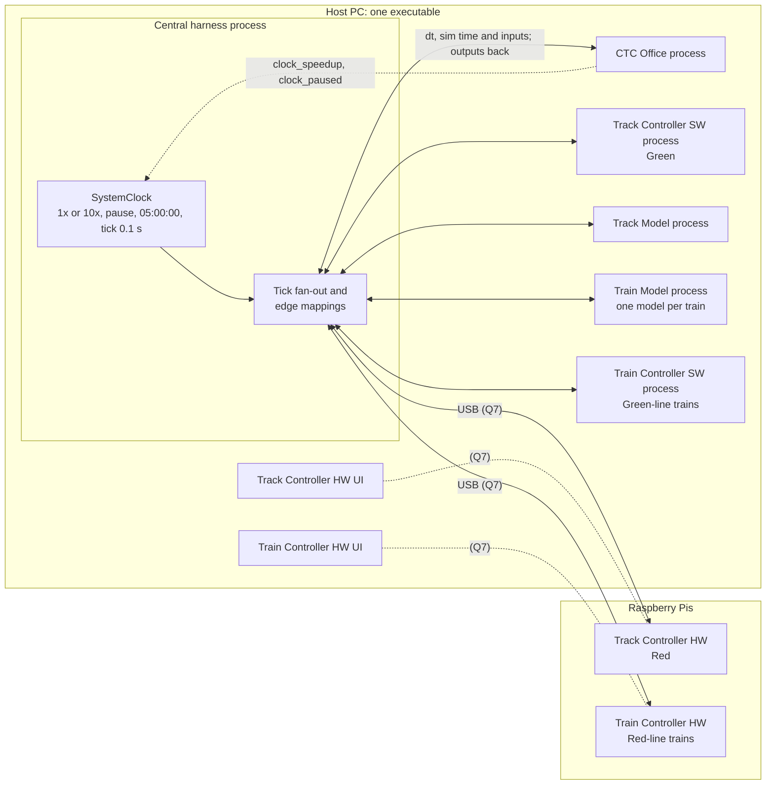

# System Integration Design: Central Harness and Shared Clock

| | |
|---|---|
| **Status** | Draft v0.4, revised after the answers of 2026-10-20 to the per-module questions. Not normative. |
| **Date** | 2026-10-20 |
| **Requested by** | Kevin Schillinger |
| **Prepared by** | Claude (Claude Code session) |
| **Basis** | `development` at `1aaa9a8`; `truth` at `f7c52c1`; all remote branches and open pull requests as fetched on 2026-10-16 at about 23:00 UTC; the team's review of v0.1 on 2026-10-16; the answers of 2026-10-17 and 2026-10-20; test runs of 2026-10-16 |

The `truth` branch is the authoritative record. This document cites it by shard path
(`origin/truth:truth/<path>`, shortened below to the shard name) and does not override it.
Where a fact is missing or contested, the document records a gap (section 6) instead of
choosing a value. Nothing here is filled in silently.

**Changes since v0.3**

- Section 1.4 records the answers of 2026-10-20 (R44 to R64). Everything not answered
  directly took the suggestion, except the Track Controller items, which wait on the
  Track Controller owners.
- Section 1.5 updates every question's status and adds Q21 to Q25. Section 1.6 restates
  the Track Controller items as plain questions.
- Sections 4 to 6 now show the decisions: wait for every reply, unwrapped time, release
  and retirement of trains, preloading the next block, and the harness protocol.
- Section 7 adds twenty proposals, seven of them re-filed CTC proposals, and lists which
  of this branch's proposals to promote and which to deny.
- `TrainModel/docs/integration.md` now assumes one process per module (R62).

v0.3 recorded the answers of 2026-10-17 (R33 to R43), and v0.2 the review of v0.1 (R1
to R32). Git history holds the earlier text.

**Tags**

| Tag | Meaning |
|---|---|
| [T] | Normative fact on `truth`. |
| [R*n*] | Decision *n*: R1 to R32 from the team's review of v0.1 on 2026-10-16, R33 to R43 from the answers of 2026-10-17, and R44 to R64 from the answers of 2026-10-20 (section 1). Statements new to `truth` were filed as proposals (section 7). |
| [U] | Stated by Kevin Schillinger on 2026-10-16 when requesting this design. |
| [P] | Pending proposal under `truth/_inbox/`. Not a fact. |
| [C] | Observed in code at `1aaa9a8`, unless another ref is named. Current behaviour, not a decision. |
| [D] | Stated in a project document: SRS, course deck, module README or guide, or meeting log. |
| G-… | Gap or question, listed in section 6. |
| Q*n*, TC-*n* | Question for the team (section 1.5) or for the Track Controller owners (section 1.6). |

## 1. Decisions and open questions

### 1.1 The ten questions of v0.1

Quotes are verbatim from the review.

| # | v0.1 question | Decision | What it settles | What it leaves open |
|---|---|---|---|---|
| R1 | What "in parallel" means | "Direct fan out to the modules. Modules only see inputs on the rising clock edge" | The harness sends every tick straight to every module, and no module relays it. A module steps on the inputs delivered with tick *k*. Because the steps run at the same time (R4), those inputs come from outputs of tick *k*−1. | Whether the harness waits for every reply before the next tick (G-CLK-11) |
| R2 | What each module receives per tick | "Send both dt and sim time" | Every module receives dt and the simulation time. | Which simulation time: unwrapped, or time of day (G-CLK-2) |
| R3 | How pause and resume reach the harness | "Clock_paused and clock speedup signals were added to the ctc" | The CTC Office's `clock_paused` and `clock_speedup` outputs carry pause, resume and speed. | How the harness reads `clock_paused` while nothing is stepped (G-CLK-3) |
| R4 | One process, or one per module | "Central harness is one process that spawns processes for each module, the whole thing runs as one exe". Section 4.3: "Option C". Section 4.5: "Process model 2. One process per module chosen" | Process model 2 and tick option C. | The harness-to-module protocol, liveness and packaging (G-RUN-2, G-RUN-6, G-RUN-7) |
| R5 | What makes the HW variants hardware; which variant runs where | "The HW variants run on Raspberry pis and communicate with the host pc via USB. HW on the red line and SW on the green. If a train is on the green line it gets SW train controller on red a HW controller" | Track Controller: HW on Red, SW on Green. Train Controller: chosen by the line the train is on. | The USB link (G-HW-1, Q7). R40 later put the Blue Line out of scope. |
| R6 | The canonical block identifier | "Follow the block identifier used in the CTC module" | Line and block number as strings, for example `("Green", "63")`. This matches [T] `conventions/identifiers.md`. | How the case of line names fits R17 (Q15) |
| R7 | Suggestions per train or per block | `TrainSuggestion(train_id="T1", line="Green", block_id="63", suggested_speed_mps=18, authority_blocks=2)`: "this is what the ctc sends" | One suggestion per train, naming the block the train is in. The CTC Office's type already has these fields. | The train ID format (Q4). R38 later kept the speed an int. |
| R8 | Readiness shape and what it gates | "Shape is 2d array : per line, per track controller. Action is fully gated per line until every track controller signals ready. One line can operate while the other is stalled but all track controllers on one line need to be ready for safe operation(i.e. no dispatch of trains until ready)" | The shape, and gating per line. | What makes a controller ready, who loads PLC programs in an integrated run, and a line that reads ready too early (Q13, Q20) |
| R9 | Who creates and retires trains | "The CTC pulls trains from the "yard" and sends them back into the yard.The yard is just a blackbox with unlimited capacity" | The CTC Office owns dispatch from the yard and return to it. | How the Train Model and Train Controller learn of a new train. R35 later made the CTC Office its creator (Q3, G-SIG-6). |
| R10 | Stale commanded speed and authority | "The track controller sends commanded speed and authority to a block. This block is assumed to be occupied by the correct train. Then once the track model sends the commanded speed and authority to the train model and clears these values back to zero" | Per-block values that the Track Model clears to zero after delivering them. | A conflict with the Train Controller's failure detection (Q5, G-NEW-1) |

### 1.2 Other rulings from the review

| # | v0.1 section | Ruling (quoted or closely paraphrased) |
|---|---|---|
| R11 | 2.2, 3.4 | "Common/interfaces.py is stale and should not be treated as true"; "common/interfaces.py has been superseded"; "common/harness/track_model_edges.py is just the module interface". |
| R12 | 2.2 | The Train Model test UI is removed at integration and the harness becomes its single driver: "this is true for all modules". |
| R13 | 2.2, G-RUN-4 | "No event logger is needed"; "event logger does not exist". |
| R14 | 3.2 | Track Controller SW and HW: "time_s will not be used as the sim time will be sent to every module on every tick". |
| R15 | 3.2, 3.3 | Train Controller: "No SW controller exists code is the same as HW". Outputs: "bool[2] for brakes, lights, and doors, announcement_command". The speed-scaled dt "was assumed for the train controller test ui only". R37 later kept the Train Model's `announcement` field. |
| R16 | 3.4 | The four `SystemClock` instances "are for the testing harnesses only they should be replaced by the single central harness". |
| R17 | 4.4 | "All enums should be all caps". |
| R18 | 4.6 | "the line JSON files should be loaded by default on startup". |
| R19 | 4.6, G-LIFE-4 | When a module rejects a tick: "Continue under assumption that a proper tick will be coming in the near future". G-LIFE-4: "we will come back to this, we have no clue what is going to cause a breakage". |
| R20 | G-SIG-3 | "follow CTC structure, Track controllers will only parse the block ID and suggested speed but subsequent modules need associated train IDs". |
| R21 | G-SIG-4 | "Stale". |
| R22 | G-SIG-7 | Ticket sales: "Truth never got updated, it should be sent to CTC as per station and then CTC aggregates the total ticket sales." |
| R23 | G-SIG-8 | "update software such that it should consume failures that come from track model. Track controller also only reports failures as closures". R33 later: failures are seen as occupancy. |
| R24 | G-SIG-9 | `track-info`: "it should be all 6 fields, and the speed should be a float. Train model should send the doors open signal". |
| R25 | G-SIG-10 | The driver sees the light through the windshield: "make sure that the driver is able to see next light state". |
| R26 | G-SIG-15 | Station dwell: "its 45 seconds". |
| R27 | G-SIG-17 | Maintenance: "it should reference closed-blocks and query that array before trying to open/close blocks on the track controller sides, any block that is in this array is considered to be under maintenence, hence why we dont need to send the maintenence mode boolean". |
| R28 | G-SIG-18 | "Ambient temp should be a UI input from Track Model." |
| R29 | G-RUN-2 | "the single executable that will open the central harness and then from there each module can be opened is how we are proceeding". |
| R30 | G-RUN-3 | "final iteration, all modules will be able to run on one computer". |
| R31 | G-RUN-5 | PySide6: "follow 6.11 or later". This matches [T] `conventions/toolchain.md`. |
| R32 | G-HW-1 | "Every hardware modules are running on raspberry Pis. The interfaces between the software and hardware modules are identical meaning that they will consume the same IO, but hardware will communicate over USB to the PIS". |

The review also said: section 2.1 "Ok"; section 5 "All good"; section 6.1 repeats earlier
points; for the Track Controller HW, "see pr #43 for updates"; and the CTC pause signal was
added.

### 1.3 Answers of 2026-10-17

Quotes are as written.

| # | Answers | Ruling | Effect |
|---|---|---|---|
| R33 | Q6, failures | "failures should be seen as occupancy" | A failed block reads as occupied to the Track Controller, as PR #43 has it. Either the Track Model or the edge mapping folds a failure into occupancy. |
| R34 | G-NEW-5, Red data | The HW variant's Red data "can be loaded later" | Not a blocker now. |
| R35 | Q3, train creation | "ctc creates the train" | The CTC Office creates each train it pulls from the yard ([P] D022). It needs an output that carries the new train to the Train Model and the Train Controller. |
| R36 | G-NEW-2, readiness | "wayside will never die" | A wayside that stops reporting is not a case to design for. |
| R37 | Q8, brakes and announcement | "if you mean one supersedes the other then nothing should prevent both from being applied simultaneously. use the announcement field in he train model" | Both brakes may be on at once ([P] `brakes-apply-together`). The announcement keeps the Train Model's field name, `announcement`, as on [T]. |
| R38 | Q9, speed type | "speed sent by CTC remains an int" | Suggested speed stays an int, as on [T]. Commanded speed is a float on the track signal (R24). |
| R39 | Q10, next light | "It is sent from the track model to the train controller directly. and it is spelled SUPER_GREEN" | A Track Model → Train Controller signal that bypasses the Train Model ([P] `signal-aspect-ahead`). |
| R40 | Q11, Blue Line | "The blue line was for testing on a previous iteration not for the final product nothing on the blue line should be accounted for" | The system runs the Green and Red Lines only ([P] D023). |
| R41 | Q7, USB and one computer | "open still" | Unchanged. |
| R42 | Q14, gains | "the harware versions communicate with the host machine over the usb cable but the UI still runs on the host machine" | A HW variant's UI runs on the host PC ([P] D021), so gains are set in the UI as today. |
| R43 | Q16, dwell | "assume the train controller holds this for now" | The Train Controller holds the 45 s dwell, for now ([P] D007). |

### 1.4 Answers of 2026-10-20

Relayed by Kevin Schillinger, with the CTC Office's answers in its owner's words. Quotes
are as written.

| # | Answers | Ruling | Effect |
|---|---|---|---|
| R44 | Q13 (Track Controller) | "PLC programs and databases are not loaded by default. This is the purpose of using a ready signal. Unready system does not gate clock advancement" | A person loads them; readiness gates dispatch, never the clock ([P] `track-controller-ready`). |
| R45 | Second aspect (Track Controller) | "Will change orange to yellow" | The aspects are `RED`, `YELLOW`, `GREEN`, `SUPER_GREEN` ([P] `signal-aspect-ahead`). |
| R46 | Q3 (CTC) | Send the new train "when it releases a train from the yard", one per line at a time, only when the exit block is clear, no train is authorized into it, the line's waysides are ready, and the scheduler isn't holding the run. Retire a train when it "reaches the yard entry block (Green 57, Red 9) and stops there, with authority 0 at its destination". Events, applied exactly once. | [P] D022, D005. |
| R47 | Q4 (CTC) | "The CTC is the source of train IDs." Scheduled `G1`–`G10`, `R1`–`R10`; manual as entered (the window suggests `T1`, `T2`…); a plain string, trimmed, printable, at most 32 characters. Drop the Train Model link's `T-n` and its startup `T-1`. | [P] `identifiers`. |
| R48 | Q17 (CTC) | "Only the per-train modules need the ID, and they get it from the new-train output." | The harness drops the ID on the way to the Track Controller. |
| R49 | Q5 (CTC) | Preload the next block, only when authority is at least 1, with its speed recomputed for that block and authority one less; up to two `TrainSuggestion` entries per train; the next block is always within the train's exclusive authority. | [P] `suggested-speed`, `suggested-authority`. |
| R50 | Q15 (CTC) | Line names stay `Green`, matched exactly; the harness maps the Track Model's `GREEN`. Station names stay as written in the layout files (`GLENBURY`). | [P] `identifiers`. |
| R51 | G-CLK-3 (CTC) | Confirmed: one boolean, true while paused, starting paused. While paused the harness reads `clock_paused` from the CTC's `snapshot()`. | Promote `ctc-deployment/20261016-1517-clock-pause.md`. |
| R52 | G-SIG-7 (CTC) | A mapping from station to count, zeros optional, as sales since the last report. The CTC rejects unknown stations, so Blue stations must not reach it; each tick's sales go through exactly once. | Q22. |
| R53 | G-TR-1 (CTC) | Seven removed CTC proposals to re-file (two updated for R49), three to log as denied, three in the inbox to promote. | Re-filed here (section 7.1). |
| R54 | Q8 (Train Controller) | "We can either keep it or update it doesn't matter" | My call: the brake commands stay two separate booleans, as on [T] and in the Train Model. Nothing to change. |
| R55 | Gains (Train Controller) | "Trains must wait for engineer to set gains, can be a default value but aren't auto applied" | [P] D024. |
| R56 | Station stop (Train Controller) | "wait for cmd speed above zero then depart" | [P] D007. |
| R57 | Wall-clock timers (Train Controller) | "sure if it doesn't break anything" | Gains hand-over on simulation time. |
| R58 | Displayed time (Train Controller) | "sure" | Harness time of day. |
| R59 | Old prototype (Train Controller) | "already deleted just not pushed to dev" | Nothing to do here. |
| R60 | Q18 (Train Model) | "good" | Per-train rejection ([P] `modules/train-model.md`). |
| R61 | Passenger brake release (Train Model) | "add" | [P] `passenger-brake-release`. |
| R62 | Train Model guide | "replace" | Done in this revision. |
| R63 | Displayed time (Train Model) | "fine" | Harness time of day. |
| R64 | Everything else | "any other open question that was not directly addressed is that your suggestions were accepted" | Applied to every module except the Track Controller ("waiting on track ctrl"). Q7 and Q19 stay open: Q7 was left "open still", and Q19 had no single suggestion. |

### 1.5 Questions

"Blocks" says what an open question holds up: "Core" is the harness skeleton, "Iter 3"
is the first train run, graded on 2026-11-12, and "Full" is the complete system.

| Q | Question | Status | Gap | Blocks |
|---|---|---|---|---|
| Q1 | Wait for every reply before the next tick? | Answered (R64): wait, with a timeout of about 1 s that pauses the clock and names the late module. | G-CLK-11 | none |
| Q2 | Wrapped or unwrapped simulation time? | Answered (R64): unwrapped; each module derives the time of day. | G-CLK-2 | none |
| Q3 | How a new train comes into being, and how it is retired. | Answered (R46). | G-SIG-6 | none |
| Q4 | Train ID format. | Answered (R47). | G-SIG-6 | none |
| Q5 | The emergency brake at block changes. | Answered (R49, R64): the CTC Office preloads the next block, and a block not commanded on the latest tick reads zero. | G-NEW-1 | none |
| Q6 | Is a failed block reported to the CTC Office as occupied or as a closure? | Waiting on the Track Controller (TC-1). The CTC Office prefers occupied. | G-SIG-8 | Iter 3 |
| Q7 | The USB link: protocol, who builds it, what runs on a Pi; whether the Pis count as "one computer"; how many Pis serve the Red-line trains. | Open (R41). | G-HW-1, G-RUN-3 | Full |
| Q8 | Brake commands as `bool[2]` or two booleans? | Answered (R54): two booleans. | G-SIG-19 | none |
| Q9–Q11 | Float reach, next light, Blue Line. | Answered (R38–R40). | | none |
| Q12 | Edge mappings without the catalog. | Answered (R64): straight from producer to consumer types. | G-SIG-13 | none |
| Q13 | Who loads programs and databases; does the clock wait? | Answered (R44): a person loads them; the clock does not wait. | G-SIG-5 | none |
| Q14 | How gains are set. | Answered (R42, R55). | G-NEW-4 | none |
| Q15 | Line names. | Answered (R50). | G-SIG-11 | none |
| Q16 | Who holds the dwell. | Answered (R43, R56). | G-SIG-15 | none |
| Q17 | Who needs the train ID. | Answered (R48). | G-SIG-3 | none |
| Q18 | Fleet-wide rejection. | Answered (R60). | G-NEW-3 | none |
| Q19 | The event logger: amend the SRS, or keep one CSV file written by the harness? | Open. Kevin is the resolution owner of the filed conflict. | G-RUN-4 | Full |
| Q20 | Should each line have a roster of its waysides, so it cannot read ready before all are loaded? | Waiting on the Track Controller (TC-2). Loading by hand (R44) makes this more likely. | G-NEW-2 | Iter 3 |
| Q21 | Only scheduled runs go back to the yard. Should the CTC Office get a "return to yard" action for manual trains? The CTC Office asks to decide this now. | Open (new) | G-SIG-6 | Iter 3 |
| Q22 | Blue Line stations: the CTC Office rejects any station it does not know. Should the harness drop stations not on Green or Red, or should the Track Model not load the Blue Line at integration? Suggestion: the Track Model does not load it, since D023 puts the Blue Line out of scope. | Open (new) | G-SIG-7 | Iter 3 |
| Q23 | Door interlock: "no power while a door is open" means the Train Controller commands zero traction power whenever a door is open, so a train can never be driven with a door open. Doors still open only when stopped, on the platform side. Adopt it? | Open (new) | G-SIG-16 | Iter 3 |
| Q24 | Which stations does a train stop at? The station-stop sequence you accepted stops at every station beacon. The re-filed D020 has a train stop only at its scheduled stations, where the CTC Office ends its authority. Suggestion: the Train Controller dwells only where its authority ends at a station, so D020 decides which stations. | Open (new) | G-SIG-15 | Iter 3 |
| Q25 | ID clash: the re-filed CTC D019 (test UI boundary, first filed 2026-10-14) and PR #43's D019 (wayside runs only its program, 2026-10-16). Which one is renumbered? | Open (new) | G-TR-3 | none |

### 1.6 Questions for the Track Controller owners

The v0.3 items read as statements, so here they are as questions. Each needs a yes or no,
or a choice.

| # | Question | Gap |
|---|---|---|
| TC-1 | When a block fails, the Track Model makes it read occupied. Should the Track Controller report that block to the CTC Office as occupied, as PR #43 does, with no separate closure? | Q6, G-SIG-8 |
| TC-2 | Waysides are loaded by hand, one at a time. Today a line reads ready as soon as the first loaded wayside has a program, even if the others are not loaded yet. Should each Track Controller report every wayside of its line from startup, as not ready until loaded? | Q20, G-NEW-2 |
| TC-3 | Is a wayside ready exactly when both its database and its PLC program are loaded, or does it need anything else? | G-SIG-5 |
| TC-4 | The SW variant treats a CTC switch command in force as maintenance. The team decided that a block in `closed_blocks` is under maintenance (R27). Can the SW variant switch to that? | G-SIG-17 |
| TC-5 | The Track Model runs heaters only when commanded, and the SW variant never commands them, so they never run. Should the Track Model switch them itself, with heater commands dropped, or should the Track Controller command them? | G-SIG-18 |
| TC-6 | Will you file `truth` entries for what you send the Track Model (switch, signal and crossing commands) and what you receive from it (occupancy, and the switch, crossing and signal read-backs)? | G-SIG-1, G-SIG-2 |
| TC-7 | Who owns the Track Controller contract shard on `truth`? Toward the CTC Office, can both variants name blocks by line and number, as PR #43 does, leaving the section letter to the harness? | G-HW-3 |
| TC-8 | Should the HW test UI stay as a standalone fallback that the harness never launches (an exception to "all test UIs removed", pending D018), or go at integration? | G-LIFE-5 |
| TC-9 | Can the SW variant load the Green Line only, since it serves Green? | G-HW-2 |
| TC-10 | Can the three sample HW wayside files get `next_blocks`, so the failing `test_territory.py` test passes? | Section 3.5 |

Already decided, for both variants: enumerated values become all caps (`NORMAL`,
`REVERSE`, `RED`), and `time_s` gives way to the common unwrapped simulation time.

## 2. Goal and fixed constraints

### 2.1 Goal [U] [R]

1. Integrate all seven module implementations into one functional system through a central
   harness. The seven are the CTC Office, Track Controller SW and HW, Train Controller SW
   and HW, Track Model, and Train Model.
2. The clock lives in the central harness. On every tick the harness sends dt and the
   simulation time straight to every module. Each module sees its inputs only on the
   rising clock edge [U, R1, R2].
3. The CTC Office sets the clock speed, 1x or 10x only, and pauses and resumes the clock,
   through its `clock_speedup` and `clock_paused` outputs [U, R3].
4. Commanded speed and authority come from the Track Controller, per block. The Track Model
   clears them after it delivers them to the train [U, R10].
5. The harness is one process that spawns one process per module. The system is one
   executable: it opens the harness, and each module is opened from there [R4, R29].
6. The HW variants run on Raspberry Pis connected to the host PC by USB, with the same
   inputs and outputs as the SW variants. Their UIs run on the host PC. Track Controller HW
   runs Red and SW runs Green. A train gets the Train Controller of its line [R5, R32, R42].
7. The system runs the Green and Red Lines. The Blue Line is out of scope [R40].

### 2.2 Constraints on `truth` [T], and pending changes

| Constraint | Shard | Pending change [P] |
|---|---|---|
| A central harness sits between the modules. Each module defines only its own boundary types. The harness owns one pure mapping function per producer-to-consumer edge. | `decisions/D005-central-harness.md` | Adds the process model and the single driver (R4, R12, R29). |
| `common/interfaces.py` is the harness-side signal catalog. Edge mappings go from producer type to catalog type to consumer type. | `decisions/D008-interfaces-harness-catalog.md` | Superseded (R11). |
| One shared `SystemClock` at `utils/system_clock.py`, owned by the harness. It passes simulation time to every module, and modules run no clocks of their own. Speeds are 1x and 10x only. The clock pauses and resumes, starts at 05:00:00, shows 24-hour `HH:MM:SS`, and ticks every 0.1 s. The CTC Office sets the speed and pauses and resumes the clock through the harness. | `decisions/D017-shared-simulation-clock.md` | Sends dt and the simulation time, directly, with inputs seen on the rising edge (R1, R2). |
| Steps use a constant dt. Speed and pause change the tick rate, never dt. | `decisions/D006-fixed-time-step.md` | none |
| The CTC Office's speed command is a boolean to the harness, true for 10x. | `signals/clock-speedup.md` | `signals/clock-pause.md` adds pause (from `ctc-deployment`) |
| Values crossing a boundary are in backend SI units. | `decisions/D002-two-unit-systems.md`, `conventions/units.md` | none |
| The Train Model test UI is removed at integration, and the harness becomes the Train Model's single driver. | `decisions/D010-train-model-test-ui-boundary.md` | R12 extends this to every module, through the D005 proposal. |
| The Train Model is physics only. Speed regulation belongs to the Train Controller. | `decisions/D009-train-model-control-boundary.md` | none |
| Authority is a non-negative count of blocks. | `decisions/D013-authority-block-count.md` | none |
| Station dwell is 45 s, with a recorded conflict against a 60 s schedule. | `decisions/D007-station-dwell.md` | Conflict resolved for 45 s (R26); the Train Controller holds the dwell, for now (R43). |
| One runnable executable, with no external services or network at runtime. The clock and an event logger are standalone shared utilities. | `conventions/files-and-paths.md` | The event logger is recorded as a conflict with R13. |
| A block is named by its line and block number, as strings: `("Green", "12")`. | `conventions/identifiers.md` | none. R6 agrees. |
| Five modules. The Track Controller and the Train Controller each have a SW and a HW instance. Enum members are UPPER_CASE. | `conventions/naming.md` | Every enumerated value is all caps, including values that cross a boundary (R17). |
| PySide6 6.11 or later; PyInstaller 6.22.2 or later. | `conventions/toolchain.md` | none. R31 agrees. |

### 2.3 Course and customer requirements that bear on integration [D]

From `documents/srs-filled.md` (line numbers in parentheses):

- Clock and timing:
  - REQ-INTF-013 (211): all submodules share a single simulation clock.
  - REQ-FUNC-001, -002 and -003 (237-241): real-time speed, "at least 10x", and pause.
  - REQ-NFR-001.1 (443): the simulation *should* advance in 1 ms ticks.
  - REQ-NFR-001.2 (444): the simulation *shall not* drop any ticks.
  - REQ-NFR-007 (462): ready within 20 s of launch. Under R4 that covers seven processes.
- Channels:
  - REQ-INTF-017 (223): the track circuit carries speed and authority from the Track
    Controller to the Train Controller.
  - REQ-INTF-018 (225): the Track Model tells the Track Controller about occupancy and
    train presence.
  - REQ-INTF-019 and -020 (227-229): the CTC Office sends speed and authority to the Track
    Controller, which reports occupancy back.
  - REQ-INTF-021 (231): every channel is non-vital.
- Variants: REQ-INTF-009 and -010 (199-201): the HW and SW variants expose equivalent
  external interfaces. R32 says they are identical.
- Event log: REQ-NFR-008 (466), REQ-INTF-015 (215) and REQ-DSN-005 (512) require one, in
  CSV. R13 drops it, and the conflict is filed (Q19).
- Delivery: REQ-DSN-001, -002 and -003 (496-504): a standalone, pre-compiled executable on
  a single machine with no network. R5 adds Raspberry Pis on USB (Q7).

Schedule (`documents/Track_Overflow_Schedule.gan`): Design Review on 2026-10-22; Iteration 3,
the System Group Review, on 2026-11-12; Iteration 4, the final, on 2026-12-10. The
Iteration 3 rubric gives 35 points each to "Do the Sub-systems Communicate" and "Does the
Train Move from Yard to Destination Block". The course deck (`Final Project vF.pdf`, p.80)
advises integrating in the order "Train -> Train Controller -> Track -> Wayside Controller
-> CTC", after "All at once… FAILED".

## 3. Current state (re-read on 2026-10-16)

### 3.1 Integration guides

The request assumed that every module already had an integration guide. On `development`
only the Train Model has one. The Track Model's is on a branch.

| Module | Guide | Nearest material, and how it stands against the decisions |
|---|---|---|
| CTC Office | Partial | `CTC-Office/ctc_ui/README.md` covers the boundary, the test links and the snapshot fields, `clock_paused` included (lines 123-126). It has nothing on stepping, startup or shutdown. |
| Track Controller SW | None | One paragraph in `TrackCtrlSW/README.md`, and `TrackCtrlSW/INTEGRATION_DISCREPANCIES.md`. |
| Track Controller HW | Partial | `TrackCtrlHw/README.md`, "Integrating the module" (lines 66-160). It keeps the test UI and has the harness hand the window its controller in the same process. Both contradict R4 and R12. PR #43 rewrites the boundary. |
| Train Controller (SW and HW) | None | R15: one code base. The only integration material is the `TrainControllerFleet` docstring and `Train-Ctrl_HW/harness_sim.py`, both on branches (section 3.6). |
| Track Model | On a branch | `origin/track-model:TrackModel/INTEGRATION.md`, 365 lines. It runs the Track Model in the harness's process, contradicting R4. It has no shutdown section, and it says to delete `test_ui/`, `test_link/` and the link server at integration. The branch is 132 commits behind `development`. |
| Train Model | Yes, needs an update | `TrainModel/docs/integration.md` §3 says "Every train runs in the system process… There is no process per train and no IPC" (lines 162-164), which contradicts R4. It also says to delete `link.py`, the only transport the Train Model has. |

### 3.2 Module status at a glance [C]

| Module | Callable boundary | Time input | Clock or timer of its own | Scope | Entry point and link | Tests |
|---|---|---|---|---|---|---|
| CTC Office | `CtcOffice.step(dt, inputs) -> CtcOutputs`; Qt-free core | dt only | Yes. The window owns a `SystemClock` and `ClockDriver` (`ctc_ui/sim_clock.py:40-45`). | One per system | `python -m ctc_ui`; link `trains-ctc-office`, plus a clock link | 208 passed |
| Track Controller SW | `step(dt, TrackControllerInputs(time_s, ctc, track_model))`; Qt-free core | dt and `time_s` | Not in the core. The test client has one. | Loads Green and Red (`track_ctrl/state.py:69-71`) | `python main.py [--no-test-link] [--load-starters]`; link `ece1140-track-controller-stimulus` | 186 passed |
| Track Controller HW | Same shape as SW; Qt-free core | dt and `time_s` | Not in the core. The test UI has one. | One line (`controller.py:75-81`) | `python TrackCtrlHw/ui/main.py`, or `launch.py` for window plus test UI; link `trains-track-controller-hw` | 61 passed, **1 failed** |
| Train Controller SW | None. R15: there is no SW controller; the HW code serves both. `TrainController/` is an earlier prototype with no boundary and is not used. | n/a | `TrainController/` has its own 1 s timer. | n/a | n/a | 24 passed (`TrainController/`) |
| Train Controller HW | `development`: `ConsoleBackend.apply_inputs`, with outputs on a Qt signal. Branches: `TrainControllerFleet.add`, `remove` and `step_all(dt, inputs_by_id)`, with no Qt. | dt only (fleet) | Yes: 20 Hz and 10 Hz timers. With a fleet only the 10 Hz UI timer runs, and it still advances the console's own clock. | Many trains per process | `python main.py [--test \| --both \| --check]`; no link | No pytest suite |
| Track Model | `TrackModel.step(dt, inputs) -> TrackModelOutputs`; Qt-free core | dt; an optional `sim_time_s` on `origin/track-model` | Not in the core. The test UI has a `QTimer`. | One instance for all lines | `python TrackModel/main.py`; link `track-overflow-track-model` | 266 passed |
| Train Model | `TrainModelFleet.add`, `remove`, `step_all(dt, inputs_by_id)`; Qt-free physics | dt only | Not in the module. The test UI has a `SystemClock`. | One model per train | `python main.py`, which creates train `T-1`; link `trains-train-model` | 760 passed, 13 skipped |

Neither HW variant has hardware or USB code. There is no serial, USB or GPIO code on any
branch, and no document says what runs on a Pi (G-HW-1).

### 3.3 Per-module notes [C], checked against the decisions

**CTC Office** (`CTC-Office/`)
- Boundary: `step(dt, CtcInputs) -> CtcOutputs`.
  - Inputs from the Track Controller: occupancy, switch reports, crossing reports and one
    `WaysideStatus` per wayside (`ctc/interface.py:86-92`). There is no input for closures.
  - Input from the Track Model: ticket sales per station (`:110`).
  - Outputs: one `TrainSuggestion` per followed train (`:124-142`), which matches R7 field
    for field with `suggested_speed_mps: int`; `closed_blocks`; switch commands;
    `clock_speedup`; and `clock_paused`, which defaults to true (`:183-193`).
- Clock (R3, R16): the window still owns a `SystemClock`. The header's Run, Pause, 1x and
  10x act on it (`ctc_ui/ui/Main.qml:73-79`), and the host copies its state into the
  module's outputs (`ctc_ui/ctc_host.py:213-229, 811-824`). The module's own setters exist
  (`ctc/interface.py:402-406`), but the header does not call them directly.
- Time (R2): the module takes dt only. It keeps its own time, 05:00:00 plus the sum of every
  dt it was given (`ctc/model.py:417-445, 754`), so a rejected step loses that dt. The
  throughput history and the current hour are updated in the window's tick handler
  (`ctc_host.py:231-247`), outside the module.
- Readiness (R8): a line is ready when a wayside on it has reported and every wayside
  that reported is ready (`ctc/model.py:346-351`). It keeps no roster of the waysides it
  expects (G-NEW-2).
- Trains (R9, R35): the CTC Office creates each train, but today it never announces one. It
  matches occupancy of the yard exit block, Green 63 or Red 9, against waiting orders. Trains return to the yard from
  Green 57 or Red 9 (`ctc/tracking.py:39-44`). IDs are `T{n}` for manual dispatch
  (`ctc_host.py:493-496`) and `G1` or `R1` for scheduled runs (`ctc/scheduler.py:79`).
- Against the decisions: enumerated values are lowercase (`"normal"`, `"active"`) (R17), and
  no output announces a new train (R35). It also has no input for closures, which matters
  only if Q6 keeps closures.

**Track Controller SW** (`TrackCtrlSW/`; PR #41 merged since v0.1)
- Boundary: `step(dt, TrackControllerInputs(time_s, ctc, track_model))`. Each wayside
  reports `CtcReport(wayside_id, line, sent_at_s, ready, blocks, reason)`. While any wayside
  is not ready the whole module stalls, and its docstring tells the CTC Office to send
  nothing "on any line" (`track_ctrl/interface.py:175-215`).
- `common/harness/ctc_edges.py`, now on `development`, maps `TrainSuggestion` to a per-block
  `Suggestion` and drops the train ID, which fits R20. If two suggestions name one block, it
  takes the lower speed and the lower authority separately, as its docstring says.
- Against the decisions:
  - It loads both lines (R5: Green only). Once it loads only Green, its module-wide stall
    becomes the per-line stall of R8.
  - It takes `time_s` (R14).
  - Enumerated values are lowercase (R17).
  - It has no failure input. Under R33 a failed block reaches it as occupancy, so it needs
    none once the Track Model or the mapping folds failures into occupancy.
  - It treats a CTC switch command in force as maintenance (`module.py:16-18`), where R27
    makes a block under maintenance one that is in `closed-blocks`.
  - Its README installs PySide6 6.8 (R31).
- Speed must be an int, and a float rejects the tick (`track_ctrl/module.py:83-90, 330`).
  That stands, since the CTC Office's speed stays an int (R38).
- PLC programs load from the UI, from `--load-starters`, or by the test link's
  `load_starter_programs` operation.

**Track Controller HW** (`TrackCtrlHw/`; PR #43 open)
- PR #43 is open from `feature/TrackCtrl-Showcase-Feedback`: 7 commits, 32 files, merge
  blocked. It:
  - keys CTC Office inputs by `BlockRef(line, block_id)`, which fits R6;
  - drops `maintenance_mode`, which fits R27;
  - adds per-wayside readiness with a module-wide stall, which fits R8 while the module
    runs one line;
  - states that a failure "reaches it only as an occupied block, and it reports that block
    to the CTC Office as occupied" (`track_ctrl_hw/interface.py:14-16` on the PR head).
    Seeing failures as occupancy fits R33. Reporting them as occupied rather than as
    closures (R23) waits on Q6.
- Data: wayside databases and PLC programs exist for three Green waysides only, 50 of the
  line's 150 blocks. Red's, where R5 puts this variant, will be loaded later (R34).
- Still against the decisions on the PR head:
  - Track Model-side keys keep the section letter (`BlockKey(line, section, block_id)`).
  - Enumerated values are lowercase (R17).
  - It takes `time_s` (R14).
  - The README keeps the test UI (R12).
  - Databases and programs load from the window (`loadDatabase`, `loadProgram` in
    `track_ctrl_hw/state.py`). On `development` the link cannot load them (R18, Q13).
  - It has no USB or Pi code (R5).
- One test fails on `development` (section 3.5).

**Train Controller** (`Train-Ctrl_HW/`; one code base for SW and HW, R15)
- The `train_ctrl/` package with `TrainControllerFleet` is on `origin/Train-Ctrl_HW` and
  `origin/Train_Ctrl_integration` (section 3.6), not on `development`. The fleet has no Qt.
  `run(..., fleet=)` then skips the 20 Hz timer, but `main.py` never passes a fleet.
- Outputs are `TrainModelCommands(power_w, service_brake, emergency_brake, door_command,
  light_command, temperature_setpoint_c, announcement)`. Doors are (left, right) and lights
  are (interior, exterior). The announcement keeps the Train Model's name, `announcement`
  (R37). R15 wants the brakes as `bool[2]`; which element is which is Q8.
- Signal-pickup detection: if the received (speed, authority) becomes exactly (0.0, 0)
  right after a nonzero speed with authority of at least 2 blocks, the controller latches a
  signal-pickup failure. That cuts power and latches the emergency brake until the failure
  clears (`train_ctrl/control.py:219-223`; on `development`, `main.py:575-579`). See
  G-NEW-1.
- Light ahead: the input is taken only if it is `"RED"`, `"YELLOW"`, `"GREEN"` or
  `"SUPER GREEN"`, with a space. Anything else is dropped without an error
  (`train_ctrl/inputs.py:69-70`; `main.py:196`). R39 fixes the spelling as `SUPER_GREEN`,
  which the code as written would drop.
- A train applies no power until an engineer commissions its gains in the UI. That stays:
  the UI runs on the host PC for the HW variant too (R42), so each new train waits for its
  gains.
- It has no dwell or station-stop logic, which R43 now gives it.
- It has no link, no pytest suite and no hardware layer.

**Track Model** (`TrackModel/`)
- Boundary: `step(dt, TrackModelInputs(controller, trains, ambient_temp_c))`.
- Commanded speed and authority arrive per block. "A key that is absent keeps the last value
  commanded for it" (`track_model/interface.py:184`; `model.py:280-281`). That is
  against R10, under which the values are cleared to zero after delivery.
- `ambient_temp_c` is a required input, and the UI can override it (`model.py:156-158`).
  Under R28 the UI is the source, so the input becomes optional or goes.
- Enumerated values are all caps (`NORMAL`, `RED`, `SUPER_GREEN`), which fits R17. Block IDs
  look like `"GREEN K-63"`, with an upper-case line and a section letter, which differs from
  R6.
- Commanded speed is an int (`model.py:124`), against R24.
- `track-info` has six fields in code, which fits R24. `doors_open` is an input, so it needs
  the Train Model output that R24 asks for.
- Ticket sales go out per station, which fits R22. Nothing converts its list to the CTC
  Office's per-station mapping.
- `origin/track-model` (`3e7c15f`) adds `INTEGRATION.md` and an optional `sim_time_s` input
  (R2).

**Train Model** (`TrainModel/`, unchanged since v0.1)
- `TrainModelFleet.add(train_id, line)`, `remove(train_id)` and `step_all(dt, inputs_by_id)`,
  on one thread. It takes dt only (R2).
- It has no doors-open output (R24). The light ahead does not pass through it (R39).
- One invalid input rejects the whole fleet's tick (Q18).
- Passenger emergency brake release has no mechanism (G-SIG-16). The test UI holds the dwell
  today. R12 removes the test UI, and R43 moves the dwell to the Train Controller.
- Its link (`train_model/link.py`) assigns train IDs `T-n` itself (`:170-189`) and refuses
  to remove the last train (`:191-197`). `main.py` creates `T-1` at startup, and `step` must
  name exactly the current roster (`fleet.py:136-144`). All of this clashes with
  CTC-owned dispatch (R9, Q3).

### 3.4 Shared infrastructure [C]

- `utils/system_clock.py` implements D017: start 05:00:00, tick 0.1 s, speeds 1 and 10,
  pause, resume, reset and `HH:MM:SS`. It starts paused, which matches the CTC Office's
  `clock_paused` default. Tick listeners receive `(sim_time_s, tick_s)` and run one after
  another on the calling thread (`system_clock.py:140-149`).
- `utils/clock_driver.py` paces the clock from a Qt event loop. Owed ticks run back to back
  in one timer fire. With more than 100 owed it runs one and drops the rest, so simulated
  time slips (`clock_driver.py:27-30, 155-177`).
- The CTC window, the Train Model test UI, the Track Controller HW test UI and the Track
  Controller SW test client each have a clock. R16 replaces them with the harness's clock.
- `common/interfaces.py` is superseded (R11).
- `common/harness/` holds `ctc_edges.py` (CTC Office to Track Controller SW) and
  `track_model_edges.py`, six one-sided Track Model edges to the old catalog (Q12).
- Six `QLocalServer` test links exist (Appendix B). None was built as a harness channel, and
  the docs of three modules say to delete theirs at integration. Neither Train Controller
  has a link.
- Encoders and decoders for boundary types exist only in that test scaffolding:
  `ctc/wire.py`, `track_ctrl/wire.py`, `track_ctrl_hw/wire.py`, `TrackModel/test_link/codec.py`
  and `train_model/link.py:95-126`. There are none for the Train Controller. A block is
  encoded four different ways among them.
- Packaging:
  - `requirements.txt` pins PyInstaller 6.22.2 and PySide6 6.11.2.
  - The only build recipe is in `TrainModel/README.md` (lines 226-263): two separate
    `--onedir` executables.
  - Only the Train Model handles `sys._MEIPASS`.
  - There is no `.spec` file, no `freeze_support`, no build script and no packaging CI.
  - `TrackCtrlHw/launch.py` is the only code that spawns processes. It runs
    `[sys.executable, <script>.py]`, which assumes a Python interpreter and `.py` files on
    disk.

### 3.5 Tests (re-run 2026-10-16 at `1aaa9a8`)

Environment: a scratch virtual environment outside the repository, with Python 3.13.16,
PySide6 6.11.2 and pytest 9.1.1, `QT_QPA_PLATFORM=offscreen` and `-p no:cacheprovider`. Each
suite ran from its module folder, one after another. The runs changed no file in the
repository.

| Suite | Result |
|---|---|
| `utils` | 31 passed, **1 failed**: `test_clock_driver.py::ClockDriverAccuracyTest::test_stall_drops_backlog_instead_of_bursting` (12.4 s against 13.0 ± 0.5 s). It is a wall-clock test. It passed in the v0.1 run with `utils/` unchanged since, and on three isolated reruns it passed twice and failed once. |
| `CTC-Office` | 208 passed |
| `TrackCtrlSW` | 186 passed |
| `TrackCtrlHw` | 61 passed, **1 failed**: `tests/test_territory.py`, where the sample waysides lack the `next_blocks` field that `TrackModel/green_line.json` gained in PR #24 |
| `TrainController` | 24 passed |
| `TrackModel` | 266 passed |
| `TrainModel` | 760 passed, 13 skipped |
| `Train-Ctrl_HW` | No pytest suite |

No integration or system test exists.

### 3.6 Work outside `development`

- Merged since v0.1:
  - PR #41 (`Track-Ctrl-SW`): `ctc_edges.py` and per-wayside readiness.
  - PR #39: Track Controller HW example PLC programs.
  - PR #42 (`ctc-deployment`): the CTC Office's `clock_paused`.
- Open: [Landiss04/Track-Overflow#43](https://github.com/Landiss04/Track-Overflow/pull/43),
  Track Controller HW (section 3.3).
- `origin/track-model` (`3e7c15f`) holds `INTEGRATION.md` and `sim_time_s`. It is 132 commits
  behind `development`.
- `origin/Train_Ctrl_integration` (`b9e3f6a`) and `origin/Train-Ctrl_HW` (`1bc21d1`) hold the
  `train_ctrl/` package and its fleet. The first also has `harness_sim.py`, a stand-in
  harness in one process: it spawns three trains, feeds each a fixed 55 mph command and
  integrates a toy plant. It is not a harness for the real modules.
- Both Train Controller branches fork far behind `development`, delete `TrainModel/`, and
  have no `utils/`. Take only `Train-Ctrl_HW/` from them.

## 4. Architecture

### 4.1 Topology (decided: R1, R4, R5)

All module-to-module data passes through the harness's edge mappings (D005). Appendix A
lists what each edge carries. A HW variant's UI runs on the host PC (R42). How it reaches
its Pi is part of Q7.

### 4.2 Clock

| Aspect | Design | Source | Open |
|---|---|---|---|
| Owner | One `SystemClock` in the harness process. Every module clock and test clock goes. | [T] D017; [R16] | The CTC window clock (G-CLK-7) |
| Per tick | The harness sends dt and the simulation time, with each module's inputs, straight to every module. | [R1, R2, R64] | none: unwrapped |
| dt | 0.1 s, fixed. Speed and pause change the tick rate only. The Train Controller's speed-scaled dt belonged to its test UI. | [T] D006, D017; [R15] | none |
| Speed | `clock_speedup` true makes the harness call `set_speed(10)`, and false `set_speed(1)`. | [T] `clock-speedup`; [R3] | none |
| Pause and resume | `clock_paused` true makes the harness call `pause()`, and false `resume()`. While paused nothing is stepped, so the CTC Office cannot report a resume as a step output. The harness has to read `clock_paused` outside a step, for example from a state message the CTC Office's process sends when the value changes. [P] `ctc-deployment/20261016-1517-clock-pause.md` proposes exactly that. | [R3, R51]; [P] | none |
| Start | Paused at 05:00:00. | [T] D017 | none |
| Display | Every window shows the time the harness sends. | [T] D017 | G-CLK-8 |
| Pacing | `ClockDriver` on the harness's Qt event loop. The harness waits for every reply before the next tick. | [C]; [R64] | none |

**Wrapped or unwrapped simulation time (Q2).** `SystemClock.sim_time_s` starts at 18 000 s
(05:00:00) and keeps counting. One simulated day later it reads 104 400 s, not 18 000 s.
That is unwrapped time. `SystemClock.time_of_day_s` is the same value modulo 86 400 s, so
it drops back to 0 at midnight. That is wrapped time (`utils/system_clock.py:126-133`).

| Send | For | Against |
|---|---|---|
| Unwrapped (`sim_time_s`) | It never goes backwards, so a duration (a dwell, tickets per hour, a timeout) is a plain subtraction. | Every display and schedule lookup takes the value modulo 86 400 s itself. |
| Wrapped (`time_of_day_s`) | It matches the `HH:MM:SS` on every window and the schedule's times of day. The Track Controllers' `time_s` already means seconds since midnight. | It jumps from 86 399 s back to 0 at midnight, which breaks any duration measured across it. |

A run reaches midnight only after 19 simulated hours, or 1.9 hours of real time at 10x.
Decided (R64): send unwrapped time, and each module derives the time of day.

### 4.3 One tick (decided: option C with R1)

Tick *k*:

1. The clock fires tick *k*, with its simulation time and dt.
2. The harness maps the outputs it holds from tick *k*−1 into each module's inputs.
3. It sends dt, the simulation time and the inputs to every module process at once.
4. Every module steps in its own process at the same time and replies with its outputs.
5. The harness stores the replies for tick *k*+1.
6. Windows refresh from their own module's state. What an operator changes in a window
   reaches the other modules through that module's next outputs (G-RUN-8).

Decided (Q1, R64): step 5 waits for every reply before tick *k*+1, with a timeout of
about 1 s that pauses the clock and names the late module. A rejected tick is skipped and
the run continues (R19).

**Wait or continue (Q1).** "Wait" means the harness sends tick *k*+1 only after every
module has replied to tick *k*. "Continue" means it sends tick *k*+1 on time, and a module
that has not replied yet counts as having sent its last outputs again.

| | Wait for every reply | Continue on time |
|---|---|---|
| Results | Deterministic: the same inputs give the same run. Every module always sees outputs exactly one tick old. | They depend on timing. A late module steps on older inputs, and the others see its stale outputs. A run cannot be reproduced. |
| Speed | The slowest module sets the pace. At 10x the slowest round trip, USB included, must fit in 10 ms, or the run falls below 10x. A short hold-up is made up afterwards, because the clock driver runs owed ticks back to back, up to 100. | The clock keeps real time. A slow module does not slow the others. |
| A module that hangs | It stops the whole simulation, clock included, until it replies, so a timeout is needed. | The others carry on, with that module's outputs frozen. |
| The late module itself | It never misses a tick. | It either skips ticks, losing their dt (the CTC Office's time and the Train Model's physics fall behind), or works through a backlog later. Every message needs a tick number to tell which. |
| Rules that count ticks | The block change below takes the same number of ticks on every run. | The same rules see varying gaps, so a check like the Train Controller's pickup check can trip on one run and not the next. |
| Work | Count the replies. | Tick numbers, staleness tracking, and a catch-up rule in every module. |

Decided (R64): wait, with that timeout.

Latency: a suggestion travels CTC Office → Track Controller → Track Model → Train Model →
Train Controller in four ticks, 0.4 s simulated. A block change takes seven ticks to come
back to the train's controller as new values, as traced below. G-NEW-1 depends on this.

**A block change, tick by tick (G-NEW-1).** A train enters block B during tick *j*. Under
R10, B holds no values until the Track Controller sends some, and the CTC Office still names
the train's old block. With each module seeing the previous tick's outputs (R1):

| Tick | What happens |
|---|---|
| *j* | The Train Model moves the train into B. |
| *j*+1 | The Track Model puts the train in B and sends it B's values: 0 m/s and 0 blocks. It reports B occupied. |
| *j*+2 | The Train Model passes 0 and 0 on. The Track Controller reports B occupied to the CTC Office. |
| *j*+3 | The Train Controller reads 0 and 0 right after reading, say, 18 m/s and 2 blocks. It latches a signal-pickup failure and the emergency brake. The CTC Office moves the train's suggestion to B. |
| *j*+4 | The Track Controller sends B's values. |
| *j*+5 | The Track Model delivers them to the train. |
| *j*+6 | The Train Model passes them on. |
| *j*+7 | The Train Controller reads them, but the emergency brake stays latched until the failure is cleared. |

The 2 in the check is the authority the train held before the change, not blocks travelled,
so one block change is enough. The train never needs to cover 2 blocks in 5 ticks.

The same trace shows a second edge of R10. Until *j*+3 the Track Controller keeps sending
values to the old block, which the Track Model has shown empty since *j*+1. Nothing delivers
them, so nothing clears them, and the next train to enter that block reads them first.

Decided (Q5, R49, R64): the CTC Office preloads the next block on the train's route, a
form of the first way below, and a block the Track Controller did not command on the
latest tick reads zero, which also closes the second edge above. The ways that were on
the table:

- The Track Controller also sends values to the blocks ahead of the train, within its
  authority, so a block holds values before the train enters it. This changes R10's "This
  block is assumed to be occupied by the correct train".
- The Train Controller counts 0 m/s and 0 blocks as a pickup failure only when it lasts
  longer than a block change takes. The train would still service-brake for those ticks,
  because the controller stops on zero authority (`enforce_safety` in
  `train_ctrl/control.py`), so every block change would jolt it.
- The Track Model keeps delivering a train's last values after it enters a new block, until
  that block's own values arrive. This changes R10's clearing to zero.

Budget: at 10x a tick comes every 10 ms of real time. Seven module processes make 700 step
messages a second, two of them over USB. Nothing has been measured (G-CLK-6).

### 4.4 Data exchange

- One mapping function per edge (D005). The catalog is gone (R11), so each mapping
  presumably goes straight from producer type to consumer type (Q12).
- Blocks are named as the CTC Office names them, `("Green", "63")` (R6). The Track Model
  (`"GREEN K-63"`) and the Track Controller HW's Track Model side (with the section letter)
  need translating.
- Every enumerated value is all caps (R17). The CTC Office and both Track Controllers spell
  theirs in lower case today. The Track Model is all caps. The Train Controller spells the
  fourth aspect `"SUPER GREEN"`, with a space, where R39 fixes `SUPER_GREEN`.
- Suggestions: the CTC Office sends up to two `TrainSuggestion`s per train, one for the
  block it is in and one for the next block on its route (R7, R49). The Track Controllers
  read the block and speed (R20), and the harness drops the train ID on the way (R48).
- Speeds: the CTC Office's suggested speed stays an int (R38), and commanded speed on the
  track signal is a float (R24). Nothing sends the Track Controllers a float, so their int
  check stands.
- Process boundary: every edge now crosses two process boundaries, module to harness and
  harness to module. So every module needs an encoder and decoder for its boundary types, in
  one wire format shared by all (G-RUN-6). Today these exist only in test scaffolding
  (section 3.4).

### 4.5 Process model (decided: option 2)

The harness is one process. It spawns one process per module, and the HW variants run on
Pis on USB (R4, R5). The executable opens the harness, and the harness opens each module
(R29).

What each module needs when the harness launches it [C]:

| Module | Today's entry point | Must be off or replaced under the harness |
|---|---|---|
| CTC Office | `python -m ctc_ui` | The window's own clock and its clock link (`ctc_ui/__main__.py:76-77`). The header must drive the module's `clock_paused` and `clock_speedup`. Its time of day and hourly history must come from the harness's time. |
| Track Controller SW | `python main.py` | Loading Red. The test client is simply not launched. PLC programs must be loaded (Q13). |
| Track Controller HW | `python TrackCtrlHw/ui/main.py` | The test UI (R12). Its databases and programs load only from the window (Q13). |
| Train Controller | `python main.py` in `Train-Ctrl_HW/` | The test bench, and the console's own timers and clock. Its fleet must be passed in. Gains are still commissioned in its UI (R42). |
| Track Model | `python TrackModel/main.py` | The test UI (R12). |
| Train Model | `python main.py` in `TrainModel/` | The test UI (R12), and the `T-1` it creates at startup (Q3). |

Existing links, measured against what a harness channel needs [C] (Appendix B):

| Link | Usable as is | Missing |
|---|---|---|
| CTC Office | It has request IDs and `step`, and it pushes a snapshot on change, `clock_paused` and `clock_speedup` included. | Simulation time in `step`. Each reply is the whole snapshot. The client blocks for up to 2 s. Any number of clients may drive it. The code calls itself "only for testing". |
| Track Controller SW | `step` carries `time_s`, and PLC programs load over the link. | Up to 25 full UI snapshots a second interleave with replies. A second client is refused, so a test UI left running would lock out the harness. There is no reusable client. |
| Track Controller HW | It has `step` and `reset`. | Territories and PLC programs cannot load over the link. |
| Track Model | It has `step`. | It has no request IDs, so an error cannot be matched to its request. Pushes and replies both carry `outputs`. Any number of clients may drive it. |
| Train Model | It has request IDs, `step`, `add` and `remove`. | `add` picks the train ID itself, and the last train cannot be removed. `step` must name exactly the current roster. |
| Train Controller | none | Everything |

Decided on 2026-10-20 (R64; [P] D005 and `files-and-paths`):

- **G-RUN-6, protocol.** One protocol for all seven modules: newline-delimited JSON, over
  local sockets on the PC and over USB to the Pis. Every message carries an integer
  request ID and the tick number. A module accepts one driver, the harness, and the
  harness side never blocks.
- **G-RUN-7, liveness.** Each module tells the harness when it is ready. A module's window
  hides instead of closing, and only the harness ends a module process.
- **G-RUN-8, changes between ticks.** A window action changes its module's state at once
  and shows up in that module's next outputs. Pause and resume are read from the CTC
  Office's state, because nothing ticks while the clock is paused.
- **G-RUN-2, packaging.** One executable: run with no arguments it starts the harness, and
  with `--module <name>` one module. The harness starts each module by running the same
  executable again. One path helper finds data files both from source and from the built
  executable. Try the frozen build on Windows early.

### 4.6 Lifecycle

1. **Launch.** The executable starts the harness, which creates the clock, paused at
   05:00:00 (R29).
2. **Modules.** The harness spawns each module process and chooses variants by line (R5):
   the Track Controller SW for Green, the HW on a Pi for Red, and for each train the Train
   Controller of its line. A HW variant's UI runs on the host (R42). How a Pi is started is
   open (Q7).
3. **Layouts.** Each module loads the line JSON files by default at startup (R18). The CTC
   Office, the Track Controller SW and the Track Model already read them. The Track
   Controller HW reads its own wayside files, Green only for now (R34), and only from its
   window.
4. **Readiness.** Gated per line (R8): no dispatch on a line until every Track Controller on
   it is ready. A person loads the PLC programs and wayside databases, and the clock does
   not wait for readiness (R44). A line whose waysides load one at a time can read ready
   too early (Q20).
5. **Run.** The dispatcher presses Run in the CTC Office. `clock_paused` goes false, and the
   harness resumes the clock (R3).
6. **Release.** A dispatch only creates an order. The CTC Office releases one train per
   line at a time, under the conditions in R46, and reports it as a `new_trains` event.
   The harness adds the train to the Train Model and the Train Controller and puts it on
   the line's yard exit block. An engineer sets its gains before it moves (R55).
7. **Retire.** A train sent back to the yard stops at the yard entry block with authority
   0. The CTC Office reports a `retired_trains` event, and the harness removes the train.
   Manual trains are Q21.
8. **Errors.** A rejected tick is skipped and the run continues (R19). What can break is to
   be revisited (G-LIFE-4).
9. **Shutdown.** The harness tells every module to quit, and ends any that do not (R64).

There is no event logger (R13).

## 5. Integration plan

The team accepted the phases ("All good"). Phase 0 changes to fit process model 2. Each
phase still ends with a runnable harness test, following the course deck's advice against
integrating everything at once.

| Phase | Content | Needs first |
|---|---|---|
| 0 | Harness process: `SystemClock` and `ClockDriver`; spawning and watching the child processes; the protocol and wire format; tick fan-out to stub module processes; reading the CTC Office's speed and pause; an end-to-end tick test with stubs. | Measure the budget (G-CLK-6) |
| 1 | Train Model and one Train Controller on a fixed track feed, for one Green train: fleet `add`, the commands, the release command. | Q23 |
| 2 | Track Model: track feeds, position reports, doors open, clearing after delivery (R10), and zero for blocks not commanded. | none |
| 3 | Track Controller SW on Green: commanded speed and authority per block, switches, signals, readiness, failures. | Q6, Q20 (TC-1, TC-2) |
| 4 | CTC Office: dispatch from the yard, suggestions, occupancy, ticket sales and clock control. The Iteration 3 scenario on Green: dispatch a train from the yard to a station (2026-11-12). | Q21, Q22, Q24 |
| 5 | Red: Track Controller HW and Train Controller HW on Pis over USB, with the Red wayside data loaded (R34); packaging as one executable. | Q7 |

The missing integration guides (section 3.1) should be written as each module joins.

## 6. Gaps and open questions

"Owner" is the owner named on the governing `truth` entry, or "unassigned". Status is one
of: **Resolved** (by a decision; any leftover work is noted), **Partly** resolved, **Closed**
(dropped by a decision), or **Open**.

### 6.1 Clock and timing

| ID | Status | Gap, and what remains | Owner |
|---|---|---|---|
| G-CLK-1 | Resolved (R1, R4) | Meaning of "in parallel": direct fan-out, concurrent steps, inputs on the rising edge. The barrier question moved to G-CLK-11. | D017 owner Landis |
| G-CLK-2 | Resolved (R2, R64) | Every module gets dt and the unwrapped simulation time, `sim_time_s`, and works out the time of day itself ([P] D017). Left: the CTC Office, Track Model, Train Model and Train Controller need the new input, and the Track Controllers' `time_s` gives way to it (R14). | D017 owner Landis; module owners |
| G-CLK-3 | Resolved (R3, R51) | `clock_paused` is one boolean, true while paused, starting paused. While paused the harness reads it from the CTC Office's `snapshot()` ([P] `ctc-deployment/20261016-1517-clock-pause.md`, form confirmed). Left: the CTC header must drive the module's value, not the window's own clock. | signal owner CTC Office |
| G-CLK-4 | Resolved (R64) | The 0.1 s tick is a recorded deviation from REQ-NFR-001.1's 1 ms "should" ([P] D017). | D017 owner Landis |
| G-CLK-5 | Resolved (R64) | No tick is skipped: when the harness falls behind, simulated time runs slower than real time ([P] D017). | D017 owner Landis |
| G-CLK-6 | Open, action agreed (R64) | Real-time budget: measure seven stub processes at 10x before the real modules are wired in. The wall-clock driver test fails intermittently on this machine (section 3.5). | unassigned |
| G-CLK-7 | Resolved (R15, R16, R57) | The test-UI clocks and the CTC window's clock go. The Train Controller's gains hand-over moves to simulation time; its announcement lockout and the Train Model's ads and popups stay on wall-clock time. | module owners |
| G-CLK-8 | Resolved (R58, R63, R64) | Every window shows the harness's time of day. Left: the code in the Train Model, Track Model and Train Controller windows. | module owners |
| G-CLK-9 | Resolved (R64) | The `SystemClock` code stays in `utils/system_clock.py`, and the harness owns the instance. | D017 owner Landis |
| G-CLK-10 | Resolved (R64) | No reset during a run; resetting means restarting the system ([P] D017). | D017 owner Landis |
| G-CLK-11 | Resolved (R64) | The harness waits for every reply, with a timeout of about 1 s that pauses the clock and names the late module ([P] D017). | D017 owner Landis |

### 6.2 Signals and edges

| ID | Status | Gap, and what remains | Owner |
|---|---|---|---|
| G-SIG-1 | Partly (R10, R39, R45) | Track Controller → Track Model. Commanded speed and authority go per block ([P] `track-signal`). The aspects are `RED`, `YELLOW`, `GREEN` and `SUPER_GREEN`. Waiting on the Track Controller: `truth` entries for the switch, signal and crossing commands (TC-6). | Track Controller and Track Model owners |
| G-SIG-2 | Waiting on the Track Controller (R23, R33) | Track Model → Track Controller. Failures arrive as occupancy. `truth` entries for occupancy and the read-back states are TC-6. | Track Controller owners |
| G-SIG-3 | Resolved (R7, R20, R48) | One suggestion per train, naming the block. Only the per-train modules need the train ID, and they get it from the new-train event; the harness drops it on the way to the Track Controller. | signal owner CTC Office |
| G-SIG-4 | Closed (R21) | Track Controller → CTC Office reports. The team ruled it stale. The crossing spelling difference (`"active"` against a bool) falls under R17 and the mappings. | none |
| G-SIG-5 | Partly (R8, R44) | Readiness: a 2-D array, gated per line ([P] `track-controller-ready`). Programs and databases are loaded by hand, and an unready line does not hold the clock. Waiting on the Track Controller: what makes a wayside ready (TC-3), and a roster of each line's waysides (Q20, TC-2). | Track Controller owners |
| G-SIG-6 | Resolved (R9, R35, R46, R47) | The CTC Office creates a train when it releases it from the yard, one per line at a time and only when the line is clear and ready, and retires it at the yard entry block. Both go out as one-time events, applied exactly once. The CTC Office's IDs are the train IDs ([P] D022, `identifiers`). Left: a "return to yard" action for manual trains (Q21). | identifiers owner Kevin |
| G-SIG-7 | Resolved (R22, R52) | A mapping from station to count, zeros optional, counting sales since the last report. The harness passes each tick's sales on exactly once ([P] D005). Left: the Blue Line stations, which the CTC Office rejects (Q22). | signal owner Track Model |
| G-SIG-8 | Waiting on the Track Controller (R23, R33) | A failed block reads as occupied. Whether the Track Controller reports it to the CTC Office as occupied (PR #43, D015) or as a closure is Q6 (TC-1). The CTC Office prefers occupied, and its re-filed proposals assume it. | Track Controller owners |
| G-SIG-9 | Resolved (R24, R38, R40, R64) | Six-field `track-info`, a float commanded speed, doors open from the Train Model, and each beacon sent once, on block entry. Left in code: the Track Model's commanded speed is an int; the Train Model has no doors-open output. | signal owner Track Model; Train Model owner Kevin Schillinger |
| G-SIG-10 | Resolved (R25, R39, R45) | The next light goes from the Track Model to the Train Controller directly: `RED`, `YELLOW`, `GREEN` or `SUPER_GREEN` ([P] `signal-aspect-ahead`). Left: the Train Controller must accept `SUPER_GREEN`, and the Track Model must produce the light ahead of each train. | signal owner Track Model |
| G-SIG-11 | Resolved (R6, R50) | Blocks are named as the CTC Office names them. Line names match exactly (`Green`); station names are written as in the layout files (`GLENBURY`) ([P] `identifiers`). Left: the harness maps the Track Model's `GREEN` and the HW variant's section keys. | identifiers owner Kevin |
| G-SIG-12 | Resolved (R10, R64) | The Track Model clears values after delivery, and a block not commanded on the latest tick reads zero ([P] `track-signal`). Left: the Track Model code still keeps the last value. | Track Model owner |
| G-SIG-13 | Resolved (R11, R64) | Each edge maps straight from producer to consumer types. The six Track Model edges are rewritten that way, and `common/interfaces.py` goes ([P] D005). | D008 owner Kevin |
| G-SIG-14 | Open | Edge coverage: only CTC Office → Track Controller SW is mapped end to end. Nothing maps Track Controller → CTC Office, Train Model ↔ Train Controller, or the clock. | unassigned |
| G-SIG-15 | Resolved (R26, R43, R56) | The Train Controller holds the 45 s dwell and departs once commanded speed is above zero ([P] D007). Left: which stations a train stops at (Q24); the Train Controller has no dwell logic yet. | D007 owner Kevin |
| G-SIG-16 | Partly (R61) | The Train Controller releases a passenger pull with a one-shot command ([P] `passenger-brake-release`). Open: the door interlock (Q23). | Train Controller; Train Model |
| G-SIG-17 | Resolved (R27); SW change waiting on the Track Controller | Maintenance is `closed-blocks`, with no boolean. The SW variant still reads maintenance from switch commands (TC-4), and SRS REQ-FUNC-057 still names maintenance mode. | signal owner CTC Office |
| G-SIG-18 | Partly (R28, R64) | Ambient temperature comes from the Track Model UI, and the input becomes optional. Waiting on the Track Controller: who switches the heaters (TC-5). | unassigned |
| G-SIG-19 | Resolved (R37, R54) | The brake commands stay two separate booleans, as on [T] and in the Train Model. The announcement keeps the Train Model's field name, and both brakes may be applied at once ([P] `brakes-apply-together`). | Train Controller |

### 6.3 Lifecycle

| ID | Status | Gap, and what remains | Owner |
|---|---|---|---|
| G-LIFE-1 | Resolved (R18, R44) | Layout files load by default at startup; PLC programs and wayside databases are loaded by hand. Left: Red's HW data, later (R34). | unassigned |
| G-LIFE-2 | Resolved (R64), to measure | The harness starts every module at once and allows Run once each has said it is ready ([P] D005). Left: measure it against 20 s. | unassigned |
| G-LIFE-3 | Resolved (R64) | On exit the harness tells every module to quit, and ends any that do not ([P] D005). | unassigned |
| G-LIFE-4 | Partly (R19, R64) | A rejected tick is skipped, the run continues, and the harness shows the rejection in its window. The team will return to what can break. | unassigned |
| G-LIFE-5 | Resolved (R12) | Every test UI goes at integration ([P] D005). Waiting on the Track Controller: whether the HW test UI stays as a standalone fallback (TC-8). | D010 owner Kevin Schillinger |

### 6.4 Process, packaging and runtime

| ID | Status | Gap, and what remains | Owner |
|---|---|---|---|
| G-RUN-1 | Resolved (R4) | Process model 2. The work it creates is G-RUN-6, -7 and -8. | none |
| G-RUN-2 | Resolved (R29, R64), to test | One executable: no arguments starts the harness, `--module <name>` a module, and the harness re-runs it once per module ([P] `files-and-paths`). Left: try the frozen build on Windows early; the course deck's per-subsystem installables. | unassigned |
| G-RUN-3 | Open (R30, R41) | One computer in the final iteration; how the Pis fit is Q7. | unassigned |
| G-RUN-4 | Closed (R13) | No event logger. The conflict with the SRS is filed (Q19). | files-and-paths owner Kevin |
| G-RUN-5 | Resolved (R31) | PySide6 6.11 or later. Left: `TrackCtrlSW/README.md` still installs 6.8. | toolchain owner Kevin |
| G-RUN-6 | Resolved (R64), to build | Newline-delimited JSON, each message with a request ID and the tick number; one driver per module ([P] D005). | unassigned |
| G-RUN-7 | Resolved (R64), to build | Each module says when it is ready; windows hide rather than close; only the harness ends a module ([P] D005). | unassigned |
| G-RUN-8 | Resolved (R64) | Window changes show up in the module's next outputs; pause is read from the CTC Office's state ([P] D005). | unassigned |

### 6.5 Hardware variants and variant selection

| ID | Status | Gap, and what remains | Owner |
|---|---|---|---|
| G-HW-1 | Open (R41) | Pis on USB with the UI on the host ([P] D021). The USB protocol, what runs on a Pi, and whether the Pis count as "one computer" are still open (Q7). | unassigned |
| G-HW-2 | Resolved (R5, R40) | Track Controller HW on Red and SW on Green; Train Controller by the train's line ([P] D021). The Blue Line is out of scope (R40, [P] D023). Left: the HW variant's Red data, to be loaded later (R34); the SW variant still loads both lines. | D021 owner Kevin |
| G-HW-3 | Waiting on the Track Controller (R32) | The interfaces are to be identical. Who owns the contract shard, and how blocks are named toward the CTC Office, are TC-7. | unassigned |

### 6.6 Truth and process

| ID | Status | Gap, and what remains | Owner |
|---|---|---|---|
| G-TR-1 | Resolved (R53) | Commits `61f4a28` and `201708b` removed eleven `ctc-deployment` proposals without promotion. Seven are re-filed on this branch (section 7.1). Three should be logged as denied, and `20261014-1702` is replaced by the pending `20261016-1354` (section 7.2). | humans who promote |
| G-TR-2 | Open, action agreed (R64) | Eight of nine module shards are placeholders; each owner fills in their own. | module owners |
| G-TR-3 | Partly | Section 7.2 recommends what to promote and what to deny, including the CTC Office's list (R53) and the D019 clash (Q25). | humans who promote |
| G-TR-4 | Partly (R62, R64) | The Train Model guide now assumes one process per module. Left, for their owners: the Track Model guide (in-process), the Track Controller HW README (keeps the test UI) and the Track Controller SW README (PySide6 6.8). | module owners |

### 6.7 Risks found while checking the decisions against the code

| ID | Risk | Evidence | Owner |
|---|---|---|---|
| G-NEW-1 | Resolved (R49, R64). The CTC Office also suggests values for the next block on the train's route, and a block not commanded on the latest tick reads zero ([P] `suggested-speed`, `suggested-authority`, `track-signal`). | Section 4.3 | CTC Office; Track Model |
| G-NEW-2 | **A line can read ready before all its waysides are loaded.** With programs and databases loaded by hand (R44), the HW variant's line reads ready once its first loaded wayside has a program. Waiting on the Track Controller (Q20, TC-2). | `ctc/model.py:346-351`; `track_ctrl_hw/controller.py:67-76` on PR #43 | Track Controller; CTC Office |
| G-NEW-3 | Resolved (R60). Only the train whose input is invalid misses the tick ([P] `modules/train-model.md`). Left: the `step_all` code. | `TrainModel/train_model/fleet.py:124-146` | Train Model owner Kevin Schillinger |
| G-NEW-4 | Closed (R42). Gains are set in the UI, which runs on the host PC for the HW variant too. Each new train still waits for an engineer to set its gains before it moves. | Section 3.3 | Train Controller |
| G-NEW-5 | Closed (R34). Red data for the Track Controller HW will be loaded later. | `TrackCtrlHw/data/` | Track Controller HW |

## 7. Truth proposals

### 7.1 Filed from this work (under `truth/_inbox/claude/quirky-fermi-sickg4/`)

Forty-two proposals, each a complete entry. Promote these twenty-seven:

| File | Target | Records |
|---|---|---|
| `20261016-2254-D008-catalog-superseded.md` | `decisions/D008-…` | The catalog is superseded (R11) |
| `20261016-2254-track-info-six-fields.md` | `signals/track-info.md` | Six fields (R24) |
| `20261016-2254-door-state-to-track-model.md` | `signals/door-state.md` | Also sent to the Track Model (R24) |
| `20261016-2259-naming-enum-values-all-caps.md` | `conventions/naming.md` | Enumerated values all caps (R17) |
| `20261017-1433-D021-hardware-ui-on-host.md` | `decisions/D021-…` (new) | HW variants on Pis over USB, UI on the host, variant by line (R5, R32, R42) |
| `20261017-1433-D023-blue-line-out-of-scope.md` | `decisions/D023-…` (new) | The Blue Line is out of scope (R40) |
| `20261017-1433-brakes-apply-together.md` | `arbitration/brakes-apply-together.md` (new) | Neither brake supersedes the other (R37) |
| `20261020-0039-D005-protocol-and-liveness.md` | `decisions/D005-central-harness.md` | Process per module, single driver, protocol, readiness, shutdown, exactly-once delivery (R4, R12, R29, R46, R64) |
| `20261020-0039-D007-depart-on-commanded-speed.md` | `decisions/D007-station-dwell.md` | 45 s; the Train Controller holds it and departs on commanded speed (R26, R43, R56) |
| `20261020-0039-D017-unwrapped-time-and-wait.md` | `decisions/D017-shared-simulation-clock.md` | dt and unwrapped time to every module; wait with a timeout; no reset; the tick deviation (R1, R2, R64) |
| `20261020-0039-D019-ctc-test-ui-boundary.md` | `decisions/D019-ctc-test-ui-boundary.md` (new) | CTC test UI scope (re-filed; ID clash, Q25) |
| `20261020-0039-D020-automatic-dispatch-scheduled-stations-only.md` | `decisions/D020-…` (new) | Scheduled stations only, in track order (re-filed) |
| `20261020-0039-D022-release-and-retire.md` | `decisions/D022-yard-black-box.md` (new) | Yard as a black box; creation on release; retirement at the yard entry (R9, R35, R46) |
| `20261020-0039-D024-train-gains-set-by-engineer.md` | `decisions/D024-…` (new) | Gains set by an engineer; defaults never auto-applied (R55) |
| `20261020-0039-block-occupancy-only-train-information.md` | `signals/block-occupancy.md` | Occupancy is all the CTC Office learns about trains (re-filed) |
| `20261020-0039-files-and-paths-executable-modes.md` | `conventions/files-and-paths.md` | The executable's harness and module modes (R64); the event logger as a Conflict (R13) |
| `20261020-0039-identifiers-train-ids-and-names.md` | `conventions/identifiers.md` | Train IDs, exact line names, station names (R47, R50) |
| `20261020-0039-no-authority-into-inferred-failure.md` | `arbitration/no-authority-into-unusable-block.md` | No authority into an inferred failure (re-filed) |
| `20261020-0039-passenger-brake-release.md` | `signals/passenger-brake-release.md` (new) | One-shot release command (R61) |
| `20261020-0039-passenger-emergency-brake-release-command.md` | `arbitration/passenger-emergency-brake.md` | Release through that command (R61) |
| `20261020-0039-signal-aspect-ahead-yellow.md` | `signals/signal-aspect-ahead.md` (new) | The next light, direct to the Train Controller; four aspects (R39, R45) |
| `20261020-0039-suggested-authority-next-block.md` | `signals/suggested-authority.md` | With the block; second value for the next block (R7, R49; re-filed) |
| `20261020-0039-suggested-speed-next-block.md` | `signals/suggested-speed.md` | With the block; second value for the next block (R7, R49; re-filed) |
| `20261020-0039-track-controller-ready-loaded-by-hand.md` | `signals/track-controller-ready.md` (new) | 2-D array gated per line; loaded by hand; never holds the clock (R8, R44) |
| `20261020-0039-track-signal-uncommanded-reads-zero.md` | `signals/track-signal.md` | Per block; cleared after delivery; uncommanded reads zero (R10, R24, R64) |
| `20261020-0039-train-model-per-train-rejection.md` | `modules/train-model.md` | Per-train rejection; consumes the release command (R60, R61) |
| `20261020-0039-train-tracking-from-occupancy.md` | `arbitration/train-tracking-from-occupancy.md` (new) | Tracking from occupancy, yard rule updated for release (re-filed) |

Deny these fifteen, each overtaken by a later proposal on this branch:

| File | Superseded by |
|---|---|
| `20261016-1828-D017-clock-to-every-module-in-parallel.md` | `20261020-0039-D017-…` |
| `20261016-1844-track-signal-from-track-controller.md` | `20261020-0039-track-signal-…` |
| `20261016-2155-D017-fan-out-dt-and-sim-time.md` | `20261020-0039-D017-…` |
| `20261016-2155-D005-harness-process-per-module.md` | `20261020-0039-D005-…` |
| `20261016-2155-track-signal-per-block-cleared-after-delivery.md` | `20261020-0039-track-signal-…` |
| `20261016-2254-D021-hardware-variants-and-selection.md` | `20261017-1433-D021-…` |
| `20261016-2254-D022-yard-black-box.md` | `20261020-0039-D022-…` |
| `20261016-2254-D007-dwell-conflict-resolved.md` | `20261020-0039-D007-…` |
| `20261016-2254-suggested-speed-with-block.md` | `20261020-0039-suggested-speed-…` |
| `20261016-2254-suggested-authority-with-block.md` | `20261020-0039-suggested-authority-…` |
| `20261016-2254-track-controller-ready-per-line.md` | `20261020-0039-track-controller-ready-…` |
| `20261016-2259-files-and-paths-event-logger-conflict.md` | `20261020-0039-files-and-paths-…` |
| `20261017-1433-D022-ctc-creates-trains.md` | `20261020-0039-D022-…` |
| `20261017-1433-D007-train-controller-holds-dwell.md` | `20261020-0039-D007-…` |
| `20261017-1433-signal-aspect-ahead.md` | `20261020-0039-signal-aspect-ahead-…` |

### 7.2 Other pending proposals that the decisions touch

Only proposals that `truth/_promotions.md` does not list as promoted or denied are included.

| Proposal (branch/file) | Target | Against the decisions | Recommendation |
|---|---|---|---|
| `ctc-deployment/20261016-1517-clock-pause.md` | `signals/clock-pause.md` | Fits R3; its form is confirmed (R51). | Promote |
| `ctc-deployment/20261015-1433-no-scheduled-head-on-meets.md` | `arbitration/no-scheduled-head-on-meets.md` | The CTC Office asks for it (R53). | Promote |
| `ctc-deployment/20261016-1354-nothing-sent-until-every-wayside-ready.md` | `arbitration/nothing-sent-until-track-controller-ready.md` | Fits R8: each line is gated on its own waysides. | Promote |
| `ctc-deployment/20261015-1949-nothing-sent-until-track-controller-ready-per-line.md` | same | Superseded by the 1354 version above. | Deny |
| `Track-Ctrl-SW/20261014-0950-track-controller-ready.md` | `signals/track-controller-ready.md` | One flag for the whole module; superseded by its own branch's 1000 version. | Deny |
| `Track-Ctrl-SW/20261016-1000-track-controller-ready-per-wayside.md`; `feature/TrackCtrl-Showcase-Feedback/20261016-1430-track-controller-ready.md` | same | Hold "every wayside of every line", against R8's gating per line. | Deny, or amend the gating and promote one in place of section 7.1's |
| `ctc-interfacing/20261012-1704-ticket-sales-per-station.md` | `signals/ticket-sales.md` | A mapping from station to count, which R52 chose. | Promote |
| `track-model/20261013-1900-ticket-sales-per-station.md` | `signals/ticket-sales.md` | Per station, but as a list of pairs; R52 chose the mapping. | Deny |
| `track-model/20261008-1824-ticket-sales-direct-to-ctc.md`; `track-model/20261013-1830-ticket-sales-no-total.md` | same | Per line, against R22, and they spell the line `"GREEN"`, against R6. | Deny |
| `feature/TrackCtrl-Module-Implementation/20261008-1314-D018-track-controller-test-ui-kept.md` | `decisions/D018-…` | Keeps the HW test UI at integration, against R12. | Deny, or the team records an exception to R12 |
| `feature/TrackCtrl-Module-Implementation/20261007-0110-maintenance-mode.md` | `signals/maintenance-mode.md` | Revives the boolean, against R27 and [T]. | Deny |
| `feature/TrackCtrl-Module-Implementation/20261007-0110-D014-track-controller-line-split.md` | `decisions/D014-…` | HW on one line and SW on the other. It leaves open which line, which R5 decides. Its databases "loaded … in the Track Controller UI" bear on Q13. | Promote alongside D021 |
| `feature/TrackCtrl-Showcase-Feedback/20261016-1430-D015-track-controller-knows-blocks.md`, and its two earlier versions | `decisions/D015-…` | A failure reaches the Track Controller only as occupancy, which fits R33, and is reported to the CTC Office as occupied, which waits on Q6. | Promote if Q6 comes out "occupied"; deny the two earlier versions |
| `feature/TrackCtrl-Module-Implementation/20261007-0110-signal-light-command.md` | `signals/signal-light-command.md` | Its aspect-name conflict is settled: `RED`, `YELLOW`, `GREEN`, `SUPER_GREEN` (R39, R45). | Amend to those names, then promote |
| `feature/TrackCtrl-TestUI-PerBlock/20261006-1530-suggested-speed.md`, `…-suggested-authority.md` | `signals/suggested-*.md` | Per-train versus per-block keying is settled by R7. | Deny: superseded by section 7.1 |
| `train-model-instance-mgmt/20261008-2035-train-model-fleet.md`; `…/20261009-1928-train-model-fleet-test-ui-trains.md` | `decisions/D0NN-train-model-fleet.md` | "Runs in the system process… no IPC" against R4, and "the central harness decides when a train is dispatched" against R46, under which the CTC Office releases trains. | Deny |
| `Track-Ctrl-SW/20261008-1732-test-ui-clock.md` | `decisions/track-controller-test-ui-clock.md` | Moot: R12 removes the test UI. | Deny |
| `feature/TrackCtrl-UI-Implementation/20261002-1452-track-controller-hw.md` | `modules/track-controller/track-controller-hw.md` | Lists the test UI as an entry point (R12), and a package path that no longer exists. | Refresh before promotion |

Also for the humans who promote:

- Log as denied, since they were removed from the inbox and later versions replace them
  (R53): `ctc-deployment/20261012-2122-no-authority-into-inferred-failure.md`,
  `ctc-deployment/20261012-2122-train-tracking-from-occupancy.md` and
  `ctc-deployment/20261014-1810-automatic-dispatch-from-schedule.md`. The removed
  `ctc-deployment/20261014-1702-nothing-sent-until-track-controller-ready.md` is not
  re-filed: the pending `20261016-1354` replaces it.
- PR #43's `20261016-1430-D019-wayside-runs-only-its-program.md` clashes with the re-filed
  CTC D019. Renumber one of them (Q25).

Not filed, because they wait on open questions: failures reported as occupied or as
closures (Q6), a wayside roster (Q20), manual trains returning to the yard (Q21), the Blue
Line stations (Q22), the door interlock (Q23) and which stations a train stops at (Q24).

## Appendix A: Edge map

Signals are named by their `truth` key (`signals/<key>.md`).

| Edge | On `truth` [T] | Pending [P] or decided [R] | Mapping today [C] |
|---|---|---|---|
| Harness → every module | D017: simulation time | dt and simulation time, direct [P, R1, R2] | none |
| CTC Office → harness | `clock-speedup` | `clock-pause` [P, R3, R51]; `new_trains` and `retired_trains` events [P, R46] | none |
| CTC Office → Track Controller | `suggested-speed`, `suggested-authority`, `closed-blocks`, `switch-command` | Suggestions carry the block, up to two per train with the second for the next block [P, R7, R49]; the speed stays an int [R38] | `ctc_to_track_controller`, SW only |
| Track Controller → CTC Office | `block-occupancy` | `track-controller-ready` [P, R8]; failures as closures [R23], no entry | none |
| Track Controller → Track Model | none (`track-signal` runs Track Model → Train Model) | `track-signal` values come from the Track Controller, per block, cleared after delivery, zero when not commanded [P, R10, R64]; `signal-light-command` [P] | one-sided, to the old catalog |
| Track Model → Track Controller | none | Failures [R23], no entry | one-sided, to the old catalog |
| Track Model → CTC Office | `ticket-sales` (per line) | Per station, as a mapping [P, R22, R52] | one-sided, to the old catalog |
| Track Model → Train Model | `track-info`, `track-signal`, `beacon`, `passengers-boarded` | `track-info` with six fields [P, R24] | one-sided, to the old catalog |
| Train Model → Track Model | `train-position`, `block-change-event`, `actual-speed`, `passenger-capacity` | `door-state` [P, R24] | one-sided, to the old catalog |
| Train Model → Train Controller | `actual-speed`, `brake-state`, `door-state`, `light-state`, `cabin-temperature`; pass-through of `track-signal`, `beacon` and the speed limit | none; the next light does not pass through here [R39] | none |
| Train Controller → Train Model | `power-command`, `service-brake-command`, `emergency-brake-command`, `door-command`, `light-command`, `temperature-setpoint`, `announcement` | The brake commands stay two booleans [R54]; `announcement` keeps its name [R37]; both brakes may apply together [P, R37]; `passenger-brake-release` [P, R61] | none |
| Track Model → Train Controller | none | `signal-aspect-ahead`, the next light [P, R25, R39] | one-sided, to the old catalog |

`failure-status` and `maintenance-mode` are superseded on `truth`.

## Appendix B: Inter-process endpoints today [C]

All six are `QLocalServer` links with newline-delimited JSON, handled on the module's GUI
thread. There are no TCP or UDP ports, and no thread or `multiprocessing` use in module code.

| Endpoint | Server | Requests and replies | Clients and pushes |
|---|---|---|---|
| `trains-ctc-office` (env `CTC_LINK`) | CTC window (`ctc/socket_link.py`) | `{id, op, args}`; replies are the whole snapshot. Operations: `step(dt, inputs)`, `set_inputs`, `batch`, `snapshot` and dispatcher actions. The client blocks: 2000 ms per reply. | Any number. Snapshot pushed on connect and on each change or new simulated second. `listen()` refuses if a CTC Office already serves. |
| `TrackOverflow.CTCOffice.clock` | CTC window (`ctc_ui/clock_link.py`) | `{type: pause, resume or set_speed}` in; `{type: "clock", time, paused, speed}` out | Any number |
| `ece1140-track-controller-stimulus` | Track Controller SW window (`track_ctrl/link.py`) | `{id, type, …}`. `step` carries dt and `inputs.time_s`; `user` covers 12 operations, PLC loading included. The test client has no reply timeout. | One; a second is told `busy` and closed. UI snapshots at up to 25 a second. |
| `trains-track-controller-hw` (env `TRACK_CTRL_HW_LINK`) | Track Controller HW window (`track_ctrl_hw/link.py`) | Integer `id` required. Operations: `step` and `reset`. The client blocks: 2000 ms per reply. | One; a second is told `busy`. Territories and last outputs pushed on connect. |
| `track-overflow-track-model` | Track Model window (`TrackModel/test_link/link.py`) | No request IDs. Operations: `step`, `set_block_failure`, `edit_block`, `reset`. | Any number. Outputs pushed on connect and after window actions. |
| `trains-train-model` (env `TRAIN_MODEL_LINK`) | Train Model window (`train_model/link.py`) | Integer `id` required. Operations: `step` (dt, per-train inputs, `clear_passenger_brake`), `add`, `remove`, `reset`. The client blocks: 2000 ms per reply. | One; a second is told `busy`. A new client resets every train the last one stepped. |

Neither Train Controller has an endpoint.

## Appendix C: How this document was gathered

- `truth` was read with `git show`, `git grep` and `git ls-tree` on `origin/truth` only.
  Nothing from `truth` was written into the repository except proposals under
  `truth/_inbox/claude/quirky-fermi-sickg4/`.
- v0.1 drew on ten read-only research passes over the seven modules, the shared clock and
  harness code, the project documents and the `truth` store.
- For v0.2, as the review asked, a second round of read-only research passes (Haiku and
  Sonnet agents) re-read each module against the decisions, PR #43 and the open branches,
  the pending proposals on every branch, and the process model.
- The facts this revision depends on were then checked directly in the code:
  - the CTC Office's clock outputs, readiness rule, yard blocks and train IDs;
  - the Track Controller SW's readiness and whole-number check;
  - PR #43's failure handling and its Green-only data;
  - the Track Model's last-value rule and ambient temperature;
  - the Train Controller's signal-pickup latch, light aspects and outputs;
  - the Train Model guide's one-process statement.
- The test suites were run again at `1aaa9a8`, as described in section 3.5.
- v0.3 records the answers of 2026-10-17. The code facts it adds were checked directly: the
  block-change trace and the Train Controller's braking on zero authority, the HW Track
  Controller's count of loaded waysides on PR #43, the absence of station-stop logic in the
  Train Controller, and the `SystemClock` time fields.
