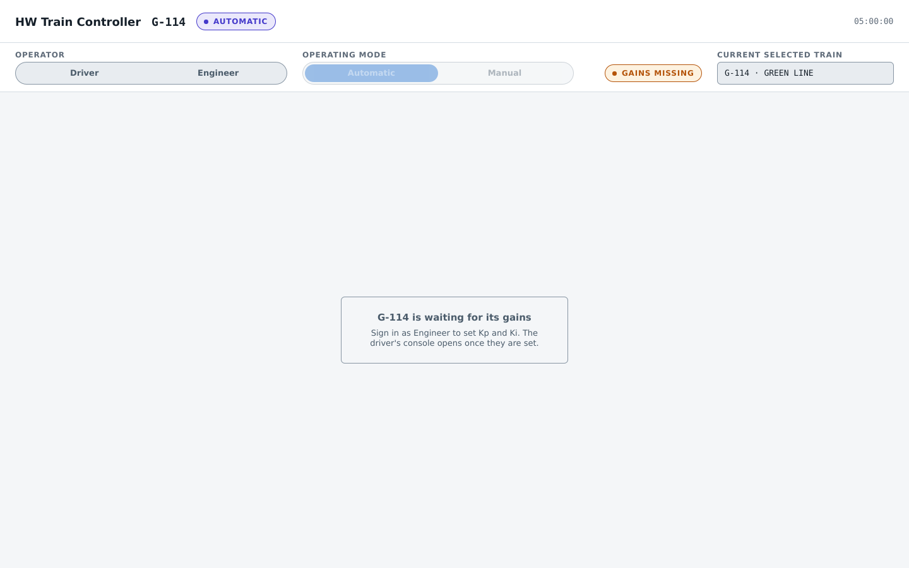
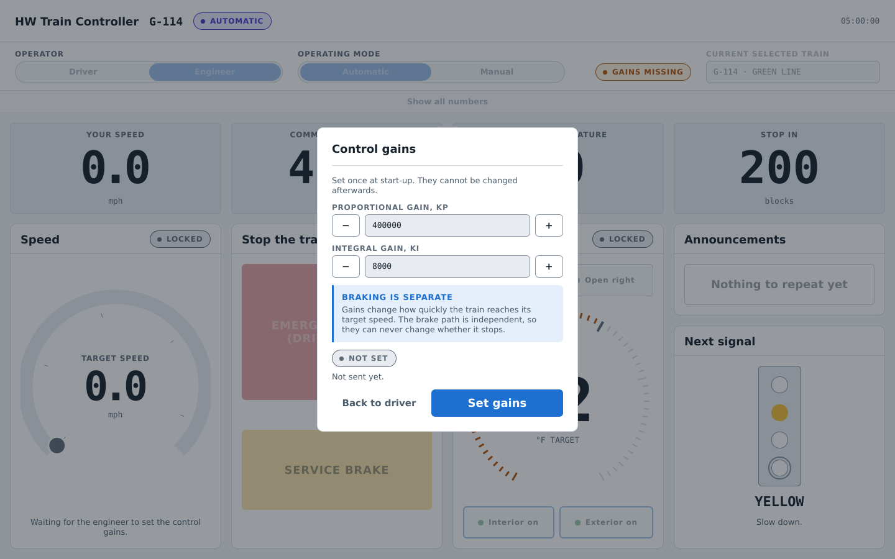
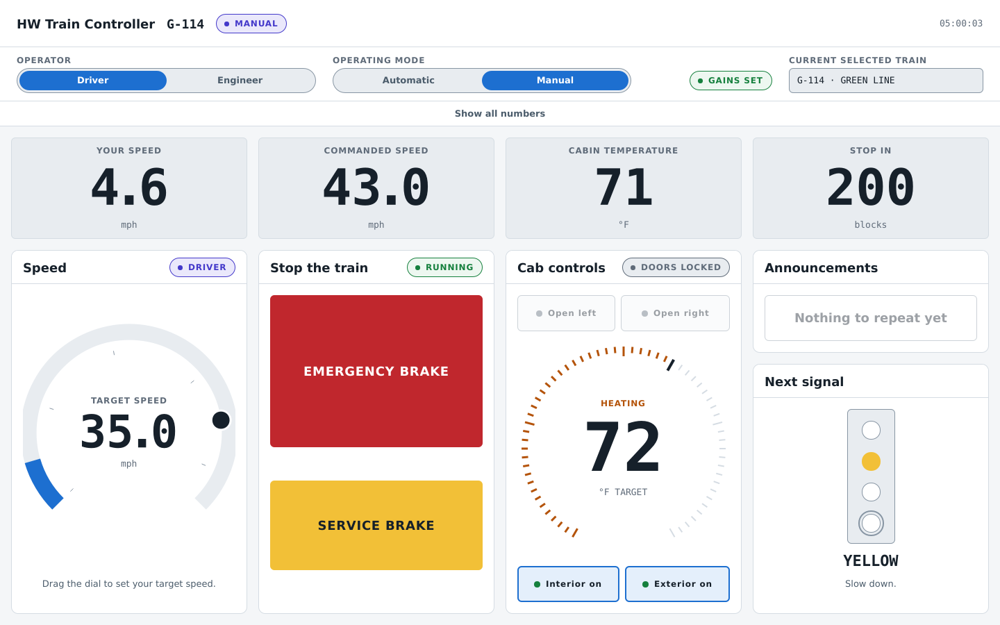
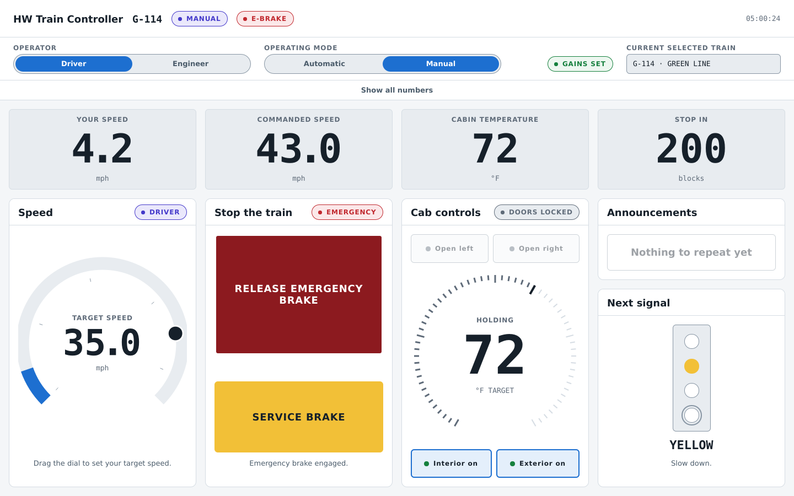
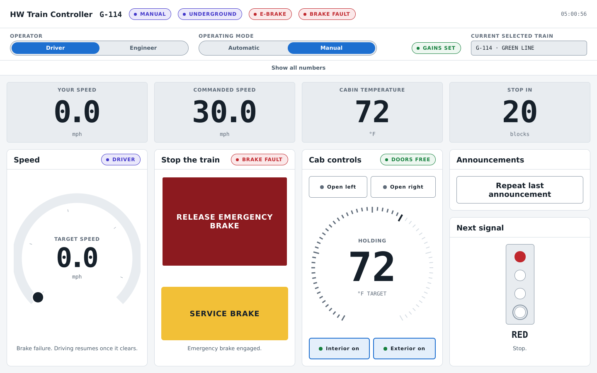
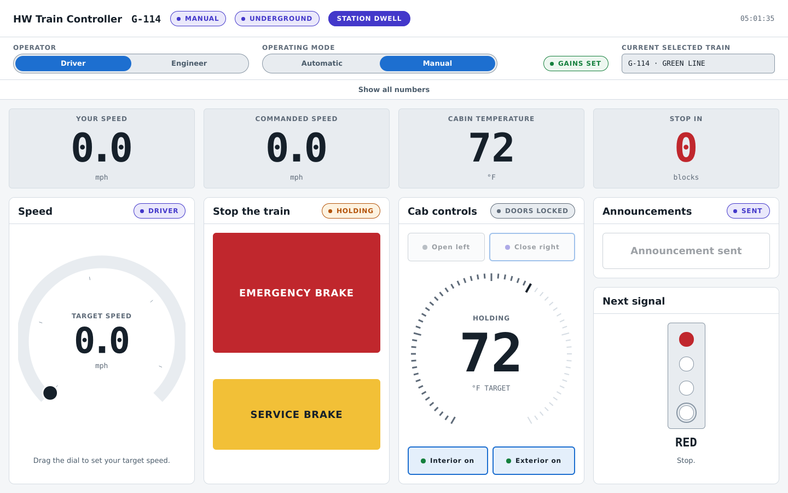
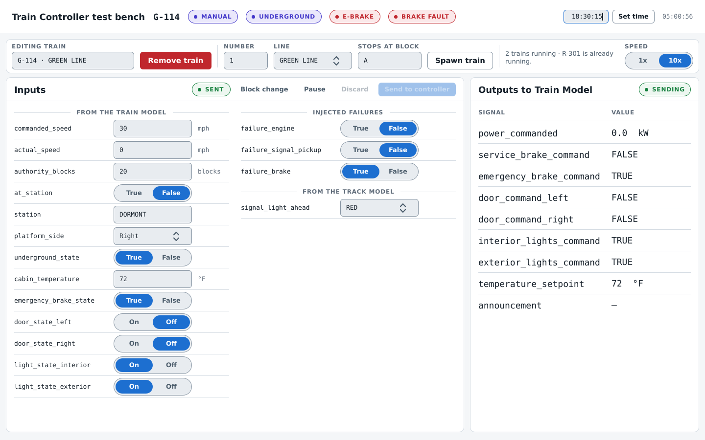

# Train Controller — User Help

User help for the **Track Overflow HW Train Controller** (ECE1140 Team 3),
written to [`user-help-strategy.md`](user-help-strategy.md). It is the
Train Controller's User Manual and driver quick reference (strategy §3, §5).

- **Who it is for:** the Train Driver and the Engineer. Testers should read
  §9 as well.
- **Built from:** `development` at `ea45158` (`Train-Ctrl_HW/`). Screenshots
  come from that build's own self-check (`python main.py --check --shots`).
- **Same screen, two variants:** the SW Train Controller looks and works the
  same. It drives Green Line trains; the HW one drives Red Line trains.

---

## Quick reference

| To… | Do this |
|---|---|
| Start a new train | Engineer: sign in, check Kp and Ki, press **Set gains** (§3) |
| Drive it yourself | Sign in as **Driver**, pick **Manual**, drag the speed dial (§4) |
| Let the CTC drive | Pick **Automatic** (§5) |
| Slow down or stop | Press **Service brake**. Press again to release |
| Stop now | Press **Emergency brake**. Release it only when stopped (§6) |
| Open doors | Stop the train, then press **Open left** or **Open right** |
| Change cabin temperature | Drag the thermostat, 60–80 °F |
| See a fault | Read the red badges at the top (§7) |

---

## 1. Safety

- **The emergency brake latches.** Only the driver can release it, and only
  once the train has stopped.
- **Any fault stops the train.** The controller applies the emergency brake
  by itself. You cannot drive until the fault clears.
- **Doors open only when the train is stopped.** They close if the train
  starts moving.
- **The commanded speed is the limit.** Your target speed is capped at it,
  in both modes. Keeping trains under the track's speed limit is the
  wayside's job.
- **Authority 0 means stop.** When **Stop in** reads 0 blocks, the train
  brakes to a stand.

## 2. Start up

The Train Controller opens on its own when the Track Overflow system starts.
The HW variant runs its control core on a Raspberry Pi connected by USB.
Setting up the Pi is covered in [`pi-owner-setup.md`](pi-owner-setup.md).

To run the Train Controller on its own, from `Train-Ctrl_HW/`:

```
python main.py --test
```

This opens the test bench (§9). Spawn a train there to open its console.

### The screen



The **top bar** always shows:

- the module name, the train number, and the mode badge
  (**AUTOMATIC** or **MANUAL**);
- fault badges, such as **E-BRAKE** or **BRAKE FAULT**, while they apply;
- the system clock, on the right.

The **operator bar** below it has the **Operator** switch, the
**Operating mode** switch, the gains badge, and **Current selected train**.

## 3. Engineer: set the control gains

A new train will not move until the engineer sets its gains. Until then the
console shows "*train* is waiting for its gains" and a **GAINS MISSING**
badge. The driver cannot sign in to that train.



1. Pick the train in **Current selected train**.
2. Under **Operator**, press **Engineer**. The **Control gains** dialog opens.
3. Check **Proportional gain, Kp** and **Integral gain, Ki**. The defaults
   are 400000 and 8000. Type a value, or use **−** and **+**.
4. Press **Set gains**. The badge turns to **GAINS SET**.
5. Press **Back to driver**.

Gains are set **once per train**. They cannot be changed afterwards.
Gains only change how quickly the train reaches its speed. They never change
whether it stops.

| Message | What to do |
|---|---|
| Kp and Ki must be numbers. | Type digits only, then press **Set gains**. |
| Kp and Ki cannot be negative. | Enter 0 or more. |
| The train did not confirm the gains. Press Set gains again. | Press **Set gains** again. If it keeps failing, check the Pi's USB link. |

## 4. Driver: drive in Manual



1. Under **Operator**, press **Driver**.
2. Under **Operating mode**, press **Manual**.
3. Drag the **Speed** dial to set your **target speed**. It moves in
   0.1 mph steps, up to 43.5 mph.
4. Watch the top row:
   - **Your speed** — how fast the train is going.
   - **Commanded speed** — the most the track allows now.
   - **Cabin temperature** — the temperature inside, in °F.
   - **Stop in** — blocks you may still travel.

If the commanded speed drops below your target, the train slows to it.
When it rises again, the train returns to your target, no higher.
A stop clears your target, so set a new one to move off again.

**Brakes**

- **Service brake** slows the train. Press **Release service brake** to
  let it go.
- **Emergency brake** stops the train fast. See §6.

**Cab controls**

- **Open left / Open right** — at a stand only. Greyed out while moving.
  The badge reads **DOORS FREE** or **DOORS LOCKED**.
- **Thermostat** — drag to set 60–80 °F. It reads **HEATING**, **COOLING**
  or **HOLDING**.
- **Interior on/off** and **Exterior on/off** — cabin lights and headlights.
  Lights also switch on by themselves underground and from 18:00 to 06:00.
  Your choice stands until the next of those changes.

**Announcements**

The controller sends "arriving soon", "arrived" and "departing"
announcements by itself. In Manual, **Repeat last announcement** plays the
last one again.

**Next signal** shows the light ahead (for example, **YELLOW — Slow down**)
when the train enters a signal block.

## 5. Automatic mode

In **Automatic**, the train follows the commanded speed from the CTC Office.
The dial reads "Set by the CTC. Switch to Manual to take control."

- Brakes, doors, lights and announcements are run by the controller.
- The **Emergency brake** stays available to the driver.
- You can switch to **Manual** at any time, even during a fault.

## 6. Emergency brake



1. Press **Emergency brake**. The **E-BRAKE** badge appears and the button
   turns into **Release emergency brake**.
2. Wait until **Your speed** reads 0.0.
3. Press **Release emergency brake**.
4. In Manual, set a new target speed.

A passenger can also pull the emergency brake from the train. Only you can
release it.

| Message | Meaning |
|---|---|
| Cannot release: the train is still moving. | Wait for a full stop. |
| Cannot release: waiting for a safe power command. | A vitality breach is still active (§7). Wait for it to clear. |
| Emergency brake engaged: rollback detected. | The train rolled backwards with no brake asked for. |
| Emergency brake engaged: runaway detected. | The train moved under a brake fault. |

## 7. Faults

The controller finds faults on its own. Each one shows a red badge in the top
bar and applies the emergency brake. There is no reset button: the badge
clears when the controller sees the fault is fixed.



| Badge | What happened | What you do |
|---|---|---|
| **BRAKE FAULT** | The service brake did not apply when commanded. | Press **Service brake** again. When it applies, the fault clears. Then release the emergency brake. |
| **ENGINE FAULT** | The train lost power. | Stop, then release the emergency brake. The controller tests the engine for about 2 s. If it still fails, the train is held and retested every 10 s. |
| **SIGNAL PICKUP FAULT** | The train lost the track signal. Speed and authority show "--". | Wait. It clears when the signal returns. Then release the emergency brake. |
| **VITALITY BREACH** | The three power calculations disagreed. 0 W was sent. | Wait. It clears on the next good calculation. Then release the emergency brake. |

The **Speed** panel says what is holding the train, for example "Brake
failure. Driving resumes once it clears."

## 8. Stations



When the train stops at a station, with authority 0:

1. The platform-side doors open by themselves.
2. A **STATION DWELL** badge counts down 45 s. The train is held and the
   doors stay open.
3. The doors close by themselves.
4. When a new commanded speed and authority arrive, the train departs.
   In Manual, set a target speed.

After the dwell, in Manual, you may open and close the platform side until
the new commands arrive.

## 9. Test bench (testers)

The bench stands in for the rest of the system when the Train Controller
runs alone. It feeds the same inputs the Train Model and Track Model would.



1. Enter a **Number**, pick a **Line**, and press **Spawn train**.
   A Red Line train opens the HW console; a Green Line train opens the SW one.
2. Edit values under **Inputs**, then press **Send to controller**.
3. Toggle **Injected failures** to test fault handling (§7).
4. Press **Block change** to pass one block (authority goes down by 1).
5. Use **Pause**, **1x / 10x**, and **Set time** to control the clock.

**Outputs to Train Model** shows what the controller sends each tick.

## 10. Help and contact

- Requirements and rules: [`Train-Ctrl_HW/REQUIREMENTS.md`](../Train-Ctrl_HW/REQUIREMENTS.md)
- Known issues: [`Train-Ctrl_HW/OPEN_ISSUES.md`](../Train-Ctrl_HW/OPEN_ISSUES.md)
- Contact: **[placeholder — module owner name and contact]**
